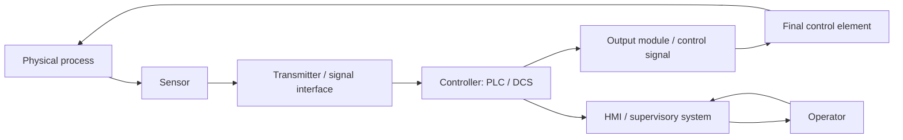
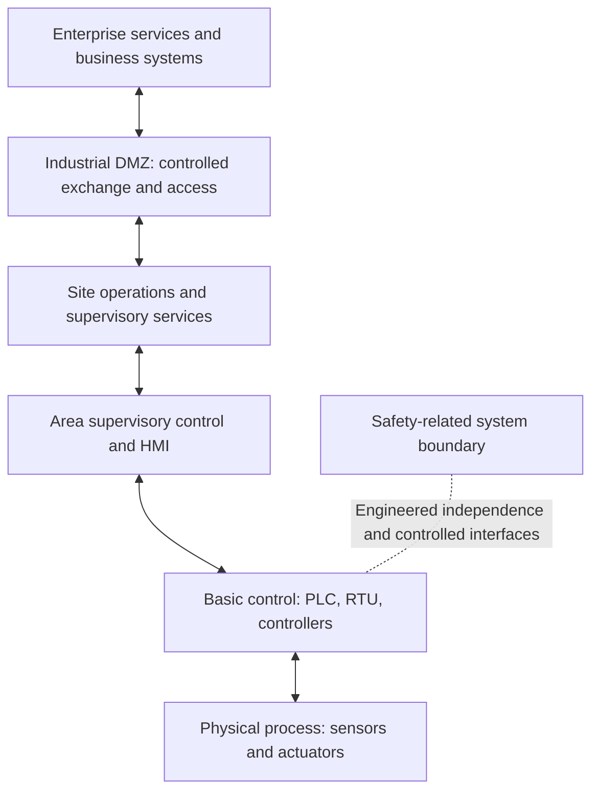

# OT and ICS Fundamentals
## Professional Handbook and Field Playbook

**Document ID:** UOTS-01-OTICS | **Version:** 2.0 | **Status:** Draft — technical review required

**Audience:** OT security engineers, control-system engineers, automation engineers, SOC analysts, assessors, architects, auditors, risk owners, and students.

> **Safety notice:** This is an educational and defensive reference. It is not a site engineering design, safety case, operating procedure, legal opinion, or authorization to test a live industrial environment. Site procedures, vendor documentation, engineering authority, and applicable safety requirements take precedence.

---

# 1. Executive overview

Operational technology (OT) comprises programmable systems and devices that interact with the physical environment, or manage devices that do so. They detect or cause change through monitoring and/or control of devices, processes, and events. Examples include industrial control systems, building automation, transportation systems, physical access control, and environmental monitoring.

OT cybersecurity protects more than computers and information. It protects trustworthy operation of physical processes and the people, communities, services, equipment, and environments that depend on them.

A sound OT security assessment begins with the process, not with a scanner or a list of CVEs. Understand what is controlled, how it is controlled, what can go wrong, who owns decisions, and how safe operation and recovery are maintained.

## 1.1 Learning outcomes

By completing this chapter, readers should be able to:
- Distinguish OT, ICS, IACS, SCADA, DCS, and cyber-physical systems.
- Explain a sensor-to-controller-to-actuator control loop.
- Identify common industrial components and their roles.
- Explain why OT security must account for process safety, availability, integrity, and recoverability.
- Recognize common architectures, dependencies, trust boundaries, and attack surfaces.
- Conduct an initial, non-intrusive discovery review using approved records.
- Identify what must be authorized before any active assessment.

## 1.2 How to use this chapter

Use it as the entry point for OT cybersecurity learning, a common vocabulary reference, and a preparation guide for authorized architecture reviews. It does not replace detailed design, safety engineering, vendor manuals, or site procedures.

---

# 2. Terminology and scope

## 2.1 Operational Technology

OT is the broad category of programmable systems and devices that interact with the physical environment or manage devices that do so. It includes industrial control, building management, power automation, transportation, physical access, and environmental monitoring systems.

## 2.2 Industrial Control System

ICS commonly refers to systems used to monitor and control industrial processes. Depending on context, it can include SCADA, DCS, PLC-based systems, instrumentation, communications, and supporting services. An ICS is not simply a network of PLCs; it includes people, engineering tools, control applications, communications, operator interfaces, procedures, and dependencies.

## 2.3 Industrial Automation and Control System

IACS is terminology used in the ISA/IEC 62443 standards family. Use the exact definitions in the applicable standard edition when writing formal requirements or compliance documents.

## 2.4 Cyber-Physical System

A cyber-physical system integrates computation, communications, sensing, and physical processes. OT environments are frequently cyber-physical systems, but the terms are not exact synonyms in every context.

## 2.5 Terms that must not be confused

| Term | Working meaning | Distinction |
|---|---|---|
| OT | Broad category of systems interacting with the physical environment | Broader than traditional ICS |
| ICS | Systems used to monitor/control industrial processes | A major subset of OT |
| IACS | ISA/IEC 62443 terminology | Use the applicable standard definition |
| SCADA | Supervisory monitoring/control, often distributed | Not a synonym for every ICS |
| DCS | Distributed process control architecture | Common in continuous and batch processes |
| PLC | Controller executing programmed logic | Component, not complete control system |
| HMI | Human-machine interface | Operator presentation and interaction |
| SIS | Safety instrumented system | Safety lifecycle must be distinguished from BPCS |
| IIoT | Industrial connected devices and services | May introduce additional remote/data paths |

**Terminology rule:** Define terms at the beginning of formal documents. Do not use OT, ICS, IACS, SCADA, and DCS interchangeably.

---

# 3. Understand the physical process first

## 3.1 Process-first thinking

Before examining networks or software, understand:
- **Inputs:** raw material, energy, water, fuel, feedstock, electrical supply, or external commands.
- **Transformations:** heating, cooling, mixing, separation, movement, generation, pumping, dosing, or switching.
- **Outputs:** product, treated water, electrical power, movement, discharge, or service delivery.
- **Measurements:** pressure, temperature, flow, level, voltage, current, speed, position, vibration, or quality.
- **Control actions:** start, stop, open, close, increase, decrease, switch, regulate, or trip.
- **Operating modes:** normal, startup, shutdown, maintenance, degraded, emergency, and recovery.
- **Safety constraints:** limits, interlocks, trips, alarms, permissives, and safe-state requirements.

Cybersecurity events must be interpreted in relation to these process functions.

## 3.2 Example: water pumping process

A simplified pumping station may operate as follows:
1. A level sensor measures water level.
2. A transmitter sends the measurement to a controller.
3. The controller evaluates it against configured logic and operating conditions.
4. The controller sends an output to a motor starter or variable-frequency drive.
5. The pump changes state or speed.
6. Operators observe status and alarms through an HMI or SCADA system.

Questions for security review:
- Could the measurement be unavailable, stale, or manipulated?
- Could an unauthorized command start or stop the pump?
- Could a configuration change alter control logic?
- Could loss of communications prevent operators seeing the actual process state?
- What local protections or independent safeguards exist?
- Who approves changes to setpoints or controller logic?

These are illustrative questions. Actual control logic and safe operating procedures are site-specific.

## 3.3 Process consequence worksheet

| Question | Record |
|---|---|
| What is the process objective? | |
| What is being measured? | |
| What equipment performs the action? | |
| What operating modes are relevant? | |
| What happens if measurement is lost? | |
| What happens if a command is incorrect? | |
| What happens if control or visibility is unavailable? | |
| Which independent safeguards exist? | |
| Who owns the operating decision? | |

Never invent process limits or safe states. Obtain them from approved engineering and operating documentation.

---

# 4. Industrial control system building blocks

## 4.1 Field instruments

Sensors detect conditions such as temperature, pressure, flow, level, vibration, proximity, position, or chemical properties. Transmitters convert measurements into signals suitable for control or monitoring. Actuators create physical movement or change. Final control elements include valves, drives, contactors, and dampers.

Security considerations: device identity, configuration, calibration, maintenance interfaces, physical access, measurement integrity, and approved change control.

## 4.2 Programmable Logic Controller (PLC)

A PLC is an industrial controller designed to execute control logic and interact with field inputs and outputs.

Typical functional elements:
- CPU or processing unit.
- Program and data memory.
- Digital and analog I/O modules.
- Communication interfaces.
- Power supply.
- Engineering and diagnostic interfaces.
- Firmware and configuration.

A common conceptual execution sequence is: read inputs, execute configured logic, update outputs, perform scheduled communications/diagnostics, and repeat. Actual execution differs by controller family, task configuration, firmware, and process architecture.

**Security concerns:** unauthorized engineering access, weak/shared credentials, unapproved program or firmware changes, exposed programming interfaces, inadequate backups, unrestricted communication paths, unsupported firmware, and insufficient change monitoring.

**Review questions:** What exact model and firmware are deployed? Which engineering software is approved? Who can modify logic? Where are project files and backups stored? How are changes reviewed and controller configuration integrity verified?

Never perform an informal program download, mode change, reset, write command, or reboot as a security test.

## 4.3 Remote Terminal Unit (RTU)

An RTU collects telemetry and supports remote monitoring or control, often across geographically distributed assets such as pipelines, substations, pumping stations, and remote energy installations. Communications may use fiber, radio, cellular, microwave, satellite, or leased services.

Security concerns include remote communications exposure, intermittent connectivity, unattended physical locations, weak device authentication, maintenance access, time integrity, and shared credentials. A remote site is not trusted merely because it is geographically separated.

## 4.4 Distributed Control System (DCS)

A DCS distributes process control across controllers, operator stations, engineering tools, servers, and communications infrastructure. Common characteristics include distributed control functions, coordinated operator supervision, engineering and maintenance environments, alarms, historians, and selected redundancy.

Security concerns include engineering access, server/workstation hardening, controller configuration, vendor maintenance, network segmentation, redundancy design, and change management.

## 4.5 Supervisory Control and Data Acquisition (SCADA)

SCADA provides supervisory monitoring and control, often for geographically distributed assets. Common elements include supervisory servers, HMI, communications front ends, RTUs/PLCs, historians, alarm services, and engineering workstations.

SCADA is not limited to one protocol or topology. Security concerns include loss of visibility, unauthorized remote commands, telemetry manipulation, remote communications compromise, weak authentication, and compromised operator or engineering workstations.

## 4.6 Human-Machine Interface (HMI)

An HMI presents process information and approved operator interaction. Functions may include process visualization, alarms, trends, status, diagnostics, and authorized commands.

Security considerations include role-based access, clear process-state presentation, audit records, secure workstation configuration, controlled application changes, and least privilege. An HMI is not necessarily the controller, but compromise can mislead operators or expose command paths.

## 4.7 Safety Instrumented System (SIS)

A SIS implements one or more safety instrumented functions intended to achieve or maintain a safe process state under defined conditions. It may include safety sensors, logic solvers, final elements, and engineering/diagnostic interfaces.

The relationship between SIS and the Basic Process Control System (BPCS) must be understood through the site's functional safety lifecycle and engineering documentation. Cybersecurity measures must not compromise SIS independence, availability, or safety functions. A firewall or product label alone does not prove functional safety independence.

Changes affecting SIS require review and approval by responsible functional safety and process engineering authorities.

## 4.8 Intelligent Electronic Device (IED)

IEDs are programmable electronic devices used for protection, control, measurement, and automation, especially in power systems. Examples include protection relays, bay controllers, and meters.

Security concerns include protection settings integrity, engineering access, time synchronization, communication exposure, firmware lifecycle, event-record integrity, and supplier access.

## 4.9 Historian

A historian collects and stores time-series process data. It may support operations analysis, trending, production reporting, quality analysis, engineering investigation, and enterprise data exchange.

Security concerns include unauthorized data changes, compromised collection services, exposed interfaces, excessive enterprise connectivity, and loss of trustworthy timestamps.

## 4.10 Supporting systems

A complete inventory should also consider engineering and operator workstations, identity services, virtualization, storage, backup systems, switches, routers, firewalls, gateways, remote access, privileged access, time synchronization, patch staging, vendor support, and cloud/IIoT gateways.

An assessment that inventories only PLCs and RTUs is incomplete.

---

# 5. How a basic control loop works

This is a simplified conceptual loop. Real systems may contain multiple controllers, networks, interlocks, independent safety functions, gateways, and supervisory layers.

## 5.1 Operating sequence

1. The physical process changes.
2. A sensor detects a condition.
3. A transmitter or interface communicates a measurement.
4. A controller evaluates the input against configured logic, modes, permissives, and process requirements.
5. The controller updates an output or command.
6. A final control element acts on the process.
7. The process changes and is measured again.
8. The HMI or supervisory layer presents relevant information to operators.

## 5.2 Security analysis by stage

| Stage | Example concern | Defensive question |
|---|---|---|
| Physical process | Tampering or unsafe conditions | Are physical access and process safeguards defined? |
| Sensor | Incorrect/manipulated measurement | How is measurement plausibility assessed? |
| Transmitter | Configuration or signal issue | Who can configure and maintain it? |
| Controller | Unauthorized logic/parameter change | Are engineering access and change controls enforced? |
| Output | Unauthorized or incorrect command | Are command paths and permissions controlled? |
| Final element | Physical action or failure | What independent safeguards and diagnostics exist? |
| HMI | Misleading view or unauthorized command | Are identity, audit, and display integrity addressed? |
| Operator | Manipulated information or human error | Are procedures, training, and alarm management effective? |

## 5.3 Worked scenario: manipulated measurement

**Situation:** A displayed measurement differs from the actual process condition.

Potential consequences depend on process design:
- Operators may make decisions using inaccurate information.
- Automatic control may respond incorrectly if the manipulated value is used as an input.
- Alarm handling may be affected.
- Investigation may be delayed if historian records are also unreliable.

Defensive considerations include independent measurement or plausibility checks where engineered, monitoring unexpected configuration changes, controlled access to field devices, trusted time records, and documented operator escalation. Process safety engineering must determine which safeguards are suitable.

---

# 6. OT architecture and communication context

## 6.1 Common architecture elements

An OT environment may contain field instrumentation, controllers, supervisory systems, engineering environments, operations management, an industrial DMZ, enterprise services, remote sites, suppliers, and cloud/IIoT platforms.

## 6.2 Conceptual Purdue-style view

The Purdue model is a useful conceptual reference, not a universal network blueprint, mandatory set of VLANs, or proof of security. Actual architecture must reflect process, risk, engineering, and operating requirements.

## 6.3 Zones and conduits

A **zone** groups assets with common security requirements. A **conduit** is a controlled communication path between zones.

For each zone, identify purpose, process function, assets, owner, criticality, safety relevance, security requirements, allowed communication, and monitoring responsibilities.

For each conduit, identify source, destination, purpose, initiating direction, protocol, ports, data types, authentication, enforcement, monitoring, availability requirements, owner, and approval.

## 6.4 Industrial DMZ

An industrial DMZ may broker selected data exchange and remote administration between enterprise and OT environments. Possible services include jump hosts, remote access gateways, historian replication, data brokers, file-transfer staging, patch staging, and monitoring collectors.

A network called "DMZ" is not automatically secure. Design it around explicit flows, threat assumptions, and ownership.

## 6.5 Common communication patterns

- Sensor to controller input.
- Controller to actuator output.
- Controller to HMI status and command.
- SCADA master to RTU telemetry.
- Engineering workstation to controller maintenance.
- Historian to enterprise reporting.
- Vendor to jump host remote maintenance.
- OT to cloud data export.

Document real flows from approved evidence. Do not infer communications solely from hostnames or diagrams.

---

# 7. OT versus IT

| Dimension | Typical IT | Typical OT |
|---|---|---|
| Purpose | Information and business services | Monitor/control physical processes |
| Main impact | Data, applications, business operations | Process, equipment, safety, environment, service continuity |
| Availability | Often high priority | Frequently critical to physical operation |
| Integrity | Data and transaction correctness | Measurements, commands, logic, configuration, process state |
| Timing | Often tolerates variable latency | Some functions have strict timing requirements |
| Change | Often more frequent | Carefully scheduled and validated |
| Patching | Often routine/automated | Vendor, process, safety, and maintenance constraints |
| Lifecycle | Often shorter | May span decades |
| Testing | Automated scans common | Active tests may disrupt fragile devices |
| Recovery | Restore applications and data | Restore services, configurations, communications, and safe operation |

These are general tendencies, not absolutes. Some IT systems are safety-critical and not all OT functions are directly safety-related.

## 7.1 Tailor IT controls before OT deployment

Before introducing endpoint agents, scanners, patches, firewalls, authentication dependencies, or automated isolation, ask:
1. Is the product supported by the device vendor?
2. Has it been tested on a representative system?
3. Could it affect timing, availability, control communications, or operator visibility?
4. Does it introduce an enterprise/cloud dependency?
5. Is there a tested rollback or contingency?
6. Who approves and validates the change?
7. How will the process be monitored during implementation?

---

# 8. OT cybersecurity objectives

- **Safety:** Protect people, the environment, and safe process operation. Cybersecurity must not undermine engineered safety functions.
- **Availability:** Maintain the ability to monitor and control the process as required. Consider power, network, time, communications, operator access, and recovery.
- **Integrity:** Protect measurements, logic, setpoints, parameters, commands, configurations, alarms, events, and engineering files.
- **Confidentiality:** Protect credentials, engineering documents, network diagrams, recipes, production information, and supplier information.
- **Visibility and accountability:** Maintain trustworthy process information, alarms, system changes, and user activity.
- **Resilience and recoverability:** Prepare for, withstand, recover from, and learn from disruptive events.

Do not reduce OT security to a simple IT confidentiality-first checklist. Priorities and trade-offs depend on the process and hazard context.

---

# 9. Threat landscape and attack surfaces

## 9.1 Common attack surfaces

- Enterprise-to-OT connectivity.
- Remote access gateways and vendor support.
- Engineering workstations and programming tools.
- Operator workstations and HMI applications.
- Controllers and device management interfaces.
- Industrial network infrastructure.
- Historians, data brokers, and integration platforms.
- Wireless and remote telemetry.
- Removable media and maintenance laptops.
- Cloud and IIoT gateways.
- Supplier software, firmware, and update channels.
- Physical access to field devices and cabinets.

## 9.2 Common threat categories

Credential theft and misuse; ransomware affecting IT or OT-supporting services; unauthorized engineering changes; manipulation of measurements or displays; disruption of supervisory visibility; exploitation of vulnerable products; supplier compromise; abuse of exposed services; insider misuse; and physical tampering.

## 9.3 Threat-to-consequence reasoning

| Threat event | Possible process consequence | Assessment question |
|---|---|---|
| Engineering account compromise | Unauthorized configuration or logic change | Which functions can this identity modify? |
| Loss of SCADA communications | Loss of remote visibility or control | What local control and fallback exist? |
| Manipulated measurement | Incorrect operator or control response | Which independent checks exist? |
| Historian compromise | Loss of trustworthy records | Which decisions rely on historian data? |
| Remote access abuse | Unauthorized access to OT zones | Is access approved, time-bounded, monitored? |
| Ransomware on support servers | Loss of HMI, engineering, or supervisory capability | Which services are essential and how are they recovered? |

These are hypothetical scenarios. Actual impact must be established through site-specific engineering analysis.

---

# 10. Roles and decision authority

| Role | Typical responsibility |
|---|---|
| Asset owner | Accountable for IACS and associated risk |
| Operations | Safe operation, process monitoring, operational decisions |
| Control/automation engineer | Control logic, architecture, instrumentation, engineering changes |
| Process engineer | Process requirements and process impact |
| Functional safety engineer | Safety lifecycle, SIS requirements, safety validation |
| OT cybersecurity | Security architecture, risk, safeguards, monitoring, assessment |
| IT/network team | Enterprise services and approved network support |
| SOC | Detection, triage, coordination, escalation |
| Integrator | Design, integration, configuration, testing, commissioning, handover |
| Product supplier | Product development, support, advisories, lifecycle |
| Maintenance provider | Approved maintenance and support |
| Risk owner | Accepts or treats risk within delegated authority |

ISA/IEC 62443 emphasizes shared responsibility across asset owners, product suppliers, integrators, and service providers. One organization may perform multiple roles.

**Decision rule:** Cybersecurity staff should not independently order a process shutdown, bypass an interlock, isolate a controller, modify a safety system, or restart equipment merely because an alert is critical. Follow site incident command, operations, engineering, and safety authority.

---

# 11. OT security lifecycle

| Lifecycle stage | Security activities | Typical evidence |
|---|---|---|
| Concept/procurement | Requirements and supplier review | Security requirements, supplier assessment |
| Design | Risk assessment, architecture, zones/conduits | Approved design and risk record |
| Integration | Secure configuration, interface control, testing | Build records and baseline |
| FAT | Factory acceptance and approved validation | FAT plan and results |
| Installation/SAT | Site validation and network/access review | SAT evidence and as-built diagrams |
| Commissioning | Accounts, backup, monitoring, handover | Commissioning checklist |
| Operations | Monitoring, access reviews, change control | Logs and change records |
| Maintenance | Patch evaluation and vendor access | Maintenance approvals |
| Incident response | Safe coordination and evidence | Incident timeline |
| Recovery | Verified restoration and process validation | Restore test and handover |
| Decommissioning | Access removal and data sanitization | Decommissioning record |

## 11.1 Management of change

A change record should identify reason, scope, affected assets/process, technical and operational impact, safety review, vendor compatibility, test and rollback plan, approvals, maintenance window, and post-change verification.

---

# 12. Foundational standards and guidance

## 12.1 NIST SP 800-82 Rev. 3

NIST SP 800-82 Rev. 3, *Guide to Operational Technology (OT) Security*, was published in September 2023. It provides OT security guidance while addressing performance, reliability, and safety requirements. It covers OT overview and topologies, threats, vulnerabilities, and safeguards.

NIST published an initial public draft of Rev. 4 on 21 September 2026, with comments due 30 November 2026. At the date of this chapter, Rev. 4 is a draft and must not be described as final.

## 12.2 ISA/IEC 62443

The ISA/IEC 62443 family addresses industrial automation and control system cybersecurity through stakeholder responsibilities and lifecycle requirements. It includes work relevant to asset owners, service providers, system design, system requirements, product development, and component requirements.

Use the exact applicable edition and licensed standard text for formal assessments.

## 12.3 MITRE ATT&CK for ICS

MITRE ATT&CK for ICS is a knowledge base of adversary tactics and techniques relevant to industrial control environments. It can structure threat scenarios and detection analysis. A mapping is not proof that a particular actor used a technique in a specific incident.

## 12.4 Standards-use rules

- Verify edition, amendment, and publication status.
- Distinguish standards from laws, regulations, and regulator controls.
- Do not reproduce copyrighted normative text.
- Do not claim a framework mapping proves compliance.
- Document why a control applies to the system.
- Record evidence and limitations.

---

# 13. Field playbook: initial OT discovery and architecture review

## 13.1 Objective

Build an initial understanding of an OT environment using approved documentation, interviews, and authorized observation. This is a planning and review workflow, not an active scanning procedure.

## 13.2 Preconditions

Before starting:
- Obtain written authorization and define purpose.
- Identify asset owner and site contact.
- Confirm scope, locations, and exclusions.
- Identify operations, control engineering, process safety, and cybersecurity contacts.
- Complete site safety induction and access requirements.
- Agree prohibited actions and stop-work conditions.
- Confirm evidence handling and confidentiality requirements.

If authorization, site contact, or safety requirements are unclear, stop and resolve them first.

## 13.3 Procedure

**Step 1 — Understand the operation.** Ask what the facility produces or provides, which processes are in scope, relevant operating modes, essential functions, and what happens during loss of power, network, control, or supervision.

*Output:* Process overview and stakeholder-approved scope notes.

**Step 2 — Identify owners and responsibilities.** Identify asset owner, operations, automation, process engineering, safety, IT/network, OT security, SOC, vendors, and maintenance providers.

*Output:* Responsibility and escalation matrix.

**Step 3 — Collect approved documentation.** Request process descriptions, approved diagrams, network architecture, asset registers, communication-flow records, remote access registers, engineering/maintenance procedures, backup/recovery procedures, change records, incident procedures, and regulatory scope assessments.

Do not copy sensitive site documents into a public repository.

**Step 4 — Build a preliminary inventory.** Record asset identity, function, site, zone, owner, manufacturer, model, version, dependencies, criticality, support status, and evidence source. Mark unknown fields as unknown.

**Step 5 — Map communications.** Identify approved paths between enterprise, DMZ, supervisory, control, safety-related, remote-site, and supplier environments. Record purpose, source, destination, protocol, direction, owner, authentication, monitoring, and approval.

**Step 6 — Identify dependencies.** Consider power, network, time, identity, DNS, virtualization, storage, remote access, cloud services, telecoms, vendor support, and backups.

**Step 7 — Identify process and safety constraints.** Ask qualified engineering and safety personnel which actions could affect production, protection, interlocks, timing, or safe operation. Record restrictions and prohibited tests.

**Step 8 — Validate.** Review inventory and diagrams with responsible engineers and operators. Separate confirmed facts, assumptions, discrepancies, and unknowns.

**Step 9 — Report.** Summarize scope, architecture, asset visibility, dependencies, remote access, safety constraints, documentation gaps, and recommended next steps.

## 13.4 Stop-work conditions

Stop and contact the designated site authority if:
- An unexpected process alarm or abnormal operating condition occurs.
- An asset or path appears more critical than the approved scope indicated.
- A requested action could change a controller, process value, configuration, or network state.
- A device behaves unexpectedly.
- Operations or engineering withdraws approval.
- Personnel safety, environmental protection, or service continuity could be affected.
- Evidence collection requires access outside the approved scope.

## 13.5 Expected deliverables

- Approved scope and rules of engagement.
- Process and system overview.
- Stakeholder and decision-authority matrix.
- Preliminary asset inventory.
- High-level architecture and communication-flow diagrams.
- Dependency register.
- Safety and operational constraints register.
- Evidence register.
- Gaps, assumptions, and open questions.
- Recommended follow-on assessment plan.

---

# 14. Practical scenario exercises

Use synthetic information or an isolated lab. These are discussion exercises, not instructions for testing live systems.

## Scenario A — Loss of remote telemetry

A remote pumping station stops reporting to the supervisory system.

Discuss: What information is unavailable? Does local control continue? Who confirms physical process state? Which communications dependencies may be involved? What fallback is approved? Who must be informed? What evidence can be collected safely?

**Learning point:** Loss of visibility is not automatically loss of local control. The design and site procedures determine the response.

## Scenario B — Unexpected controller project change

An engineering audit identifies a controller project timestamp that differs from the approved baseline.

Discuss: Is the timestamp trustworthy? Was an approved maintenance change performed? Which project/controller records can confirm it? Who authorizes validation? What safety constraints apply? How is evidence preserved?

**Learning point:** An unexpected timestamp is an investigation lead, not proof of malicious modification.

## Scenario C — Vendor remote access outside maintenance window

A remote access log records a vendor session outside the approved window.

Discuss: Is the account attributable to a person? Was emergency approval granted? Which gateway and destination were accessed? What actions were recorded? Who validates the activity? What is the approved revocation and escalation process?

**Learning point:** Remote access governance requires identity, approval, scope, session evidence, and ownership.

## Scenario D — Historian inconsistency

Operators report that historian trends do not match other approved process indications.

Discuss: Is the issue collection, time, storage, display, or source? Which independent records exist? Are control decisions relying on historian data? Who validates actual process state? How is evidence preserved?

**Learning point:** Data integrity matters even when a historian does not directly control equipment.

---

# 15. Field checklists

## 15.1 Initial OT understanding

- [ ] Purpose and process scope documented.
- [ ] Process and asset owners identified.
- [ ] Operating modes and critical functions understood.
- [ ] Safety-related systems and authorities identified.
- [ ] Major OT asset classes identified.
- [ ] Engineering and operator workstations identified.
- [ ] Remote and third-party access paths identified.
- [ ] Architecture reviewed with engineering.
- [ ] Main dependencies recorded.
- [ ] Operational restrictions documented.
- [ ] Unknowns and assumptions marked.

## 15.2 Component understanding

- [ ] PLC, RTU, DCS, and SCADA roles distinguished.
- [ ] HMI and historian functions understood.
- [ ] Field sensors and actuators identified.
- [ ] SIS and BPCS boundaries discussed with qualified personnel.
- [ ] Engineering interfaces and software identified.
- [ ] Firmware and product lifecycle information requested.
- [ ] Configuration and backup ownership identified.
- [ ] Communication paths recorded from approved evidence.

## 15.3 Safety and authorization

- [ ] Written authorization confirmed.
- [ ] Scope and exclusions confirmed.
- [ ] Site safety requirements completed.
- [ ] Operations and engineering contacts available.
- [ ] Prohibited actions documented.
- [ ] Stop-work triggers agreed.
- [ ] Evidence classification and storage approved.
- [ ] No active test without separate technical and operational approval.

## 15.4 Evidence quality

- [ ] Source of each fact recorded.
- [ ] Date/time and timezone recorded where relevant.
- [ ] Asset identity verified or marked uncertain.
- [ ] Observations separated from interpretations.
- [ ] Assumptions and limitations explicit.
- [ ] Sensitive site data protected.
- [ ] Diagrams and screenshots approved for report.
- [ ] Findings validated with responsible stakeholders.

---

# 16. Knowledge assessment

1. What distinguishes OT from a typical enterprise IT system?
2. Is every OT environment an ICS?
3. What is the difference between a PLC and a complete control system?
4. What is the purpose of an RTU?
5. How does SCADA commonly differ from DCS?
6. What is the role of an HMI?
7. Why must SIS boundaries be understood separately from BPCS?
8. What is a zone and what is a conduit?
9. Why is Purdue not a universal network blueprint?
10. Why is active scanning not automatically safe in OT?
11. What is the difference between loss of visibility and loss of control?
12. Why is CVSS alone insufficient for OT risk?
13. Who approves a change affecting a safety-related function?
14. What evidence helps determine whether a controller project change was authorized?
15. What must be established before an OT assessment begins?

## Answer guide

1. OT interacts with or manages physical processes; decisions must consider process and safety impact.
2. No. OT also includes building automation, transportation, physical access, and environmental systems.
3. A PLC is one controller component; a control system also includes devices, engineering, communications, interfaces, infrastructure, people, and procedures.
4. It collects telemetry and supports remote monitoring/control.
5. SCADA commonly supervises distributed assets; DCS commonly distributes process control within a facility. Implementations vary.
6. It presents process information and approved operator interaction.
7. SIS implements safety instrumented functions and has specific safety lifecycle and independence requirements.
8. A zone groups assets with common security requirements; a conduit is a controlled path between zones.
9. It is conceptual; actual architecture reflects process, risk, and engineering.
10. Fragile devices, timing, vendor implementation, and process dependencies can make probes disruptive.
11. Visibility concerns seeing process/system information; control concerns influencing the process. They may fail independently.
12. CVSS does not fully describe process consequence, exposure, prerequisites, safety impact, or patching risk.
13. The responsible engineering and safety authorities under site governance, with operations/asset-owner approval as required.
14. Approved change records, project baselines, controller audit records where available, maintenance records, and stakeholder validation.
15. Authorization, scope, asset owner, process context, safety constraints, stakeholders, prohibited actions, evidence handling, and stop-work conditions.

---

# 17. Glossary

| Term | Working definition |
|---|---|
| Actuator | Device that creates physical movement or action |
| BPCS | Basic Process Control System used for normal process control |
| Conduit | Controlled communication path between zones |
| CPS | Cyber-Physical System |
| DCS | Distributed Control System |
| EWS | Engineering Workstation |
| HMI | Human-Machine Interface |
| IACS | Industrial Automation and Control System |
| ICS | Industrial Control System |
| IED | Intelligent Electronic Device |
| IIoT | Industrial Internet of Things |
| Interlock | Engineered condition or logic that restricts or permits an action |
| OT | Operational Technology |
| PLC | Programmable Logic Controller |
| RTU | Remote Terminal Unit |
| SCADA | Supervisory Control and Data Acquisition |
| SIS | Safety Instrumented System |
| Zone | Group of assets with common security requirements |
| Historian | System that collects and stores time-series process data |

Use definitions from the applicable licensed standard, regulation, or vendor documentation for formal engineering or compliance work.

---

# 18. Document control and review

## 18.1 Revision history

| Version | Date | Change | Status |
|---|---|---|---|
| 1.0 | 2026-11-17 | Initial short-form foundations | Superseded |
| 2.0 | 2026-11-17 | Expanded into handbook and field playbook | Draft — technical review required |

## 18.2 Review requirements

Before marking Verified:
- Review terminology against current NIST and ISA/IEC sources.
- Have an OT/control engineer review component and control-loop explanations.
- Have a functional safety practitioner review SIS wording.
- Validate diagrams and links.
- Check for unsupported universal claims.
- Confirm no sensitive site information or copyrighted standard text is included.
- Record reviewer role, date, and changes.

## 18.3 Primary references

1. **NIST SP 800-82 Rev. 3 — Guide to Operational Technology (OT) Security**, September 2023. https://csrc.nist.gov/pubs/sp/800/82/r3/final
2. **NIST SP 800-82 Rev. 4 — Initial Public Draft**, published 21 September 2026; comments due 30 November 2026. https://csrc.nist.gov/pubs/sp/800/82/r4/ipd
3. **ISA/IEC 62443 Series of Standards — ISA overview.** https://www.isa.org/standards-and-publications/isa-standards/isa-iec-62443-series-of-standards
4. **MITRE ATT&CK for ICS.** https://attack.mitre.org/matrices/ics/
5. **CISA Industrial Control Systems recommended practices.** https://www.cisa.gov/resources-tools/resources/ics-recommended-practices

## 18.4 Limitations

This is a foundational learning and planning document. It is not exhaustive, does not replace licensed standards, does not establish legal applicability, and does not authorize active testing. Technical details vary by vendor, model, firmware, process, and site architecture. Operational decisions must be validated by the responsible asset owner, operations, engineering, and safety authorities.
