# OT Reference Architecture, Zones, Conduits and Network Segmentation
## Professional Engineering Handbook and Field Playbook

**Document ID:** UOTS-02-ARCH | **Version:** 2.0 | **Status:** Draft — engineering review required

**Audience:** OT/ICS security architects, control-system engineers, network engineers, system integrators, OT SOC teams, risk owners, assessors, and industrial cybersecurity consultants.

> **Safety and design notice:** This document presents conceptual reference patterns and a defensive engineering workflow. It is not a universal plant design, production firewall rule set, network implementation specification, safety case, or authorization to change a live industrial network. Actual design must be validated against process requirements, site risk, vendor support, functional safety requirements, and approved change procedures.

---

# 1. Executive summary

An OT reference architecture describes how industrial assets, applications, networks, users, and external services are organized and how they communicate. Its purpose is to support reliable process operation while controlling the paths through which information and commands move.

A secure architecture is not created simply by placing a firewall between IT and OT or assigning devices to VLANs. It requires a defensible understanding of:
- The physical and operational processes being supported.
- Asset function, criticality, ownership, and management authority.
- Trust boundaries and security requirements.
- Required data flows and their direction.
- Communication dependencies and failure modes.
- Safety-related functions and engineered independence.
- Remote maintenance and supplier access.
- Monitoring, response, resilience, and recovery.

NIST SP 800-82 Rev. 3 describes segmentation using levels, tiers, or zones and explains the use of mapped data flows to identify required communications and configure isolation devices. It emphasizes that segmentation decisions must consider day-to-day operations, safety, and response capabilities. ISA/IEC 62443 uses zones and conduits as key concepts in IACS security risk assessment and architecture.

## 1.1 Learning outcomes

Readers should be able to:
- Explain the difference between a logical level, security zone, conduit, VLAN, subnet, and firewall boundary.
- Read a conceptual Purdue-style architecture without treating it as a mandatory blueprint.
- Develop a preliminary zone and conduit model from asset and process information.
- Build a communication-flow register.
- Explain the purpose and design considerations of an industrial DMZ.
- Identify common remote access patterns and their governance requirements.
- Recognize architecture risks involving enterprise connectivity, vendors, cloud services, wireless networks, and safety-related systems.
- Plan a safe architecture review and produce reviewable engineering evidence.

## 1.2 Architecture design principle

**Start with process, risk, and communication requirements. Choose network technologies only after those requirements are understood.**

A design should be explainable to operations, control engineering, safety, IT/network, cybersecurity, and the asset owner.

---

# 2. Core architecture concepts

## 2.1 Reference architecture

A reference architecture is a reusable conceptual model showing common functions, relationships, boundaries, and design principles. It is not a copy-and-deploy configuration.

A site-specific architecture must account for process type and operating modes, facility layout and remote sites, existing control-system design, vendor-supported communication and redundancy, safety and availability constraints, business and regulatory requirements, threat model, risk appetite, and operational ownership.

## 2.2 Logical levels and tiers

Levels and tiers help organize functions, but they do not automatically define security zones. A Purdue-style model is commonly used to discuss industrial functions from physical process and control through site operations and enterprise services. Modern deployments may not align neatly with a simple hierarchy. IIoT, cloud, remote operations, virtualization, and shared services can create additional paths and dependencies.

## 2.3 Security zone

A zone is a grouping of assets that share defined security requirements and are treated as a security boundary for risk and policy purposes.

Zone definition should consider:
- Process function and operational purpose.
- Asset owner and management authority.
- Criticality and consequence of compromise.
- Trust level and exposure.
- Required communication patterns.
- Security capabilities and constraints.
- Safety relevance and dependencies.
- Maintenance and support model.

**Do not define zones only by physical location, IP range, VLAN, vendor, or department name.** Those attributes may help implement a boundary but do not, by themselves, establish common security requirements.

## 2.4 Conduit

A conduit is a controlled communication path between zones. It includes the relevant communication mechanisms and security requirements governing that exchange.

A conduit description should specify source and destination zones, source and destination assets or services, purpose, initiating direction and response behavior, protocol and data types, authentication and authorization, encryption or other protections where appropriate, filtering and monitoring, availability and failover needs, owner, approval, and review date.

## 2.5 Network segmentation

Segmentation divides a network into smaller logical or physical areas to control communication and limit unnecessary reachability.

Common mechanisms include:
- Physical separation and dedicated infrastructure.
- VLANs and Layer 2 controls.
- Subnets and Layer 3 routing boundaries.
- Firewalls and industrial security gateways.
- Access control lists.
- Unidirectional gateways or data diodes where appropriate.
- Host-level controls where technically supported.

A VLAN is not equivalent to a complete security zone. Segmentation is effective only when paths are controlled, policies are enforced, and the design is validated.

## 2.6 Trust boundary

A trust boundary is a point where assets, users, networks, or services with different trust assumptions interact. It may be enforced by a firewall, gateway, proxy, access broker, physical separation, or combination of controls.

Examples include enterprise IT to industrial DMZ, DMZ to site operations, supervisory network to cell/area control, vendor remote access to OT jump environment, IIoT edge platform to control network, and control network to safety-related environment.

## 2.7 Key distinctions

| Concept | What it describes | What it does not prove |
|---|---|---|
| Purdue level | Functional hierarchy | A secure boundary |
| Security zone | Assets with shared security requirements | That all assets are equally safe |
| Conduit | Controlled communication between zones | That the flow is correctly configured |
| VLAN | Layer 2 logical segmentation | Strong isolation by itself |
| Subnet | IP addressing and routing grouping | Security policy by itself |
| Firewall | Traffic enforcement mechanism | Correctness of architecture or rules |
| DMZ | Intermediary security zone | Security merely because it is named DMZ |
| Jump host | Controlled administrative access point | That the target or session is safe |

---

# 3. Conceptual architecture models

## 3.1 Purdue-style functional view

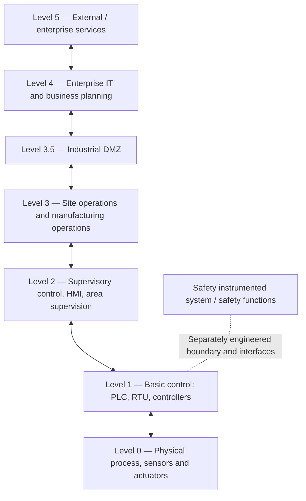

This is a functional illustration. Not every site has all levels, and real architectures may use multiple DMZs, cells, areas, remote facilities, or other models. The SIS relationship must come from functional safety engineering, not from a generic diagram.

## 3.2 Example enterprise-to-process communication path

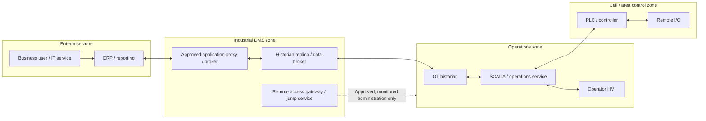

The drawing is illustrative and intentionally omits product-specific ports and detailed rules. A site design must define exactly which service initiates each connection and which direction is required.

## 3.3 ISA/IEC 62443 zone and conduit concept

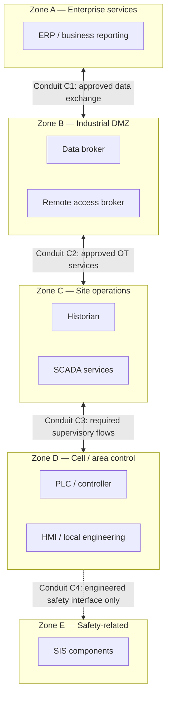

The labels describe conceptual relationships. Actual security requirements, permitted paths, independence, and risk treatment must be determined by the site's assessment and engineering authorities.

## 3.4 Multiple-cell architecture

A large facility may contain multiple production areas or cells. Segmentation should allow necessary supervisory functions while restricting unnecessary lateral movement between areas.

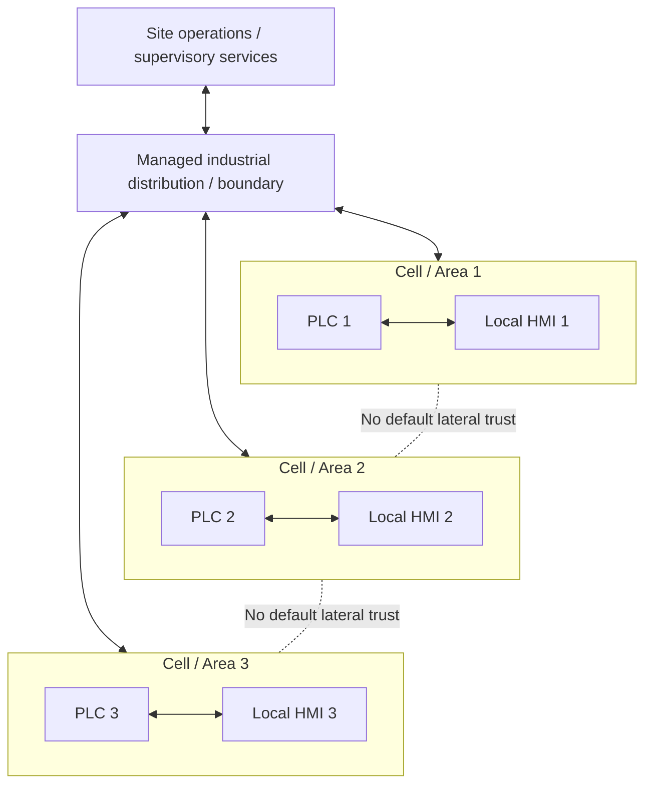

The objective is not to prohibit every inter-cell flow. It is to identify justified communication, control it, and avoid assuming all production areas should trust one another.

---

# 4. Architecture design workflow

## 4.1 End-to-end design workflow

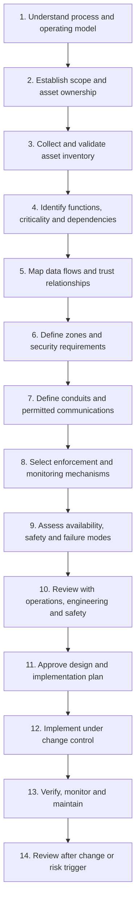

## 4.2 Step 1 — Understand process and operating model

Document facility and process purpose, normal/startup/shutdown/maintenance/emergency modes, essential process functions, production dependencies, local operating capabilities, safety functions, and consequences of loss of control, visibility, power, or communications.

**Deliverable:** process context and operational dependency summary.

## 4.3 Step 2 — Establish scope and ownership

Identify asset owner, system owner, operations and shift responsibility, control/automation engineering, process engineering, functional safety, OT security and SOC, IT/network and identity teams, integrators, vendors, and support providers.

**Deliverable:** scope statement, exclusions, responsibility matrix, and escalation contacts.

## 4.4 Step 3 — Build and validate the asset inventory

Record asset identifier, function and process area, manufacturer/model/version where verified, addressing details where approved, physical and logical location, zone and owner, criticality and safety relevance, dependencies and communication peers, support status, evidence source, and confidence.

Mark unknown or unverified data explicitly. A network discovery result alone may not identify an asset reliably.

## 4.5 Step 4 — Identify dependencies

Consider power and UPS, core/distribution network, DNS, identity, authentication, time services, virtualization, storage, backup, historian, data broker, remote access, vendor support, telecommunications, cloud/IIoT, engineering software, and facility systems.

A dependency map helps identify single points of failure and hidden routes into critical operations.

## 4.6 Step 5 — Map data flows

Do not create firewall rules from assumptions. Gather communication requirements from approved architecture records, engineering documentation, vendor guidance, and validation with system owners.

For each flow, capture source/destination, initiator/responder, protocol/service, data type and purpose, frequency and timing, authentication and protections, availability and failover behavior, owner, and approval.

## 4.7 Step 6 — Define zones

Group assets based on common security requirements, risk, process function, management authority, and communication needs. Separate assets where their risk or security requirements differ materially.

Potential zones include enterprise IT, industrial DMZ, site operations, supervisory control, cell/area control, safety-related systems, engineering and maintenance, remote/unmanned site, vendor access, and IIoT/edge integration. These are candidate groupings, not a required list.

## 4.8 Step 7 — Define conduits

For every inter-zone communication, state why it exists and how it is controlled. Remove unnecessary paths only through approved engineering and change control. Some systems require redundant, time-sensitive, or vendor-specific communications; do not break them by applying a generic rule.

## 4.9 Step 8 — Select enforcement and monitoring

Select controls according to protocol, availability, architecture, vendor support, and risk. Examples include firewalls, routers, access control lists, proxies, secure gateways, unidirectional gateways, network monitoring sensors, and host controls where supported.

## 4.10 Step 9 — Validate operational and safety impact

Evaluate latency and jitter, throughput and multicast behavior, redundancy and failover, time synchronization, controller/HMI dependencies, vendor support, alarm visibility, safe degraded operation, and recovery/rollback.

## 4.11 Step 10 — Approve and maintain

Obtain approvals from designated asset, operations, engineering, safety, and cybersecurity authorities. Maintain version-controlled diagrams, flow matrices, firewall policy records, exceptions, and review history.

---

# 5. Zone design and security requirements

## 5.1 Zone definition record

| Field | Required description |
|---|---|
| Zone ID and name | Unique identifier and clear name |
| Business/process purpose | Why the zone exists |
| Included assets | Verified assets or asset groups |
| Excluded assets | Similar assets deliberately outside scope |
| Owner | Accountable person or role |
| Management authority | Team permitted to administer |
| Criticality | Site-defined criticality classification |
| Safety relevance | Safety relationship and responsible authority |
| Security requirements | Identity, access, integrity, availability, monitoring |
| Allowed communication | Approved conduits and services |
| Dependencies | Services required for operation |
| Threat assumptions | Relevant threat and failure scenarios |
| Recovery requirements | Backup, restore, failover, manual fallback |
| Review trigger | Change, incident, vendor update, or periodic review |

## 5.2 Example candidate zones

| Candidate zone | Typical contents | Main architecture concerns |
|---|---|---|
| Enterprise IT | Business applications, office endpoints | Untrusted-origin paths, identity and malware dependencies |
| Industrial DMZ | Brokers, gateways, replicas, jump services | Controlled exchange and no unintended transit |
| Site operations | Historian, operations management services | Service availability and controlled access |
| Supervisory control | SCADA, HMI, area supervision | Operator visibility and supervisory command paths |
| Cell/area control | PLCs, RTUs, local HMI, remote I/O | Process impact, deterministic communication, engineering access |
| Safety-related | SIS and related components | Functional safety, independence, tightly governed interfaces |
| Engineering/maintenance | Engineering workstations and tools | Privileged access, project integrity, vendor tools |
| Remote site | RTU, local control, telemetry | Intermittent links, physical exposure, remote maintenance |
| Vendor access | Access broker and approved sessions | Identity assurance, time-bound access, audit |
| IIoT/edge | Edge gateway, data collection | Data egress, cloud dependency, inbound path restrictions |

A zone can be implemented with more than one VLAN or subnet, and one VLAN may contain assets that should not share a security zone. The security model must drive implementation.

## 5.3 Zone risk questions

- What is the worst credible consequence if this zone is compromised?
- Which assets can change physical process behavior?
- Which identities can administer or reconfigure these assets?
- What external or adjacent zones can communicate with it?
- Can an attacker move laterally within the zone?
- Which services are required for normal and degraded operation?
- What monitoring can observe critical activity?
- What recovery evidence exists?
- Are safety functions or safety dependencies involved?

---

# 6. Conduit design and communication-flow engineering

## 6.1 Conduit record template

| Field | Example placeholder |
|---|---|
| Conduit ID | C-OT-001 |
| Source zone | Site operations |
| Destination zone | Cell 01 control |
| Source endpoint | Approved supervisory server |
| Destination endpoint | Approved controller service |
| Purpose | Required process supervision |
| Initiator | To be validated |
| Protocol/service | Vendor- and deployment-specific |
| Direction | Explicitly documented |
| Authentication | Supported method and identity |
| Inspection/enforcement | Approved boundary control |
| Monitoring | Network and host evidence where available |
| Availability requirement | Site-defined |
| Owner | Operations/control engineering |
| Approval | Change record / design authority |
| Review | Periodic and on material change |

Do not copy the placeholder example into a live firewall configuration. Protocol and endpoint details must come from the actual system and vendor documentation.

## 6.2 Communication-flow matrix

| Flow ID | Source | Destination | Purpose | Protocol | Direction | Owner | Status |
|---|---|---|---|---|---|---|---|
| F-001 | HMI service | Controller | Operator supervision | Verify per site | Verify per site | Control engineering | To validate |
| F-002 | Controller | Historian collector | Process data collection | Verify per site | Verify per site | OT operations | To validate |
| F-003 | DMZ broker | Enterprise reporting | Approved data exchange | Verify per site | Verify per site | IT/OT owner | To validate |
| F-004 | Vendor jump service | Approved maintenance target | Time-bound support | Verify per site | Verify per site | Asset owner | To validate |

## 6.3 Flow validation sequence

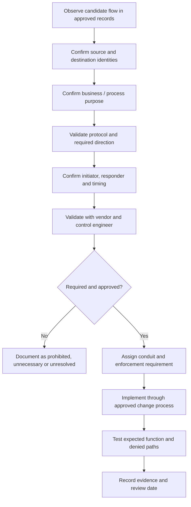

## 6.4 Least functionality and allow-listing

The design objective is to permit only communications required for approved operational functions. This is not an instruction to block unknown traffic immediately. First understand the system, observe and validate dependencies, obtain engineering approval, and test proposed restrictions in a representative environment where possible.

## 6.5 Inbound and outbound direction

For each flow, document who initiates the session and what responses are expected. A diagram arrow alone can be ambiguous because stateful protocols allow response traffic. Rules must match the actual enforcement technology and protocol behavior.

---

# 7. Industrial DMZ architecture

## 7.1 Purpose

An industrial DMZ is an intermediary zone used to control and broker selected communications between enterprise and OT environments. Its purpose is to prevent uncontrolled direct connectivity and provide defined places for shared services.

NIST SP 800-82 Rev. 3 discusses DMZs as enforcement boundaries and recommends using mapped data flows to inform segmentation and isolation design.

## 7.2 Illustrative industrial DMZ pattern

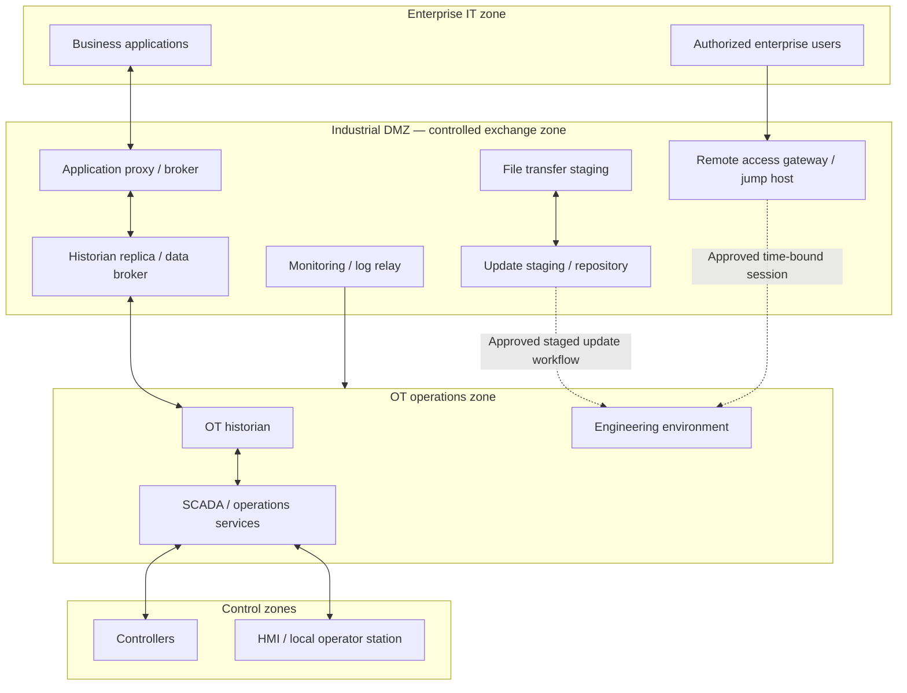

This diagram does not imply that all these services should be deployed or that all arrows should be bidirectional. Each service and path requires a documented purpose, risk review, and approved design.

## 7.3 Potential DMZ services

| Service | Possible purpose | Design questions |
|---|---|---|
| Jump host / access broker | Controlled administration | How are users approved, authenticated, monitored, and revoked? |
| Historian replica | Share selected process data | Is replication one-way or two-way? Which data is required? |
| File transfer staging | Controlled file exchange | How are files approved, inspected, and tracked? |
| Patch/update staging | Stage approved updates | How are updates validated and tested? |
| Application proxy | Broker selected application access | Does it terminate and validate sessions appropriately? |
| Monitoring/log relay | Transfer logs and alerts | Does monitoring create an unintended path back into OT? |
| Remote access gateway | Govern vendor/remote sessions | Are sessions named, time-bounded, scoped, and audited? |

## 7.4 DMZ design principles

- Avoid direct enterprise-to-control connectivity.
- Do not use the DMZ as an unrestricted transit network.
- Separate services with different trust and exposure requirements.
- Harden and maintain DMZ hosts as critical infrastructure.
- Minimize installed software and administrative privileges.
- Monitor allowed and denied communication.
- Restrict management interfaces to approved administrators.
- Define recovery, backup, and failover requirements.
- Validate that compromise of one DMZ service does not automatically expose every OT zone.
- Review data direction and replication behavior.
- Ensure no service bypasses the intended security boundary.

## 7.5 Common DMZ design mistakes

- Treating the DMZ as a flat shared server network.
- Allowing broad any-to-any rules for convenience.
- Giving DMZ servers dual-homed access without a documented need.
- Allowing enterprise users to reach control devices through a convenience route.
- Placing untrusted file exchange directly beside engineering systems.
- Failing to monitor administrative activity.
- Omitting time synchronization, backup, and recovery.
- Assuming a historian replica is automatically one-way.
- Failing to document ownership and patch responsibilities.

---

# 8. Remote access and third-party connectivity

## 8.1 Remote access risk

Remote access creates a path from users, devices, suppliers, or external networks into an environment that may directly affect physical processes. Treat it as a designed and governed conduit, not a convenience feature.

## 8.2 Recommended governance workflow

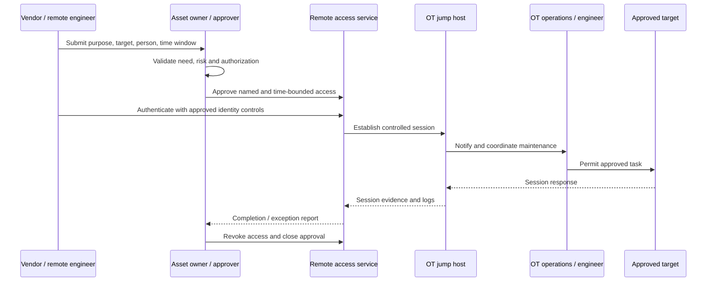

## 8.3 Remote access control checklist

- Named individual accounts; avoid shared vendor accounts where possible.
- Identity verification and appropriate MFA.
- Business justification and asset-owner approval.
- Explicit target systems and permitted activities.
- Time-bounded access and automatic expiry where feasible.
- Controlled jump host or broker.
- Least privilege and separation of duties.
- Session logging and recording where technically feasible and lawful.
- Vendor device security requirements.
- Emergency access process with retrospective review.
- Immediate revocation process.
- Periodic review of vendors, accounts, keys, certificates, and access paths.

## 8.4 Remote access exceptions

Emergency access should not become a permanent bypass. Define who can authorize it, how identity is verified, what systems can be reached, how activity is logged, how long access remains available, and who reviews it afterward.

## 8.5 Remote site considerations

Remote sites may have limited physical access, intermittent links, constrained bandwidth, cellular/satellite communication, local autonomous control, and delayed maintenance. The design must account for safe local operation when central connectivity is unavailable.

---

# 9. Safety-related systems and architecture

## 9.1 Safety is an engineering property

The security architecture must respect the functional safety design and lifecycle. A network diagram cannot establish that an SIS is independent or that a safety function will operate correctly.

## 9.2 Review questions

- Which systems implement safety instrumented functions?
- Who owns the safety lifecycle and approves changes?
- What are the documented SIS/BPCS interfaces?
- Are shared power, network, time, identity, or engineering dependencies present?
- How are maintenance and diagnostic connections controlled?
- What is the approved response to loss of communication?
- How are cybersecurity changes assessed for safety impact?
- What evidence supports claimed independence and availability?

## 9.3 SIS interface illustration

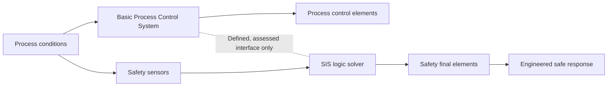

This is a simplified conceptual illustration, not a functional safety design. Real architectures may share or separate sensors, final elements, utilities, diagnostics, and networks according to the safety lifecycle and design requirements.

---

# 10. IIoT, cloud, wireless, and modern connectivity

## 10.1 IIoT and edge architecture

Industrial IoT gateways and edge platforms may collect, normalize, buffer, or analyze process data. They can create new trust boundaries and potential paths between field systems, enterprise platforms, and cloud services.

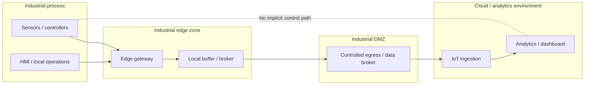

The diagram shows an illustrative data-export pattern. Cloud-to-control commands, remote management, or bidirectional synchronization require separate architecture, risk, safety, and authorization analysis.

## 10.2 Cloud connectivity questions

- What data leaves the OT environment?
- Is the flow one-way, request/response, or bidirectional?
- Which party owns the cloud tenant and data?
- How are identities, keys, certificates, and APIs managed?
- What happens if the internet or cloud service is unavailable?
- Is local process control independent of cloud availability?
- Are data retention, residency, and privacy requirements addressed?
- How are cloud provider and supplier access paths governed?
- Can cloud compromise create an inbound route to OT?
- How are logs and incidents correlated across environments?

## 10.3 Wireless and remote telemetry

Wireless technologies may be used for sensors, mobile maintenance, remote sites, and telemetry. Assess authentication, encryption, key management, coverage, interference, physical exposure, device lifecycle, and the relationship to wired control zones. Do not assume a wireless link is safe because it uses proprietary radio or is not directly routed to enterprise networks.

---

# 11. Availability, resilience, and failure-mode analysis

## 11.1 Architecture must account for failure

A segmentation design can unintentionally create a single point of failure or interrupt a required control path. Security enforcement devices, power supplies, switches, DNS, identity, time, and remote access services may all become operational dependencies.

## 11.2 Resilience review model

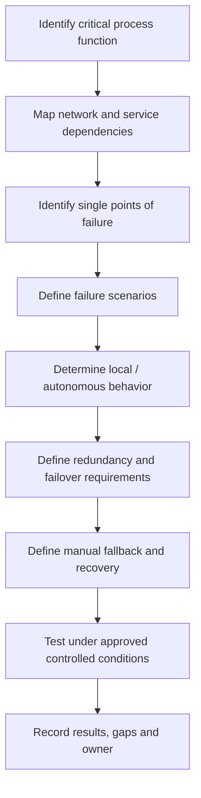

## 11.3 Questions for architecture review

- Does loss of a firewall interrupt a required process path?
- Are redundant paths genuinely independent?
- Does failover preserve state and timing requirements?
- Are redundant devices configured consistently?
- Can operators continue safely if enterprise identity or DNS is unavailable?
- Does the system rely on a cloud service for local control?
- Are backup and restore procedures tested?
- Are network configuration backups available?
- Is there a manual or local operating fallback?
- Who authorizes failover testing?

Do not perform live failover tests without site-specific planning and approval.

---

# 12. Security enforcement and monitoring

## 12.1 Enforcement mechanisms

| Mechanism | Typical role | OT design consideration |
|---|---|---|
| Firewall | Permit/deny traffic at a boundary | Validate protocol behavior, latency, availability, and rule ownership |
| Router / ACL | Route and restrict network paths | Routing separation alone may not be sufficient for every trust boundary |
| Industrial gateway | Broker or translate selected traffic | Validate supported protocols and failure behavior |
| Unidirectional gateway | Enforce one-way data movement | Confirm direction, acknowledgements, and operational need |
| Proxy / broker | Terminate and mediate application exchange | Prevent unintended transit and manage identities |
| NAC / port controls | Govern network attachment | Ensure compatibility with fixed-function and legacy devices |
| Passive network monitoring | Observe traffic and asset behavior | Validate sensor placement, visibility, and alert handling |
| Host security controls | Protect servers/workstations | Vendor support and performance testing are essential |

## 12.2 Monitoring architecture

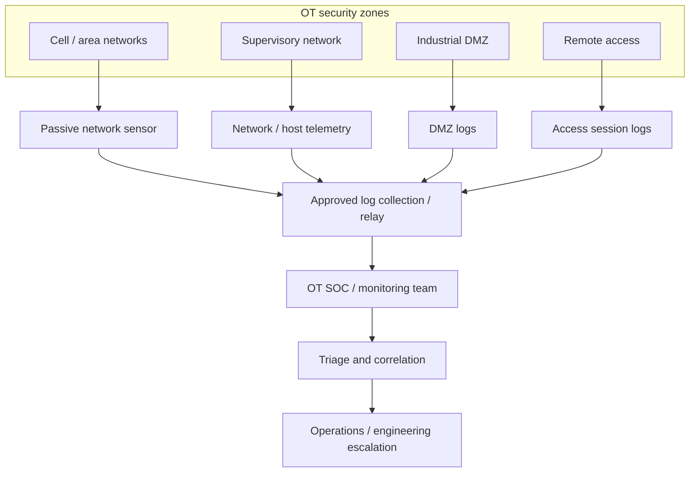

Monitoring should not create an unintended control path. Sensor deployment, SPAN/TAP configuration, log forwarding, and collectors must be reviewed for availability and data-flow implications.

## 12.3 Architecture monitoring use cases

- New or unexpected communication between zones.
- Traffic from an unapproved source or destination.
- Unusual engineering workstation activity.
- Remote access outside approved windows.
- Changes to firewall rules or network devices.
- New assets or services on control networks.
- Unexpected protocol or service use.
- Loss of visibility from a critical sensor.
- DMZ service compromise indicators.
- Failed or unusual authentication activity.

Detection logic must be tuned to site baselines and operational context.

---

# 13. Common architecture weaknesses and design anti-patterns

| Anti-pattern | Why it is a problem | Better engineering approach |
|---|---|---|
| Flat OT network | Broad lateral reachability | Risk-based zones and controlled conduits |
| Enterprise directly reaches PLCs | Expands exposure and bypasses mediation | Approved DMZ and constrained access path |
| DMZ used as transit | Compromise can bridge trust zones | Separate services and prohibit unintended forwarding |
| VLAN treated as security boundary | Routing or trunk paths may bypass intended controls | Validate enforcement and trust model |
| Any-to-any firewall rules | Removes meaningful control | Documented allow-list flows |
| Shared vendor credentials | Weak accountability | Named identity and session governance |
| Permanent remote access | Long-lived external exposure | Just-in-time, time-bounded approval |
| Unmanaged engineering laptops | Malware/configuration risk | Controlled engineering asset lifecycle |
| No flow inventory | Rules based on assumptions | Validated communication matrix |
| No change control | Unexpected outages and unsafe changes | Approved engineering change process |
| Safety systems grouped casually | May undermine safety assumptions | Functional safety-led boundary design |
| Cloud assumed harmless | Creates hidden dependencies and egress | Explicit cloud threat model and flow controls |
| No recovery design | Security controls can become availability risks | Tested backup, failover, and recovery planning |

---

# 14. Architecture assessment and validation playbook

## 14.1 Objective

Review an existing or proposed OT architecture using approved documentation, stakeholder interviews, and authorized observation. Determine whether the architecture reflects process needs, risk, and approved communication requirements.

## 14.2 Preconditions

- Written authorization and defined scope.
- Asset owner and site authority identified.
- Operations, control engineering, network, and safety contacts available.
- Site safety and access requirements completed.
- Approved architecture and asset records obtained.
- Prohibited actions and stop-work conditions documented.
- Evidence classification and storage approved.

No active scanning, firewall change, route change, failover, controller access, or configuration modification is implied by this playbook.

## 14.3 Review procedure

**Step 1 — Collect architecture evidence.** Obtain current network diagrams, asset inventories, firewall rule exports through approved channels, routing and VLAN records, remote access design, vendor connection list, and relevant change records.

**Step 2 — Confirm diagrams against the site.** Validate with operations and engineering. Record stale diagrams, undocumented connections, and uncertainty.

**Step 3 — Identify trust boundaries.** Mark enterprise, DMZ, supervisory, cell/area, safety-related, remote, vendor, and cloud boundaries where applicable.

**Step 4 — Validate zones.** Confirm each zone has a purpose, owner, asset list, security requirements, dependencies, and risk rationale.

**Step 5 — Validate conduits.** Confirm every inter-zone flow has a business/process purpose, source, destination, direction, protocol, owner, and approval.

**Step 6 — Review enforcement.** Establish which device or mechanism enforces each boundary and whether all paths traverse it.

**Step 7 — Review remote access.** Verify identity, approval, target restriction, time window, monitoring, vendor governance, and revocation.

**Step 8 — Review safety and availability.** Engage qualified engineering and safety roles to assess dependencies, failover, degraded modes, and consequences of enforcement-device failure.

**Step 9 — Review monitoring and recovery.** Confirm visibility of important conduits, access sessions, boundary changes, backups, and restore evidence.

**Step 10 — Report and prioritize.** Distinguish confirmed facts, gaps, assumptions, and recommendations. Assign accountable owners and remediation dependencies.

## 14.4 Stop-work conditions

Stop and contact the designated site authority if operations reports an abnormal process condition; the review requires an unapproved active test or configuration access; a safety-related dependency is unclear; a proposed change could affect a live path; scope or authorization is withdrawn or ambiguous; evidence handling would expose sensitive architecture information; or an unexpected network/process effect occurs.

## 14.5 Expected deliverables

- Scope and authorization record.
- Current-state architecture diagram.
- Zone register.
- Conduit and communication-flow register.
- Remote access register.
- DMZ service inventory.
- Boundary enforcement matrix.
- Dependency and single-point-of-failure register.
- Safety and operational constraints.
- Monitoring coverage map.
- Findings, risk rationale, and recommendations.
- Proposed target-state architecture.
- Approved remediation roadmap.

---

# 15. Reusable engineering templates

## 15.1 Zone register

| Zone ID | Zone name | Purpose | Asset owner | Criticality | Safety relevance | Key dependencies | Review status |
|---|---|---|---|---|---|---|---|
| Z-001 | Enterprise | Placeholder | TBD | TBD | TBD | TBD | Example only |
| Z-002 | Industrial DMZ | Placeholder | TBD | TBD | TBD | TBD | Example only |
| Z-003 | Site operations | Placeholder | TBD | TBD | TBD | TBD | Example only |
| Z-004 | Cell / area control | Placeholder | TBD | TBD | TBD | TBD | Example only |

## 15.2 Conduit register

| Conduit ID | Source zone | Destination zone | Purpose | Flow IDs | Enforcement point | Owner | Approval |
|---|---|---|---|---|---|---|---|
| C-001 | TBD | TBD | TBD | TBD | TBD | TBD | Pending |

## 15.3 Firewall / boundary rule review record

| Field | Description |
|---|---|
| Rule ID | Exact rule identifier from approved export |
| Device / boundary | Enforcement device |
| Source / destination | Exact approved objects |
| Service / protocol | Verified service |
| Direction | Initiation and response behavior |
| Business/process reason | Why the rule exists |
| Owner | Accountable service/process owner |
| Approval | Change or design reference |
| Logging | Required evidence |
| Last used / hit data | Only if available and reliably interpreted |
| Expiry / review | Date or trigger |
| Risk / exception | Documented rationale |

Do not remove or alter production rules based solely on apparent inactivity. Validate dependencies and follow change control.

## 15.4 Remote access register

| Field | Description |
|---|---|
| Supplier / organization | Third party or internal support group |
| Named users | Individual identities |
| Business purpose | Justification |
| Target zone/assets | Explicit authorized targets |
| Access method | Approved gateway/broker |
| Authentication | Approved identity controls |
| Approval owner | Designated approver |
| Time window | Start/end and expiry |
| Session evidence | Logging/recording details |
| Emergency process | Exception approval and review |
| Revocation | How access is disabled |
| Review date | Periodic review |

## 15.5 Architecture decision record

For each significant design choice, record decision ID and date, context and requirement, options considered, selected approach, security rationale, operational and safety impact, availability and recovery impact, vendor support considerations, assumptions and limitations, approvers, and review trigger.

---

# 16. Practical architecture scenarios

## Scenario 1 — Enterprise reporting requires process data

**Situation:** Business reporting requires production data from an OT historian.

Review: What data is required and why? Which system is authoritative? Is a replica or broker suitable? What is the required direction and frequency? Can enterprise access be prevented from initiating connections into control zones? What happens if reporting is unavailable? Who owns the interface and monitoring?

**Expected learning:** Data sharing should be explicitly brokered and should not create an unnecessary control path.

## Scenario 2 — Vendor requires remote engineering support

**Situation:** A supplier requests remote access to troubleshoot a controller.

Review: Is access justified? Who verifies identity? What target and task are authorized? Is a controlled jump environment available? What operations coordination is required? How is the session monitored? How and when is access revoked?

**Expected learning:** Vendor connectivity is a governed conduit with explicit identity, purpose, scope, duration, and evidence.

## Scenario 3 — Two production cells need data exchange

**Situation:** Two production areas need to exchange selected production status data.

Review: What exact data is needed? Which system initiates the exchange? Can the requirement be met through a broker or supervisory layer? Is direct controller-to-controller communication necessary? What happens if the exchange is unavailable? How is lateral movement restricted? Who approves the architecture?

**Expected learning:** Shared business purpose does not automatically justify broad network trust between cells.

## Scenario 4 — Cloud analytics platform

**Situation:** A cloud analytics service needs process telemetry.

Review: Which data leaves the site? Is export one-way? Does the cloud service require any inbound route? What identity and key management are used? Does local control remain independent? What happens during cloud or internet outage? What supplier, privacy, residency, and incident requirements apply?

**Expected learning:** Cloud integration creates a new trust boundary and dependency that must be explicitly assessed.

## Scenario 5 — Firewall refresh project

**Situation:** A firewall is being replaced and existing rules must be migrated.

Review: Are current rules and owners documented? Are all paths and redundant links understood? Are vendor protocol requirements validated? What is the maintenance window and rollback plan? How are stateful sessions and failover affected? Who validates process functionality? What evidence is required before and after the change?

**Expected learning:** Firewall migration is an engineering change with operational and safety implications, not a simple configuration copy.

---

# 17. Architecture validation checklists

## 17.1 Architecture completeness

- [ ] Scope, site, and process context are documented.
- [ ] Diagram owner, version, date, and classification are visible.
- [ ] Assets and system owners are identified.
- [ ] Remote and third-party connections are represented.
- [ ] Cloud, IIoT, wireless, and external dependencies are represented where present.
- [ ] Safety-related systems and interfaces are represented accurately.
- [ ] Trust boundaries are visible.
- [ ] Data-flow directions and purposes are documented.
- [ ] Unverified assumptions are clearly marked.

## 17.2 Zones and conduits

- [ ] Zones are based on common security requirements and risk.
- [ ] Zone owners and management authorities are assigned.
- [ ] Conduits have documented purpose and endpoints.
- [ ] Protocols and directions are validated.
- [ ] Unnecessary paths are identified for controlled review.
- [ ] Enforcement points are known.
- [ ] Exceptions have owners and expiry/review dates.
- [ ] Monitoring covers critical boundaries.

## 17.3 Industrial DMZ

- [ ] No unintended direct enterprise-to-control path exists.
- [ ] DMZ services have defined owners and purposes.
- [ ] DMZ does not operate as unrestricted transit.
- [ ] Management access is restricted.
- [ ] File exchange and update staging are governed.
- [ ] Historian replication direction is understood.
- [ ] Logging and monitoring are defined.
- [ ] Backup, recovery, and failover are addressed.

## 17.4 Remote access

- [ ] Named identities are used where feasible.
- [ ] Business justification and approval are recorded.
- [ ] MFA or equivalent approved controls are evaluated.
- [ ] Target systems and privileges are restricted.
- [ ] Access is time-bounded.
- [ ] Sessions are logged and monitored.
- [ ] Emergency access is governed and reviewed.
- [ ] Supplier access is periodically recertified.
- [ ] Revocation is tested and documented.

## 17.5 Resilience and safety

- [ ] Critical dependencies are documented.
- [ ] Single points of failure are identified.
- [ ] Redundancy and failover are engineered and validated.
- [ ] Loss of enterprise services is considered.
- [ ] Local operation and degraded modes are understood.
- [ ] Safety-related boundaries are reviewed by qualified personnel.
- [ ] Recovery and rollback plans exist.
- [ ] Changes are governed by site management of change.

---

# 18. Standards and technical references

## 18.1 NIST SP 800-82 Rev. 3

NIST SP 800-82 Rev. 3, *Guide to Operational Technology (OT) Security*, September 2023, provides guidance for securing OT while accounting for performance, reliability, and safety. Its network architecture discussion covers segmentation and isolation, use of levels/tiers/zones, DMZ boundaries, and mapping required data flows before enforcing communication restrictions.

NIST announced an initial public draft of Revision 4 on 21 September 2026 with comments due 30 November 2026. At the date of this document, that revision is a draft, not a final publication.

## 18.2 ISA/IEC 62443 series

The ISA/IEC 62443 family addresses industrial automation and control system cybersecurity across stakeholders and lifecycle stages. The zone and conduit model is a central architectural concept. Formal assessments must use the exact applicable standard edition and licensed normative text.

## 18.3 MITRE ATT&CK for ICS

MITRE ATT&CK for ICS provides a knowledge base of adversary tactics and techniques relevant to industrial environments. Its Network Segmentation mitigation describes restricting access to critical systems and using zones and conduits to constrain data flows.

## 18.4 Reference list

1. NIST SP 800-82 Rev. 3 — Guide to Operational Technology (OT) Security: https://csrc.nist.gov/pubs/sp/800/82/r3/final
2. NIST SP 800-82 Rev. 3 PDF: https://doi.org/10.6028/NIST.SP.800-82r3
3. ISA/IEC 62443 Series of Standards: https://www.isa.org/standards-and-publications/isa-standards/isa-iec-62443-series-of-standards
4. MITRE ATT&CK for ICS — Network Segmentation mitigation: https://attack.mitre.org/mitigations/M0930/
5. CISA Industrial Control Systems recommended practices: https://www.cisa.gov/resources-tools/resources/ics-recommended-practices

---

# 19. Document control and review

## 19.1 Revision history

| Version | Date | Change | Status |
|---|---|---|---|
| 1.0 | 2026-11-17 | Initial conceptual reference | Superseded |
| 2.0 | 2026-11-17 | Expanded into architecture engineering handbook and field playbook | Draft — engineering review required |

## 19.2 Required technical review

Before marking this document Verified:
- Have an OT network architect review the zone, conduit, and DMZ patterns.
- Have control engineers validate process and communication examples.
- Have a functional safety practitioner review all SIS references.
- Validate diagrams render correctly and do not imply unsupported universal paths.
- Check protocol and vendor-specific details against primary documentation before adding them.
- Confirm example tables are clearly marked as placeholders.
- Confirm no site-sensitive architecture details are published.
- Record reviewer role, date, comments, and disposition.

## 19.3 Limitations

This document is a conceptual and educational engineering reference. It does not establish legal compliance, prescribe a universal Purdue implementation, provide production firewall rules, or authorize active testing. Actual architecture must be designed and approved for the facility, process, risk, vendors, safety lifecycle, and operating model. Use licensed standards and current vendor documentation for formal design and assurance.
