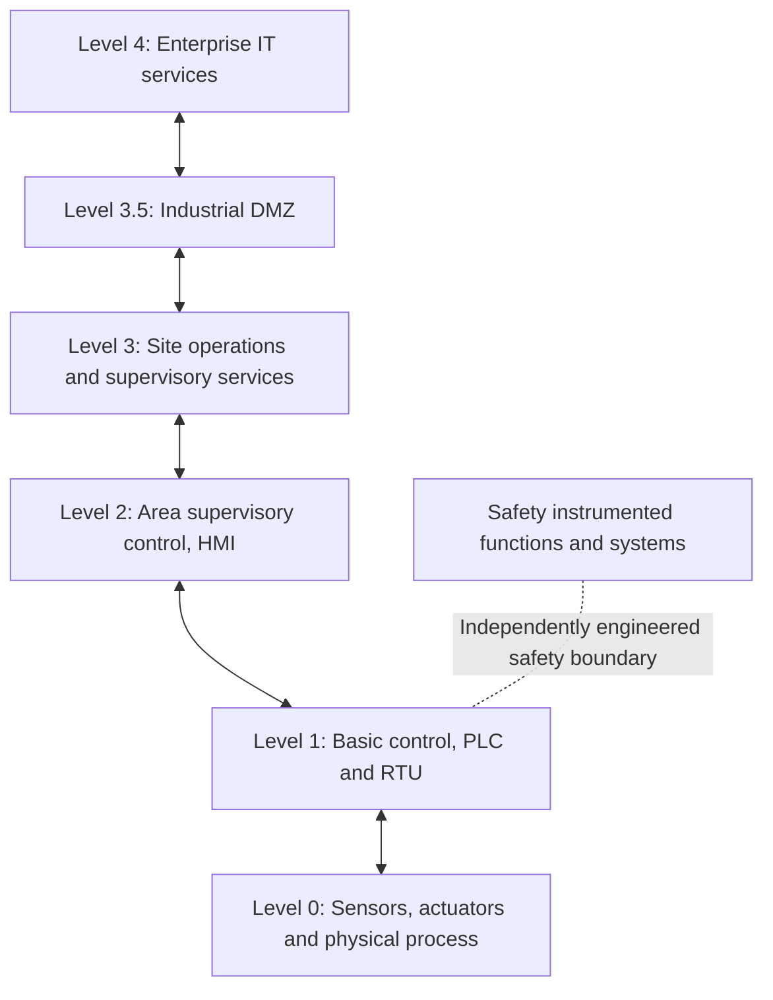

# OT Reference Architecture, Zones, and Conduits

## Purpose

Explain how to reason about industrial architecture and security boundaries. This is a conceptual reference, not a universal plant design.

## Architectural principles

- Start with process and safety requirements, not a preferred network product.
- Inventory assets, owners, functions, dependencies, protocols, and trust relationships.
- Separate business, supervisory, control, safety, and external access functions according to risk.
- Define zones by common security requirements and consequence.
- Define conduits as controlled communications paths between zones.
- Minimize and explicitly authorize cross-boundary flows.
- Provide monitored, controlled remote access with strong identity and session accountability.
- Avoid direct internet exposure of control devices.
- Design for safe degraded operation and recovery.

## Illustrative Purdue-style view

The Purdue model is a useful conceptual model, not a mandatory architecture or a substitute for site-specific risk assessment. Real environments may have multiple sites, cells, remote assets, cloud services, wireless links, and vendor-operated services.

## Zones

A zone groups assets with similar security requirements and risk. Candidate zones include:
- Enterprise IT
- Industrial DMZ
- Site operations
- Supervisory control
- Cell or area control
- Safety systems
- Remote or unmanned sites
- Vendor access
- IIoT and edge
- Engineering and maintenance

Do not place assets in the same zone solely because they share a VLAN or physical location.

## Conduits

A conduit is a controlled communication path between zones. Document:
- Source and destination zones
- Business and process purpose
- Initiating direction and response behavior
- Protocol, ports, endpoints, and data types
- Authentication and authorization
- Encryption or compensating protections
- Inspection, logging, and monitoring
- Availability and failover requirements
- Owner, approval, and review interval

## Industrial DMZ

An industrial DMZ can broker data exchange and remote administration between enterprise and OT environments. Typical services may include jump hosts, secure file transfer, remote access gateways, update staging, historian replication, and monitoring collectors. Placement and design must be based on threat model and availability needs.

## Remote access

Use named accounts, MFA where technically and operationally appropriate, just-in-time approval, least privilege, controlled jump hosts, session recording where lawful, time-bounded access, vendor identity verification, and rapid revocation. Emergency access must be designed, tested, logged, and governed.

## Safety system considerations

SIS independence and safety lifecycle requirements must be determined by functional safety engineering. Cybersecurity measures must not compromise safety functions or introduce unassessed dependencies. Coordinate changes with process safety, control engineering, and the responsible safety authority.

## Validation checklist

- [ ] Complete and owner-approved asset and communication inventory
- [ ] Zones defined by security requirements and consequence
- [ ] Conduits documented and allow-listed
- [ ] Unnecessary paths removed through approved change control
- [ ] Industrial DMZ and remote access reviewed
- [ ] Safety boundaries and dependencies assessed
- [ ] Monitoring covers critical conduits
- [ ] Recovery and degraded operation tested
- [ ] Architecture diagrams have owner, version, and classification
