# Industrial Asset Technical Reference
## PLC, RTU, DCS, SCADA, HMI, SIS, IED and supporting infrastructure

**Document ID:** UOTS-03-ASSET-TECH | **Version:** 1.0 | **Status:** Draft — engineering review required

**Audience:** OT/ICS cybersecurity professionals, automation and control engineers, OT network architects, system integrators, asset owners, assessors, and OT SOC analysts.

> **Safety notice:** This is a conceptual technical reference, not a vendor configuration guide or authorization to access, scan, modify, or test live industrial assets. Device behavior, safety functions, communication support, and failure modes vary by vendor, model, firmware, project configuration, and process. Confirm all technical actions with the asset owner, control engineer, vendor, and site safety authority. Never apply IT assumptions to a live control system without engineering approval.

---

# 1. Purpose and learning outcomes

Industrial environments are built from assets that observe physical conditions, execute control logic, present information to operators, coordinate production, and protect people, equipment, and the environment. Cybersecurity decisions must begin with an understanding of what each asset does in the process.

This handbook describes the purpose and relationships of major industrial asset classes, their typical architecture, operational dependencies, security exposure, lifecycle controls, and safe assessment considerations.

After studying this guide, the reader should be able to:
- Distinguish PLC, PAC, RTU, DCS, SCADA, HMI, SIS, IED, and field-device functions.
- Explain how a measurement becomes a control action.
- Identify common engineering, supervisory, control, and safety dependencies.
- Understand typical asset interfaces without assuming every vendor implementation is identical.
- Identify security-relevant configuration and lifecycle risks.
- Build asset-specific inventory and criticality records.
- Plan an authorized, safety-aware asset review.
- Communicate findings in terms of process consequence and evidence.

# 2. Industrial automation at a glance

## 2.1 The physical-to-digital relationship

Industrial automation connects a physical process to instruments, control devices, supervisory applications, and people. Information flows upward for monitoring and analysis; commands and configuration may flow downward through approved control paths.

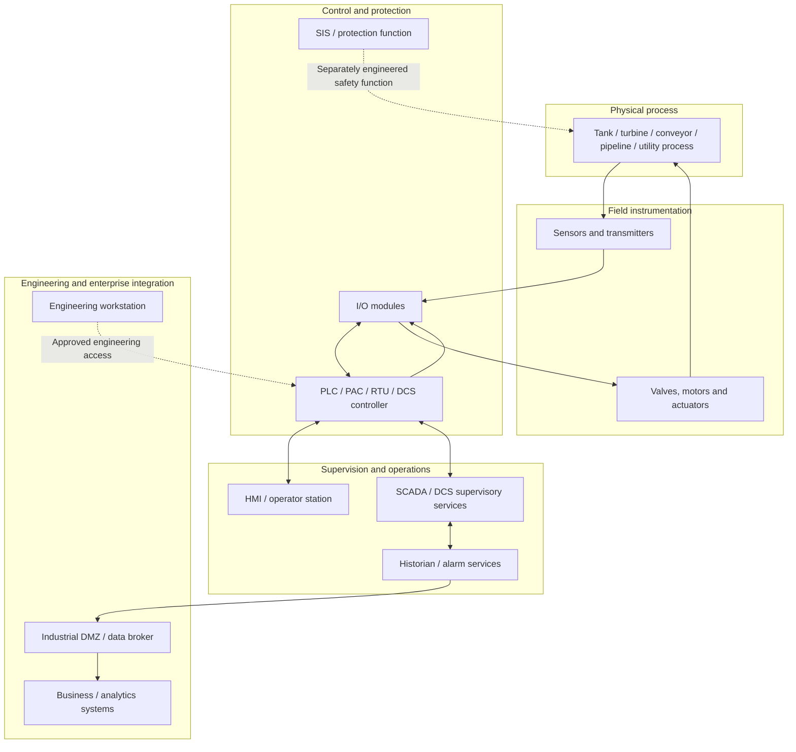

This is a functional overview, not a universal wiring or network diagram. The physical process may have redundant sensors, distributed I/O, multiple controllers, separate operator stations, and independently engineered safety systems.

## 2.2 Common asset families

| Asset family | Main purpose | Typical examples |
|---|---|---|
| Field instruments | Measure process variables | Pressure, temperature, flow, level, vibration, gas detectors |
| Final control elements | Change process conditions | Control valves, actuators, variable-speed drives, motor starters |
| Controllers | Execute deterministic control logic | PLC, PAC, RTU, DCS controller |
| Supervisory systems | Coordinate and visualize operations | SCADA servers, DCS operator services |
| Operator interfaces | Present state and accept operator input | HMI panels, operator workstations |
| Safety/protection systems | Perform risk-reduction or electrical protection functions | SIS logic solvers, fire and gas systems, protection relays |
| Engineering assets | Configure, maintain, and diagnose systems | Engineering workstations, programming tools |
| Infrastructure | Connect, host, secure, and support assets | Switches, firewalls, servers, hypervisors, time sources |
| Data and integration | Store or exchange operational information | Historians, gateways, MES, IIoT edge, brokers |

---

# 3. PLC — Programmable Logic Controller

## 3.1 Purpose

A PLC is an industrial controller designed to execute programmed logic and interact with field inputs and outputs. It is commonly used for machine control, discrete automation, process sequences, interlocks, and equipment coordination.

A PLC may receive inputs from sensors and switches, execute a control program, update output modules, communicate with HMIs or supervisory systems, and exchange data with other controllers. The exact architecture depends on the controller family and application.

## 3.2 Typical PLC architecture

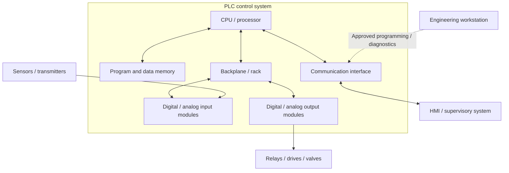

## 3.3 Main components

| Component | Function | Security and assurance considerations |
|---|---|---|
| CPU | Executes control logic and task scheduling | Protect program integrity, mode changes, access and availability |
| Memory | Holds firmware, program, configuration and runtime data | Protect backups, project files and integrity |
| I/O modules | Interface with field signals | Validate channel configuration, scaling and wiring evidence |
| Communication module | Connects networks and devices | Restrict reachable peers and management services |
| Backplane | Connects modules | Physical access and hardware change control |
| Power supply | Supplies controller and module power | Redundancy, monitoring and failure behavior |
| Programming port | Supports engineering access | Govern access, authentication and use of vendor tools |

## 3.4 PLC operating cycle

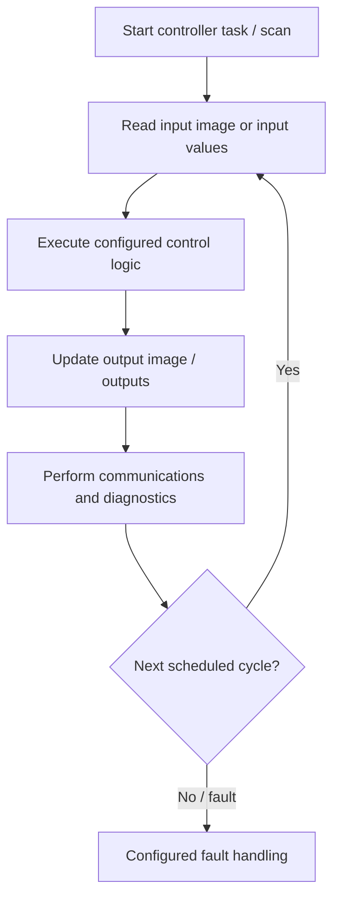

This is a simplified teaching model. Real controllers may use periodic, event-driven, interrupt, task-priority, motion, safety, and asynchronous communication mechanisms. Never infer timing or fail-state behavior from this generic diagram.

## 3.5 PLC security considerations

- Unauthorized program or logic modification.
- Unapproved mode changes or remote control.
- Exposed programming and diagnostic interfaces.
- Weak or shared engineering credentials.
- Uncontrolled engineering workstation access.
- Unprotected project files and backups.
- Unnecessary network services or broad peer reachability.
- Firmware and hardware lifecycle gaps.
- Physical access to cabinets, ports, removable media, or modules.
- Inadequate change approval and program comparison.

## 3.6 Defensive review questions

1. Who owns the PLC and its control logic?
2. Which process or machine does it control?
3. What is the approved program baseline and backup location?
4. Which engineering workstations can access it?
5. Which communication peers are required?
6. Is remote programming permitted, and under what approval?
7. How are program changes reviewed, tested, and recorded?
8. What is the documented behavior on communication or power loss?
9. Is the controller supported by the vendor?
10. Are spare modules and recovery procedures available?

## 3.7 PLC assessment evidence

Collect only through approved channels:
- Asset identity, model, firmware, and module configuration.
- Approved network and communication records.
- Program backup and checksum/comparison evidence where supported.
- Access-control and change logs where available.
- Engineering workstation and vendor support records.
- Lifecycle, patch, and end-of-support status.
- Owner-approved recovery and restoration evidence.

Do not upload proprietary controller projects, credentials, or sensitive plant details to a public repository.

---

# 4. PAC — Programmable Automation Controller

## 4.1 Purpose and distinction

A PAC is a term used by vendors and industry for controllers that combine PLC-like control with broader processing, communication, data handling, or modular capabilities. The boundary between PLC and PAC is not universally standardized. Some products are marketed as PACs while supporting familiar PLC programming and I/O models.

## 4.2 Review considerations

Assess the actual model and application rather than relying on the label:
- Supported control tasks and execution model.
- CPU, memory, operating environment, and firmware.
- I/O and motion/control integration.
- Supported protocols and network interfaces.
- User and role management.
- Engineering toolchain and project backup.
- Vendor lifecycle and security advisories.
- Redundancy, diagnostics, and recovery.

**Security principle:** classify the device by what it does, what it can reach, and the consequence of compromise—not by the product category printed on its datasheet.

---

# 5. RTU — Remote Terminal Unit

## 5.1 Purpose

An RTU is commonly used to monitor and control geographically distributed or remote assets. It collects telemetry from field instruments, may execute local control logic, and communicates with a central SCADA or control system over a communications link.

Typical environments include pipelines, substations, water networks, remote pumping stations, energy facilities, and unmanned sites.

## 5.2 Typical RTU architecture

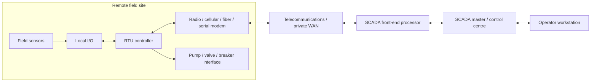

## 5.3 RTU operational characteristics

- Designed for remote or unattended operation.
- May operate over constrained, high-latency, or intermittent links.
- May buffer telemetry and report on a schedule or event.
- May perform local logic during loss of central communication.
- Can use serial, radio, cellular, Ethernet, or other site-specific communications.
- Often has physical exposure and environmental constraints.

## 5.4 RTU security considerations

- Insecure or poorly governed remote communication links.
- Weak device identity or authentication.
- Legacy serial gateways and modem access.
- Exposed management services.
- Physical tampering at remote sites.
- SIM, radio, antenna, or telecommunications account compromise.
- Inadequate time synchronization and event integrity.
- Unclear behavior during loss of communication.
- Uncontrolled vendor or field technician access.

## 5.5 RTU review questions

- Is the RTU site unmanned or intermittently attended?
- Which control functions continue locally if the WAN is unavailable?
- How is the communications link authenticated and protected?
- Are remote management paths documented?
- Is the RTU physically protected and monitored?
- How are telemetry gaps and stale values identified?
- How are local changes and field maintenance recorded?
- Are communication failover and recovery tested under approved conditions?

---

# 6. DCS — Distributed Control System

## 6.1 Purpose

A DCS is an integrated control system used to monitor and control complex industrial processes through distributed controllers, operator stations, engineering services, I/O, and supervisory applications. It is common in continuous and batch process industries such as oil and gas, chemicals, petrochemicals, power, and manufacturing.

A DCS distributes control functions across controllers and process areas while providing coordinated operator supervision and engineering management.

## 6.2 Typical DCS architecture

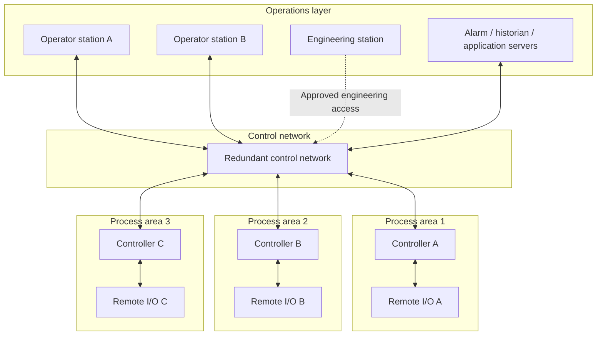

This conceptual view does not prescribe a vendor's controller topology, redundancy protocol, network design, or safety architecture.

## 6.3 DCS components

| Component | Purpose | Security focus |
|---|---|---|
| DCS controller | Executes process control | Logic integrity, availability and controlled engineering |
| Remote I/O | Interfaces with field devices | Physical and configuration integrity |
| Operator station | Process monitoring and control | User identity, session controls and alarm visibility |
| Engineering station | Configures control applications | Privileged access, project integrity and change control |
| Application server | Provides supporting services | Hardening, patch governance and dependencies |
| Historian | Retains process values and events | Integrity, time, access and replication |
| Control network | Connects DCS components | Segmentation, resilience and monitoring |

## 6.4 DCS security considerations

- Shared engineering or administrator accounts.
- Uncontrolled changes to control strategies.
- Flat or poorly documented control networks.
- Legacy operating systems and vendor dependencies.
- Weak separation between operator and engineering privileges.
- Inadequate project backup and restoration testing.
- Misconfigured redundancy or time services.
- Uncontrolled third-party maintenance access.
- Monitoring gaps across controller and application layers.

## 6.5 DCS review questions

- Which process units and controllers are in scope?
- Which components are redundant, and what is their failure behavior?
- Who can change control strategies?
- How are operator and engineering roles separated?
- How are application and controller backups maintained?
- What vendor support constraints affect security updates?
- Which network paths are required for normal operations?
- How are alarms, events, and engineering changes audited?

---

# 7. SCADA — Supervisory Control and Data Acquisition

## 7.1 Purpose

SCADA is a supervisory system used to collect telemetry, present status, generate alarms, and allow authorized operators to supervise distributed or geographically separated processes. SCADA commonly includes central servers, front-end processors, communication infrastructure, operator stations, historians, and remote field controllers.

SCADA is not itself a single controller type. It is a system architecture that interacts with PLCs, RTUs, IEDs, and other field assets.

## 7.2 Typical SCADA architecture

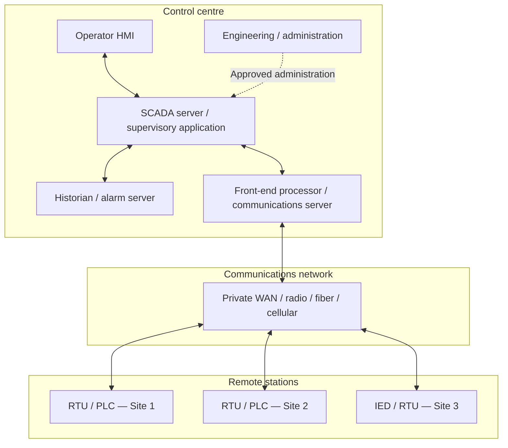

## 7.3 SCADA workflow

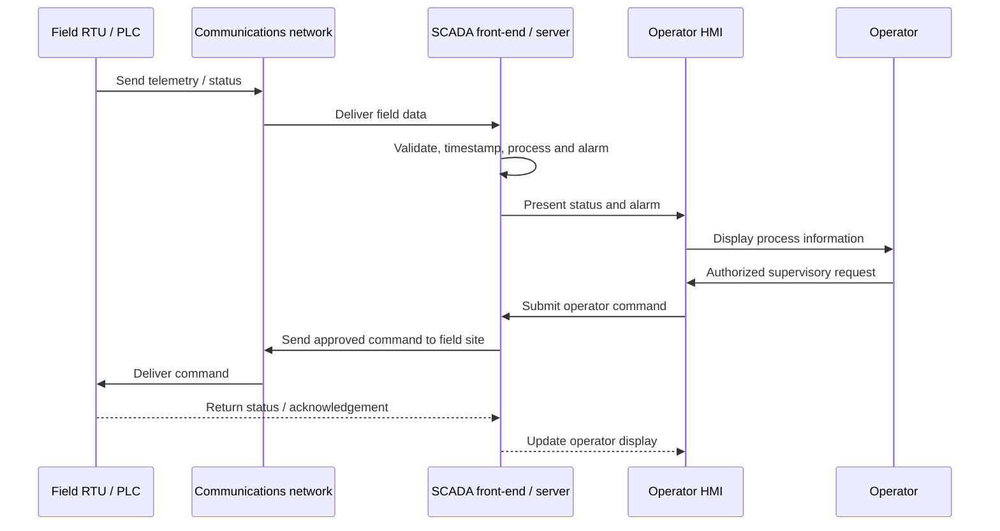

This is a conceptual sequence. Command authorization, interlocks, select-before-operate, local permissives, and communications behavior vary by implementation and must be confirmed for the actual system.

## 7.4 SCADA security considerations

- Uncontrolled access to operator or supervisory servers.
- Weak authentication between control centre and remote sites.
- Exposed communications gateways or front-end processors.
- Inadequate separation of enterprise and control-centre services.
- Unauthorized command or setpoint changes.
- Time synchronization and telemetry integrity issues.
- Remote site communications disruption.
- Unmonitored engineering and administrator activity.
- Inadequate failover and disaster recovery.

## 7.5 SCADA review questions

- Which remote sites and protocols are supported?
- How are field endpoints authenticated?
- How are telemetry freshness and communication loss displayed?
- How are operator commands authorized and logged?
- Is the control centre resilient to server or WAN failure?
- What local autonomy exists at remote sites?
- Are communication gateways and front-end processors segmented?
- Are historian and enterprise integrations mediated?

---

# 8. HMI — Human-Machine Interface

## 8.1 Purpose

An HMI is the interface through which an operator views process state, alarms, trends, and controls. It may be a panel-mounted terminal, industrial PC, workstation application, or interface embedded in a larger control system.

An HMI is not necessarily the controller. It typically displays information and sends authorized operator requests to the control system, which applies configured logic and interlocks.

## 8.2 HMI interaction flow

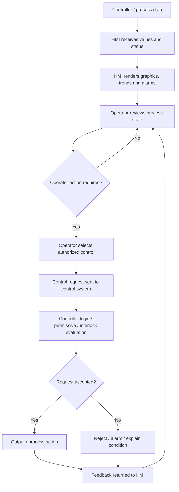

## 8.3 HMI security considerations

- Shared operator accounts and weak session control.
- Unrestricted engineering or desktop access.
- Unnecessary browser, email, or office applications.
- Insecure remote desktop exposure.
- Unapproved screen or graphic changes.
- Alarm suppression or misleading displays.
- Removable media and USB exposure.
- Weak application allowlisting or endpoint protection where supported.
- Uncontrolled configuration and image backups.

## 8.4 HMI review questions

- Are operator identities individual or shared, and what is the approved rationale?
- Are operator, supervisor, engineer, and administrator permissions distinct?
- Can an HMI directly change controller logic, or only request operational commands?
- How are alarm acknowledgements and operator actions recorded?
- Are screens and graphics under change control?
- Are HMI operating systems and software vendor-supported?
- Is remote access restricted and monitored?
- Are known-good images and recovery procedures maintained?

---

# 9. SIS — Safety Instrumented System

## 9.1 Purpose

A Safety Instrumented System (SIS) implements one or more safety instrumented functions (SIFs) intended to achieve or maintain a defined safe state when specified process conditions occur. It may include safety sensors, logic solvers, and final elements.

An SIS is part of a functional safety lifecycle. Its design, independence, proof testing, validation, and change management are governed by safety engineering requirements. Cybersecurity controls must not compromise the safety function or introduce unassessed dependencies.

## 9.2 Conceptual SIF path

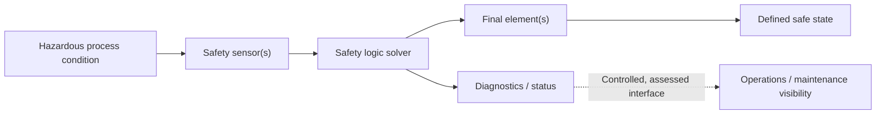

## 9.3 SIS components

| Component | Function | Safety and cybersecurity considerations |
|---|---|---|
| Safety sensor | Detects defined process condition | Proof testing, calibration, physical integrity |
| Logic solver | Executes safety logic | Access control, program integrity, lifecycle evidence |
| Safety I/O | Interfaces with sensors and final elements | Configuration control and fault diagnostics |
| Final element | Performs safety action | Proof testing, mechanical condition and response |
| Engineering tools | Configure and validate safety logic | Strict privilege and change governance |
| Diagnostics interface | Exposes status and faults | Controlled data access and safe maintenance |

## 9.4 SIS and BPCS relationship

The Basic Process Control System (BPCS) and SIS may exchange selected information, but their relationship and independence must be determined by the safety lifecycle and engineering design. A generic network diagram cannot prove independence.

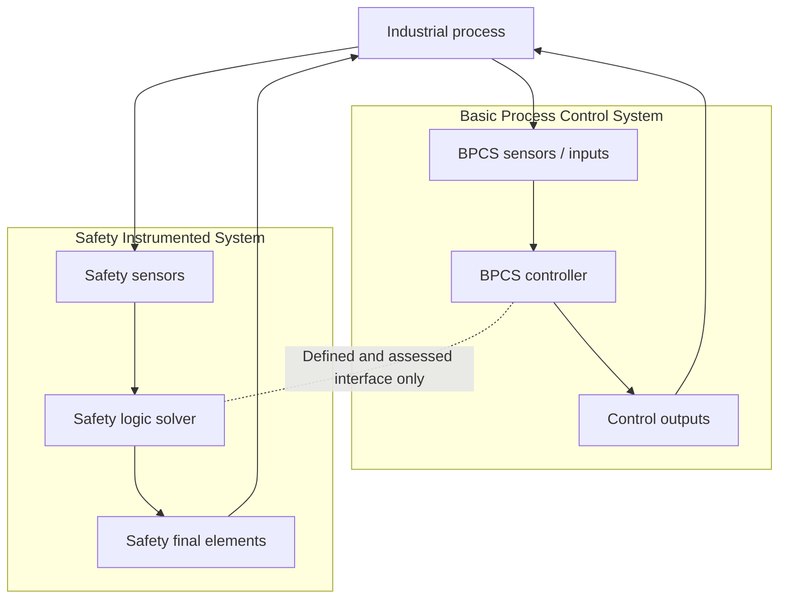

## 9.5 SIS cybersecurity considerations

- Unauthorized modification of safety logic or configuration.
- Uncontrolled access to safety engineering tools.
- Inadequate protection of project files and backups.
- Shared or unmanaged maintenance credentials.
- Unassessed network or identity dependencies.
- Unauthorized firmware or component changes.
- Poorly governed diagnostic and remote access.
- Inadequate proof-test, validation, or change evidence.
- Cybersecurity changes that affect safety availability or independence.

## 9.6 SIS review rules

- Involve the responsible functional safety authority.
- Do not conduct active testing without specific written authorization and safety planning.
- Do not change safety logic, bypasses, inhibits, or trip settings as part of a generic cyber assessment.
- Do not infer SIL, SIF performance, or independence from a product name or network drawing.
- Preserve approved safety lifecycle and management-of-change evidence.
- Treat all test, bypass, and maintenance arrangements as site-governed safety activities.

---

# 10. IED — Intelligent Electronic Device

## 10.1 Purpose

An IED is a microprocessor-based electronic device used for protection, control, monitoring, metering, or automation in electrical power systems and other industrial applications. Examples include protection relays, bay controllers, meters, and substation automation devices.

IEDs may exchange status, measurements, events, and control information with station systems, gateways, and control centres. The actual functions and protocols depend on device and project configuration.

## 10.2 Typical substation automation view

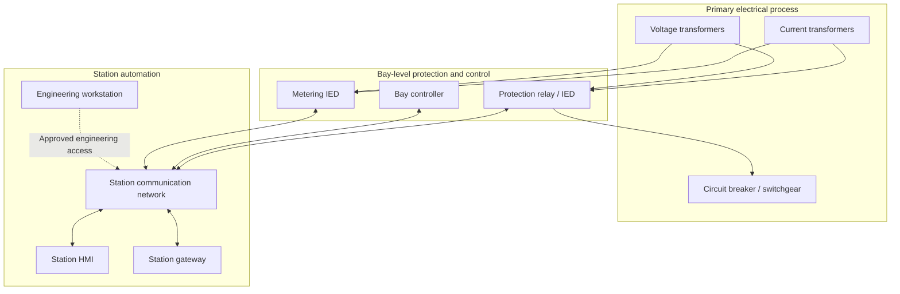

## 10.3 IED security considerations

- Unauthorized relay setting or protection configuration changes.
- Weak engineering access controls.
- Uncontrolled station network connectivity.
- Inadequate event and time synchronization integrity.
- Insecure maintenance interfaces.
- Unprotected configuration files and setting groups.
- Physical access to cabinets and communication ports.
- Legacy firmware and vendor support limitations.

## 10.4 IED review questions

- What protection or control function does the device perform?
- Which settings are approved and who owns them?
- How are setting changes reviewed and independently checked?
- What is the approved configuration backup and restoration method?
- Which station and control-centre systems communicate with it?
- How are time sources and event records protected?
- What is the maintenance and proof-test process?
- Are vendor tools and access credentials controlled?

---

# 11. Other important industrial assets

## 11.1 Field sensors and transmitters

Sensors measure physical variables such as pressure, temperature, flow, level, vibration, speed, position, and gas concentration. Transmitters convert measurements into signals or protocol messages used by controllers and supervisory systems.

Security and reliability concerns include calibration integrity, physical tampering, signal spoofing, wiring changes, incorrect scaling, maintenance access, and loss of measurement. A bad measurement can create operational consequences even when the controller and network are functioning normally.

## 11.2 Actuators and final control elements

Actuators and final elements change physical process conditions. Examples include control valves, motorized valves, pumps, variable-speed drives, contactors, dampers, and breakers.

Review control authority, local/remote mode, permissives, fail position, maintenance bypasses, drive configuration, physical access, and the consequences of unintended activation. Actual safe position and failure behavior must come from process and equipment engineering.

## 11.3 Variable-frequency drives and motor control

Drives control motor speed, torque, and operating characteristics. Motor control centres and starters distribute and control electrical power to motors. Their communication and parameter interfaces may create cybersecurity exposure.

Review drive parameter backups, firmware, local and remote control selection, engineering access, communication gateways, protective settings, and vendor lifecycle. Do not alter drive parameters without approved engineering procedures.

## 11.4 Industrial network infrastructure

Industrial switches, routers, firewalls, serial gateways, wireless access points, and time sources provide communications and segmentation. They are operational dependencies and potential control points.

Review configuration backup, management-plane access, authentication, protocol exposure, firmware lifecycle, redundant topology, logging, time synchronization, physical ports, and approved change records.

## 11.5 Engineering workstations

Engineering workstations host vendor tools and project files used to configure controllers, HMIs, drives, relays, and other assets. They are high-value systems because authorized access may permit changes to control logic or device configuration.

Review privileged accounts, software provenance, removable media, remote access, endpoint hardening, project-file integrity, backups, network paths, and change approval. Use dedicated and controlled engineering environments where feasible and vendor-supported.

## 11.6 Historians, alarm servers, and MES

Historians store time-series process data and events. Alarm servers manage alarm information and operator response. Manufacturing Execution Systems (MES) coordinate production execution and may exchange information with control systems.

Review data integrity, time synchronization, retention, role access, interfaces, replication direction, backup, and enterprise integration. Do not assume a historian is read-only or that an MES interface cannot affect production workflows; validate the actual design.

---

# 12. Asset-to-asset relationship and dependency mapping

## 12.1 Typical relationship map

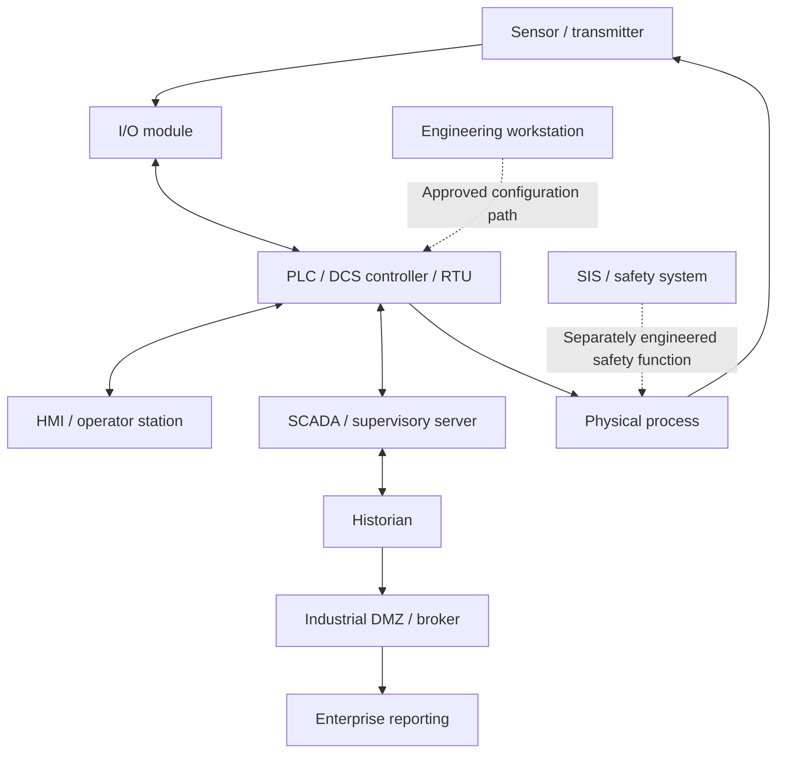

## 12.2 Dependency categories

| Dependency | Example | Failure or compromise question |
|---|---|---|
| Power | UPS, panel supply | Does loss cause safe shutdown, loss of visibility, or uncontrolled behavior? |
| Network | Switch, router, firewall | Which controllers or operator functions become isolated? |
| Identity | Directory, local accounts | Can authorized operators and engineers still access required systems? |
| Time | NTP/PTP/GPS source | Are event ordering, sequence-of-events, or protection functions affected? |
| Compute | Hypervisor, server, storage | Which supervisory services depend on the platform? |
| Data | Historian, broker, database | Can loss or corruption affect operations or decisions? |
| Vendor | Licensing, remote support | Can the site operate and recover without external service? |
| Telecommunications | Radio, fiber, cellular | What local autonomy exists during outage? |
| Safety | SIS utilities and interfaces | Are independence and safety requirements preserved? |

## 12.3 Failure propagation exercise

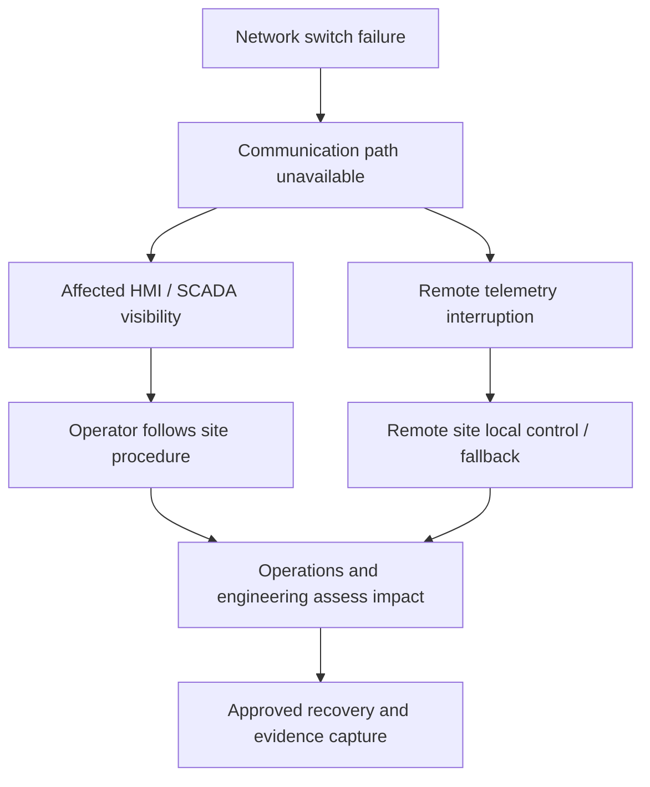

This scenario is illustrative. Whether control continues locally, outputs hold, communications fail over, or a process transitions to another state depends on the actual design.

---

# 13. Asset lifecycle and secure engineering workflow

## 13.1 Lifecycle overview

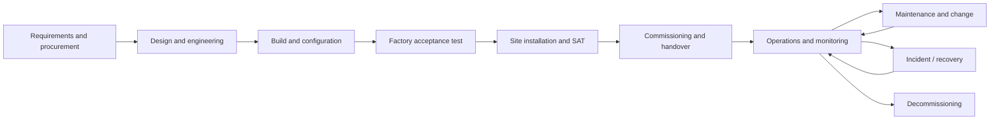

## 13.2 Procurement and design

Before procurement, identify the process function, required availability, environmental rating, supported protocols, identity and access capabilities, vendor support period, update process, backup and recovery method, and security documentation.

Security requirements should be included in specifications and acceptance criteria. Avoid purchasing based only on feature lists or assuming that a newer device automatically has a secure configuration.

## 13.3 Build and configuration

- Use approved engineering workstations and tool versions.
- Record hardware, firmware, software, and module configuration.
- Apply vendor-supported hardening.
- Disable unnecessary services only after dependency validation.
- Configure accounts and roles according to operational needs.
- Establish known-good project and configuration backups.
- Record communication requirements and zone placement.
- Preserve configuration provenance and approval records.

## 13.4 FAT and SAT

Factory Acceptance Testing (FAT) and Site Acceptance Testing (SAT) validate that equipment and systems meet specified requirements in their respective test environments.

Cybersecurity-related acceptance evidence may include access-control validation, configuration baseline, approved communication behavior, backup/restore evidence, logging, time synchronization, remote access governance, and documented exceptions.

Do not add disruptive cyber tests to FAT/SAT without agreed scope, test procedures, vendor support, and acceptance authority.

## 13.5 Operations and maintenance

Maintain asset inventory, owner records, approved configuration, access reviews, vulnerability/advisory tracking, vendor support, backups, maintenance windows, and incident procedures. Security updates require compatibility and process-impact review.

## 13.6 Change management workflow

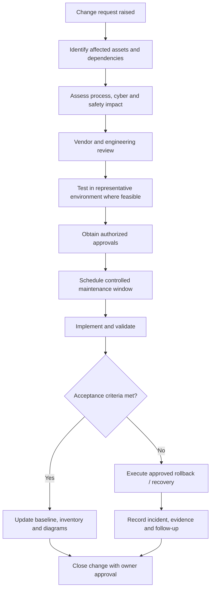

## 13.7 Decommissioning

Decommissioning must address process dependencies, network removal, account and certificate revocation, remote access removal, data retention, configuration archive, secure media handling, vendor lease/return obligations, and safe disposal. Do not remove an asset from inventory until the owner confirms that operational dependencies and access paths have been addressed.

---

# 14. Asset-specific security assessment methodology

## 14.1 Assessment principles

The purpose of an asset review is to establish its role, exposure, configuration governance, dependencies, and security evidence. Use documentation review, interviews, approved configuration exports, passive monitoring, and vendor-supported methods as appropriate.

Active discovery or testing can affect industrial devices. It requires explicit authorization, technical review, rate and timing constraints, operational approval, and a documented stop procedure.

## 14.2 Assessment workflow

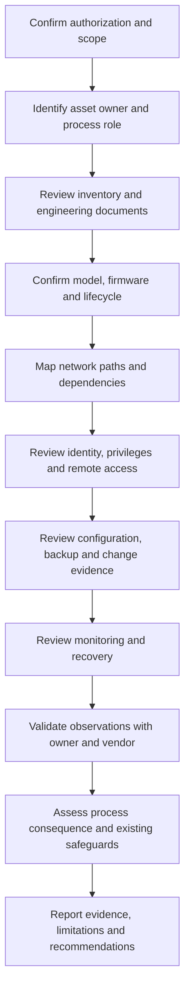

## 14.3 Asset review matrix

| Asset | Key review focus | Evidence examples |
|---|---|---|
| PLC/PAC | Logic integrity, engineering access, program backup | Approved project baseline, access and change records |
| RTU | Remote communications, local autonomy, physical exposure | Telemetry design, access records, failover procedure |
| DCS | Controller/engineering separation, redundancy, change governance | Architecture, role matrix, backup and test records |
| SCADA | Supervisory access, remote site communications, command audit | Data-flow matrix, server roles, alarm/event logs |
| HMI | Operator identity, application restrictions, graphic change | Role configuration, approved image, change records |
| SIS | Safety lifecycle, logic access, proof-test and change controls | Safety requirements, validation, proof-test and approval records |
| IED | Protection settings, engineering access, event integrity | Approved settings, configuration comparison, event records |
| Historian | Data integrity, access, replication and retention | Interface design, role matrix, backup and restore test |
| Network device | Management plane, segmentation, configuration backup | Approved configuration, rule review, change records |
| Engineering workstation | Privileged access, project files, removable media | Software baseline, access review, backup and endpoint evidence |

## 14.4 Finding quality

Each finding should separate:
- **Observation:** what was actually seen or verified.
- **Evidence:** approved record, configuration, interview, or telemetry source.
- **Affected asset and process:** where the condition exists and what it supports.
- **Security implication:** credible misuse or failure scenario.
- **Operational consequence:** potential impact on safety, availability, integrity, environment, or production.
- **Recommendation:** proportionate corrective action.
- **Limitations:** unverified assumptions, inaccessible systems, or vendor constraints.

Do not claim exploitability, safety impact, or process disruption without supporting evidence and qualified review.

---

For the full inventory schema, relational data model, evidence confidence, dependency mapping, lifecycle governance and criticality approval workflow, use the companion [OT Asset Inventory, Dependency Mapping and Criticality Engineering Playbook](OT-ASSET-INVENTORY-AND-CRITICALITY.md). This technical reference explains asset families; the companion playbook governs how those assets are recorded and prioritized.

# 15. Criticality and consequence-based classification

## 15.1 Why asset criticality matters

A device's security priority should reflect the consequence of compromise or failure, not only its purchase cost, network exposure, or data sensitivity. A low-cost remote controller may support an essential process; a high-value server may have limited direct process authority.

## 15.2 Consequence dimensions

- Personnel safety.
- Environmental impact.
- Loss of control or visibility.
- Essential service interruption.
- Equipment damage.
- Product quality and batch integrity.
- Recovery time and spare availability.
- Dependencies and common points of failure.
- Legal, contractual, and regulatory obligations.

## 15.3 Example consequence scoring model

The following is an illustrative starting point only. Each organization must define its own scoring criteria, thresholds, risk methodology, and approval authority.

| Score | Example consequence description |
|---|---|
| 1 — Low | Localized inconvenience; no material process effect; routine recovery |
| 2 — Moderate | Limited operational disruption; manageable by local team |
| 3 — Significant | Major production or service impact; specialist recovery required |
| 4 — Severe | Extended outage, substantial equipment/environmental consequence, or safety-relevant scenario requiring formal assessment |
| 5 — Critical | Potential for catastrophic or widespread consequence; requires highest governance and protection priority |

Do not use this table as a substitute for a site's formal process hazard analysis, safety lifecycle, or enterprise risk methodology.

## 15.4 Criticality workflow

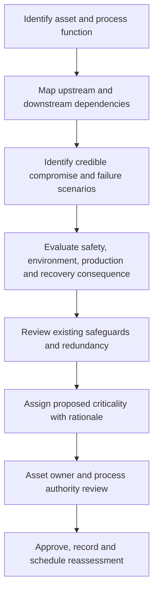

---

# 16. Practical engineering scenarios

## Scenario 1 — PLC engineering access

**Situation:** An engineering workstation is permitted to access a PLC for maintenance.

Review:
1. Is the workstation approved and dedicated for the task?
2. Who can log in and change logic?
3. Is the access path documented and restricted?
4. Are changes approved and compared with a known-good baseline?
5. Is a tested backup available?
6. Is vendor support and rollback understood?

**Expected output:** asset access record, approved engineering path, change evidence, and recovery reference.

## Scenario 2 — RTU communication loss

**Situation:** A remote pumping station stops reporting telemetry to the control centre.

Review:
1. Is the issue communications-only or does local control also fail?
2. What is the documented local operating mode?
3. How are stale values and communication loss alarmed?
4. Which carrier, radio, gateway, or power dependencies exist?
5. Who is authorized to visit or remotely support the site?

**Expected output:** dependency map, communications escalation, local operating procedure reference, and evidence of authorized recovery.

## Scenario 3 — DCS engineering workstation compromise concern

**Situation:** An endpoint alert is raised on a DCS engineering workstation.

Review:
1. What process areas and controllers can it administer?
2. Is the endpoint isolated or shared with other duties?
3. What approved response procedure applies?
4. Can operations continue without the workstation?
5. Which project files and backups may be affected?
6. Who coordinates with the DCS vendor and site authority?

**Expected output:** asset impact map, response coordination record, and project integrity/recovery evidence.

## Scenario 4 — SCADA remote command audit

**Situation:** An operator reports an unexpected remote command.

Review:
1. Which user or service initiated it?
2. Which HMI, SCADA server, gateway, and field device were involved?
3. What do event logs and timestamps show?
4. Was the command expected and authorized?
5. Did the remote asset acknowledge or execute it?
6. What is the process owner-approved response?

**Expected output:** timeline, evidence sources, affected assets, and a validated operational impact statement.

## Scenario 5 — SIS configuration change request

**Situation:** A supplier proposes a change to safety logic or configuration.

Review:
1. Who is the functional safety authority?
2. What safety lifecycle documents govern the change?
3. What validation and proof-test requirements apply?
4. How are project versions and approvals preserved?
5. What cybersecurity risks and access controls apply?
6. What are the required commissioning and handover records?

**Expected output:** safety-governed change package. A generic cybersecurity assessment must not perform or approve the safety change.

## Scenario 6 — IED settings integrity

**Situation:** A protection relay's settings are suspected to differ from the approved baseline.

Review:
1. Obtain the approved settings record.
2. Obtain a device configuration export using an authorized vendor-supported method.
3. Confirm device identity and firmware.
4. Compare settings through a validated method.
5. Have the protection engineer assess deviations.
6. Preserve evidence and follow the protection change process.

**Expected output:** validated configuration comparison and protection-engineering disposition.

---

# 17. Reusable asset documentation templates

## 17.1 Industrial asset profile

| Field | Description |
|---|---|
| Asset ID | Unique identifier |
| Asset class | PLC, RTU, DCS, SCADA, HMI, SIS, IED, etc. |
| Manufacturer/model | Verified product identity |
| Firmware/software | Exact known version |
| Process function | What the asset does |
| Process area/site | Physical and operational context |
| Owner | Accountable asset owner |
| Operator/support | Operational and maintenance roles |
| Zone/conduit | Network security context |
| Interfaces | Physical and logical interfaces |
| Communication peers | Approved source/destination systems |
| Privileged access | Approved engineering/admin identities |
| Safety relationship | Safety function, dependency, or unknown |
| Criticality | Approved rating and rationale |
| Lifecycle | Supported, end-of-support, spare, retired |
| Backup | Location, owner, last test |
| Monitoring | Available logs and telemetry |
| Evidence | Source and verification confidence |
| Last verified | Actual date and method |

## 17.2 Asset configuration baseline

| Field | Description |
|---|---|
| Asset ID | Inventory identifier |
| Baseline ID | Unique configuration baseline |
| Hardware modules | Model and revision |
| Firmware | Version and source |
| Application/project | Version and checksum where supported |
| Network settings | Approved configuration reference |
| Accounts/roles | Approved access model |
| Enabled services | Justified service list |
| Backup reference | Secure repository reference |
| Approval | Change or commissioning record |
| Validation | Reviewer and evidence |
| Review date | Actual date |

## 17.3 Asset dependency record

| Dependency ID | Asset | Dependency type | Required service | Failure consequence | Owner | Recovery reference |
|---|---|---|---|---|---|---|
| DEP-001 | Example asset | Network/power/time/identity | To be validated | To be assessed | TBD | TBD |

## 17.4 Engineering change record

Capture request ID, affected assets, reason, current baseline, proposed change, vendor guidance, process impact, safety review, cyber review, test evidence, approval, maintenance window, rollback plan, implementation evidence, post-change validation, and inventory/diagram updates.

---

# 18. Glossary

| Term | Meaning |
|---|---|
| BPCS | Basic Process Control System |
| DCS | Distributed Control System |
| EWS | Engineering Workstation |
| FAT | Factory Acceptance Test |
| HMI | Human-Machine Interface |
| IED | Intelligent Electronic Device |
| I/O | Input/Output |
| MES | Manufacturing Execution System |
| PAC | Programmable Automation Controller |
| PLC | Programmable Logic Controller |
| RTU | Remote Terminal Unit |
| SAT | Site Acceptance Test |
| SCADA | Supervisory Control and Data Acquisition |
| SIF | Safety Instrumented Function |
| SIS | Safety Instrumented System |
| WAN | Wide Area Network |

---

# 19. Standards, guidance and further reading

Use current editions and applicable licensed normative texts for formal design, assessment, and compliance. The following references provide background and technical guidance; they do not replace site-specific engineering approval.

1. NIST SP 800-82 Rev. 3, *Guide to Operational Technology (OT) Security*: https://csrc.nist.gov/pubs/sp/800/82/r3/final
2. ISA/IEC 62443 series, *Security for Industrial Automation and Control Systems*: https://www.isa.org/standards-and-publications/isa-standards/isa-iec-62443-series-of-standards
3. MITRE ATT&CK for ICS: https://attack.mitre.org/matrices/ics/
4. CISA Industrial Control Systems recommended practices: https://www.cisa.gov/resources-tools/resources/ics-recommended-practices
5. NIST SP 800-82 Rev. 3 PDF: https://doi.org/10.6028/NIST.SP.800-82r3

For functional safety, protection engineering, and electrical-system requirements, consult the applicable standards, regulator requirements, vendor manuals, and qualified site engineering authorities. Do not infer normative requirements from this educational summary.

---

# 20. Document control and technical review

## 20.1 Revision history

| Version | Date | Change | Status |
|---|---|---|---|
| 1.0 | 2026-11-17 | Initial asset-by-asset technical handbook | Draft — engineering review required |

## 20.2 Review requirements

Before marking this guide Verified:
- Have a controls engineer review PLC, PAC, RTU, DCS, SCADA, and HMI descriptions.
- Have a functional safety practitioner review SIS material.
- Have a protection engineer review IED and substation examples.
- Validate all diagrams for accurate relationships and safety boundaries.
- Confirm that no vendor-specific behavior is stated as universal.
- Check technical references and editions.
- Review all assessment advice for safe, authorized use.
- Record reviewer role, date, comments, and disposition.

## 20.3 Limitations

This handbook is an educational and professional reference. It does not establish legal compliance, certify a product, define a site's safety case, prescribe a vendor configuration, or authorize active testing. Industrial asset architecture and behavior vary by implementation. Validate all site-specific decisions with asset owners, operations, control engineering, vendors, and the responsible safety authority.
