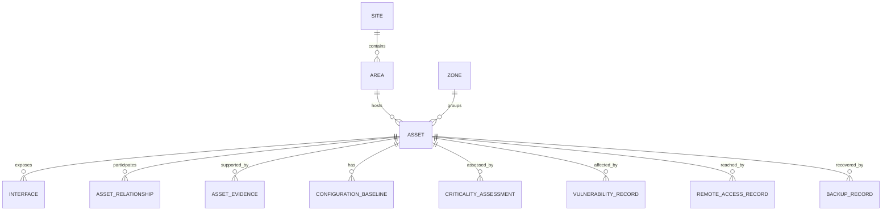
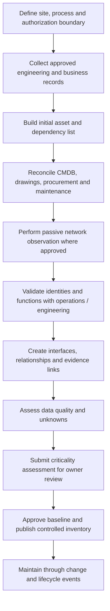
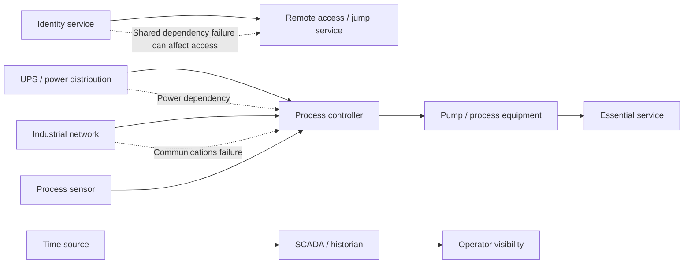

# OT Asset Inventory, Dependency Mapping and Criticality Engineering Playbook

## 1. Objective and relationship to other repository guides

Establish a reliable, maintained view of the assets and dependencies required to operate, monitor, protect and recover industrial processes. The inventory is a controlled engineering record, not merely a list of IP addresses or devices observed on a network.

This playbook defines the inventory data model, collection and reconciliation workflow, dependency relationships, criticality assessment method, data quality controls and lifecycle governance.

Use it with:
- [Industrial Asset Technical Reference](INDUSTRIAL-ASSET-TECHNICAL-REFERENCE.md) for asset-family functions, technical context and asset-specific review questions.
- [OT Reference Architecture, Zones and Conduits](../02-Industrial-Architecture/REFERENCE-ARCHITECTURE-AND-ZONES.md) for zones, conduits, communication flows and architecture decisions.
- [OT Security Templates and Professional Deliverables](../18-Templates-and-Reference-Materials/OT-SECURITY-TEMPLATES-AND-PROFESSIONAL-DELIVERABLES-PLAYBOOK.md) for reusable register fields, risk worksheets and evidence records.
- [Industry-Specific OT Security Engineering Playbook](../07-Industry-and-Use-Cases/INDUSTRY-SPECIFIC-OT-SECURITY-ENGINEERING-PLAYBOOK.md) and sector handbooks for process-specific context.

Do not duplicate technical asset descriptions in the inventory. Link to the technical reference and record the actual asset identity, site role, dependencies, evidence and accountable owner.

## 2. Core principles

1. **Process-first:** identify the process function before assigning security priority.
2. **One managed identity:** assign one stable Asset_ID to each uniquely managed asset. Model interfaces and relationships separately.
3. **Evidence-based:** distinguish verified facts, inferred attributes and unknown values.
4. **Consequence-led:** assess what loss, compromise or misoperation could do to people, the environment, production, essential services and recovery.
5. **Safety authority:** only qualified process and functional-safety authorities determine safety relationships and safety consequences.
6. **Relationship-aware:** include dependencies, communication peers, common services and failure propagation.
7. **Lifecycle maintained:** update the inventory after commissioning, maintenance, change, incident, replacement and decommissioning.
8. **Protected information:** facility-specific inventories and topology are sensitive operational information. This public repository uses generic fields and synthetic examples only.

## 3. Scope and asset taxonomy

Include assets that monitor, control, protect, communicate with, support or recover industrial processes. The inventory boundary should include both direct process-control assets and supporting infrastructure whose loss could affect operations.

| Asset family | Examples | Inventory considerations |
|---|---|---|
| Field instrumentation | Pressure, temperature, flow, level, vibration, gas and quality analyzers | Tag, process variable, range, calibration owner, process function |
| Final control elements | Valves, actuators, dampers, motor starters, drives | Controlled equipment, local/remote mode, feedback and interlocks |
| Basic control | PLC, PAC, RTU, remote I/O, embedded controller | Program revision, firmware, controller role, I/O and process area |
| Distributed control | DCS controllers, operator stations, application servers | System instance, redundancy, control domain and support lifecycle |
| Supervisory control | SCADA servers, front-end processors, telemetry gateways | Remote sites, communication paths, polling and failover |
| Operator interface | HMI panels, operator workstations, alarm servers | Operator role, display/control function and alarm dependencies |
| Safety and protection | SIS controllers, safety I/O, fire and gas, protection relays, emergency systems | Safety authority, safety function reference, validation evidence and access restrictions |
| Engineering | Engineering workstations, programming laptops, configuration tools | Programming capability, project baseline, authorized users and backup |
| Industrial networking | Switches, routers, firewalls, serial gateways, wireless controllers, time sources | Interfaces, paths, firmware, management plane and zone membership |
| OT compute and storage | Virtualization hosts, servers, storage, historians, backup infrastructure | Hosted workloads, dependencies, recovery and administrative access |
| Identity and remote access | Directory services, jump hosts, VPN, remote access gateways, MFA services | Authentication dependencies, privileged roles, external paths |
| Industrial data integration | IIoT gateways, edge platforms, brokers, cloud connectors, MES interfaces | Data direction, command capability, external trust and owner |
| Facility and utility support | UPS, generators, power management, HVAC, cooling and environmental monitoring | Utility dependencies, redundancy, facility impact |
| Supplier and managed infrastructure | OEM appliances, managed gateways, support portals, service endpoints | Contract owner, remote access, support lifecycle and shared dependencies |

### 3.1 Include non-IP and difficult-to-discover assets

Do not exclude assets because they lack an IP address, cannot be queried, are serial-connected, are embedded in packaged equipment, or are absent from endpoint management. Use engineering drawings, equipment registers, control narratives, maintenance records, procurement data, vendor documentation, field walkdowns and operator confirmation.

Unknown or unverified assets must be recorded as reconciliation items with an owner and target date. Do not silently omit them.

## 4. Inventory data model

Use linked logical registers rather than forcing every attribute into one oversized spreadsheet. A relational model reduces duplicate records and preserves stable identity.

The model is conceptual. Implementations may use a CMDB, asset management platform, GRC system, database or controlled spreadsheet pack.

### 4.1 Site and process-area register

| Field | Required | Description |
|---|---|---|
| Site_ID | Yes | Stable site or facility identifier |
| Site_Name | Yes | Approved facility name; protect sensitive names |
| Organization_ID | Yes | Owning organization or business unit |
| Sector | Yes | Water, power, manufacturing, mining, oil/gas, transport, etc. |
| Country_Jurisdiction | Yes | Applicable country and regulator context |
| Area_ID | Yes | Stable process-area identifier |
| Parent_Area_ID | Conditional | Parent area for nested process hierarchy |
| Process_Name | Yes | Process or service function |
| Process_Owner | Yes | Accountable operational owner |
| Operating_Mode | Yes | Normal, startup, shutdown, maintenance, emergency, standby or other |
| Critical_Service | Yes | Service supported and consequence context |
| Record_Status | Yes | Active, planned, retired or under reconciliation |

Avoid using exact coordinates, detailed layouts or facility-sensitive identifiers in public or broadly accessible registers.

### 4.2 Core asset register

One row per uniquely managed asset. Use a stable Asset_ID that does not change when an IP address, hostname, rack position or owner changes.

| Field | Required | Description |
|---|---|---|
| Asset_ID | Yes | Unique immutable register key |
| Site_ID / Area_ID | Yes | Physical and process context |
| Asset_Name | Yes | Approved operational name |
| Asset_Type | Yes | PLC, RTU, HMI, SCADA server, DCS node, IED, sensor, gateway, firewall, etc. |
| Asset_Subtype | Recommended | More precise type, e.g. safety PLC, front-end processor, VFD |
| Function | Yes | What the asset does in the process |
| Process_Tag | Conditional | Approved instrument/equipment tag |
| Manufacturer | Recommended | Verified OEM |
| Model | Recommended | Exact product model |
| Hardware_Revision | If known | Verified hardware revision |
| Firmware_Version | If known | Verified firmware |
| OS_and_Version | Conditional | Operating system and build |
| Application_or_Project_Version | Conditional | Control project or application release |
| Serial_or_Equipment_ID | Controlled | Protect serial numbers and sensitive equipment identifiers |
| Zone_ID | Recommended | Approved security zone |
| Owner | Yes | Accountable asset owner |
| Operator | Recommended | Operational role/team |
| Support_Owner | Recommended | Internal team or supplier |
| Lifecycle_Status | Yes | Planned, supported, end-of-support, obsolete, spare, retired, unknown |
| Safety_Relationship | Yes | Safety-related, SIS, protection, safety dependency, none confirmed, unknown |
| Process_Criticality | After assessment | Approved rating, methodology version and rationale |
| Exposure_Status | Recommended | Internal only, controlled remote, external path, unknown |
| Backup_Status | Recommended | Verified, not verified, not applicable, unknown |
| Last_Verified | Yes | Date and verification method |
| Record_Confidence | Yes | High, medium, low or unknown |
| Record_Status | Yes | Draft, verified, disputed, retired or reconciliation required |

**Do not treat blank as zero or not applicable.** Use explicit values such as Unknown, Not Verified, Not Applicable or Pending Confirmation.

### 4.3 Interface register

One asset can have multiple physical and logical interfaces. Do not create duplicate asset identities for each NIC, serial port or protocol interface.

| Field | Description |
|---|---|
| Interface_ID | Stable unique interface identifier |
| Asset_ID | Parent asset |
| Interface_Name | Approved interface label |
| Interface_Type | Ethernet, serial, wireless, fieldbus, USB, console or other |
| Addressing | IP, MAC, serial address or controlled reference |
| Network_Segment | Approved network or segment reference |
| Protocols | Verified protocol/service list |
| Direction_Capability | Receive, transmit, bidirectional, management-only or unknown |
| Connected_Peer | Linked Asset_ID where known |
| Purpose | Operational reason for the interface |
| Exposure | Internal, remote, external, disabled, unknown |
| Evidence_Ref | Approved evidence pointer |
| Last_Validated | Date and method |

### 4.4 Relationship and dependency register

A dependency is not always a network connection. Capture physical, process, power, identity, time, communications, software, vendor and recovery relationships.

| Field | Description |
|---|---|
| Relationship_ID | Stable unique record |
| Source_Asset_ID | Asset that depends on or relates to another |
| Target_Asset_ID_or_Service | Depended-on asset or service |
| Relationship_Type | Controls, monitors, supplies power, authenticates, synchronizes time, transports data, hosts, backs up, supports, protects or other |
| Direction | Dependency direction |
| Required_Mode | Normal, startup, shutdown, emergency, maintenance or standby |
| Failure_Consequence | What happens if dependency is unavailable or compromised |
| Redundancy | None, partial, diverse, active/standby, unknown |
| Common_Cause | Shared power, network, identity, vendor, location or management plane |
| Recovery_Reference | Approved fallback or recovery procedure |
| Owner | Accountable owner |
| Evidence_Ref | Drawing, test, vendor or operator evidence |
| Confidence | High, medium, low or unknown |

### 4.5 Evidence and provenance register

| Field | Description |
|---|---|
| Evidence_ID | Unique identifier |
| Asset_ID | Related asset |
| Evidence_Type | Engineering drawing, CMDB, passive observation, configuration export, vendor record, walkdown, interview, maintenance record |
| Source_Reference | Controlled pointer, not public raw data |
| Collection_Date | When collected |
| Collector | Responsible person/team |
| Method | How the information was obtained |
| Scope | Assets/fields supported |
| Integrity | Hash or controlled repository reference where appropriate |
| Confidence | High, medium, low or unknown |
| Limitation | What the evidence does not prove |
| Review_Status | Accepted, disputed, expired or pending |

## 5. Asset discovery and reconciliation workflow

### 5.1 Preferred evidence sources

Use multiple sources because no single discovery method sees every asset.

| Source | Strength | Limitation |
|---|---|---|
| P&IDs, control narratives and electrical drawings | Process role and physical relationship | May be outdated or omit network details |
| PLC/DCS/SCADA project records | Controller identity and engineering configuration | May not include all connected or third-party devices |
| CMDB and asset management | Ownership and lifecycle | Often IT-centric; OT completeness varies |
| Procurement and maintenance records | OEM, model, serial and support | Does not prove current installation or network presence |
| Switch/firewall configuration | Configured paths and network endpoints | Does not prove actual use or process purpose |
| Passive network monitoring | Observed communications and protocol behavior | Quiet, serial, offline or rarely used assets may be missed |
| Vendor tools and configuration exports | Product-specific attributes | Must be supported and approved for the target |
| Site walkdown and operator interview | Physical confirmation and operational context | Human error, access restrictions and incomplete coverage |

### 5.2 Active discovery safety gate

Active discovery can affect fragile devices, deterministic communications and production networks. Before any active query or scan, require:
- Written asset-owner authorization and explicit scope.
- Control engineering and operations approval.
- Vendor compatibility guidance where relevant.
- Documented method, rate limits, test window and stop conditions.
- Confirmed rollback and incident escalation path.
- Exclusion of safety-critical or fragile systems unless separately approved.

Never assume ping, port scanning, protocol enumeration, authentication testing or inventory agents are harmless. Prefer passive observation and records-based reconciliation when safe and sufficient.

## 6. Criticality: distinguish process importance from cyber risk

Criticality describes the consequence significance of an asset or service to the process. Cyber risk additionally considers threats, exposure, vulnerabilities, likelihood, safeguards and uncertainty. A high-criticality asset is not automatically vulnerable; a low-criticality asset can still be a pivot into a critical zone.

Maintain separate fields:
- **Process criticality:** consequence if the asset fails, is unavailable, or performs incorrectly.
- **Cyber exposure:** reachable paths, trust relationships, remote access and attack surface.
- **Vulnerability status:** verified product/version weaknesses and configuration conditions.
- **Cyber risk:** likelihood and consequence under the organization's approved risk method.
- **Recovery priority:** sequence and time needed to restore the process safely.

Do not combine these into one unexplained score.

## 7. Consequence assessment dimensions

Assess credible consequences in the actual process and operating mode. Use the site's approved scoring definitions. The following dimensions are a suggested worksheet, not universal regulatory criteria.

| Dimension | Questions to assess |
|---|---|
| Personnel safety | Could failure or compromise contribute to injury, hazardous exposure, unsafe movement or loss of safety-related information? |
| Environmental impact | Could it contribute to release, spill, emissions, contamination, flooding or permit exceedance? |
| Essential service | Could it interrupt water, energy, transport, healthcare support or another essential service? |
| Production and operations | Could it stop or degrade a process, reduce throughput or remove operator visibility/control? |
| Product quality | Could it affect recipe, batch, measurement, traceability or product disposition? |
| Equipment and physical damage | Could it damage machinery, infrastructure, tooling or process equipment? |
| Regulatory and contractual | Could it create reportable events, permit breach, contractual failure or legal exposure? |
| Public and customer impact | Could it affect customers, public confidence, downstream operators or dependent services? |
| Recovery complexity | Is restoration dependent on specialist skills, vendor tools, long-lead spares or constrained outage windows? |
| Dependency concentration | Does it support multiple process units or create a common point of failure? |

### 7.1 Example consequence scale

Use a 1-to-5 scale only after the organization defines sector- and site-specific descriptions.

| Rating | Illustrative meaning | Example interpretation |
|---:|---|---|
| 1 | Low | Localized inconvenience; no material process effect; routine recovery |
| 2 | Moderate | Limited disruption; local team can recover within normal operating arrangements |
| 3 | Significant | Major production/service impact or specialist recovery needed |
| 4 | Severe | Extended outage, substantial environmental/equipment consequence, or safety-relevant scenario requiring formal authority review |
| 5 | Critical | Potential catastrophic, widespread or essential-service consequence requiring highest governance priority |

A score of 5 in personnel safety or environmental consequence must not be averaged down by low scores in other dimensions. Preserve the individual dimension scores and escalation flags.

### 7.2 Safety and environmental escalation gates

The following conditions require specialist review regardless of any numeric average:
- An asset performs or supports a safety instrumented function, protection function, emergency shutdown, fire and gas, emergency communication or another engineered safety function.
- Loss or manipulation could affect hazardous process conditions, personnel evacuation, train/vehicle movement, electrical protection or other safety-critical operation.
- The asset supports environmental monitoring, containment or control where failure could result in material release or permit exceedance.
- The assessment lacks sufficient process information to rule out a credible severe consequence.

The inventory team must not assign or infer SIL, safety integrity, protection class or independence. Record the safety relationship as unknown until the responsible authority confirms it.

## 8. Suggested criticality decision method

This is a transparent screening method for prioritizing inventory review. It is not a replacement for a site's formal risk, process hazard, functional safety or business impact methodology.

1. Score each consequence dimension from 1 to 5 using approved site definitions.
2. Record evidence and a credible scenario for every score above 1.
3. Preserve the highest individual consequence score as the **Base_Consequence_Rating**. Do not average dimensions.
4. Apply the safety/environmental escalation gates.
5. Assess dependency reach: local asset, process unit, multiple units, site-wide or multi-site.
6. Assess recovery complexity and availability of tested workarounds/spares.
7. Propose a process criticality band using the site's approved mapping.
8. Obtain asset owner, process owner and relevant safety/environmental authority approval.
9. Record methodology version, rationale, assumptions, date and reassessment trigger.

### 8.1 Illustrative criticality bands

| Band | Example interpretation | Governance expectation |
|---|---|---|
| C1 — Critical | Credible catastrophic/safety/environmental or essential-service consequence; or a common dependency whose loss could cause such consequence | Highest review priority; named accountable owner; approved safeguards and recovery evidence |
| C2 — High | Severe impact to a major process, site service or multiple operating areas | Formal owner review, documented controls and recovery plan |
| C3 — Medium | Significant but bounded process or production impact | Managed controls, assigned remediation and periodic review |
| C4 — Low | Localized impact with established workaround and routine recovery | Maintain inventory and baseline controls |
| C5 — Support / contextual | No direct process consequence established; supporting asset with bounded impact | Validate dependencies before retaining low classification |

These bands are illustrative. A site may use different labels, thresholds and mandatory categories. Do not map them automatically to IEC 62443 Security Levels, SIL, NERC impact ratings, CVSS or enterprise financial classifications.

### 8.2 Example assessment worksheet

| Asset_ID | Function | Safety | Environment | Service | Production | Recovery | Dependency reach | Proposed band | Rationale / reviewer |
|---|---|---:|---:|---:|---:|---:|---|---|---|
| SYN-PLC-001 | Controls a synthetic critical pumping process | 2 | 4 | 5 | 4 | 3 | Multiple process areas | C1 | Loss can interrupt essential service; process owner review required |
| SYN-HMI-002 | Local operator visualization for one non-critical utility skid | 1 | 1 | 1 | 2 | 1 | Local skid | C4 | Local controls remain available; operator confirmation recorded |
| SYN-GW-003 | Shared time/communications gateway for several control areas | 2 | 2 | 4 | 4 | 4 | Site-wide dependency | C2 | Common dependency; confirm redundancy and failover |

All examples are synthetic and do not describe a real facility. Ratings are illustrative, not operational recommendations.

## 9. Dependency analysis and failure propagation

For each high-criticality asset, ask:
- What upstream services does it require?
- Which process assets depend on it?
- Does it share power, network, identity, time, DNS, virtualization, storage or remote access with other assets?
- What happens during loss of communications, stale telemetry or degraded mode?
- Is redundancy genuinely independent or does it share a common management plane, carrier, power source, supplier or credential?
- Can local operation continue safely?
- What is the approved recovery sequence and who authorizes it?

This diagram illustrates relationship types, not a universal dependency chain. A dependency graph must be validated against actual site architecture and operating procedures.

## 10. Data quality, confidence and unknowns

Use a consistent confidence model.

| Confidence | Criteria | Example |
|---|---|---|
| High | Directly verified by current approved configuration, field validation or reliable primary evidence | Current controller model and firmware confirmed by approved engineering record |
| Medium | Supported by credible secondary source but not independently confirmed | CMDB record matches recent maintenance documentation |
| Low | Inferred, stale, conflicting or based on incomplete observation | Device role inferred from hostname or observed protocol only |
| Unknown | No reliable evidence | Unidentified passive network endpoint |

Confidence describes evidence quality, not asset importance. A critical asset with low confidence should receive urgent validation priority.

Maintain a reconciliation queue with:
- Unknown asset or attribute.
- Why the gap matters.
- Evidence sources checked.
- Responsible owner.
- Validation method.
- Target date.
- Status and closure evidence.

## 11. Lifecycle governance and update triggers

| Trigger | Required inventory action | Evidence |
|---|---|---|
| Project design / procurement | Create planned asset and supplier records | Design, purchase and security review |
| FAT / SAT / commissioning | Confirm identity, configuration, interfaces and owner | Test and handover pack |
| Network or control change | Update interfaces, zones, flows and relationships | Approved MOC and as-built records |
| Firmware / software change | Update versions, support and vulnerability applicability | Change record and configuration evidence |
| Vendor access change | Update support party, path, account and approval | Remote access record |
| Incident | Revalidate affected assets, dependencies and configuration | Incident timeline and forensic evidence |
| Backup / restore exercise | Update recovery status and test date | Restore evidence and approval |
| Replacement / migration | Link old and new identities; update dependencies and baselines | Migration and acceptance record |
| Decommissioning | Remove access, revoke credentials, archive evidence and update diagrams | Disposal and decommission record |
| Periodic review | Reconcile records and reapprove criticality | Review record and owner sign-off |

Suggested review cadence must be set by the asset owner based on criticality, change rate, regulatory duties and operational risk. A fixed annual review is not sufficient when major changes or incidents occur.

## 12. Governance roles and approval

| Role | Responsibility |
|---|---|
| Asset owner | Accountable for asset identity, ownership, lifecycle and inventory accuracy |
| Process owner | Confirms process function, operating consequence and service impact |
| Control/automation engineer | Validates controller role, configuration, interfaces and dependencies |
| Functional safety authority | Determines safety relationship and approves safety-related interpretation |
| OT network architect | Validates interfaces, zones, conduits and communication relationships |
| Cybersecurity team | Maintains security attributes, exposure, vulnerability and monitoring links |
| Maintenance / OEM | Confirms supported versions, spares, vendor constraints and recovery requirements |
| Risk owner | Accepts residual risk under formal governance |
| Data steward | Maintains data dictionary, quality rules, access and audit trail |

No single cybersecurity analyst should independently approve safety criticality, process consequence or live operational changes.

## 13. Inventory quality gates

Before an inventory baseline is approved, confirm:
- [ ] Scope, sites, areas and operating modes are defined.
- [ ] Asset IDs are unique and stable.
- [ ] Assets include non-IP and supporting infrastructure where relevant.
- [ ] Asset type and process function are validated or explicitly unknown.
- [ ] Owners and support parties are assigned.
- [ ] Interfaces and communication relationships are linked rather than duplicated.
- [ ] Zones and conduits reference the approved architecture.
- [ ] Dependencies and common points of failure are captured for critical assets.
- [ ] Safety relationship is confirmed by the responsible authority or marked unknown.
- [ ] Criticality methodology and version are recorded.
- [ ] Each criticality rating has rationale and evidence.
- [ ] Evidence source, confidence and last-verified date are present.
- [ ] Sensitive data is stored in an approved restricted repository.
- [ ] Unknowns have owners and due dates.
- [ ] Lifecycle and reassessment triggers are defined.

## 14. Metrics and management reporting

| Metric | Definition | What it indicates |
|---|---|---|
| Inventory coverage | Validated in-scope assets / estimated in-scope assets | Completeness, subject to a defensible denominator |
| Identity completeness | Assets with stable ID, type, function and owner / total assets | Core record quality |
| Criticality coverage | Assets with approved criticality / assets requiring assessment | Risk governance coverage |
| Evidence confidence | Assets with high/medium confidence / total assets | Reliability of inventory claims |
| Unknown asset backlog | Unresolved unknown assets by age and process area | Discovery and governance debt |
| Dependency coverage | Critical assets with validated dependency records / critical assets | Resilience visibility |
| Lifecycle visibility | Assets with verified support status / total assets | Exposure to unsupported products |
| Review timeliness | Records reviewed within owner-defined cadence / records due | Maintenance discipline |
| Reconciliation closure | Unknown/disputed records closed with evidence / records due | Data stewardship effectiveness |

Do not reward a high inventory count if records are duplicated, stale or unsupported by evidence. Report the denominator, scope and confidence alongside every percentage.

## 15. Security, privacy and handling

A detailed OT inventory can reveal facility layout, process dependencies, controller types, firmware, network addressing, remote access paths, safety relationships and single points of failure. Treat it as sensitive operational information.

- Store production inventories in an access-controlled system approved by the asset owner.
- Limit access by role and operational need.
- Encrypt transfer and storage according to organizational classification.
- Keep detailed network maps, credentials, serials, IPs and remote access details out of public repositories.
- Publish only generic schemas and synthetic examples.
- Maintain audit history for changes to criticality, ownership, exposure and safety relationship.
- Define retention, backup, export and secure disposal requirements.

## 16. Standards and technical alignment

This playbook supports engineering activities that may contribute to:
- ISA/IEC 62443 asset owner security programs, risk assessment, zones and conduits, and system requirements.
- NIST SP 800-82 Rev. 3 OT asset management, architecture, risk management and security guidance.
- NIST Cybersecurity Framework asset management and risk governance outcomes.
- Sector-specific regulator and essential-service inventory requirements.

This document does not reproduce licensed normative text and does not claim that completing the register proves compliance. Use the applicable current edition, scope, regulator interpretation and site-specific control mapping.

## 17. Document control

| Version | Date | Change |
|---|---|---|
| 1.0 | 2026-11-17 | Initial OT asset inventory and criticality overview |
| 1.1 | 2026-11-27 | Expanded relational data model, asset taxonomy, discovery workflow, evidence confidence, dependency analysis, consequence assessment, governance, lifecycle triggers, quality gates and metrics |

**Limitations:** This is a public engineering reference, not a site-specific asset inventory, process hazard analysis, safety assessment, risk acceptance, regulatory compliance determination or authorization to discover or modify live OT assets. Validate all site-specific records and decisions with the asset owner, operations, control engineering and responsible safety authorities.
