# Industrial Protocols and Network Security Engineering
## Protocol architecture, message flows, security controls, assessment and migration playbook

**Document ID:** UOTS-04-PROTOCOLS | **Version:** 2.0 | **Status:** Draft — protocol and vendor validation required

**Audience:** OT security architects, control and automation engineers, industrial network engineers, OT SOC analysts, system integrators, assessors, utilities, energy operators, manufacturers, building automation teams, and IIoT platform owners.

> **Safety and engineering notice:** This guide is a defensive engineering reference. It is not a protocol implementation specification, vendor configuration manual, production firewall rule set, or authorization to scan or test live equipment. Protocol capabilities vary by edition, profile, product, firmware, license, topology, and configuration. Confirm all details against the applicable standard, vendor documentation, asset owner, and site engineering authority. Never issue write commands, fuzz, replay, scan aggressively, or alter network behavior on a production control system without explicit authorization and a reviewed safety and operational test plan.

---

# 1. Executive purpose

Industrial protocols are the communication languages used by controllers, field devices, supervisory applications, protection systems, engineering tools, and enterprise integration services. They carry process measurements, status, alarms, control requests, configuration, diagnostics, time, and engineering data.

A protocol name alone does not tell an assessor whether a deployment is secure. Security depends on the protocol edition and profile, enabled features, device implementation, endpoint identity, network architecture, key and certificate lifecycle, operational constraints, and compensating controls.

The central engineering principle is:

**Identify the exact communication requirement, understand the protocol trust model, map the endpoints and data flows, select the appropriate security profile, and validate the complete system without endangering the process.**

## 1.1 Learning outcomes

Readers should be able to:
- Classify industrial protocols by function, media, transport, topology, and operational criticality.
- Distinguish process data, supervisory commands, engineering, diagnostics, discovery, and management traffic.
- Explain protocol security properties and limitations.
- Identify protocol-specific trust assumptions and common deployment weaknesses.
- Map protocols to zones, conduits, assets, and industry use cases.
- Design secure migration and compensating-control roadmaps.
- Review packet captures and configuration evidence using approved passive methods.
- Build protocol inventories, communication matrices, and assessment evidence.
- Map protocol security to relevant standards, threat techniques, and governance obligations.

## 1.2 Protocol security is a system property

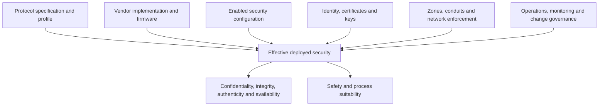

A protocol may define security capabilities that are absent, unsupported, disabled, incorrectly configured, or not interoperable in a particular deployment. Conversely, a legacy protocol without native cryptographic protection may be managed through tightly scoped architecture and compensating controls while a safe migration is planned.

---

# 2. Industrial protocol taxonomy

## 2.1 Protocol families

| Protocol / family | Common use | Typical environment | Key review focus |
|---|---|---|---|
| Modbus RTU / ASCII | Serial device data exchange | PLCs, meters, instruments | Serial line exposure, addressing, write operations, gateway |
| Modbus TCP | Ethernet-based register exchange | PLCs, drives, meters | Endpoint trust, write authorization, segmentation |
| Modbus Security | Secured Modbus communication profile | Supported Modbus TCP deployments | TLS, certificates, endpoint support and lifecycle |
| DNP3 / IEEE 1815 | Telemetry and supervisory control | Electric, water and utility systems | Secure Authentication, event integrity, command authorization |
| IEC 60870-5-101 | Serial telecontrol | Utility telemetry | Link security, gateway and physical access |
| IEC 60870-5-104 | Telecontrol over TCP/IP | Power and utility SCADA | Secure profile support, boundary protection, command governance |
| OPC Classic / DA / HDA / AE | Legacy interoperability | Windows-based control integration | DCOM exposure, identity, legacy dependencies |
| OPC UA | Secure industrial interoperability | OT data exchange, MES, IIoT | Application certificates, trust lists, policies, user identity |
| PROFINET | Real-time factory automation | PLC, drives, remote I/O | Real-time traffic, device identity, engineering access |
| PROFIBUS DP / PA | Fieldbus automation | Process and factory plants | Physical segment, master access, engineering tools |
| EtherNet/IP / CIP | Industrial control and I/O | PLC, drives, robotics | CIP services, identity, CIP Security support |
| CIP Security | Secured CIP communications | Supported EtherNet/IP deployments | Authentication, integrity, confidentiality, certificate lifecycle |
| IEC 61850 | Substation automation | Power generation, transmission, distribution | MMS, GOOSE, sampled values, IEC 62351 |
| HART / WirelessHART / HART-IP | Instrument configuration and data | Process plants | Field access, gateway, wireless and IP security |
| FOUNDATION Fieldbus | Distributed process instrumentation | Process industries | Segment design, host and device management |
| IO-Link | Sensor/actuator point-to-point integration | Factory automation | Master access, device parameters, engineering |
| BACnet | Building automation | HVAC, access and building systems | Device discovery, routing, BACnet/SC |
| MQTT | Publish/subscribe messaging | IIoT, edge, telemetry | Broker identity, TLS, topic ACLs, bridge trust |
| AMQP | Message-oriented middleware | Industrial integration | Broker authorization, TLS, routing and federation |
| DDS | Real-time data distribution | Robotics, autonomy, specialized control | Domain governance, discovery, DDS Security |
| S7 communication | Siemens automation ecosystems | PLC engineering and data access | Product-specific access protection and secure communication |
| Vendor-specific serial / proprietary protocols | Legacy and specialized devices | Many sectors | Document exact implementation and compensating controls |

This catalogue is not exhaustive. Add protocol families based on the actual asset inventory and observed communication requirements. A port number or packet signature alone does not conclusively identify a protocol or its security configuration.

## 2.2 Classify traffic by operational purpose

| Traffic category | Examples | Security questions |
|---|---|---|
| Process measurement | Analog values, status, counters | Is the source authentic? Is data freshness known? |
| Supervisory command | Start/stop, setpoint, mode | Who is authorized? Is command integrity protected? |
| Engineering | Program download, device configuration | Which named engineer and approved tool? |
| Diagnostics | Device health, alarms, fault data | Can diagnostic access modify configuration? |
| Discovery | Device identification, browsing | Is discovery restricted to appropriate zones? |
| Time synchronization | NTP, PTP, GNSS-derived time | Can time manipulation undermine event correlation or control? |
| Management | Firmware, account, network configuration | Is management separated and audited? |
| Data integration | Historian, MES, cloud broker | Is direction, purpose and data ownership explicit? |

---

# 3. Common protocol security properties

## 3.1 Security property matrix

| Property | Meaning | Engineering question |
|---|---|---|
| Authentication | Establishes identity of communicating party | How does each endpoint prove who it is? |
| Authorization | Limits permitted actions | Can a device read but not write? Are roles enforced? |
| Integrity | Detects unauthorized alteration | Can a message or configuration be modified undetected? |
| Confidentiality | Protects information from disclosure | Is sensitive traffic encrypted where required? |
| Replay protection | Prevents reuse of captured valid messages | Are freshness, sequence, challenge or time controls used? |
| Availability | Maintains required communication | What happens under congestion, loss, failover or attack? |
| Non-repudiation / accountability | Supports attribution and evidence | Are identities and actions logged reliably? |
| Key lifecycle | Manages cryptographic trust material | Who issues, stores, rotates, revokes and recovers keys? |
| Crypto agility | Supports change in cryptographic algorithms | Can the product transition when algorithms become unsuitable? |

No single property proves the entire protocol or deployment is secure. Evaluate endpoint, application, transport, network, operations, and physical context.

## 3.2 Trust boundary model

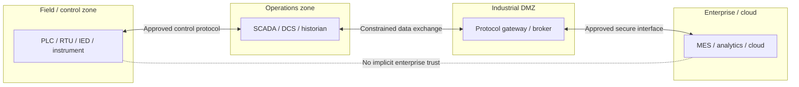

Gateways can translate, proxy, filter, or broker communications, but they can also become critical trust anchors and single points of failure. Document their function, supported protocol behavior, management path, availability design, and security owner.

---

# 4. Protocol analysis method

## 4.1 Ten-stage protocol review

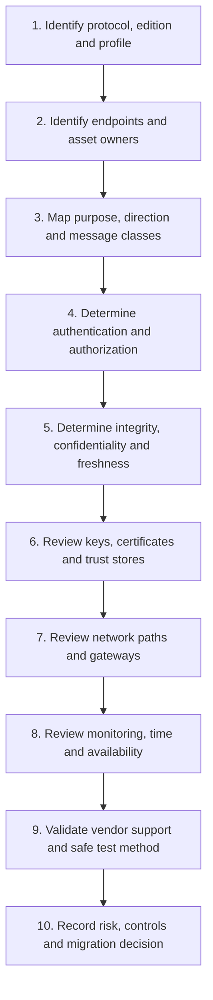

## 4.2 Evidence hierarchy

Prefer evidence in this order, while recording limitations:
1. Applicable protocol standard and normative profile.
2. Vendor product manual and security configuration guide for the exact model and firmware.
3. Approved engineering design and communication specification.
4. Approved configuration export and asset baseline.
5. Passive network observations with capture location and time context.
6. Interviews with asset owners and control engineers.
7. Inference from port, protocol fingerprint, or partial packet metadata.

Do not report an inferred protocol or feature as verified fact. Record confidence and evidence source.

## 4.3 Per-flow record

For each communication, capture:
- Flow ID and business/process purpose.
- Source and destination asset IDs.
- Source and destination zones.
- Initiator and responder.
- Protocol, edition, profile, transport, media, and vendor implementation.
- Message category: telemetry, command, engineering, diagnostics, discovery, management, or time.
- Read/write capability and authorized operations.
- Authentication and authorization model.
- Integrity, confidentiality, freshness, and replay protections.
- Certificate/key owner, renewal and revocation method where applicable.
- Frequency, timing, bandwidth, latency and availability requirements.
- Monitoring and log source.
- Change owner, approval and review date.
- Safety relevance, test restrictions and fallback behavior.

## 4.4 Protocol security decision

A protocol flow should be classified as:
- **Secure profile enabled and validated:** supported protections are enabled and evidence is available.
- **Secure profile supported but not enabled:** migration or configuration action required.
- **Secure profile unavailable on endpoint:** compensating controls and lifecycle roadmap required.
- **Legacy or proprietary implementation:** exact behavior must be documented and vendor support engaged.
- **Unknown / unverified:** do not assume secure or insecure; investigate safely.

---

# 5. Modbus RTU, ASCII, TCP and Modbus Security

## 5.1 Purpose and deployment

Modbus is used for exchanging data between industrial devices. Serial variants commonly operate over RS-232 or RS-485 physical links, while Modbus TCP operates over Ethernet/TCP. Common use cases include PLC register exchange, instrumentation, power meters, drives, remote I/O, and gateways.

## 5.2 Conceptual communication

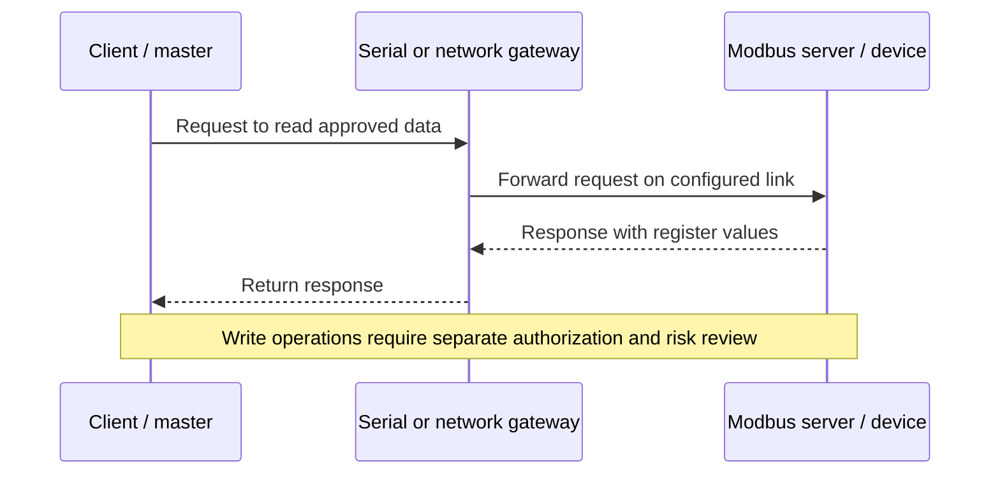

Terminology varies between protocol generations and implementation contexts. Confirm client/server or master/slave roles in the actual product documentation.

## 5.3 Security characteristics

Traditional Modbus variants do not inherently provide modern cryptographic endpoint authentication and confidentiality. A reachable device may accept requests according to its implementation and configured controls. Modbus Security defines a secured variant using TLS and X.509 certificates. Availability depends on both endpoints and the actual product implementation.

## 5.4 Main risks

- Unauthorized register reads or writes.
- Weak network reachability controls.
- Unauthenticated commands on legacy deployments.
- Unmanaged serial-to-Ethernet gateways.
- Incorrect register mapping or scaling.
- Engineering access not separated from process data.
- Uncontrolled broadcast or unit addressing behavior.
- Lack of command attribution and monitoring.

## 5.5 Defensive controls

- Restrict communications to approved clients, servers, and gateways.
- Separate field/control segments from enterprise networks.
- Prefer supported Modbus Security deployments where compatible.
- Govern write-capable paths separately from read-only data collection.
- Protect serial cabinets, converters, and physical access.
- Monitor unexpected function categories, new peers, and abnormal write patterns using passive methods.
- Maintain approved register maps and configuration baselines.
- Document unsupported endpoints and compensating controls.

## 5.6 Safe assessment evidence

Review approved network diagrams, gateway configuration, register maps, asset firmware, access records, firewall policy, vendor security guidance, and passive packet captures. Do not issue write function requests, scan devices, or fuzz a live segment as an informal test.

## 5.7 Industry mapping

| Sector | Example use |
|---|---|
| Oil and gas | PLC, meters, skid packages, utility systems |
| Water and wastewater | Pump stations, telemetry and treatment equipment |
| Power | Metering, auxiliary control and gateway integration |
| Manufacturing | Drives, machine controllers and instrumentation |
| Mining | Conveyors, pumps, process equipment |
| Buildings | Metering and plant-room equipment |

---

# 6. DNP3 / IEEE 1815

## 6.1 Purpose

DNP3 is used for communication between control centres, outstations, RTUs, IEDs, and related utility automation systems. It supports telemetry, events, status, and supervisory control. It is common in electric utilities, water, wastewater, and geographically distributed infrastructure.

## 6.2 Conceptual architecture

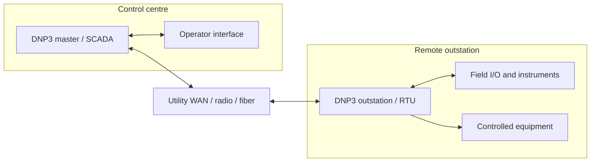

## 6.3 Security topics

- Master and outstation identity.
- Critical command authorization.
- Secure Authentication profile and version support.
- Sequence, challenge, and replay-related protection.
- Key provisioning, rotation, and recovery.
- Event integrity and time synchronization.
- Serial versus TCP/IP transport differences.
- Legacy device interoperability and gateway behavior.

DNP3 Secure Authentication is not synonymous with encrypting every byte of the transport. Evaluate the applicable IEEE 1815 edition, secure authentication version, device capabilities, and any additional transport protection separately.

## 6.4 Defensive controls

- Use supported DNP3 Secure Authentication profiles for applicable critical operations.
- Restrict master/outstation relationships and network paths.
- Protect key material and document key custody.
- Monitor command and configuration activity.
- Validate time source integrity and event sequence handling.
- Govern unsolicited responses and event reporting according to the approved design.
- Protect serial infrastructure and remote site physical access.
- Define a staged migration plan for endpoints that cannot support secure features.

## 6.5 Utility use cases

Power distribution, substation telemetry, water distribution, wastewater pumping, remote energy sites, and other distributed infrastructure.

---

# 7. IEC 60870-5-101 and IEC 60870-5-104

## 7.1 Purpose

IEC 60870-5-101 supports telecontrol over serial communication, while IEC 60870-5-104 adapts telecontrol application services for TCP/IP networks. They are used in utility control systems for telemetry and supervisory commands.

## 7.2 Architecture

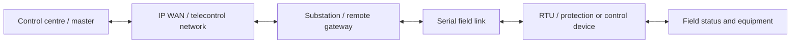

## 7.3 Security and engineering focus

- Confirm exact edition, profile, and product support.
- Review IEC 62351 applicability and the implemented security profile.
- Restrict control-centre and outstation communication peers.
- Protect gateways and serial-to-IP transition points.
- Review command authorization and event integrity.
- Govern certificates, keys, and trust anchors where used.
- Monitor unexpected endpoint relationships and command classes.
- Account for latency, redundancy, and availability constraints.

IEC 62351 parts apply to different protocol families and layers. Do not assume that implementing one IEC 62351 part secures every IEC 60870-5-104 deployment.

---

# 8. OPC Classic and OPC UA

## 8.1 OPC Classic

OPC Classic technologies such as Data Access, Historical Data Access, and Alarms & Events commonly rely on Windows COM/DCOM infrastructure. Legacy deployments can be difficult to segment because of distributed object communication, dynamic port behavior, Windows identity dependencies, and older product support.

**Review focus:** exact OPC specification, Windows versions, DCOM hardening, service accounts, host firewall policy, dynamic endpoint behavior, server/client identity, vendor compatibility, and migration constraints.

## 8.2 OPC UA purpose

OPC Unified Architecture provides platform-independent industrial information exchange, information modeling, and client/server and publish/subscribe communication patterns. Security capabilities include application authentication, certificates, secure channels, message signing and encryption, and user authentication, depending on selected security policy and deployment.

## 8.3 OPC UA client/server flow

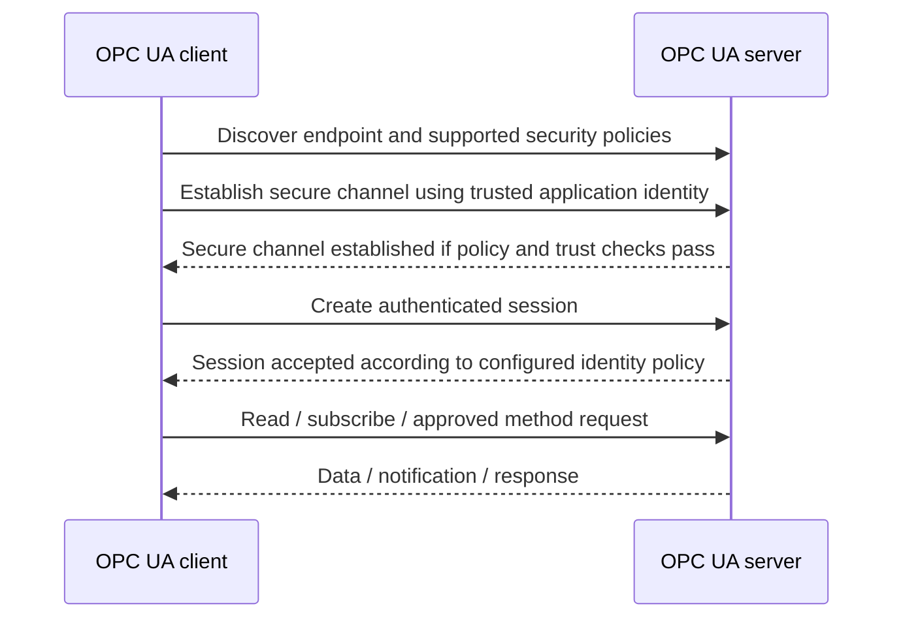

## 8.4 OPC UA security review

- Application instance certificates and private-key protection.
- Certificate trust lists, expiry, revocation and renewal.
- Security policy and message mode selection.
- User identity and role mapping.
- Endpoint exposure and network path.
- Anonymous access and insecure policy availability.
- Server method calls and write permissions.
- Audit events and time synchronization.
- Discovery services and gateway behavior.
- Certificate rollover and recovery procedure.

A secure channel does not automatically mean every user has appropriate authorization. Transport/application identity and user authorization must both be assessed.

## 8.5 OPC UA PubSub

OPC UA PubSub supports publisher/subscriber data distribution patterns. Review the selected transport mapping, message security mode, group key management, subscriber authorization, broker dependencies where applicable, multicast boundaries, and data freshness. Do not assume client/server certificate controls automatically secure PubSub.

## 8.6 Migration from OPC Classic

Plan for application compatibility, tag mapping, information model differences, latency, redundancy, client/server support, certificate operations, vendor licensing, test environment, and rollback. Avoid a big-bang migration where it could interrupt critical operations.

---

# 9. PROFINET and PROFIBUS

## 9.1 PROFINET

PROFINET is an industrial Ethernet communication technology used for automation, I/O, diagnostics, and real-time control. Deployments may include standard Ethernet/TCP/IP services and specialized real-time communication mechanisms.

### Conceptual topology

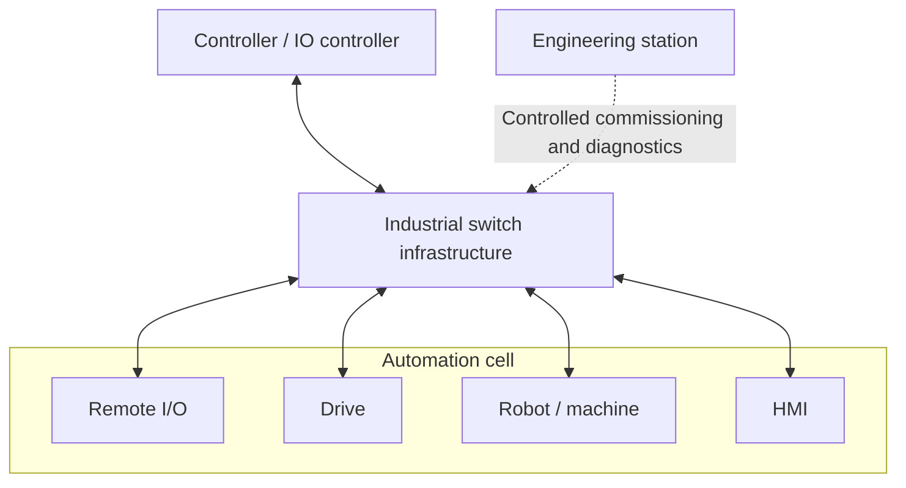

### Review focus

- Device identity and naming governance.
- Engineering and commissioning access.
- Network segmentation by cell and function.
- Real-time traffic and availability requirements.
- Discovery and device replacement procedures.
- Supported security classes and product-specific security capabilities.
- Firmware, configuration, and vendor lifecycle.
- Passive monitoring visibility and sensor placement.

Do not apply generic enterprise network changes to real-time automation without validating timing and device behavior.

## 9.2 PROFIBUS DP and PA

PROFIBUS is a fieldbus family used in factory and process automation. DP is commonly associated with decentralized peripherals; PA is designed for process automation instrumentation and related applications.

Review physical segment design, masters, slaves/devices, termination, repeaters, couplers, engineering access, device parameterization, physical access, and gateways. Security often depends substantially on physical protection, controlled engineering access, segment architecture, and gateway compensating controls.

---

# 10. EtherNet/IP, CIP and CIP Security

## 10.1 Purpose

EtherNet/IP uses the Common Industrial Protocol (CIP) over standard Ethernet and IP networks for industrial automation, control, I/O, and device integration. CIP services may support process data, explicit messaging, configuration, and diagnostics.

## 10.2 Conceptual architecture

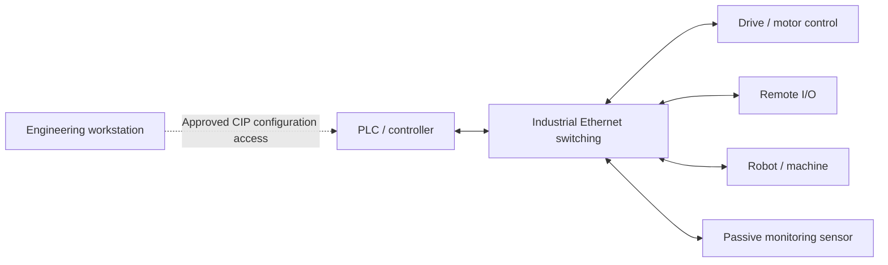

## 10.3 Security topics

- Device and application identity.
- CIP service authorization and write-capable paths.
- Explicit messaging versus I/O communication.
- Multicast and real-time traffic behavior.
- Engineering workstation privileges.
- Device firmware and product security capabilities.
- CIP Security support and compatibility.
- Certificate provisioning, trust and lifecycle.
- Network segmentation and monitoring.

CIP Security provides security mechanisms for supported CIP communications. Verify the device, communication path, product revision, configuration, and interoperability. Do not assume all EtherNet/IP traffic is automatically protected because some devices support CIP Security.

---

# 11. IEC 61850 and substation communications

## 11.1 Purpose

IEC 61850 defines communication and information models for power utility automation. It is used in substations and related power-system automation. Important communication profiles include MMS client/server communication, GOOSE peer-to-peer messaging, and Sampled Values.

## 11.2 Substation communication architecture

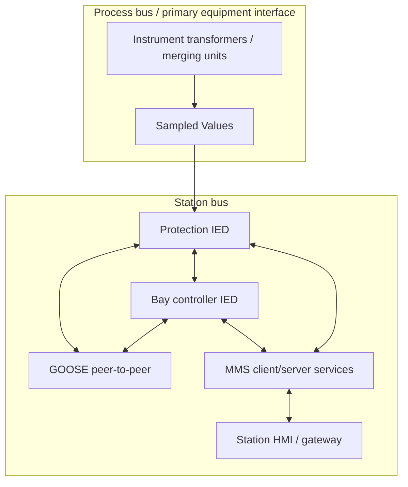

## 11.3 Communication types

| Profile | General purpose | Security and operational considerations |
|---|---|---|
| MMS | Client/server information exchange | Authentication, TLS/security profile applicability, access control, audit |
| GOOSE | Fast event/status exchange between IEDs | Peer trust, VLAN, multicast, message integrity and IEC 62351-6 applicability |
| Sampled Values | Streamed sampled measurement values | Source authenticity, integrity, timing, availability and IEC 62351 applicability |
| Engineering/configuration | Substation configuration and device management | SCL file integrity, privileged access, approvals and version control |

## 11.4 SCL engineering files

Substation Configuration Language (SCL) files describe system, IED, communication, and substation configuration information in defined formats. Treat SCL files as sensitive engineering artifacts. Govern their creation, review, signing or integrity validation where supported, versioning, storage, transfer, and deployment.

## 11.5 IEC 62351 mapping

IEC 62351 provides cybersecurity standards for selected power-system communication protocols and related operational security topics. Its parts address different protocol layers and functions, including TCP/IP profiles, MMS, IEC 60870-5 and derivatives, IEC 61850 peer-to-peer profiles, RBAC, key management, and security event logging. Determine applicability by protocol, profile, part, edition, product support, and project design.

---

# 12. HART, WirelessHART and HART-IP

## 12.1 HART

HART adds digital communication to instrumentation, commonly over a 4–20 mA analog loop. It supports device configuration, diagnostics, and process-related data exchange. Review handheld configurators, multiplexers, asset management systems, gateways, and engineering workstations.

## 12.2 WirelessHART

WirelessHART uses a managed wireless mesh for process instrumentation. Security review includes network manager, gateway, join process, device identity, key provisioning, key rotation, radio topology, time synchronization, physical exposure, and loss-of-link behavior.

## 12.3 HART-IP

HART-IP transports HART application information over IP networks. Review IP endpoint identity, gateway security, network segmentation, supported security functions, and vendor implementation.

## 12.4 Defensive controls

- Govern field maintenance tools and device configuration.
- Protect gateway and network manager access.
- Manage device identity and keys.
- Restrict access to instrument networks.
- Monitor configuration changes and device joins.
- Maintain physical and wireless site controls.
- Validate the impact of gateway or wireless failure.

---

# 13. FOUNDATION Fieldbus and IO-Link

## 13.1 FOUNDATION Fieldbus

FOUNDATION Fieldbus is a digital field communication technology used in process automation. Review segment architecture, host and linking devices, device function blocks, engineering tools, physical layer, device configuration, and vendor lifecycle.

Security controls may rely on segment isolation, physical protection, controlled host/engineering access, gateway architecture, and process-aware monitoring. Verify exact protocol and product capabilities rather than assuming IP security features apply.

## 13.2 IO-Link

IO-Link is a point-to-point communication technology between sensors/actuators and IO-Link masters. It supports device identification, parameters, diagnostics, and process data.

Review master configuration access, device replacement behavior, parameter server functions, engineering tool permissions, network path from master to controller, and unauthorized parameter changes. A secure Ethernet uplink does not automatically protect every downstream device-management operation.

---

# 14. BACnet and building automation

## 14.1 Purpose

BACnet is used in building automation and control systems, including HVAC, lighting, plant-room systems, and building integration. These environments may be connected to enterprise networks, facilities management platforms, cloud services, and physical security systems.

## 14.2 Architecture

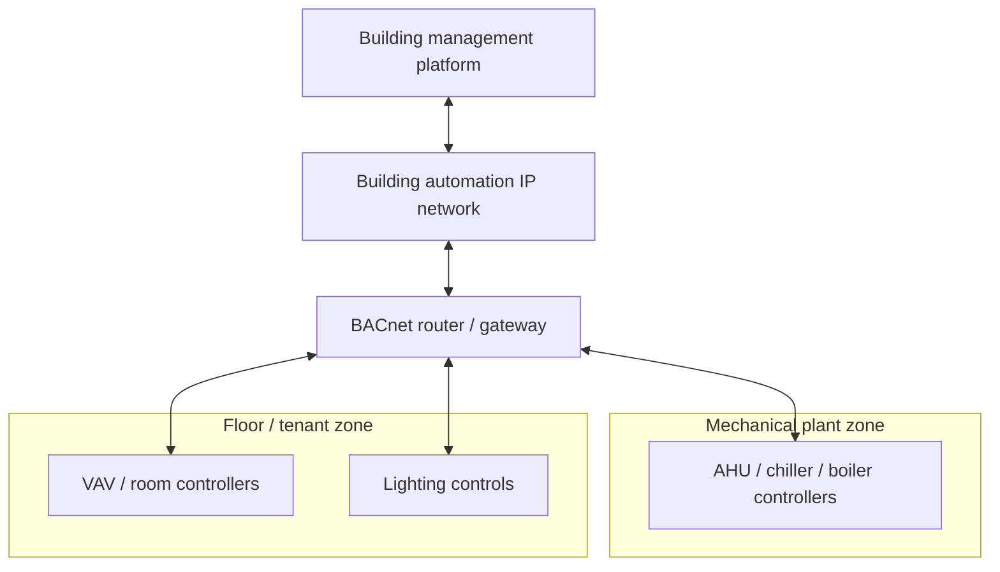

## 14.3 Security considerations

- Device discovery and broadcast scope.
- Unauthenticated or weakly governed write access.
- BACnet routing and BBMD configuration.
- Building vendor remote access.
- Integration with access control and physical security.
- BACnet Secure Connect support and configuration.
- Certificate and identity lifecycle for secure deployments.
- Separation of tenant, facilities, and enterprise systems.
- Physical access to controllers and panels.

## 14.4 BACnet Secure Connect

BACnet/SC provides a secure communication option based on WebSockets and TLS with certificate-based device identity. Confirm support and interoperability across all required devices, hubs, certificates, and operational tools. Legacy BACnet/IP devices may remain and require segmentation and compensating controls.

---

# 15. MQTT, AMQP, DDS and IIoT messaging

## 15.1 MQTT

MQTT is a lightweight publish/subscribe messaging protocol used for telemetry, edge integration, and IIoT. Devices publish messages to topics through brokers; subscribers receive messages according to broker policy.

### MQTT architecture

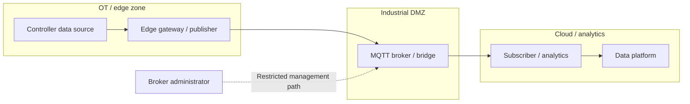

### MQTT security review

- TLS configuration and certificate validation.
- Unique client identities; no shared anonymous access.
- Topic-level publish and subscribe authorization.
- Broker listener exposure and management interface.
- Retained messages and session persistence.
- Quality of Service and duplicate/re-delivery implications.
- Last Will and Testament behavior.
- Bridge direction and trust across brokers.
- Credential and certificate rotation.
- Broker logs, client inventory, and topic governance.

MQTT QoS levels do not provide security or prove that a message is authentic. Security depends on transport, identity, authorization, broker configuration, and application-level validation.

## 15.2 AMQP

AMQP is a message-oriented middleware protocol used for reliable messaging and integration. Review broker identity, TLS, virtual hosts, exchanges, queues, routing keys, publisher/subscriber permissions, federation, management APIs, message durability, and audit. Ensure a broker bridge does not create an uncontrolled path between enterprise and control networks.

## 15.3 DDS

Data Distribution Service (DDS) supports data-centric publish/subscribe communication and is used in real-time and distributed systems. DDS Security capabilities and deployment profiles must be validated for the exact implementation. Review domain and participant identity, governance and permissions documents, discovery, cryptographic material, topic authorization, multicast behavior, and real-time constraints.

---

# 16. Vendor-specific and additional protocol families

## 16.1 Siemens S7 communication

S7 communication and related engineering services are associated with Siemens automation products. Security capabilities differ across product generations, firmware, engineering software, and communication modes.

Review exact controller family, firmware, protection level, secure communication capability, engineering workstation, project access, network exposure, and vendor hardening recommendations. Do not assume a single port or protocol label represents all S7 communication modes.

## 16.2 Additional protocols to include in site inventories

- IEC 60870-6 / TASE.2 / ICCP for control-centre interconnection.
- IEC 61968 / IEC 61970 Common Information Model integrations.
- DLMS/COSEM in metering environments.
- M-Bus in metering and building services.
- KNX in building automation.
- CANopen and DeviceNet in machinery and embedded automation.
- AS-i in field-level automation.
- Serial proprietary protocols and vendor-specific engineering channels.
- HTTP(S), REST APIs, WebSockets, SSH, RDP, SMB and database protocols used by supporting OT applications.

IT protocols used in OT must be included in the flow inventory; they do not become safe merely because they are not industrial protocols.

---

# 17. Protocol-to-industry use-case mapping

| Industry | Common protocols / families | Typical assets and flows | Key risk themes |
|---|---|---|---|
| Oil and gas upstream | Modbus, DNP3, OPC UA, HART, proprietary telemetry | RTUs, well pads, meters, compressors | Remote site access, telemetry integrity, vendor connectivity |
| Midstream pipelines | DNP3, Modbus, IEC 104, OPC UA | Pump stations, RTUs, SCADA, leak detection | Wide-area communications, command authenticity, remote access |
| Refining and petrochemicals | OPC UA, Modbus, PROFINET, HART, Fieldbus | DCS, PLC, SIS, instruments, historian | Safety boundaries, engineering access, legacy integration |
| LNG | DCS, Modbus, OPC UA, HART, vendor protocols | Process trains, utilities, package systems | Availability, safety, supplier access, redundancy |
| Power generation | Modbus, IEC 61850, DNP3, OPC UA | Turbine controls, protection, station automation | Protection integrity, control centre links, timing |
| Transmission and distribution | IEC 61850, DNP3, IEC 104, ICCP | IEDs, RTUs, substations, control centres | GOOSE/SV integrity, telecontrol, key management |
| Water and wastewater | Modbus, DNP3, OPC UA, MQTT | Pump stations, treatment PLCs, remote telemetry | Remote access, unauthorized writes, availability |
| Manufacturing | PROFINET, EtherNet/IP, PROFIBUS, OPC UA, IO-Link | PLCs, robots, drives, sensors, MES | Cell segmentation, engineering workstations, machine availability |
| Mining | Modbus, PROFINET, EtherNet/IP, DNP3 | Conveyors, crushers, pumps, remote operations | Safety, wireless/remote links, physical exposure |
| Rail and transport | IEC 61850 in power, industrial Ethernet, specialized signalling protocols | Traction power, station systems, signalling | Safety-critical assurance, strict change governance |
| Ports and logistics | OPC UA, Modbus, EtherNet/IP, MQTT | Cranes, conveyors, terminal automation | Remote vendor access, availability, OT/IT integration |
| Smart buildings | BACnet, KNX, Modbus, MQTT | HVAC, lighting, BMS, meters | IT convergence, third-party access, physical security |
| Data centres | BACnet, Modbus, SNMP, vendor APIs | Chillers, UPS, generators, BMS | Availability, building/IT dependencies, management plane |
| Healthcare facilities | BACnet, Modbus, vendor protocols | HVAC, generators, medical facility infrastructure | Service continuity, supplier access, segmentation |
| Agriculture and food | Modbus, OPC UA, PROFINET, HART | Processing, cold chain, irrigation, packaging | Product integrity, remote sites, supplier access |
| Renewables and DER | IEC 61850, DNP3, Modbus, IEC 104, vendor APIs | Inverters, plant controllers, substations, storage | Remote access, grid interfaces, cloud dependencies |

This table is an orientation map, not a statement that every site uses every listed protocol. Confirm protocol presence through verified asset and flow evidence.

---

# 18. Threat scenarios and defensive detection mapping

## 18.1 Protocol-focused threat scenarios

| Scenario | Potential effect | Defensive visibility |
|---|---|---|
| Unauthorized write request | Setpoint or device state change | Passive protocol metadata, controller audit, change records |
| New unauthorized client | Unexpected device access | Network flow baseline, firewall logs, asset inventory |
| Engineering session misuse | Logic/configuration modification | Engineering workstation logs, project comparison, access records |
| Replay or stale data | Incorrect process state or command | Protocol security telemetry, timestamps, sequence/freshness checks |
| Gateway compromise | Cross-zone access or data manipulation | Gateway logs, configuration monitoring, conduit traffic |
| Certificate/key misuse | Impersonation or trust failure | PKI logs, certificate inventory, authentication events |
| Broker topic abuse | Unauthorized telemetry publication/subscription | Broker ACL logs, client identity, topic audit |
| Discovery abuse | Device enumeration or network disruption | Passive traffic baseline and rate anomalies |
| Time-source manipulation | Event ordering and control correlation issues | Time service monitoring, source integrity and offset alerts |
| Denial of service | Loss of visibility or communication | Network health, controller diagnostics, process alarms |

## 18.2 MITRE ATT&CK for ICS mapping

Use MITRE ATT&CK for ICS as a threat-behavior knowledge base, not as a compliance checklist. Map a technique only when the scenario and evidence support it.

Relevant areas for protocol security reviews may include:
- Initial access through external remote services or exposed systems.
- Discovery of control-system assets and network services.
- Lateral movement between connected systems.
- Manipulation of control logic or process control.
- Unauthorized command or message activity.
- Inhibit response function or loss of view.
- Denial of service and loss of availability.
- Remote access abuse and engineering workstation compromise.

For each mapped technique, document the asset, observed behavior, data source, confidence, detection coverage, and response owner. Avoid claiming a technique occurred solely because a protocol is present.

## 18.3 Detection engineering workflow

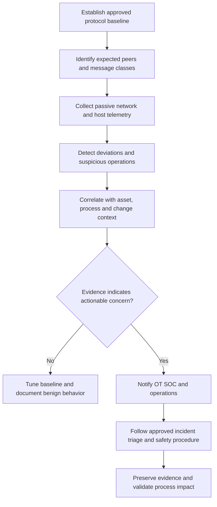

Do not trigger automatic blocking of control traffic based on an unvalidated anomaly. OT detection response must be coordinated with operations and site safety procedures.

---

# 19. Secure protocol architecture patterns

## 19.1 Pattern A — Legacy protocol inside a controlled zone

Use when endpoint devices cannot support modern protocol security.

- Keep communication inside a dedicated zone or cell.
- Permit only verified peers and required services.
- Restrict engineering and management access.
- Monitor passively at appropriate boundaries.
- Protect physical ports, gateways, and cabinets.
- Document the risk acceptance and migration plan.

## 19.2 Pattern B — Secure protocol end-to-end

Use where all required endpoints support interoperable secure profiles.

- Validate protocol security mode at both ends.
- Establish trusted device/application identities.
- Manage certificates and keys with defined ownership.
- Enforce authorization at the application and device.
- Monitor authentication failures and configuration changes.
- Test recovery and certificate renewal procedures.

## 19.3 Pattern C — Gateway-mediated protection

Use where legacy field devices need to communicate with modern platforms.

- Identify the exact translation and termination behavior.
- Ensure gateway management is separately protected.
- Restrict source and destination paths.
- Validate data mapping and write capability.
- Monitor gateway configuration and health.
- Assess gateway compromise and failover consequences.

## 19.4 Pattern D — One-way operational data export

Use when business analytics requires data but no inbound control is necessary.

- Define the data set and business purpose.
- Use a validated one-way transfer or approved broker pattern.
- Prevent enterprise systems from creating an unintended control path.
- Monitor export integrity and service availability.
- Keep local control independent of enterprise/cloud availability.

## 19.5 Pattern comparison

| Pattern | Security advantage | Main residual risk |
|---|---|---|
| Isolated legacy segment | Limits reachability | Malicious insider or compromised local endpoint |
| End-to-end secure protocol | Strong endpoint and message protections when correctly configured | Key lifecycle, implementation flaws, misconfiguration |
| Gateway mediation | Supports legacy interoperability | Gateway compromise and translation errors |
| One-way export | Reduces inbound connectivity | Data integrity, availability, and incorrect trust assumptions |

---

# 20. Protocol migration and modernization roadmap

## 20.1 Migration principles

- Do not replace a protocol solely because it is old.
- Establish business and process requirements first.
- Verify device support, licenses, firmware, and vendor roadmap.
- Identify real-time, safety, redundancy, and interoperability constraints.
- Plan test environments and representative lab validation.
- Include certificate, key, identity, and monitoring operations.
- Maintain rollback and legacy support during transition where required.
- Obtain operations, engineering, safety, and cybersecurity approvals.

## 20.2 Migration workflow

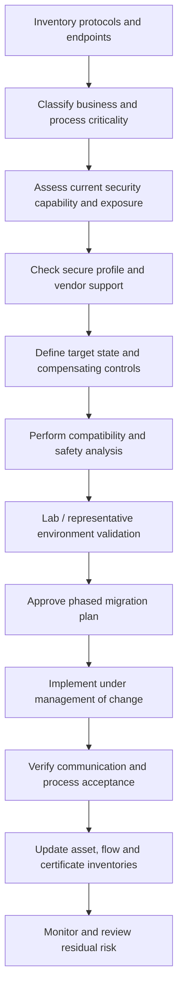

## 20.3 Prioritization factors

Prioritize based on:
- Ability to issue process-impacting commands.
- External or cross-zone reachability.
- Lack of authentication, integrity, or replay protection.
- Asset and process criticality.
- Known exploitation or exposure evidence.
- Vendor support and replacement horizon.
- Availability of secure alternatives.
- Operational feasibility and safety impact.
- Compensating controls and monitoring coverage.

## 20.4 Example migration register

| ID | Current protocol | Target / action | Endpoint constraint | Compensating control | Owner | Status |
|---|---|---|---|---|---|---|
| MIG-001 | Legacy Modbus TCP | Evaluate Modbus Security or brokered architecture | Confirm device support | Restrict peers and monitor writes | OT engineering | Assess |
| MIG-002 | Legacy DNP3 | Evaluate supported Secure Authentication profile | Confirm master/outstation versions | Constrained links and key governance | Utility engineering | Assess |
| MIG-003 | OPC Classic | Evaluate OPC UA migration | Client compatibility and DCOM dependencies | Restrict endpoints and host paths | OT applications | Assess |
| MIG-004 | BACnet/IP | Evaluate BACnet/SC where supported | Legacy controllers may remain | Building zone isolation and access governance | Facilities engineering | Assess |
| MIG-005 | Legacy CIP | Evaluate CIP Security | Confirm device and scanner compatibility | Cell segmentation and approved peers | Automation engineering | Assess |

These are planning examples, not universal mandates or product compatibility claims.

---

# 21. Protocol assessment and testing playbook

## 21.1 Preconditions

- Written authorization and defined systems, paths, dates, and activities.
- Asset owner, operations, control engineer, and safety contacts identified.
- Exact product, firmware, protocol profile, and vendor constraints understood.
- Approved test environment or maintenance window.
- Prohibited actions and stop-work conditions documented.
- Evidence storage and data handling approved.
- Rollback and incident escalation arrangements established.

## 21.2 Safe assessment stages

**Stage 1 — Documentation review:** inspect approved network diagrams, protocol inventories, vendor configuration guides, firmware records, communication matrices, firewall policies, and change records.

**Stage 2 — Passive observation:** use approved network taps, SPAN feeds, existing sensors, or exported packet captures. Record capture location, time, visibility limitations, and whether traffic was mirrored or filtered.

**Stage 3 — Configuration review:** inspect approved exports and device security settings through supported vendor tools and authorized personnel.

**Stage 4 — Lab validation:** reproduce protocol behavior on representative lab devices or simulators. Use synthetic data and isolated networks.

**Stage 5 — Controlled production validation:** only when specifically approved, vendor-supported, risk-assessed, and scheduled. Define exact test cases, expected behavior, monitoring, stop criteria, and rollback.

## 21.3 Stop-work conditions

Stop and contact the site authority if process behavior becomes abnormal; an unexpected alarm or communication degradation occurs; a device becomes unstable; test scope is unclear or withdrawn; a safety-related function is implicated; vendor or site authority requests a stop; or evidence handling risks exposing sensitive information.

## 21.4 Testing matrix

| Test objective | Preferred evidence method | Production caution |
|---|---|---|
| Identify protocol and version | Documentation, passive capture, vendor inventory | Fingerprinting can be incomplete |
| Identify communicating peers | Passive flow analysis | Avoid active enumeration without approval |
| Confirm secure profile | Approved configuration and certificate review | Do not probe live endpoints casually |
| Review write authorization | Role/configuration evidence and lab test | Never issue unapproved writes |
| Review replay resistance | Specification, vendor evidence, isolated lab | Never replay messages on production |
| Review malformed input handling | Vendor test reports or isolated lab | Fuzzing can crash or disrupt devices |
| Review availability | Architecture and approved resilience evidence | No uncontrolled load or failover test |
| Review certificate lifecycle | PKI records and configuration | Do not revoke or rotate live credentials without change control |

---

# 22. Protocol inventory and engineering templates

## 22.1 Protocol inventory

| Field | Description |
|---|---|
| Protocol ID | Unique record |
| Protocol / family | Exact name |
| Edition / profile | Verified edition/profile |
| Vendor implementation | Product and firmware |
| Source asset | Asset ID |
| Destination asset | Asset ID |
| Purpose | Process/business requirement |
| Message classes | Telemetry, command, engineering, etc. |
| Transport / media | TCP, serial, Ethernet, wireless, etc. |
| Security mode | Verified enabled mode |
| Identity | Device/application identity |
| Key/certificate owner | Responsible party |
| Zone / conduit | Approved architecture |
| Monitoring | Sensor/log source |
| Criticality | Process consequence |
| Lifecycle | Supported / legacy / unknown |
| Evidence confidence | Verified / inferred / unknown |
| Review date | Actual date |

## 22.2 Protocol flow register

| Flow ID | Source | Destination | Protocol/profile | Purpose | Direction | Security mode | Owner |
|---|---|---|---|---|---|---|---|
| PF-001 | TBD | TBD | TBD | TBD | TBD | TBD | TBD |

## 22.3 Certificate and key register

| Field | Description |
|---|---|
| Identity / certificate ID | Unique identifier |
| Subject / device | Identity represented |
| Issuer / trust anchor | Issuing authority |
| Purpose | Application, device, client, server |
| Validity | Start and expiry |
| Storage | Approved protected location |
| Owner | Responsible role |
| Renewal | Process and lead time |
| Revocation | Procedure and dependencies |
| Recovery | Replacement and restoration plan |
| Review evidence | Last validation |

Do not place private keys, passwords, shared secrets, or sensitive certificate material in this public repository.

## 22.4 Protocol risk record

Record protocol and endpoint, verified security properties, unsupported capabilities, exposure paths, process consequence, credible misuse scenario, existing safeguards, residual risk, recommended action, accountable owner, target date, acceptance authority, and reassessment trigger.

---

# 23. Standards and framework mapping

The following is an orientation map. It is not a clause-level compliance crosswalk. Formal assessments must use the applicable licensed standards, exact edition, national adoption, sector rules, and regulator guidance.

| Reference | Relevance to protocol security |
|---|---|
| NIST SP 800-82 Rev. 3 | OT communications, architecture, segmentation, secure configuration, monitoring and risk |
| ISA/IEC 62443-2-1 | Asset-owner security program and operational governance |
| ISA/IEC 62443-2-4 | Security requirements for service providers |
| ISA/IEC 62443-3-2 | System risk assessment, zones and conduits |
| ISA/IEC 62443-3-3 | System security requirements and security levels |
| ISA/IEC 62443-4-1 | Secure product development lifecycle |
| ISA/IEC 62443-4-2 | Technical security requirements for IACS components |
| IEC 62351 series | Security for selected power-system communication protocols and functions |
| NIST Cybersecurity Framework 2.0 | Govern, Identify, Protect, Detect, Respond, Recover outcomes |
| MITRE ATT&CK for ICS | Adversary behavior and defensive detection context |
| NCSC Secure Connectivity Principles for OT | Secure protocol selection, architecture and migration guidance |

## 23.1 IEC 62443 engineering mapping

| Engineering activity | Related concept | Evidence examples |
|---|---|---|
| Protocol inventory | Asset and system understanding | Protocol/asset register |
| Zone/conduit design | Risk-based architecture | Approved diagrams and flow matrix |
| Endpoint authentication | Component/system security | Identity and configuration evidence |
| Authorization | Least privilege and access control | Roles, ACLs and access review |
| Secure configuration | System/component hardening | Baseline and exception records |
| Monitoring | Security event and network visibility | Detection use cases and log sources |
| Vendor access | Service provider governance | Supplier access register |
| Migration | Risk treatment and lifecycle | Approved roadmap and change records |

Do not assert that a protocol's presence or a single control proves an IEC 62443 requirement is met. Map evidence to exact requirements in a separate controlled assessment.

## 23.2 IEC 62351 protocol mapping orientation

| Protocol family | Relevant IEC 62351 topics to investigate |
|---|---|
| IEC 60870-5 and derivatives including DNP3 | Part 5 and applicable profiles |
| IEC 61850 over TCP/IP | Parts 3 and 4 as applicable |
| IEC 61850 peer-to-peer profiles | Part 6 |
| Role-based access control | Part 8 |
| Key management | Part 9 |
| Security event logging | Part 14 |

The mapping is deliberately indicative. Confirm current editions, applicability, conformance, and product support from IEC and vendor documentation.

---

# 24. Governance and operating model

## 24.1 Protocol ownership

| Role | Accountability |
|---|---|
| Asset owner | Business/process need and risk acceptance |
| Control engineer | Protocol behavior, process dependencies, safe operation |
| OT network engineer | Segmentation, routing, boundary enforcement and availability |
| OT cybersecurity | Risk assessment, secure design, monitoring and assurance |
| Vendor / integrator | Product support, protocol implementation and validated guidance |
| OT SOC | Detection, triage and operational escalation |
| Functional safety authority | Safety impact review and safety lifecycle requirements |
| Enterprise/cloud owner | Secure integration and external service governance |
| Change authority | Formal approval and implementation control |

## 24.2 Required governance artifacts

- Approved protocol inventory.
- Zone and conduit architecture.
- Communication-flow register.
- Vendor protocol and security capability matrix.
- Certificate and key lifecycle register.
- Engineering access register.
- Secure configuration baseline.
- Monitoring and detection use cases.
- Exceptions and compensating controls.
- Migration and modernization roadmap.
- Change, validation, and recovery evidence.

---

# 25. Practical case studies

## Case 1 — Legacy Modbus in a water pumping station

**Context:** PLCs and meters exchange data with a local supervisory server. A business reporting platform requests access to the same devices.

**Review:** Identify which values are required, whether any write capability is needed, where the gateway sits, and which approved path serves reporting.

**Design outcome:** Keep control communication within the control zone. Broker only required data through a controlled boundary. Record unsupported device security and compensating controls.

## Case 2 — DNP3 remote utility sites

**Context:** A utility operates remote outstations over a private wide-area network.

**Review:** Verify master/outstation identities, secure authentication support, key management, command authorization, remote site physical protection, and local operating behavior during WAN loss.

**Design outcome:** Define supported security profiles, peer restrictions, key governance, monitoring, and a phased endpoint migration plan.

## Case 3 — OPC Classic historian integration

**Context:** A legacy historian exchanges data with multiple Windows-based control applications using OPC Classic.

**Review:** Document DCOM dependencies, dynamic communication paths, service identities, host firewall policy, vendor compatibility, and the business need for each connection.

**Design outcome:** Restrict existing flows while planning a tested OPC UA migration or brokered data architecture. Do not assume migration is a simple endpoint replacement.

## Case 4 — IEC 61850 substation

**Context:** Protection IEDs exchange GOOSE and sampled values while station services use MMS.

**Review:** Identify station and process bus topology, multicast boundaries, IED identities, SCL configuration governance, time sources, IEC 62351 applicability, and protection engineering approvals.

**Design outcome:** Protect peer communication and engineering workflows using a validated substation security architecture. Avoid generic firewall changes that could affect protection timing or availability.

## Case 5 — MQTT cloud analytics

**Context:** An edge gateway publishes process telemetry to a broker used by cloud analytics.

**Review:** Identify publisher identity, topic permissions, TLS, bridge direction, broker administration, retained data, and local operation during cloud outage.

**Design outcome:** Use unique identities, least-privilege topic authorization, secure transport, monitored broker configuration, and no implicit cloud-to-controller command path.

## Case 6 — BACnet building integration

**Context:** HVAC controllers and a building management platform share a network connected to enterprise facilities applications.

**Review:** Identify BACnet routers, BBMDs, device discovery scope, write permissions, vendor access, BACnet/SC support, and links to physical security.

**Design outcome:** Separate building automation zones, restrict management and remote access, and plan secure-connect migration where compatible.

---

# 26. Validation checklists

## 26.1 Protocol identification and inventory

- [ ] Protocol and family are identified from reliable evidence.
- [ ] Edition/profile and vendor implementation are recorded.
- [ ] Endpoints and asset owners are known.
- [ ] Process purpose and message classes are documented.
- [ ] Direction and initiating party are confirmed.
- [ ] Unknown or inferred details are labelled.
- [ ] Sensitive site-specific details are protected.

## 26.2 Protocol security

- [ ] Authentication capabilities and actual configuration are reviewed.
- [ ] Authorization and write permissions are reviewed.
- [ ] Integrity and replay protection are evaluated.
- [ ] Confidentiality requirements are assessed.
- [ ] Certificate/key ownership and lifecycle are defined.
- [ ] Legacy limitations have compensating controls.
- [ ] Vendor support and firmware lifecycle are known.

## 26.3 Architecture and operations

- [ ] Communication paths map to approved zones and conduits.
- [ ] Gateways and brokers have defined ownership.
- [ ] Enterprise/cloud access is explicitly mediated.
- [ ] Real-time, latency, redundancy and availability constraints are documented.
- [ ] Passive monitoring coverage is understood.
- [ ] Time synchronization and event integrity are addressed.
- [ ] Change and rollback processes are documented.
- [ ] Operations and safety authorities have reviewed relevant changes.

## 26.4 Assessment quality

- [ ] Authorization and scope are recorded.
- [ ] No unapproved write or disruptive test was performed.
- [ ] Evidence source and confidence are documented.
- [ ] Observations are separated from assumptions.
- [ ] Process impact is validated with engineering.
- [ ] Recommendations have owners and review dates.
- [ ] Residual risks and exceptions are recorded.

---

# 27. Glossary

| Term | Meaning |
|---|---|
| ACL | Access Control List |
| BBMD | BACnet Broadcast Management Device |
| BMS | Building Management System |
| CIP | Common Industrial Protocol |
| DCOM | Distributed Component Object Model |
| DNP3 | Distributed Network Protocol |
| DDS | Data Distribution Service |
| GOOSE | Generic Object Oriented Substation Event |
| HART | Highway Addressable Remote Transducer |
| IED | Intelligent Electronic Device |
| MMS | Manufacturing Message Specification |
| MQTT | Message Queuing Telemetry Transport |
| OPC UA | OPC Unified Architecture |
| SCL | Substation Configuration Language |
| SV | Sampled Values |
| TLS | Transport Layer Security |
| WAN | Wide Area Network |

---

# 28. Primary references and technical resources

Use official specifications, vendor manuals, and current editions for implementation decisions. The following resources support further research:

1. NIST SP 800-82 Rev. 3, *Guide to Operational Technology (OT) Security*: https://csrc.nist.gov/pubs/sp/800/82/r3/final
2. NCSC, *Secure Connectivity Principles for Operational Technology*, Principle 4: https://www.ncsc.gov.uk/collection/operational-technology/secure-connectivity/principle-4
3. IEC 62351 cybersecurity for IEC 61850 and related power-system protocols: https://iec61850.dvl.iec.ch/what-is-61850/technical-principles/61850-cybersecurity/
4. IEC 62351-5:2023: https://webstore.iec.ch/en/publication/65511
5. ODVA, *Secure Deployment of Industrial Communication Protocols — A Risk Management Based Approach*: https://www.odva.org/publication_download/secure-deployment-of-industrial-communication-protocols-a-risk-management-based-approach/
6. Modbus Organization: https://www.modbus.org/
7. OPC Foundation: https://opcfoundation.org/
8. DNP Users Group: https://www.dnp.org/
9. PROFIBUS and PROFINET International: https://www.profibus.com/
10. ODVA: https://www.odva.org/
11. IEC 61850: https://www.iec.ch/
12. BACnet International: https://bacnetinternational.org/
13. OASIS MQTT: https://mqtt.org/
14. MITRE ATT&CK for ICS: https://attack.mitre.org/matrices/ics/
15. CISA Industrial Control Systems recommended practices: https://www.cisa.gov/resources-tools/resources/ics-recommended-practices

## 28.1 Reference interpretation notes

- NIST SP 800-82 Rev. 3 provides broad OT security guidance and should be read with current vendor and sector requirements.
- NCSC guidance recommends secure protocol variants where feasible, protocol migration planning, and compensating controls when legacy constraints remain.
- IEC 62351 parts address different protocol families and security functions; verify the exact part and edition.
- The joint ODVA, OPC Foundation, FieldComm Group, and PI technical paper emphasizes risk-based secure deployment and the importance of operational compensating controls.
- Product support is not equivalent to secure deployment. Confirm actual configuration and interoperability.

---

# 29. Document control and technical review

## 29.1 Revision history

| Version | Date | Change | Status |
|---|---|---|---|
| 1.0 | 2026-11-17 | Initial protocol-neutral outline | Superseded |
| 2.0 | 2026-11-17 | Expanded master playbook with protocol families, security mapping, use cases, assessment and migration workflows | Draft — technical review required |

## 29.2 Required technical review

Before marking Verified:
- Have protocol specialists review Modbus, DNP3, IEC 60870, OPC, PROFINET, PROFIBUS, CIP, IEC 61850, HART, BACnet, and IIoT messaging sections.
- Validate exact standard editions and protocol security feature claims.
- Confirm diagrams represent conceptual patterns and not universal implementations.
- Verify vendor-specific details against primary manuals.
- Review all assessment procedures for operational and safety constraints.
- Validate cross-industry use-case mappings with practitioners.
- Confirm reference links remain current.
- Record reviewer role, date, comments, and disposition.

## 29.3 Limitations

This guide is a public educational engineering reference. It is not a normative protocol specification, legal compliance opinion, vendor configuration guide, production firewall policy, or permission to test live industrial equipment. Protocol security is deployment-specific. Use current licensed standards, exact product documentation, and qualified site engineering review for all implementation and assurance decisions.
