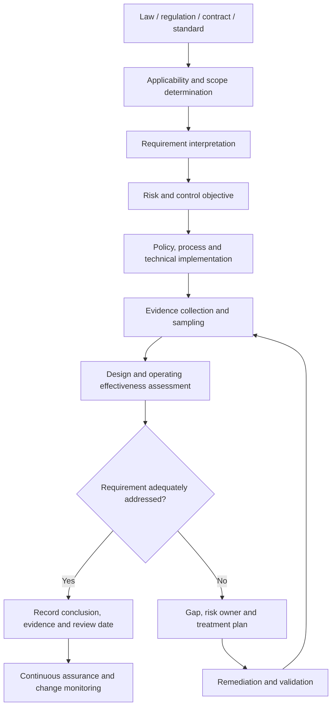
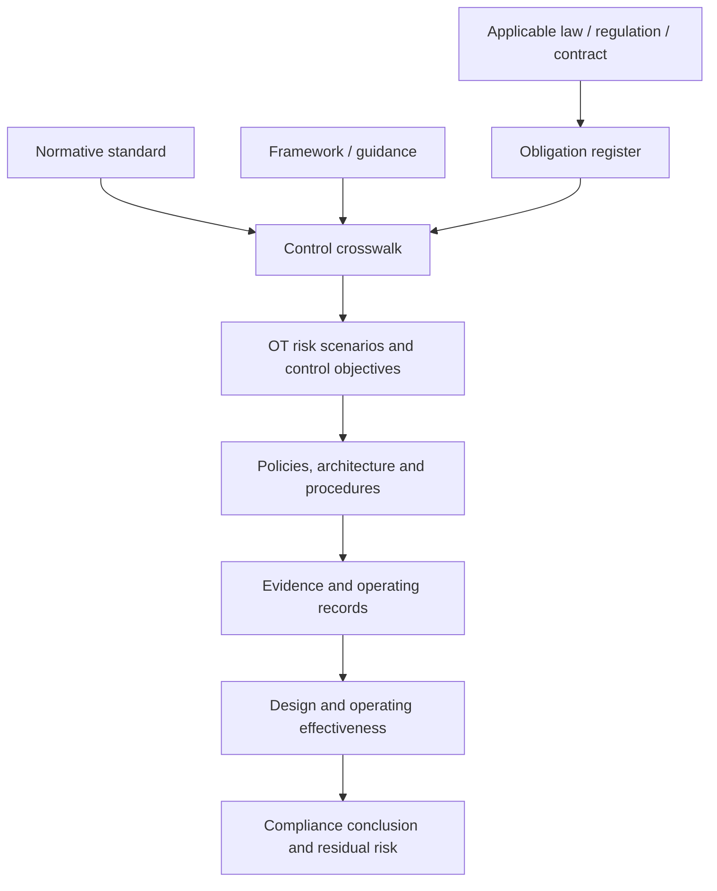
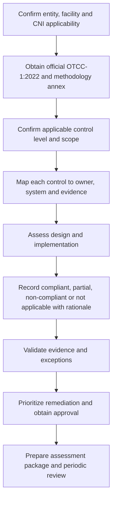
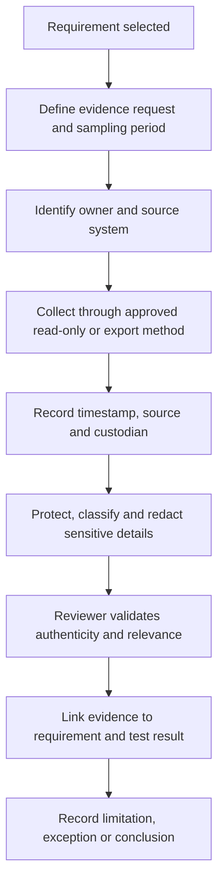
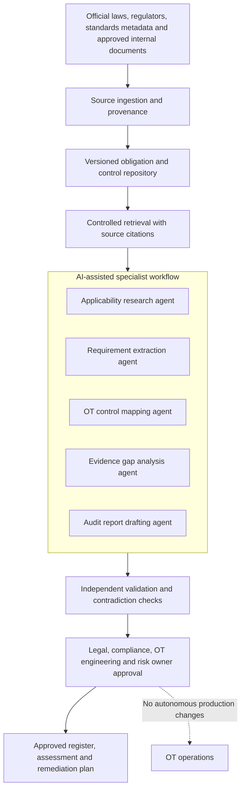

# OT Standards, Frameworks and Compliance Engineering
## International standards, national requirements, sector obligations and evidence-based assurance

**Document ID:** UOTS-05-STANDARDS | **Version:** 1.0 | **Status:** Research baseline — jurisdictional and licensed-standard validation required

**Audience:** OT cybersecurity leaders, CISOs, CIOs, compliance officers, OT engineers, auditors, risk owners, regulators, system integrators, managed service providers, and critical infrastructure operators.

> **Important legal and technical notice:** This is an independent educational mapping guide, not legal advice, a certification, a conformity assessment, or a substitute for licensed standards and regulator direction. A control mapping does not prove compliance. Applicability depends on the legal entity, sector, facility designation, service, contract, regulator, national implementation, effective date, and approved scope. Verify the current official instrument and obtain qualified legal, regulatory, engineering, and audit review before making compliance claims.

---

# 1. Purpose and assurance model

OT security compliance is not a checklist exercise. It is the disciplined process of identifying obligations, determining which systems and services are in scope, translating requirements into operational controls, collecting reliable evidence, assessing effectiveness, treating gaps, and maintaining assurance through the asset lifecycle.

This chapter establishes a reusable method to map:
- International OT standards and technical guidance.
- Enterprise cybersecurity frameworks.
- National cybersecurity controls and regulations.
- Critical infrastructure and sector-specific obligations.
- OT assets, zones, conduits, protocols, threats, and operational scenarios.
- Policies, procedures, engineering controls, monitoring, and audit evidence.

## 1.1 Outcomes

A practitioner using this guide should be able to:
1. Identify the authoritative source and exact version of a requirement.
2. Determine whether it is law, regulation, regulator control, contractual requirement, voluntary standard, or guidance.
3. Record jurisdiction, sector, entity, facility and system applicability.
4. Map requirements to OT risks, assets, architecture, controls, owners and evidence.
5. Distinguish direct mappings, partial mappings, supporting relationships and gaps.
6. Build an audit-ready evidence register without exposing sensitive operational information.
7. Create a prioritized remediation and maturity roadmap.
8. Reassess when laws, standards, assets, vendors or process risks change.

## 1.2 The assurance chain

A document can be published and still not be applicable to a specific organization. Conversely, an organization may be in scope through a regulator designation, license, contract, supply chain role, or critical service even if the organization does not self-identify as an OT operator.

## 1.3 Requirement types

| Type | Meaning | Example | How to treat |
|---|---|---|---|
| Law | Binding legal instrument | National cybersecurity or critical infrastructure law | Confirm legal entity and jurisdiction |
| Regulation / implementing rule | Binding requirements under legal authority | Sector regulator cybersecurity regulation | Confirm scope, dates, enforcement and exemptions |
| Regulator control / directive | Requirement issued by competent authority | National OT cybersecurity controls | Confirm applicability and compliance mechanism |
| Contractual obligation | Binding through contract, license or procurement | Customer security schedule | Track contract version, parties and flow-down |
| Normative standard | Published requirements or specifications | IEC 62443, ISO/IEC 27001 | Confirm adopted edition and contractual/regulatory adoption |
| Framework | Structured outcomes or control catalogue | NIST CSF 2.0 | Usually voluntary unless adopted by authority or contract |
| Guidance / good practice | Recommended implementation approach | NIST SP 800-82 | Use as design input; do not label law without adoption |
| Certification scheme | Defined assessment and certification program | Accredited product/system certification | Verify scheme, scope, certificate validity and accredited body |

---

# 2. Standards and frameworks landscape

## 2.1 Primary OT and IACS references

| Reference | Main purpose | Typical users | Mapping role |
|---|---|---|---|
| ISA/IEC 62443 series | Cybersecurity across IACS lifecycle and stakeholders | Asset owners, integrators, service providers, product suppliers | Core OT control and lifecycle reference |
| NIST SP 800-82 Rev. 3 | OT security architecture, threats, vulnerabilities and safeguards | OT operators and security teams | Technical guidance and control design |
| NIST CSF 2.0 | Enterprise cybersecurity outcomes and governance | Organization-wide risk owners | Governance and outcome mapping |
| NIST SP 800-53 Rev. 5 | Security and privacy control catalogue | Government and enterprise control programs | Tailored control mapping; use OT overlays carefully |
| ISO/IEC 27001:2022 | Information security management system requirements | Organizations establishing an ISMS | Governance, risk, audit and continual improvement |
| ISO/IEC 27002:2022 | Information security controls guidance | Security and control owners | Supporting control guidance |
| ISO/IEC 27019 | Information security controls for energy utility industry | Energy utility organizations | Sector-tailored ISMS guidance |
| IEC 62351 series | Cybersecurity for selected power system communications and related functions | Utilities, vendors, integrators | Protocol and power-system security |
| MITRE ATT&CK for ICS | Adversary tactics and techniques | Threat analysts, defenders, red/blue teams | Threat-informed detection and risk scenarios |
| CIS Controls | Prioritized cybersecurity safeguards | Enterprise security teams | Supporting enterprise hygiene; OT tailoring required |
| CISA Cross-Sector Cybersecurity Performance Goals | Baseline practices for critical infrastructure | Critical infrastructure organizations | Voluntary prioritization reference unless adopted |
| NERC CIP | North American bulk electric system reliability cybersecurity standards | Registered entities and applicable BES facilities | Mandatory sector compliance where applicability criteria are met |

## 2.2 ISA/IEC 62443 series: stakeholder and lifecycle view

The ISA/IEC 62443 series is a family of standards and technical reports. It is not a single checklist. Its documents address foundational concepts, asset-owner security programs, service-provider programs, system risk assessment, system security requirements, and product development/component requirements.

| Document | Subject | Primary application | Typical evidence |
|---|---|---|---|
| 62443-1-1 | Terminology, concepts and models | Common IACS security language and models | Definitions, architecture vocabulary |
| 62443-2-1 | Security program requirements for IACS asset owners | Asset-owner cybersecurity program | Policies, governance, risk, operations |
| 62443-2-2 | IACS security protection scheme technical report | Protection scheme concepts | Protection scheme design and assurance |
| 62443-2-3 | Patch management in IACS | OT patch management | Patch risk process, testing, approvals |
| 62443-2-4 | Security program requirements for IACS service providers | Integrators and service providers | Supplier procedures, service delivery controls |
| 62443-3-2 | Security risk assessment for system design | System under consideration, zones and conduits | SRA, zone/conduit model, risk treatment |
| 62443-3-3 | System security requirements and security levels | IACS system requirements | SR/RE assessment, system design evidence |
| 62443-4-1 | Secure product development lifecycle | Product suppliers/developers | SDL processes, threat modeling, testing |
| 62443-4-2 | Technical security requirements for IACS components | IACS component capabilities | Component requirements and product evidence |

**Edition control:** ISA's published catalogue lists ANSI/ISA-62443-2-1-2024 and ISA-TR62443-2-2-2025, alongside other editions shown in the official catalogue. The standards catalogue changes. Before any project uses a clause or requirement, confirm the current IEC/ISA edition, amendments, corrigenda, adoption, and licensed text. Do not assume every part has the same publication year or status.

Official catalogue: https://www.isa.org/standards-and-publications/isa-standards/isa-iec-62443-series-of-standards

## 2.3 NIST references

### NIST SP 800-82 Rev. 3

NIST SP 800-82 Rev. 3 is a key OT security guide. It addresses OT while recognizing performance, reliability and safety requirements. Its scope includes ICS, building automation, transportation, physical access control, and other systems interacting with the physical environment.

The NIST publication page records Rev. 3 as published in September 2023 and notes an initial public draft of Revision 4, with public comments due November 30, 2026. A draft is not a final replacement. At the time of this repository revision, cite Rev. 3 as the final published guide and track Rev. 4 draft developments separately.

Official page: https://csrc.nist.gov/pubs/sp/800/82/r3/final

### NIST Cybersecurity Framework 2.0

Use the CSF 2.0 functions:
- Govern
- Identify
- Protect
- Detect
- Respond
- Recover

The CSF provides outcomes and profiles, not a ready-made OT technical control checklist. Translate outcomes into OT-specific practices, account for safety and availability, and map to detailed controls where necessary.

Official resource: https://www.nist.gov/cyberframework

### NIST SP 800-53 Rev. 5

SP 800-53 provides a broad security and privacy control catalogue. NIST SP 800-82 Rev. 3 includes OT tailoring and an OT overlay discussion. Select controls based on system impact, risk, architecture, and safety constraints. Do not blindly apply enterprise IT baselines to controllers or deterministic networks.

Official resource: https://csrc.nist.gov/pubs/sp/800/53/r5/upd1/final

## 2.4 ISO/IEC references

| Standard | Focus | OT application |
|---|---|---|
| ISO/IEC 27001:2022 | ISMS requirements | Organization-level governance and risk |
| ISO/IEC 27002:2022 | Information security controls | Supporting control guidance |
| ISO/IEC 27005 | Information security risk management | Risk methodology support |
| ISO/IEC 27017 | Cloud security controls | OT cloud services and supporting platforms |
| ISO/IEC 27018 | Personal data in public cloud | Where personal data processing applies |
| ISO/IEC 27019 | Energy utility information security controls | Utility-specific ISMS control guidance |
| ISO 22301 | Business continuity management | Continuity and recovery governance |
| ISO 31000 | Risk management guidelines | Enterprise risk methodology |
| ISO 19011 | Auditing management systems guidance | Audit program and audit conduct |

Verify current editions, amendments, national adoptions and licensed texts at https://www.iso.org/standards.html. Do not claim certification to one standard based solely on a mapping spreadsheet.

---

# 3. Cross-framework mapping methodology

## 3.1 Mapping principles

A mapping is a relationship between two requirements or control objectives. It is not proof that one requirement satisfies another.

Use four relationship types:

| Relationship | Meaning | Example interpretation |
|---|---|---|
| Direct | Substantially addresses the same objective and scope | Both require controlled access to a defined system |
| Partial | Addresses only some aspects | One requires access governance; the other also requires periodic review and monitoring |
| Supporting | Helps implement or evidence another requirement | Asset inventory supports risk assessment |
| No equivalent identified | No defensible mapping established | Do not invent a crosswalk to fill a spreadsheet |

For every mapping, record:
- Source requirement ID and exact title.
- Target requirement ID and exact title.
- Source and target editions.
- Relationship type and rationale.
- Differences and residual obligations.
- Implementation owner.
- Evidence references.
- Reviewer and approval date.

## 3.2 Mapping hierarchy

Legal and regulatory obligations take precedence over a voluntary crosswalk. Where a regulator defines its own wording, retain the regulator's exact control identifier and text in a controlled source register.

## 3.3 Common OT control domains

1. Governance, accountability and policy.
2. Asset inventory and ownership.
3. Risk assessment and treatment.
4. Secure architecture, zones and conduits.
5. Identity and access management.
6. Remote access and third-party services.
7. Secure configuration and hardening.
8. Vulnerability and patch management.
9. Change and configuration management.
10. Network security and communications.
11. Malware protection and removable media.
12. Logging, monitoring and detection.
13. Incident response and reporting.
14. Backup, restoration and recovery.
15. Business continuity and resilience.
16. Physical and environmental security.
17. Supplier and product security.
18. Secure development and system integration.
19. Personnel awareness and competence.
20. Audit, metrics and continual improvement.

These are repository-level organizing domains, not a claim that all frameworks use identical domain names or requirement structures.

---

# 4. Master OT control crosswalk

The following is a high-level thematic crosswalk. It is intentionally not represented as a clause-level equivalence. Exact control identifiers and wording must be entered from the licensed or official source for the applicable edition.

| OT control domain | ISA/IEC 62443 reference area | NIST CSF 2.0 outcome area | ISO/IEC 27001/27002 support | Evidence examples |
|---|---|---|---|---|
| Governance and policy | 2-1 | Govern | Leadership, policy, roles | Approved OT policy, charter, management review |
| Asset inventory | 2-1, 3-2 | Identify | Asset inventory | OT inventory, ownership, lifecycle |
| Risk assessment | 3-2, 2-1 | Govern, Identify | Risk assessment and treatment | SRA, risk register, acceptance |
| Zones and conduits | 3-2, 3-3 | Protect | Network security | Approved diagrams, flow matrix, rules |
| Access control | 2-1, 3-3, 4-2 | Protect | Access control | Account register, role matrix, access reviews |
| Remote access | 2-1, 2-4, 3-3 | Protect | Access control, supplier relationships | Remote access approvals, session records |
| Secure configuration | 2-1, 3-3, 4-2 | Protect | Configuration management | Baselines, deviations, hardening records |
| Vulnerability management | 2-1, 2-3, 4-1 | Identify, Protect | Technical vulnerability management | Advisory register, risk decisions, test evidence |
| Change management | 2-1, 2-4, 3-2 | Govern, Protect | Change management | MOC, approvals, validation and rollback |
| Monitoring | 2-1, 3-3, 4-2 | Detect | Logging and monitoring | Passive sensors, logs, alert use cases |
| Incident response | 2-1 | Respond | Incident management | OT playbooks, exercises, incident records |
| Recovery | 2-1, 3-3 | Recover | Backup and continuity | Restore tests, recovery plans, RTO/RPO |
| Supplier security | 2-1, 2-4, 4-1 | Govern, Protect | Supplier relationships | Due diligence, contract clauses, access reviews |
| Product security | 4-1, 4-2 | Govern, Protect | Secure development | SDL records, product test reports |
| Physical security | 2-1, 3-3 | Protect | Physical controls | Site access logs, cabinet controls |
| Competence and awareness | 2-1, 2-4 | Govern, Protect | Awareness and training | Role-based training, competency records |

**Do not use this table to assert that a specific control is satisfied.** It identifies where a detailed crosswalk should be built and reviewed.

---

# 5. Saudi Arabia — national OT cybersecurity mapping

## 5.1 Primary national reference

The Saudi National Cybersecurity Authority (NCA) publishes **Operational Technology Cybersecurity Controls, OTCC-1:2022**. The NCA describes OTCC as an extension of its Essential Cybersecurity Controls and states that the controls aim to establish minimum cybersecurity requirements for OT/ICS protection.

Official NCA page: https://nca.gov.sa/en/regulatory-documents/controls-list/otcc/

The NCA page also lists:
- OTCC-1:2022.
- OTCC-1:2022 methodology and mapping annex.
- OTCC assessment and compliance tool.

The NCA implementation guide describes the OTCC scope as government organizations and their companies/entities, as well as private-sector organizations owning, operating or hosting Critical National Infrastructures (CNIs). The guide encourages other Saudi organizations to use the controls as best practice. Applicability must be determined for the specific entity and facility.

## 5.2 OTCC compliance context

The published OTCC material states that compliance with the applicable Essential Cybersecurity Controls is a prerequisite and describes NCA assessment through self-assessment and/or field visits by NCA or designated third parties under approved mechanisms. Confirm current control levels, tools, methodology, and regulator instructions directly from NCA before an engagement.

Official OTCC implementation guide: https://cdn.nca.gov.sa/api/files/public/upload/0d563108-e1c6-43fd-bd4b-a0d5a22d83e8_OTCC_Implementation-Guideline_en.pdf

## 5.3 OTCC mapping workflow

## 5.4 OTCC evidence mapping register

| Mapping field | Required content |
|---|---|
| OTCC control ID | Exact ID from official OTCC source |
| Exact control text | Preserve regulator wording in controlled workpapers |
| Control level | As defined by the current official instrument |
| Applicability | Applicable / not applicable / pending determination |
| Asset/process scope | Facility, system, zone, service |
| Internal control | Policy, procedure or technical control |
| ISA/IEC 62443 relationship | Direct / partial / supporting / none identified |
| NIST relationship | CSF outcome or SP 800-82 guidance reference |
| Evidence | Exact evidence ID, period and custodian |
| Assessment | Design and operating effectiveness |
| Gap and risk | Deficiency, consequence and exposure |
| Action owner | Named accountable role |
| Due date | Approved remediation date |
| Reviewer | Independent reviewer and date |

## 5.5 Saudi sector and related obligations

Investigate additional NCA controls and sector regulator requirements where applicable, including Essential Cybersecurity Controls, Cloud Cybersecurity Controls, Data Cybersecurity Controls, and relevant sector or critical infrastructure directions. Do not assume OTCC alone covers every national or sector obligation.

The NCA's official controls list shows separate control publications and update dates. Verify the current instrument for each engagement: https://nca.gov.sa/en/regulatory-documents/

---

# 6. United Arab Emirates — national and sector mapping

## 6.1 Applicability approach

The UAE has federal and emirate-level government, sector, and critical infrastructure cybersecurity arrangements. Requirements may depend on the entity, government affiliation, regulated activity, critical infrastructure designation, free-zone or emirate jurisdiction, and contractual obligations.

This repository does not assert a single universal UAE OT cybersecurity control catalogue applicable to every UAE organization. The assessment team must identify the competent authority and the instrument that applies to the legal entity and facility.

## 6.2 Research and applicability register

Investigate and verify, where relevant:
- UAE national cybersecurity strategy and competent federal cybersecurity authority publications.
- UAE Information Assurance Regulation and associated standards where applicable to the entity.
- Dubai Electronic Security Center (DESC) requirements for entities within its defined jurisdiction and scope.
- Abu Dhabi government and critical infrastructure cybersecurity requirements issued by the competent authority.
- Sector-specific requirements for energy, water, transport, aviation, healthcare, telecommunications, and financial services.
- Applicable cloud, data protection, privacy, incident reporting, and supplier obligations.
- License conditions and customer or operator contractual requirements.

Do not apply a Dubai government standard to an Abu Dhabi private operator without an applicability basis. Do not treat a guidance document as a law or regulation unless the issuing authority and legal basis establish that status.

## 6.3 UAE OT assessment record

| Field | Required determination |
|---|---|
| Emirate / jurisdiction | Federal, Abu Dhabi, Dubai, other emirate, free zone |
| Legal entity | Exact regulated or government entity |
| Sector | Energy, utilities, transport, buildings, manufacturing, etc. |
| Competent authority | Confirmed regulator or government authority |
| Instrument | Exact title, edition, publication date |
| Legal status | Law, regulation, directive, standard, guidance, contract |
| Applicability trigger | Entity, facility, license, criticality, contract |
| OT scope | Sites, systems, zones, services |
| Reporting obligations | Trigger, recipient, time limit, evidence |
| Review date | Official source revalidation |

---

# 7. Qatar — national and sector mapping

## 7.1 Applicability approach

For Qatar, identify the national cybersecurity authority and applicable national cybersecurity policies, critical information infrastructure requirements, sector regulator directions, government entity requirements, and contractual obligations. Determine the current competent authority, instrument title, version, applicability criteria, and implementation dates from official Qatar government sources before claiming a control is mandatory.

This chapter does not claim that one national OT control catalogue applies identically to every Qatar operator.

## 7.2 Research workstreams

For an OT operator or supplier in Qatar, investigate:
- National cybersecurity strategy and current national cybersecurity policies.
- National information assurance and critical information infrastructure requirements where applicable.
- Government entity cybersecurity requirements.
- Energy and utilities sector regulator and operator requirements.
- QatarEnergy and other operator-specific supplier cybersecurity specifications where contractually relevant.
- Transport, aviation, ports, healthcare, telecommunications, and other sector obligations.
- Personal data, privacy, cloud, outsourcing and incident reporting requirements where relevant.
- Customer, EPC, O&M, integrator and supply-chain contract clauses.

## 7.3 Qatar applicability register

Do not populate an obligation with an unverified title or control ID. Record:
- Official authority and source URL.
- Exact instrument title and language.
- Publication and effective dates.
- Legal or regulatory status.
- Entity and sector scope.
- Critical infrastructure designation criteria.
- OT/ICS applicability.
- Reporting and audit requirements.
- Official interpretation or written regulator clarification.
- Last verification date and reviewer.

---

# 8. Other Gulf and Middle East jurisdictions

The repository is regional and international, not limited to three Gulf markets. The following is a research register, not a claim that every listed authority has a single OT-specific mandatory standard.

| Jurisdiction | Research areas to verify | Applicability caution |
|---|---|---|
| Bahrain | National cybersecurity authority requirements, sector regulation, critical infrastructure and financial/energy obligations | Confirm the current competent authority and regulated entity scope |
| Oman | National cybersecurity policies, critical infrastructure, energy and utilities regulator requirements | Confirm current national instruments and sector applicability |
| Kuwait | National cybersecurity and critical infrastructure requirements, oil, power and water sector obligations | Verify official source, legal status and effective dates |
| Saudi Arabia | NCA OTCC, ECC and additional NCA controls; sector regulator requirements | OTCC applicability and facility level must be established |
| UAE | Federal and emirate requirements, DESC and sector-specific instruments | Jurisdiction and entity scope are essential |
| Qatar | National cybersecurity and critical information infrastructure requirements, sector and operator rules | Verify current official instruments and regulator interpretation |
| Jordan | National cybersecurity authority and critical infrastructure requirements | Confirm current legal instruments and sector rules |
| Egypt | National cybersecurity and critical infrastructure requirements, sector regulator obligations | Confirm current authority and binding status |
| Türkiye | National cyber strategy, sectoral regulation and critical infrastructure requirements | Verify current laws and competent regulators |
| Iraq | National cybersecurity and sector requirements | Verify official publication and applicability |
| Lebanon | National cybersecurity and sector obligations | Verify current legal and institutional status |
| Israel | National cyber directorate and sector-specific critical infrastructure requirements | Confirm applicable sector and entity designation |

For each country, separate national strategy, law, regulation, regulator controls, voluntary standards, and customer requirements. Do not infer one country's obligations from another country's framework.

---

# 9. European Union and United Kingdom

## 9.1 NIS2

Directive (EU) 2022/2555 (NIS2) establishes cybersecurity risk-management and incident-reporting obligations for in-scope essential and important entities across specified sectors. Whether a particular OT operator or supplier is in scope depends on the directive, national transposition, sector, entity type, size rules and exceptions.

Key assessment steps:
1. Identify the legal entity and establishment.
2. Determine whether the entity falls within an Annex I or Annex II sector.
3. Review size thresholds, exceptions and special entity rules.
4. Identify the relevant national transposition law and competent authority.
5. Map risk-management and incident-reporting duties.
6. Assess supply-chain and management accountability requirements.
7. Confirm national reporting timelines and enforcement mechanisms.

Do not use the EU directive alone as the final national compliance checklist. Member State transposition and competent authority guidance matter.

Official EUR-Lex text: https://eur-lex.europa.eu/eli/dir/2022/2555/oj
ENISA sector guidance: https://www.enisa.europa.eu/topics/cybersecurity-of-critical-sectors

## 9.2 United Kingdom

For UK organizations, investigate:
- Network and Information Systems Regulations 2018 and amendments.
- Competent authority requirements for relevant sectors.
- NCSC Cyber Assessment Framework where applicable.
- Sector-specific guidance and regulator directions.
- Product security, privacy, safety, and contractual requirements.

Applicability and reporting obligations depend on the entity and competent authority. Use current legislation and regulator sources: https://www.legislation.gov.uk/uksi/2018/506/contents and https://www.ncsc.gov.uk/collection/cyber-assessment-framework

---

# 10. North America and other international sector frameworks

## 10.1 NERC CIP

NERC Critical Infrastructure Protection (CIP) standards apply to registered entities and applicable Bulk Electric System (BES) cyber systems under the defined applicability criteria. They are not a universal standard for every power plant, utility, industrial site, or energy company.

A NERC CIP assessment must:
- Determine registered entity status and functional registration.
- Apply the current BES Cyber System and impact categorization criteria.
- Identify applicable facilities, systems, and assets.
- Confirm current approved standards and implementation plans.
- Map evidence to exact requirement and measure identifiers.
- Track regional entity guidance and enforcement dates.
- Review exceptions, transient cyber assets, electronic access, supply chain and incident reporting as applicable.

Official standards library: https://www.nerc.com/pa/Stand/Pages/CIPStandards.aspx

## 10.2 United States CISA and sector requirements

Investigate CISA guidance, sector risk management agency publications, binding operational directives where the organization is subject to them, TSA requirements for relevant transportation pipelines and rail entities, and sector-specific rules. Do not assume federal directives apply to private operators unless their scope says so.

## 10.3 Canada

Investigate federal and provincial critical infrastructure, energy regulator, utility reliability, privacy and sector requirements. Determine the exact province, legal entity, facility and regulator before mapping.

## 10.4 Australia

Investigate the Security of Critical Infrastructure Act 2018 and current rules, applicable critical infrastructure asset classes, responsible entity obligations, risk management programs, reporting and sector guidance. Confirm current consolidated legislation and regulator directions: https://www.cisc.gov.au/legislation-regulation-and-compliance/legislation

## 10.5 Singapore

Investigate the Cybersecurity Act and designated Critical Information Infrastructure obligations, sector regulator directions, and relevant national cybersecurity guidance. Applicability depends on designation and the current legal framework: https://www.csa.gov.sg/

## 10.6 Japan and South Korea

Investigate national cybersecurity policy, critical infrastructure sector requirements, energy and industrial safety regulation, and relevant privacy and incident reporting laws. Use the competent national authority's current official publication and translated legal text where available. Record translation limitations.

---

# 11. India — national and sector mapping

## 11.1 Applicability approach

India's OT compliance landscape may include national cyber incident directions, critical information infrastructure requirements, sector-specific regulator directions, electricity and energy requirements, data protection obligations, and contractual obligations.

Do not claim that every CERT-In direction or national cybersecurity policy applies identically to every OT device or operator. Determine the regulated entity, system, service, incident type, and legal scope.

## 11.2 Research areas

Investigate:
- CERT-In Directions under section 70B of the Information Technology Act, including current FAQs and clarifications.
- National Critical Information Infrastructure Protection Centre (NCIIPC) directions and guidance for designated critical information infrastructure.
- Electricity sector cybersecurity guidelines and applicable Central Electricity Authority requirements.
- Petroleum, natural gas, ports, rail, aviation, water and other sector regulator obligations.
- Digital Personal Data Protection Act and applicable rules where personal data is processed.
- Government procurement and supplier cybersecurity conditions.
- State-level and public-sector enterprise requirements.

Official sources:
- CERT-In: https://www.cert-in.org.in/
- NCIIPC: https://nciipc.gov.in/
- Central Electricity Authority: https://cea.nic.in/

## 11.3 CERT-In assessment notes

For each incident reporting or log-retention obligation:
- Confirm the exact current direction and applicability.
- Identify covered entity and reportable incident types.
- Record the current reporting time requirement from the official instrument.
- Define the incident triage and escalation owner.
- Preserve required logs and time synchronization evidence.
- Confirm any sector-specific or contractual reporting obligations.
- Avoid assuming that an OT operational event automatically meets a legal cyber incident reporting threshold.

---

# 12. Sector-specific standards and obligations

| Sector | Standards / obligations to investigate | OT-specific assurance focus |
|---|---|---|
| Electric utilities | NERC CIP where applicable, IEC 61850, IEC 62351, national grid codes and regulator rules | Protection systems, control centres, substations, telecontrol |
| Oil and gas | ISA/IEC 62443, ISO/IEC 27019 where applicable, national OT controls, operator/EPC requirements | Process safety, SIS, DCS, remote sites, vendor access |
| Water and wastewater | National critical infrastructure and water regulator requirements, NIST OT guidance, ISA/IEC 62443 | Pumping, treatment, telemetry, chemical dosing and continuity |
| Manufacturing | ISA/IEC 62443, product and machinery safety, sector/customer requirements | Production cells, PLCs, robotics, MES and supplier access |
| Mining | National mining safety law, critical infrastructure and OT controls | Autonomous systems, conveyors, ventilation, remote operations |
| Rail | Rail safety and cybersecurity regulator requirements, signalling standards | Signalling, traction power, control centres and safety assurance |
| Aviation | Aviation safety/security regulation and airport critical infrastructure requirements | Baggage, building systems, airfield and operational technology |
| Ports and maritime | Maritime cyber risk requirements, port authority and national critical infrastructure rules | Terminal automation, cranes, vessel/shore interfaces |
| Healthcare facilities | Healthcare regulation, privacy, medical device security, building automation | Medical support systems, HVAC, generators and facility continuity |
| Smart buildings | Building codes, fire/life safety, privacy and local cyber requirements | BMS, HVAC, access control, elevators and fire systems |
| Data centres | Customer contracts, resilience, cloud/data protection and facility requirements | UPS, generators, cooling, BMS, EPMS |
| Renewables and DER | Grid codes, utility interconnection rules, IEC 61850/62351, national energy regulation | Inverters, plant controllers, substations and remote access |
| Chemicals | Process safety law, environmental rules, ISA/IEC 62443 and national OT controls | SIS, process control, safety lifecycle and emergency response |

This is an investigation map, not a universal applicability declaration. Sector regulators, licensing authorities and facility-specific requirements may add obligations.

---

# 13. OT compliance assessment methodology

## 13.1 Phase 1 — Establish legal and organizational scope

Collect:
- Legal entity name and registration jurisdiction.
- Parent/subsidiary relationships.
- Countries, emirates, states and facility locations.
- Sector, license, concession and regulated activities.
- Critical infrastructure designation or notification.
- Customer, EPC, O&M, outsourcing and supplier contracts.
- Systems, services, facilities and data in scope.
- Applicable regulator and reporting contacts.

**Output:** approved applicability and scope memorandum.

## 13.2 Phase 2 — Build authoritative obligation register

For each source:
- Authority and issuing body.
- Official source URL and retrieved copy.
- Exact title, identifier, language, edition and publication date.
- Effective date and transition period.
- Legal status and enforcement mechanism.
- Entity, sector, facility and system scope.
- Requirement IDs and applicability rationale.
- Reporting, audit, evidence and retention requirements.
- Superseded status and next review trigger.

**Output:** obligation register with source provenance.

## 13.3 Phase 3 — Map to OT system and risk

Map each requirement to:
- Business service and process.
- Facility and OT system.
- Asset, zone and conduit.
- Threat and failure scenario.
- Control objective and accountable owner.
- Required evidence and test method.
- Safety, availability and recovery implications.

**Output:** obligation-to-system-to-control traceability matrix.

## 13.4 Phase 4 — Assess design and operating effectiveness

**Design effectiveness:** does the control, if implemented as designed, address the requirement and risk?

**Operating effectiveness:** is the control implemented consistently and operating over the required period?

Examples:
- A remote access policy exists, but do actual access records show approval, named identities, time limits, and review?
- A backup procedure exists, but is a restore test available for the sampled controller or server?
- A network diagram exists, but does approved configuration and passive evidence support the documented flows?
- A vulnerability process exists, but are OT advisories assessed, exceptions approved, and mitigations tracked?

## 13.5 Phase 5 — Report and remediate

A finding should include:
- Requirement and exact source.
- Applicability rationale.
- Condition and evidence.
- Risk and process consequence.
- Cause and affected assets.
- Existing safeguards.
- Gap and residual risk.
- Recommendation and compensating controls.
- Owner, due date and approval.
- Retest and closure evidence.

---

# 14. Audit evidence engineering

## 14.1 Evidence quality principles

Good evidence is:
- Relevant to the exact requirement.
- Traceable to a system, owner and time period.
- Authentic and protected from unauthorized alteration.
- Sufficient to support the conclusion.
- Collected using approved methods.
- Stored with controlled access and retention.
- Reviewed for sensitive operational information before sharing.

## 14.2 Evidence classes

| Evidence class | Examples | Typical reliability consideration |
|---|---|---|
| Governance | Approved policy, committee minutes, risk acceptance | Confirm approval, current version and scope |
| Architecture | Network diagram, zone/conduit model, data-flow register | Validate against actual configuration and site |
| Configuration | Firewall export, account policy, device baseline | Confirm source, timestamp, completeness and owner |
| Operational records | Access logs, change tickets, backup jobs | Sample period and completeness |
| Technical observation | Passive packet capture, endpoint telemetry | Sensor location, visibility and interpretation |
| Testing | Restore test, access review, tabletop exercise | Test scope, result, witness and remediation |
| Supplier | Contract, assurance report, access register | Confirm supplier scope, period and exceptions |
| Training | Role-based competence records | Confirm relevant roles and completion |
| Incident | Timeline, notification, post-incident review | Preserve confidentiality and legal privilege where relevant |

## 14.3 Evidence collection workflow

## 14.4 OT evidence handling restrictions

Do not place in a public repository:
- Real network diagrams with sensitive IPs, routes or security boundaries.
- PLC/DCS/SIS project files or proprietary configurations.
- Credentials, private keys, certificates containing sensitive material, or secrets.
- Unredacted asset inventories, vulnerability reports or facility details.
- Incident evidence or customer data.
- Sensitive vendor contracts and licenses.

Publish synthetic examples and redacted templates only. Maintain actual evidence in the organization's approved evidence repository.

---

# 15. Maturity model and implementation roadmap

## 15.1 Illustrative maturity scale

This scale is an internal planning aid, not a maturity model prescribed by ISA/IEC 62443, NIST, ISO or a regulator.

| Level | Description | Characteristics |
|---|---|---|
| 0 — Unknown | No reliable evidence | Scope, owners or controls are not established |
| 1 — Ad hoc | Reactive | Informal practices, inconsistent evidence |
| 2 — Defined | Documented | Approved process and assigned owners |
| 3 — Implemented | Consistent execution | Controls deployed and records maintained |
| 4 — Measured | Effectiveness evaluated | Metrics, testing and risk-based oversight |
| 5 — Adaptive | Continually improved | Threat-informed improvement and lifecycle integration |

## 15.2 Roadmap

**First 30 days**
- Confirm legal and facility scope.
- Establish owners and regulator contacts.
- Collect official standards and obligations.
- Create OT asset and system inventory baseline.
- Identify critical processes and high-risk remote paths.

**Days 31–60**
- Build obligation and control registers.
- Map zones, conduits and communication flows.
- Review privileged and third-party access.
- Review backups, restoration and incident escalation.
- Establish evidence collection and retention rules.

**Days 61–90**
- Complete risk-based gap assessment.
- Validate selected controls and evidence.
- Agree remediation owners and dates.
- Approve exceptions and compensating controls.
- Establish governance reporting and review cadence.

**Beyond 90 days**
- Implement prioritized engineering changes.
- Validate effectiveness and recovery.
- Extend supplier and product assurance.
- Run exercises and continuous monitoring.
- Refresh obligations and mappings as sources change.

Do not treat these timeframes as regulatory deadlines. Tailor to site count, complexity, risk, resources and mandatory dates.

---

# 16. Metrics and management reporting

| Metric | Definition | Important caveat |
|---|---|---|
| Obligation applicability coverage | Obligations with documented scope decision / total identified obligations | Unknown obligations can make denominator incomplete |
| Control mapping coverage | Applicable requirements mapped to owners and controls | Mapping does not mean compliant |
| Evidence sufficiency | Sampled requirements with valid evidence | Define sampling and review period |
| Critical asset inventory coverage | Known critical assets with owner and verified attributes | Criticality methodology must be approved |
| Remote access review completion | In-scope access paths reviewed in period | Include supplier and emergency paths |
| Backup restore validation | Critical systems with successful approved restore test | A backup job success is not a restore test |
| OT vulnerability treatment | Advisories assessed and risk-treated within policy | Do not reward unsafe patching speed |
| Open high-risk exceptions | Approved and unapproved high-risk gaps | Report age, owner and expiry |
| Incident exercise actions | Actions closed from OT exercises | Closure must be validated |
| Supplier assurance coverage | Critical suppliers reviewed against defined scope | Avoid relying only on questionnaires |

Metrics must not incentivize disruptive testing, rushed patching, inaccurate compliance status, or hiding exceptions.

---

# 17. Templates and registers

## 17.1 Regulatory obligation register

| Field | Description |
|---|---|
| Obligation ID | Unique record |
| Country / jurisdiction | Legal territory |
| Authority | Issuer / regulator |
| Instrument | Exact official title |
| Version / date | Edition and publication |
| Legal status | Law, regulation, directive, standard, guidance, contract |
| Effective date | Official effective date |
| Entity scope | Covered entity types |
| Sector scope | Covered sector |
| Facility/system scope | Relevant facilities and OT services |
| Requirement ID | Exact identifier |
| Requirement text reference | Official source location |
| Applicability | Applicable / not applicable / pending |
| Rationale | Evidence-based explanation |
| Owner | Accountable role |
| Last verified | Date and reviewer |
| Source URL | Official URL |
| Next review trigger | Update, change, regulator notice |

## 17.2 Control implementation register

| Field | Description |
|---|---|
| Control ID | Internal identifier |
| Requirement source | Obligation ID |
| Control objective | What must be achieved |
| Implementation | Process or technical mechanism |
| System scope | Assets, sites, zones |
| Owner | Responsible role |
| Design effectiveness | Effective / partial / ineffective / not tested |
| Operating effectiveness | Effective / partial / ineffective / not tested |
| Evidence IDs | Evidence references |
| Gap | Identified deficiency |
| Risk rating | Approved methodology |
| Treatment | Correct / mitigate / transfer / accept |
| Due date | Approved date |
| Reviewer | Independent review |

## 17.3 Cross-framework mapping register

| Field | Description |
|---|---|
| Source framework and edition | Exact source |
| Source control ID | Exact identifier |
| Target framework and edition | Exact target |
| Target control ID | Exact identifier |
| Relationship | Direct / partial / supporting / none |
| Rationale | Why the mapping is defensible |
| Difference | Uncovered requirement aspects |
| Evidence | Shared or separate evidence |
| Reviewer | Qualified reviewer |
| Approval date | Controlled approval |

## 17.4 Audit finding register

| Field | Description |
|---|---|
| Finding ID | Unique identifier |
| Requirement | Exact obligation and ID |
| Scope | Facility, system and asset |
| Condition | Verified state |
| Evidence | Traceable references |
| Cause | Root cause where established |
| Consequence | Safety, availability, integrity, environment, legal |
| Severity | Approved rating method |
| Recommendation | Practical risk treatment |
| Owner | Accountable role |
| Due date | Approved target |
| Closure evidence | Retest and approval |

---

# 18. AI-assisted compliance and agent workflows

AI can accelerate research, crosswalk preparation, evidence classification, audit preparation and remediation tracking. It must not independently decide legal applicability, approve risk acceptance, declare compliance, change production controls, or submit regulatory notifications without authorized human approval.

## 18.1 Reference architecture

## 18.2 Agent responsibilities

| Agent | Permitted task | Required guardrail |
|---|---|---|
| Source monitor | Detect official publication updates | Preserve original source, timestamp and version |
| Applicability assistant | Draft entity/sector scope questions | Legal/regulatory owner decides |
| Requirement extractor | Extract IDs and text from authorized source copies | Human verifies exact wording |
| Crosswalk assistant | Suggest candidate control relationships | Reviewer approves relationship and rationale |
| Evidence assistant | Classify evidence and identify missing records | No unsupported compliance conclusion |
| Risk assistant | Draft risk scenarios and prioritization | Risk owner approves ratings and acceptance |
| Audit writer | Draft finding and report narratives | Auditor validates evidence and conclusions |
| Remediation coordinator | Track actions and due dates | Cannot change OT configuration |

## 18.3 Agent workflow

1. Retrieve only approved source documents.
2. Record source URL, authority, edition, language, retrieval date and checksum where possible.
3. Extract exact requirement identifiers and preserve text provenance.
4. Resolve entity, sector, facility and system scope.
5. Propose control and framework mappings with rationale.
6. Retrieve approved evidence references, not unrestricted production data.
7. Flag conflicts, missing evidence, outdated sources and ambiguous applicability.
8. Route to legal, compliance, OT engineering, safety and risk owners.
9. Record human decisions and approvals.
10. Publish approved results to the controlled compliance repository.

## 18.4 AI governance requirements

- Role-based access to source and evidence repositories.
- Data classification and redaction before model processing.
- No credentials, private keys or sensitive site diagrams in public prompts.
- Versioned source corpus and retrieval provenance.
- Human review of all legal and compliance conclusions.
- Audit logging of generated mappings and approvals.
- Model output uncertainty and source conflicts made visible.
- No autonomous firewall, PLC, DCS, SIS or production network changes.
- Periodic validation for hallucination, omission and stale references.

---

# 19. Common compliance failure patterns

1. Treating a voluntary framework as a law.
2. Treating a law as universally applicable without entity scope analysis.
3. Copying a control mapping from another country without checking legal basis.
4. Using outdated editions or superseded regulator documents.
5. Mapping control titles instead of exact requirements.
6. Marking controls compliant because a policy exists.
7. Accepting screenshots without source, date or system context.
8. Treating asset inventory as complete without site validation.
9. Applying enterprise IT patching timelines to fragile OT assets without risk review.
10. Ignoring service providers, EPCs, integrators and remote maintenance.
11. Failing to include safety and operational owners in cyber decisions.
12. Claiming certification or compliance from a self-assessment alone.
13. Publishing sensitive evidence in public repositories.
14. Using AI-generated crosswalks without authoritative source verification.
15. Failing to reassess after acquisition, plant expansion, new remote access, or regulatory change.

---

# 20. Official source register and research status

The following sources were consulted for this baseline. Their presence does not mean all listed requirements apply to every organization. Revalidate at the start of each engagement.

| Source | Official resource | Use in this guide | Verification note |
|---|---|---|---|
| ISA | https://www.isa.org/standards-and-publications/isa-standards/isa-iec-62443-series-of-standards | 62443 catalogue and published editions | Confirm current licensed edition |
| NIST SP 800-82 | https://csrc.nist.gov/pubs/sp/800/82/r3/final | OT security guidance and Rev. 4 draft status | Rev. 3 final; track draft separately |
| NIST CSF | https://www.nist.gov/cyberframework | Enterprise cybersecurity outcomes | Use CSF 2.0 and current resources |
| ISO | https://www.iso.org/standard/27001 | ISO/IEC 27001:2022 metadata | Verify amendments and current status |
| Saudi NCA OTCC | https://nca.gov.sa/en/regulatory-documents/controls-list/otcc/ | Saudi OTCC-1:2022 and supporting resources | Confirm scope and current assessment tool |
| Saudi NCA controls list | https://nca.gov.sa/en/regulatory-documents/ | Related national control publications | Verify latest editions |
| ENISA | https://www.enisa.europa.eu/topics/cybersecurity-of-critical-sectors | EU critical sector and NIS2 context | Check national transposition |
| EUR-Lex | https://eur-lex.europa.eu/eli/dir/2022/2555/oj | NIS2 legal text | Read applicable national implementation |
| NERC | https://www.nerc.com/pa/Stand/Pages/CIPStandards.aspx | CIP standards library | Applicability criteria and current effective versions |
| CERT-In | https://www.cert-in.org.in/ | Indian cyber incident directions | Confirm current directions and scope |
| NCIIPC | https://nciipc.gov.in/ | Indian CII guidance and directions | Confirm designated entity obligations |
| CEA | https://cea.nic.in/ | Indian electricity sector requirements | Confirm current notified regulations |

## 20.1 Source status labels

Use these labels in future repository research:
- **Verified official source:** issuer-hosted publication and exact document identified.
- **Official source, scope pending:** source is official but applicability has not been determined.
- **Secondary interpretation:** reputable explanation, not controlling legal text.
- **Draft / consultation:** not final unless formally adopted.
- **Superseded:** replaced or withdrawn; retain only for historical traceability.
- **Unverified:** do not use to support a compliance conclusion.

## 20.2 Regional research gaps

The following jurisdictions require further primary-source research before any clause-level or mandatory-status mapping is published: UAE federal and emirate instruments, Qatar national and sector instruments, Bahrain, Oman, Kuwait, Jordan, Egypt, Türkiye, Iraq, Lebanon and Israel. The absence of a detailed crosswalk in this version is intentional. It is safer to record a research gap than to invent a control catalogue or misstate applicability.

---

# 21. Document control

## 21.1 Revision history

| Version | Date | Change | Status |
|---|---|---|---|
| 1.0 | 2026-11-17 | Initial international standards and compliance engineering guide; primary-source baseline; Saudi OTCC research; regional applicability register; audit and AI workflows | Research baseline |

## 21.2 Required specialist review

Before this chapter is labelled verified:
- A qualified ISA/IEC 62443 practitioner must validate the standards edition and requirement mapping.
- An OT engineer must review operational applicability and evidence examples.
- Legal/regulatory specialists must validate each national applicability statement.
- Saudi OTCC mappings must be checked against the official controls, methodology annex and assessment tool.
- UAE and Qatar research must be completed from competent official authorities and sector regulators.
- Sector experts must validate NERC CIP, energy, water, transport, mining and building automation applicability.
- All crosswalks must be checked against exact requirement text and edition.
- Source URLs, publication dates, amendments and superseded status must be revalidated.
- Reviewer role, date, findings and approval must be recorded.

## 21.3 Limitations

This chapter is a research and implementation baseline. It does not reproduce licensed standards, establish legal applicability, certify compliance, or replace advice from competent regulators and qualified professionals. High-level mappings are candidate relationships only. The exact legal entity, jurisdiction, facility, sector, contract, edition and evidence determine the final compliance position.
