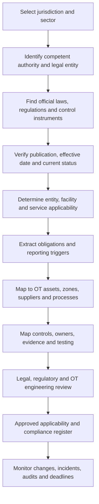
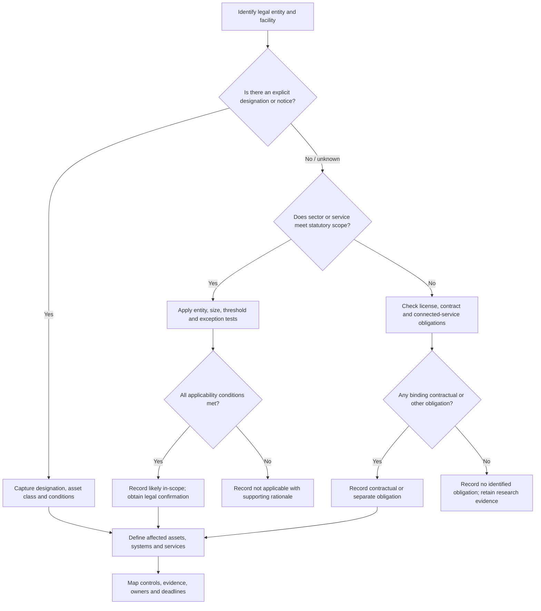
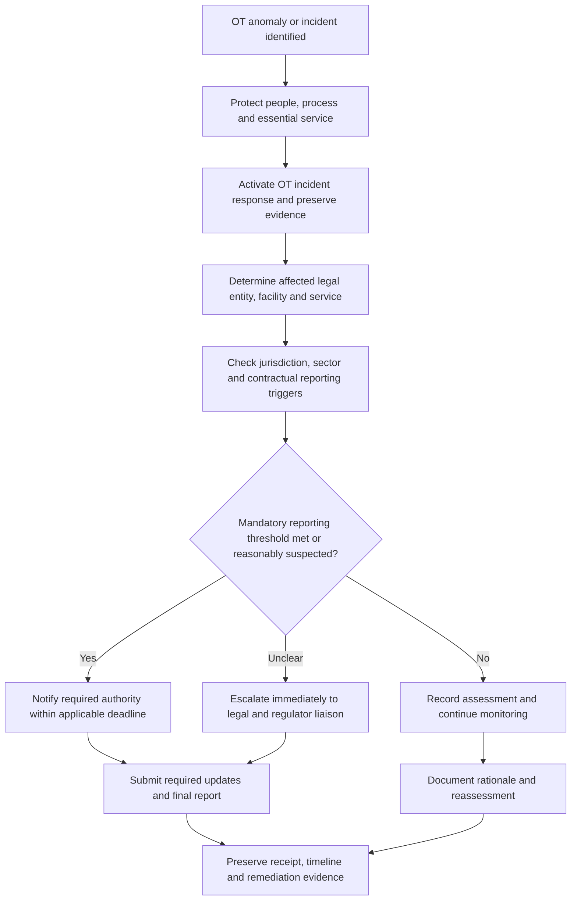
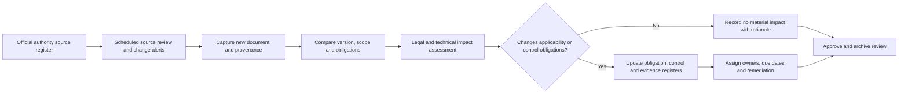
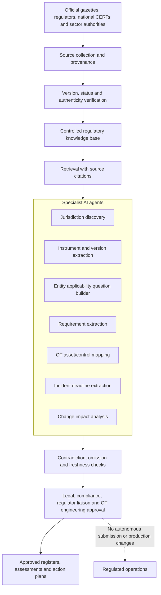

# Global OT Regulatory and Critical Infrastructure Playbook
## Country, sector, legal applicability, critical infrastructure and regulatory assurance

**Document ID:** UOTS-06-GLOBAL-REGULATORY | **Version:** 1.0 | **Status:** Verified-source research baseline — legal applicability review required

**Audience:** CISOs, OT security leaders, regulatory compliance teams, legal counsel, critical infrastructure operators, energy and utility organizations, industrial manufacturers, EPCs, system integrators, managed service providers and auditors.

> **Legal and operational notice:** This is an independent research and engineering reference, not legal advice, a regulator determination, or a compliance certificate. Regulatory applicability is entity-, facility-, service-, sector-, jurisdiction- and date-specific. A national strategy is not automatically binding law. A published control standard may be mandatory only for entities within a defined scope. Confirm current official instruments, national implementation, effective dates, regulator directions, contractual flow-downs and written interpretations before relying on a conclusion. Never infer compliance from a framework crosswalk alone.

---

# 1. Mission and scope

OT regulatory mapping must answer five questions:

1. **Who is regulated?** Identify the legal entity, operator, owner, service provider, license holder and any designated critical infrastructure entity.
2. **What is regulated?** Identify the service, facility, asset class, OT/ICS systems, connected IT systems, data and suppliers in scope.
3. **Which instrument applies?** Identify the law, regulation, regulator control, national standard, license condition, contract or guidance, including exact edition and effective date.
4. **What must be done?** Extract the actual obligations, control outcomes, reporting deadlines, assurance and evidence requirements.
5. **How is it proven?** Map obligations to assets, zones, processes, controls, owners, evidence, testing and remediation.

This chapter creates a country and sector research model for the Middle East, GCC and wider global markets. It intentionally separates verified official-source facts from applicability questions and research gaps.

## 1.1 Scope boundaries

Include:
- Industrial control systems and OT assets.
- Energy, oil and gas, LNG, petrochemicals, power, water and wastewater.
- Manufacturing, mining, transport, ports, airports, rail and logistics.
- Building automation, data centre facilities and healthcare infrastructure.
- Critical information infrastructure (CII), critical national infrastructure (CNI) and designated critical entities.
- OT-connected IT, remote access, cloud/edge services, suppliers and managed services where included by the instrument.
- Cyber incident reporting, vulnerability handling, risk management, audits, resilience and recovery.
- National, subnational, sectoral and contractual requirements.

Do not automatically include every corporate IT system in an OT legal scope, or exclude connected IT systems. Follow the actual instrument's definitions and boundary rules.

## 1.2 Regulatory intelligence workflow

---

# 2. Regulatory source hierarchy and status model

## 2.1 Source hierarchy

Use the strongest source available for the claim being made:

1. Official gazette, consolidated statute, regulation or legally authoritative publication.
2. Official regulator instrument, binding direction, standard or order.
3. Official regulator implementation guide, compliance methodology or assessment tool.
4. Official government or national cybersecurity authority publication.
5. Official sector regulator, licensing authority or critical infrastructure operator requirements.
6. Contract, concession, license, procurement or customer specification applicable to the organization.
7. Official regulator FAQ, circular, interpretation or public notice.
8. Reputable secondary legal analysis, clearly labelled as secondary.
9. Industry commentary, vendor material or media, used only as leads and not as controlling legal evidence.

Where an official English translation differs from the authoritative local-language instrument, record the language and translation caveat and obtain legal review.

## 2.2 Instrument status

| Status | Meaning | Allowed conclusion |
|---|---|---|
| In force / current | Official source confirms effective current instrument | May be assessed for applicability |
| Published, future effective | Published but commencement date is in future | Track readiness; do not state currently effective |
| Draft / consultation | Proposed instrument | Monitor; not a binding final obligation unless another legal basis applies |
| Superseded | Replaced or withdrawn | Retain historical traceability only |
| Guidance | Official advice or implementation guidance | Use as guidance unless adopted or incorporated |
| Contractual | Binding on parties under a contract | Applies to contract scope and parties |
| Scope pending | Instrument verified, entity applicability unresolved | Do not declare applicable or not applicable |
| Research required | No sufficiently authoritative source identified | No compliance conclusion |
| Not applicable with rationale | Scope test completed and documented | Reassess when facts or law change |

## 2.3 Evidence record for every legal claim

Record the official source URL, exact title, issuing authority, instrument number, publication date, commencement date, amendments, current status, local-language title, English translation status, scope provision, definitions, exclusions, regulator, enforcement provisions, reporting rules, access date and reviewer.

---

# 3. Critical infrastructure applicability model

## 3.1 Critical infrastructure is a legal and policy concept

Different jurisdictions use terms such as CII, CNI, critical infrastructure asset, essential service, vital entity, regulated entity, system of national significance, critical information infrastructure, and designated operator. These terms are not interchangeable.

A site may be critical because of:
- Formal designation or registration.
- Sector, service or asset class.
- Capacity, customer count, geography or dependency threshold.
- License or concession.
- Government ownership or operation.
- National security or essential service function.
- Regulator notice or direction.
- Contractual designation by a customer or operator.

## 3.2 Applicability decision tree

## 3.3 OT system boundary questions

For each instrument, determine whether it includes:
- OT assets directly controlling or monitoring the essential service.
- Supervisory systems, historians, engineering workstations and operator stations.
- Remote sites, substations, pump stations, pipelines and distributed assets.
- Safety instrumented systems and protection relays.
- IT systems logically or physically connected to OT.
- Cloud, data centre, telecom, identity, time and remote access dependencies.
- Third-party operated assets and outsourced services.
- Suppliers and integrators with privileged access.
- Backup control centres, disaster recovery and restoration systems.

Do not assume the legal boundary is the same as the Purdue model or a network security zone.

---

# 4. Global regulatory control domains for OT

Use these domains to normalize research and engineering implementation. Preserve each regulator's original control identifiers and wording in controlled workpapers.

| Domain | Regulatory questions | OT evidence examples |
|---|---|---|
| Governance and accountability | Who is accountable? Is there a board or executive duty? | OT security charter, RACI, management review |
| Critical asset identification | Which assets/services are designated or registered? | CII register, asset inventory, designation notice |
| Risk management | Is a formal risk assessment or risk program required? | OT risk register, SRA, treatment plans |
| Asset and configuration management | Are systems and dependencies inventoried? | Asset register, configuration baselines |
| Network security | Are boundaries, conduits and communications controlled? | Diagrams, firewall rules, flow matrix |
| Identity and access | Are privileged and remote accounts controlled? | Access reviews, MFA records, session logs |
| Supplier and third-party security | Are suppliers assessed and access governed? | Supplier register, contracts, assurance reports |
| Vulnerability and patch management | Are vulnerabilities assessed and treated? | Advisory register, exceptions, test records |
| Secure engineering and change | Are changes assessed and approved? | MOC, engineering approvals, rollback plans |
| Monitoring and detection | Are events logged and monitored? | OT SOC coverage, passive sensor records |
| Incident response | Are incidents reported and managed within required time? | Playbooks, incident timelines, notification evidence |
| Business continuity and recovery | Are essential services restored within required targets? | BCP, DR plans, restore tests |
| Physical security | Are sites, cabinets, consoles and media protected? | Access logs, visitor records, cabinet controls |
| Personnel competence | Are roles trained and competent? | Training matrix, competency assessments |
| Audit and assurance | Are assessments and remediation performed? | Audit reports, evidence index, closure records |
| Resilience and exercises | Are continuity and cyber exercises required? | Exercise reports, lessons and action plans |

---

# 5. GCC regional regulatory map

## 5.1 Saudi Arabia

### Verified primary instrument: NCA OT Cybersecurity Controls

The Saudi National Cybersecurity Authority (NCA) publishes **Operational Technology Cybersecurity Controls, OTCC-1:2022**. The NCA page identifies the controls as published on 2 June 2022 and describes them as minimum requirements to raise OT cybersecurity and protect ICS from cyber threats. The NCA states that OTCC extends its Essential Cybersecurity Controls (ECC).

The official NCA OTCC page lists:
- OTCC-1:2022.
- OTCC Methodology and Mapping Annex.
- OTCC Assessment and Compliance Tool.

Official source: https://nca.gov.sa/en/regulatory-documents/controls-list/otcc/

### Applicability

The official OTCC implementation guide describes applicability to Saudi government organizations and their companies/entities, as well as private-sector organizations that own, operate or host Critical National Infrastructures (CNIs). It encourages other organizations to use the guide as best practice. Confirm the organization's exact scope, facility level and applicable control level.

Implementation guide: https://cdn.nca.gov.sa/api/files/public/upload/0d563108-e1c6-43fd-bd4b-a0d5a22d83e8_OTCC_Implementation-Guideline_en.pdf

### Assessment implications

The OTCC material states that compliance with the applicable ECC is a prerequisite and describes NCA assessment through self-assessment and/or field visits by NCA or designated third parties under approved mechanisms. The official OTCC material also references facility-level identification and an assessment/compliance tool.

### Saudi assessment workplan

1. Confirm the legal entity and government/private-sector status.
2. Determine whether the organization owns, operates or hosts a CNI.
3. Identify affected facilities and OT systems.
4. Obtain current OTCC controls, methodology/mapping annex, implementation guide and assessment tool.
5. Confirm the required facility/control level using the official method.
6. Establish ECC prerequisite status and evidence.
7. Map each OTCC requirement to asset, owner, process, technical control and evidence.
8. Record deviations, compensating controls, residual risk and management approval.
9. Validate through the current NCA assessment mechanism.
10. Reassess after NCA updates, facility changes and major OT changes.

### Other Saudi requirements to investigate

- NCA Essential Cybersecurity Controls and other controls relevant to the entity.
- Cloud Cybersecurity Controls where cloud services are in scope.
- Data Cybersecurity Controls where applicable.
- Sector regulator requirements for energy, water, telecom, transport and finance.
- Saudi Aramco, SEC, SWCC, SABIC or other operator/customer security specifications where contractually applicable.
- Personal data and data governance requirements where personal data is processed.
- National incident reporting and regulator notification requirements applicable to the organization.

Do not claim a customer security standard applies to all Saudi operators. It may be contractual or operator-specific.

## 5.2 United Arab Emirates

### National critical information infrastructure policy

The UAE government portal describes a **Critical Information Infrastructure Protection (CIIP) Policy** established by the UAE Cyber Security Council. The policy defines a governance and protection framework for CII entities, including identification of critical assets, national risk profiles, baseline security requirements, assurance and enforcement mechanisms across vital sectors.

Official UAE government source, updated 2 July 2026: https://u.ae/en/about-the-uae/strategies-initiatives-and-awards/policies/cyber-activities/Critical-Information-Infrastructure-Protection-Policy

**Applicability:** Determine whether the organization or asset is identified as CII, which competent authority supervises it, and what sector-specific implementation requirements apply. Do not assume every private company is automatically a CII entity.

### Dubai DESC ICS Standard

The Dubai Electronic Security Center (DESC) publishes an ICS Standard. DESC states that it applies to Dubai government and semi-government entities that operate critical infrastructure and/or Industrial Control Systems (OT). The standard aims to provide a framework for managing cyber risks to ICS/OT in Dubai critical infrastructure.

Official DESC source: https://www.desc.gov.ae/regulations/standards-policies/

This is a concrete emirate-level OT reference. Do not generalize its stated applicability to every UAE emirate or every private organization without another legal or contractual basis.

### UAE research and assessment checklist

- Determine federal versus emirate jurisdiction.
- Identify CII designation and competent authority.
- Determine whether DESC ICS Standard applies to the entity.
- Check government/semi-government status and critical infrastructure operation.
- Identify sector-specific requirements and licenses.
- Obtain the current full standard and implementation materials from the authority.
- Map exact control IDs and evidence; do not rely only on the summary webpage.
- Verify incident reporting, assessment and enforcement requirements.
- Check national policies for third-party security, cloud, IoT, encryption and vulnerability disclosure where relevant.
- Record whether each source is mandatory, policy, standard or guidance.

The UAE government portal also lists national policies including third-party security, cloud security, encryption and IoT security. These should be assessed by scope and issuing authority, not assumed to be OT-specific.

## 5.3 Qatar

### National ICS Security Standard

An official Qatar National Cyber Security Agency / Q-CERT hosted document is titled **Controls for the Security of Critical Industrial Automation and Control Systems (National ICS Security Standard), Version 3.1**.

The published document states that it provides minimum controls for ICS systems determined to be critical and is to be used with a suitable risk-based security management program. Its described scope includes examples such as control centres and backup control centres, transmission substations supporting bulk-system reliability, system restoration facilities, monitoring and control systems, automatic generation control, real-time system modelling and real-time inter-utility data exchange.

Official document: https://qcert.ncsa.gov.qa/sites/default/files/public/documents/cs_national_ics_security_standard_en_v3.1_0.pdf

The standard also describes a deviation process for safety/operability and technical constraints, with alternative or compensating controls and residual-risk acknowledgement. This is important for OT: compliance actions must not inadvertently remove the operator's ability to control equipment, receive key measurements or alarms.

### National assurance framework context

Qatar NCSA publishes material describing the National Information Security Compliance Framework (NISCF) and National Information Assurance Framework (NIAF). The NISCF is described as a means to validate and assure security guided by the NIAF. The source also describes National Cyber Governance and Assurance Affairs responsibilities under Amiri Decree No. 1 of 2021.

Official NISCF booklet: https://www.assurance.ncsa.gov.qa/sites/default/files/library/2024-04/NISCF_Booklet.pdf

The National Information Assurance Standard Version 2.1 is also published on the official assurance portal. Its legal mandate section references Amiri Decree No. 1 of 2021 and notes that applicable laws take precedence in case of conflict.

Official standard: https://assurance.ncsa.gov.qa/sites/default/files/publications/policy/2023/NCSA_CSGA_%20National_Information_Assurance_Standard_En_V2.1_0.pdf

### National strategy

Qatar's NCSA national cybersecurity strategy identifies critical national infrastructure resilience, national situational awareness, incident response, continuity of critical services and development of legislation/regulatory frameworks as strategic objectives.

Official source: https://www.ncsa.gov.qa/en/national-cyber-security-strategy

### Qatar applicability actions

1. Identify whether the facility/system is designated or treated as critical ICS.
2. Confirm the current authority, current instrument version and whether Version 3.1 remains current.
3. Obtain the complete standard and any sector-specific directions.
4. Determine whether the organization is subject to NIAF/NISCF or other assurance requirements.
5. Identify applicable energy, water, transport, telecom and government requirements.
6. Determine the required assessment, certification, audit and reporting process.
7. Map deviation/exception approvals to safety, operability, technical constraint and residual risk.
8. Confirm contractually imposed QatarEnergy, utility, EPC and customer requirements separately.

**Status:** Official national ICS standard located. Current version status, mandatory adoption scope, entity designation and current assessment procedure require confirmation with the competent authority and legal counsel before a compliance conclusion.

## 5.4 Bahrain

### National Cyber Security Center

Bahrain's National Cyber Security Center (NCSC) identifies itself as the national cybersecurity authority. Its official page describes its responsibilities for national cybersecurity strategy, CNI identification/protection, cybersecurity standards and controls, risk management, incident response, audits and CNI threat monitoring.

Official NCSC source: https://www.ncsc.gov.bh/en/about/who-are-we

### Baseline Cyber Security Controls

The NCSC publishes Baseline Cyber Security Controls. The official page describes seven domains:
1. Cybersecurity governance.
2. Training and awareness.
3. Cybersecurity defense.
4. Incident and log management.
5. Third-party and cloud cybersecurity.
6. OT and IoT cybersecurity.
7. Audit.

The official controls page states that the document is an essential control baseline. The published baseline document states mandatory applicability for private and public entities that are part of Bahrain's CNI, while encouraging other entities to follow it.

Official page: https://ncsc.gov.bh/en/standards-controls/baseline-cyber-security-controls.html

### CNI Cybersecurity Controls

The NCSC identifies CNI sectors including Gas, Electricity & Oil (GEO), Financial Services, ICT, Healthcare Services, Government Services, Critical Industry and Transportation. It publishes sector control resources including Oil, Electricity and Gas and Critical Industry controls.

Official source: https://www.ncsc.gov.bh/en/standards-controls/CNI-cybersecurity-controls

### Bahrain National Cyber Security Strategy 2025–2028

The NCSC publishes a 2025–2028 strategy with pillars including advanced cyber resilience for CNI and SMEs and robust cybersecurity governance.

Official source: https://www.ncsc.gov.bh/en/national-strategy/bahrain-national-cyber-security-strategy-2025-2028.html

### Bahrain applicability actions

- Confirm whether the organization is a CNI entity and its sector.
- Obtain the current Baseline Cyber Security Controls and relevant CNI sector controls.
- Confirm mandatory applicability, scope and assessment mechanism.
- Identify the specific OT/IoT control requirements in the authoritative document.
- Confirm current NCSC audit and incident reporting expectations.
- Map energy, oil, gas, utilities, transport, healthcare and critical industry requirements separately.
- Distinguish national strategy objectives from enforceable controls.

## 5.5 Kuwait

### Official research lead

Kuwait's Communication and Information Technology Regulatory Authority (CITRA) hosts a national Cyber Security Strategy document. The published strategy discusses safeguarding national assets and critical infrastructure, national cybersecurity standards and policies, SOC and CERT functions, monitoring, incident response, business continuity and compliance.

Official source: https://www.citra.gov.kw/sites/en/LegalReferences/English%20Cyber%20Security%20Strategy.pdf

### Status and research limitations

The strategy is a national policy/strategy source, not by itself proof of a current OT-specific mandatory control catalogue. The current competent authority, current cybersecurity law and regulator instruments, CNI designation criteria, sector controls, and enforceable OT obligations must be independently verified.

### Kuwait research tasks

- Confirm current national cybersecurity governance and authority.
- Locate current laws, regulations, directives and critical infrastructure rules.
- Identify oil, gas, electricity, water, telecom, transport and government sector regulators.
- Verify whether CNI operators have mandatory controls, audits or incident reporting.
- Obtain official OT/ICS control standards if published.
- Confirm requirements for vendors, remote access, cloud and outsourced operations.
- Record all unresolved matters as Research Required.

## 5.6 Oman

### Research status

This edition does not establish a verified, current, universally applicable Oman OT cybersecurity control catalogue or a definitive legal applicability statement. Do not invent one.

### Oman research tasks

- Identify the current national cybersecurity authority and competent sector regulators from official government sources.
- Verify national cybersecurity laws, policies, critical infrastructure designation and incident reporting instruments.
- Investigate energy, oil and gas, electricity, water, ports, aviation, transport and telecom obligations.
- Determine whether government entities, license holders, CNI operators and private suppliers have different requirements.
- Obtain official control documents and assessment methodologies.
- Confirm publication dates, effective dates, amendments and enforcement mechanisms.
- Keep any national strategy separate from binding regulations and regulator controls.

## 5.7 GCC comparison matrix

| Jurisdiction | Official OT/CII source identified | What can be stated safely | Key open validation |
|---|---|---|---|
| Saudi Arabia | NCA OTCC-1:2022 and implementation material | OT-specific control publication; stated scope includes government entities and private CNI owners/operators/hosts | Entity/facility level, current tool, exact applicability |
| UAE federal | UAE CIIP Policy | National CII governance and protection framework | Entity designation and detailed obligations |
| Dubai | DESC ICS Standard | DESC states applicability to Dubai government and semi-government entities operating critical infrastructure and/or OT | Full standard, control IDs, entity facts |
| Qatar | National ICS Security Standard v3.1; NIAF/NISCF material | Official ICS baseline and national assurance documents exist | Current version, adoption, designation, assessment |
| Bahrain | Baseline controls and CNI sector controls | NCSC documents include OT/IoT domain; published baseline states CNI applicability | Current version, exact CNI designation and sector controls |
| Kuwait | National Cyber Security Strategy hosted by CITRA | Strategy identifies critical infrastructure protection objectives | Current binding controls and OT-specific instruments |
| Oman | No definitive current OT control catalogue verified in this edition | Research required | Authority, law, CNI scope, sector and OT controls |

---

# 6. Middle East beyond the GCC

This section provides a research register. It does not declare a country's obligations complete.

| Country | Primary research target | OT/critical infrastructure focus | Status in this edition |
|---|---|---|---|
| Jordan | National cybersecurity authority, cybercrime/cybersecurity legislation, CNI instruments | Energy, water, transport, telecom | Research required |
| Egypt | National cybersecurity strategy, competent national authority, sector regulators | Power, gas, water, transport, ports, manufacturing | Research required |
| Türkiye | National cybersecurity authority and strategy, sector laws and critical infrastructure rules | Energy, transport, manufacturing, telecom | Research required |
| Iraq | National cybersecurity governance and sector regulators | Oil and gas, power, water, ports | Research required |
| Lebanon | National cybersecurity authority and sector-specific laws | Energy, telecom, water, transport | Research required |
| Israel | National Cyber Directorate and sector-specific critical infrastructure directions | Energy, water, transport, manufacturing | Research required |
| Palestine | Competent national authorities and sector rules | Utilities, telecom, public infrastructure | Research required |
| Yemen | Competent national authority and sector requirements | Power, oil, water, telecom | Research required |

For every country, identify the legal authority and official publication before importing any requirement from a neighboring jurisdiction.

---

# 7. Asia-Pacific regulatory map

## 7.1 India

### Power sector: CEA Cyber Security in Power Sector Regulations, 2025

The Central Electricity Authority publishes the **Central Electricity Authority (Cyber Security in Power Sector) Regulations, 2025**. The official notification states that the regulations apply to entities that own, operate or manage OT infrastructure associated with the Power System and their IT infrastructure physically or logically connected to that OT infrastructure, for existing and upcoming infrastructure.

The notification states commencement six calendar months after publication in the Official Gazette, while identifying specified provisions with separate commencement dates to be set by the Authority. Always verify the Gazette publication date and any subsequent commencement orders before calculating deadlines.

Official CEA notification: https://www.cea.nic.in/api/regulation-report/download/en/50c978c2-b23d-44f0-805c-641ab323b61e

### Other Indian research areas

- CERT-In directions and current FAQs under the Information Technology Act.
- NCIIPC directions and requirements for designated Critical Information Infrastructure.
- Electricity sector rules, CEA directions and sectoral CERT/ISAC processes.
- Petroleum, natural gas, ports, rail, aviation, water and telecom regulator requirements.
- Digital Personal Data Protection legislation and rules where personal data is processed.
- Public procurement and customer security obligations.

Official resources:
- CERT-In: https://www.cert-in.org.in/
- NCIIPC: https://nciipc.gov.in/
- CEA: https://cea.nic.in/
- CEA Power ISAC: https://cea.nic.in/power-sector-information-sharing-and-analysis-center-isac-power/

### India assessment checklist

1. Determine whether the entity owns, operates or manages power-system OT.
2. Identify IT systems physically or logically connected to that OT.
3. Verify commencement and any provision-specific dates in Gazette and CEA orders.
4. Map exact regulation clauses to assets, processes, controls and evidence.
5. Identify applicable NCIIPC designation and directions separately.
6. Determine CERT-In reporting and log obligations for the entity and incident.
7. Map sectoral CERT escalation and coordination.
8. Check state-level, license and contractual requirements.

## 7.2 Singapore

The Cybersecurity Act establishes a legal framework for national cybersecurity and protection of Critical Information Infrastructure (CII). The Cyber Security Agency of Singapore states that CII sectors include Energy, Water, Banking and Finance, Healthcare, Transport, Infocomm, Media, Security and Emergency Services, and Government.

The CSA page states that amendments to the Act were passed in Parliament in May 2024 and the page was last updated 16 July 2026. Determine the current Act, subsidiary legislation, designation and applicable obligations for the specific CII owner.

Official source: https://www.csa.gov.sg/legislation/cybersecurity-act/

Assessment focus:
- CII designation and owner obligations.
- Cybersecurity codes of practice and directions.
- Incident notification and reporting.
- Audit, risk assessment and information provision.
- Third-party and supply-chain dependencies.
- OT/ICS scope within the designated essential service.

## 7.3 Australia

### Security of Critical Infrastructure Act 2018

The Australian Cyber and Infrastructure Security Centre states that the SOCI Act applies to 11 sectors: communications, financial services and markets, data storage or processing, defence industry, higher education and research, energy, food and grocery, healthcare and medical, space technology, transport, and water and sewerage.

The CISC describes obligations that can include asset register information, cyber incident reporting, and a written Critical Infrastructure Risk Management Program (CIRMP), depending on asset class and entity role. Systems of National Significance can have Enhanced Cyber Security Obligations.

Official source: https://www.cisc.gov.au/legislation-regulation-and-compliance/soci-act-2018

The CISC regulatory obligations page states that the Enhanced CIRMP commenced 10 June 2026. Confirm the asset class, responsible entity, current rules, thresholds, reporting triggers and transition arrangements.

Official obligations: https://www.cisc.gov.au/how-we-support-industry/regulatory-obligations

### Cyber Security Act 2024

Australia's Department of Home Affairs states the Cyber Security Act 2024 received Royal Assent on 29 November 2024. It includes initiatives such as minimum cybersecurity standards for smart devices, mandatory ransomware payment reporting for certain businesses, limited-use protections for incident information and a Cyber Incident Review Board.

Official source: https://www.homeaffairs.gov.au/cyber-security-subsite/Pages/cyber-security-act.aspx

Do not confuse the Cyber Security Act 2024 with SOCI Act obligations. Determine which statute and rules apply to each entity and activity.

## 7.4 Japan, South Korea, Indonesia, Malaysia, Thailand and Philippines

For these jurisdictions, this edition does not provide clause-level OT regulatory crosswalks. Research must identify:
- Current cybersecurity law and competent national authority.
- CII designation and covered sector definitions.
- Energy, water, transport, telecom and manufacturing regulator requirements.
- Incident notification thresholds and deadlines.
- Critical supplier and cross-border service obligations.
- Government procurement and cloud requirements.
- Current official OT/ICS guidance and standards.

Use official national gazettes, regulator sites and government portals. Record local-language sources and translation caveats.

---

# 8. Europe and United Kingdom

## 8.1 NIS2 Directive

Directive (EU) 2022/2555 (NIS2) establishes cybersecurity risk-management and incident-reporting requirements for in-scope essential and important entities across specified sectors. It covers sectors that include energy, transport, health, drinking water, wastewater, digital infrastructure, ICT service management, public administration, space, postal/courier, waste, chemicals, food, manufacturing and other listed categories.

Official legal text: https://eur-lex.europa.eu/eli/dir/2022/2555/oj

The European Commission maintains a transposition status resource. It notes that the information is based on Member State submissions and is without prejudice to the Commission's formal assessment of national transposition measures.

Official tracker: https://digital-strategy.ec.europa.eu/en/policies/nis-transposition

### NIS2 applicability workflow

1. Identify the Member State and legal establishment.
2. Determine whether the organization belongs to a listed sector and entity category.
3. Apply size thresholds and any special entity rules or exceptions.
4. Review national transposition law and competent authority guidance.
5. Determine essential or important entity status.
6. Map national requirements for risk management, supply chain, incident reporting, business continuity, cryptography, access control and management accountability.
7. Confirm national notification deadlines and supervisory/enforcement process.
8. Map OT systems and suppliers supporting the in-scope service.

Do not use the directive alone as the final national compliance checklist. Member State transposition and local regulator rules are essential.

## 8.2 Critical Entities Resilience Directive

Directive (EU) 2022/2557 (CER) concerns resilience of critical entities and covers physical and non-cyber resilience alongside related risk and incident obligations. It complements but is distinct from NIS2. Determine whether the entity is identified as a critical entity under national implementation.

Official text: https://eur-lex.europa.eu/eli/dir/2022/2557/oj

## 8.3 EU sectoral and product requirements

Investigate where relevant:
- Electricity and gas network codes and national energy regulator rules.
- EU electricity cybersecurity network code and its implementation.
- DORA for financial entities and relevant ICT third-party providers; do not apply it to an industrial operator solely because it uses IT.
- Radio equipment, machinery, product safety and product cybersecurity legislation where products are placed on the EU market.
- GDPR where personal data is processed.
- National critical infrastructure and incident reporting laws.

## 8.4 United Kingdom

Investigate the Network and Information Systems Regulations 2018, amendments, competent authority requirements and sector-specific rules for operators of essential services and relevant digital service providers.

Official legislation: https://www.legislation.gov.uk/uksi/2018/506/contents

The NCSC Cyber Assessment Framework is a structured assurance resource used in relevant contexts; it is not automatically a universal law for every UK organization.

Official CAF: https://www.ncsc.gov.uk/collection/cyber-assessment-framework

---

# 9. North America

## 9.1 United States

### NERC CIP

NERC Critical Infrastructure Protection (CIP) standards apply to registered entities and applicable Bulk Electric System (BES) cyber systems under defined applicability and categorization criteria. They are not a universal OT standard for every power, oil, gas or industrial company.

Official standards library: https://www.nerc.com/pa/Stand/Pages/CIPStandards.aspx

Assessment must confirm:
- Registered entity and functional registration.
- BES applicability and exclusions.
- BES Cyber System categorization and impact.
- Applicable CIP standards, requirements, measures and effective dates.
- Regional entity implementation guidance and enforcement.
- Electronic Security Perimeters, access, configuration, incident response, recovery and supply-chain requirements as applicable.

### TSA and other sector requirements

Investigate current Transportation Security Administration directives and requirements for covered pipeline, rail and other transportation entities. Determine whether the entity is directly covered, what security directives are current, and whether later amendments or exemptions apply.

### CISA

CISA guidance, Cross-Sector Cybersecurity Performance Goals, sector risk management agency material and binding operational directives may be relevant. A binding operational directive's scope must be checked; it is not automatically binding on every private organization.

## 9.2 Canada

Identify federal and provincial critical infrastructure, energy regulator, electricity reliability, privacy, telecommunications and sector requirements. Determine the exact province, entity, facility, regulator and applicable instrument. Do not copy US NERC CIP applicability to Canadian entities without an applicable Canadian or contractual basis.

## 9.3 Mexico

Identify national cybersecurity and critical infrastructure policy, federal and state requirements, energy regulator instruments, telecom and transport obligations, and current official incident reporting requirements. This edition does not assert a universal Mexico OT control catalogue.

---

# 10. Africa and Latin America research model

For African and Latin American jurisdictions, use the same authoritative-source method rather than importing GCC, EU or US controls.

Priority research dimensions:
- National cybersecurity and critical infrastructure law.
- National CERT and incident reporting.
- Energy, mining, oil and gas, water, ports, rail and telecom regulator requirements.
- Data protection and cross-border data obligations.
- Government procurement and supplier security.
- CNI designation and operator registration.
- Mandatory audit, resilience, continuity and reporting.

Country entries must remain Research Required until an official source, legal status, scope and effective date are verified.

---

# 11. Sector regulatory mapping

## 11.1 Oil and gas, LNG and petrochemicals

Map:
- National energy and hydrocarbons regulator.
- Critical infrastructure designation.
- Operator and concession/license conditions.
- Pipeline and process safety requirements.
- OT cybersecurity control requirements.
- Supplier, EPC, O&M and remote maintenance clauses.
- Incident reporting and environmental/safety notifications.
- Cross-border pipeline, terminal and maritime obligations where applicable.

OT system scope may include DCS, SIS, PLC, compressor/turbine control, pipeline SCADA, tank farms, loading systems, metering, terminal systems and remote field sites. Cyber and process safety obligations may be separate but must be coordinated.

## 11.2 Electricity generation, transmission and distribution

Map:
- National electricity law and regulator.
- Grid code and system operator requirements.
- Critical facility or CII designation.
- Power-sector cyber regulations.
- Substation automation and protection obligations.
- Control centre and backup control centre requirements.
- Incident notification and restoration obligations.
- Sectoral CERT/ISAC participation where required.

Assets may include generation control, plant DCS, turbine control, protection IEDs, IEC 61850 networks, SCADA, EMS, RTUs, substations, telecontrol, metering and grid communication infrastructure.

## 11.3 Water and wastewater

Map:
- Water utility and environmental regulator.
- Public health and drinking water obligations.
- Critical infrastructure designation.
- OT cybersecurity requirements.
- Chemical handling and safety obligations.
- Incident reporting and service continuity.
- Third-party and remote maintenance.

Assets may include treatment PLCs, pump stations, telemetry, dosing systems, laboratory systems, reservoirs, wastewater treatment and remote monitoring.

## 11.4 Manufacturing and industrial production

Map:
- Industrial safety and machinery requirements.
- Sector-specific product and quality regulation.
- CNI designation and national cyber controls.
- Supplier and customer contractual controls.
- Product security and secure development obligations.
- Data protection and cross-border transfer where relevant.

Assets may include PLCs, robots, CNC, MES, SCADA, industrial networks, warehouse automation, quality systems and production data platforms.

## 11.5 Mining and metals

Map:
- Mining safety regulator.
- Environmental and occupational safety laws.
- Critical infrastructure designation.
- Remote operation and autonomous systems requirements.
- Supplier access and communications.
- Incident reporting and continuity.

## 11.6 Transport, ports, airports and rail

Map:
- Transport safety and security regulators.
- Aviation, maritime, port and rail cybersecurity rules.
- Critical service designation.
- Signalling, traction power and terminal automation requirements.
- Supplier and maintenance obligations.
- Incident reporting and service continuity.

## 11.7 Buildings and data centres

Map:
- Building, fire/life safety and electrical regulations.
- Government or CII designation.
- Data centre and cloud service requirements.
- Privacy and access control obligations.
- Energy, water and facility resilience.
- BMS, HVAC, EPMS, UPS, generator and physical access system dependencies.

---

# 12. Cross-border and supplier obligations

Industrial operators often rely on global vendors, OEMs, EPCs, cloud providers, telecom operators, remote support, managed SOCs and software suppliers. A local operator's regulatory duty may not automatically transfer to the supplier, but contracts and laws may impose supplier obligations or require the operator to manage supply-chain risk.

For each supplier:
- Identify legal entity and country of establishment.
- Determine whether supplier is itself a regulated entity.
- Identify services and assets accessed.
- Record data and operational access locations.
- Define subcontractor and fourth-party access.
- Map remote access and privileged identity.
- Define incident notification and cooperation obligations.
- Define evidence, audit and vulnerability disclosure rights.
- Define termination, credential revocation and secure return/destruction.
- Review cross-border data transfer and export restrictions where relevant.

Do not assume a supplier certification proves that the operator has fulfilled its own statutory obligations.

---

# 13. Incident reporting and notification engineering

## 13.1 Reporting obligation matrix

For each jurisdiction and instrument, capture:

| Field | Required detail |
|---|---|
| Trigger | Incident, significant impact, ransomware payment, service disruption, suspected compromise, data breach |
| Covered entity | Designated operator, regulated entity, licensee, supplier |
| Recipient | Regulator, national CERT, sector CERT, law enforcement, customer |
| Initial deadline | Exact statutory/regulatory time and trigger point |
| Follow-up | Intermediate and final report deadlines |
| Required content | Impact, systems, timeline, indicators, mitigation, service effect |
| Update obligations | Material change and recovery status |
| Confidentiality | Handling and disclosure restrictions |
| Evidence | Incident timeline, decision log, notification receipt |
| Internal owner | Incident commander and legal/compliance contact |

Do not reuse one country's deadline in another country. Do not assume the clock begins at technical detection; the legal trigger may be awareness, confirmation, significant impact, or another defined event.

## 13.2 OT reporting decision flow

The incident commander must coordinate with operations and safety. A cyber reporting action must not delay urgent process safety or emergency response.

---

# 14. Regulatory change management and monitoring

## 14.1 Change triggers

Review regulatory applicability when:
- New law, regulation, standard, directive or amendment is published.
- A draft becomes final or an effective date changes.
- A regulator issues a new FAQ, circular, order or assessment method.
- The entity acquires a facility or changes ownership.
- A site is designated or removed as CII/CNI.
- The organization enters a new country or sector.
- A new license, concession or customer contract is signed.
- OT architecture, cloud dependency or remote access changes.
- A reportable incident, audit or regulator inspection occurs.
- A standard is revised or superseded.

## 14.2 Change monitoring workflow

A webpage update timestamp alone does not prove a legal amendment. Retrieve the underlying instrument and verify the legal publication.

---

# 15. Regulatory assessment and audit playbook

## 15.1 Assessment phases

**Phase 1 — Legal entity and jurisdiction**
- Confirm legal entity, operating model, country, subnational jurisdiction and ownership.
- Identify regulator, license and critical infrastructure status.
- Identify contracts, concessions and customer flow-downs.

**Phase 2 — Instrument verification**
- Obtain authoritative instrument and amendments.
- Record legal status, effective date, version and official source.
- Identify covered entity, sector, service, facility and system definitions.

**Phase 3 — OT scope**
- Inventory sites, services, systems, assets and suppliers.
- Map OT/IT dependencies, zones, conduits and remote paths.
- Identify safety, environment and continuity dependencies.

**Phase 4 — Requirement mapping**
- Extract exact requirement IDs and source references.
- Map to internal controls, owners and implementation.
- Identify direct, partial, supporting and unmapped obligations.

**Phase 5 — Evidence and testing**
- Collect approved evidence.
- Test design and operating effectiveness.
- Validate evidence authenticity, completeness, time period and scope.
- Record samples, exceptions and limitations.

**Phase 6 — Findings and remediation**
- Rate risk using approved method.
- Assign accountable owner and due date.
- Define compensating controls and residual risk.
- Obtain required management/regulator approval.
- Retest and close with evidence.

## 15.2 Compliance conclusion language

Use carefully qualified conclusions:
- **Applicable:** scope criteria have been verified and recorded.
- **Not applicable:** a documented scope test supports the conclusion.
- **Pending legal determination:** facts or legal interpretation remain unresolved.
- **Implemented:** control implementation evidence exists.
- **Design effective:** control design addresses the stated requirement.
- **Operating effective for sample:** tested operation was effective for the stated sample and period.
- **Gap identified:** requirement or control objective is not adequately addressed.
- **Not assessed:** no conclusion has been reached.
- **Compliant:** use only where a competent, complete assessment supports the claim and the relevant assurance context permits it.

Avoid saying "certified compliant" unless an authorized certification or regulator process actually produced that result.

---

# 16. Master regulatory register templates

## 16.1 Jurisdiction register

| Field | Description |
|---|---|
| Jurisdiction ID | Unique identifier |
| Country / territory | Exact jurisdiction |
| Subnational authority | Emirate, state, province or region |
| Official portal | Government/regulator portal |
| Competent authority | Current authority |
| Local language | Official instrument language |
| Research owner | Responsible analyst |
| Last verified | Date |
| Next review | Planned date |
| Confidence | Verified / partial / research required |

## 16.2 Instrument register

| Field | Description |
|---|---|
| Instrument ID | Unique record |
| Jurisdiction ID | Parent jurisdiction |
| Issuer | Exact authority |
| Title | Official title |
| Identifier | Law/regulation/control number |
| Type | Law, regulation, directive, standard, strategy, guidance, contract |
| Version | Edition and amendment |
| Publication date | Official date |
| Effective date | Commencement |
| Status | Current, draft, superseded, future effective |
| Scope | Entity, sector, service, facility |
| Enforcement | Regulator, audit, penalty or license process |
| Official URL | Primary source |
| Access date | Actual retrieval date |
| Legal review | Reviewer and outcome |

## 16.3 Requirement register

| Field | Description |
|---|---|
| Requirement ID | Exact source ID |
| Instrument ID | Parent instrument |
| Source locator | Clause, section, annex, page |
| Requirement summary | Original concise summary |
| Mandatory status | Binding / advisory / contractual / unknown |
| Trigger | Entity or activity trigger |
| Applicability | Applicable / not applicable / pending |
| OT relevance | Direct / indirect / none identified |
| Deadline | Effective or compliance date |
| Reporting | Recipient and trigger |
| Evidence | Expected evidence |
| Reviewer | Legal and technical reviewer |

## 16.4 Requirement-to-asset-to-control mapping

| Field | Description |
|---|---|
| Requirement ID | Source requirement |
| Legal entity | Covered entity |
| Service/process | Essential service |
| Facility | Site or operating location |
| Asset IDs | In-scope assets |
| Zone/conduit | Architecture boundary |
| Threat scenario | Relevant risk |
| Internal control ID | Control implementation |
| Owner | Accountable role |
| Evidence ID | Evidence pointer |
| Test method | Approved verification |
| Result | Effective / gap / not assessed |
| Risk | Approved rating |
| Action | Treatment and due date |

## 16.5 Incident notification register

| Field | Description |
|---|---|
| Jurisdiction | Applicable country |
| Instrument | Legal source |
| Covered entity | Entity class |
| Incident trigger | Exact threshold |
| Start of clock | Legal trigger |
| Initial deadline | Exact time limit |
| Recipient | Authority |
| Follow-up deadlines | Exact schedule |
| Content | Required information |
| Internal owner | Responsible role |
| Procedure | Playbook reference |
| Evidence | Notification and receipt |

---

# 17. AI-assisted regulatory intelligence and agent architecture

AI can support source discovery, change detection, document extraction, obligation classification, crosswalk drafting and audit preparation. It cannot determine legal applicability conclusively, issue legal advice, approve exceptions, declare compliance, or autonomously submit regulator notifications.

## 17.1 Agent architecture

## 17.2 Agent guardrails

- Prefer official source domains and official gazettes.
- Preserve the original file and exact source URL.
- Store document hash, retrieval date, publication date and version.
- Separate current law, draft, guidance, strategy and secondary commentary.
- Never infer a reporting deadline from a summary page.
- Extract deadlines with the event trigger and legal clock definition.
- Flag conflicting versions and translation differences.
- Require a human legal reviewer for applicability and interpretation.
- Require OT engineering review for asset and process scope.
- Require accountable management approval for risk acceptance.
- Never automatically submit notifications or change OT configurations.
- Keep confidential site evidence out of public model prompts and repositories.

---

# 18. Common regulatory mapping errors

1. Treating a national cybersecurity strategy as binding legislation.
2. Treating a government standard as universally applicable to private companies.
3. Applying Dubai DESC requirements to every UAE emirate without scope analysis.
4. Assuming every Saudi organization has the same OTCC facility level.
5. Treating Qatar's National ICS Security Standard as current and mandatory for every organization without confirming adoption and scope.
6. Treating a Bahrain national strategy as equivalent to CNI sector controls.
7. Treating a Kuwait strategy as a current OT regulation.
8. Inventing Oman OT control identifiers where no authoritative instrument has been verified.
9. Treating NIST SP 800-82 as law.
10. Treating NERC CIP as applicable to every electricity company worldwide.
11. Using the EU NIS2 Directive without national transposition analysis.
12. Copying incident reporting timelines across jurisdictions.
13. Ignoring connected IT, suppliers, cloud and managed service scope.
14. Treating a framework mapping as evidence of compliance.
15. Ignoring amendments, transition periods and commencement orders.
16. Publishing sensitive CII details in public documentation.
17. Allowing AI to create unsupported legal interpretations or deadlines.

---

# 19. Source register and verification notes

The following official sources support the jurisdiction-specific statements in this baseline. Revalidate each before using it for a live assessment.

| Jurisdiction / topic | Official source | Verified use |
|---|---|---|
| Saudi NCA OTCC | https://nca.gov.sa/en/regulatory-documents/controls-list/otcc/ | OTCC-1:2022, publication and listed supporting tools |
| Saudi OTCC implementation | https://cdn.nca.gov.sa/api/files/public/upload/0d563108-e1c6-43fd-bd4b-a0d5a22d83e8_OTCC_Implementation-Guideline_en.pdf | Described applicability and implementation guidance |
| UAE CIIP Policy | https://u.ae/en/about-the-uae/strategies-initiatives-and-awards/policies/cyber-activities/Critical-Information-Infrastructure-Protection-Policy | National CII policy description, updated 2026 |
| Dubai DESC standards | https://www.desc.gov.ae/regulations/standards-policies/ | DESC ICS Standard scope statement |
| Qatar National ICS Standard v3.1 | https://qcert.ncsa.gov.qa/sites/default/files/public/documents/cs_national_ics_security_standard_en_v3.1_0.pdf | Critical ICS baseline and deviation process |
| Qatar NISCF | https://www.assurance.ncsa.gov.qa/sites/default/files/library/2024-04/NISCF_Booklet.pdf | National compliance/assurance framework context |
| Qatar NIA Standard | https://assurance.ncsa.gov.qa/sites/default/files/publications/policy/2023/NCSA_CSGA_%20National_Information_Assurance_Standard_En_V2.1_0.pdf | National assurance standard v2.1 metadata and legal context |
| Qatar national strategy | https://www.ncsa.gov.qa/en/national-cyber-security-strategy | CNI resilience and national strategy objectives |
| Bahrain Baseline Controls | https://ncsc.gov.bh/en/standards-controls/baseline-cyber-security-controls.html | Seven control domains including OT/IoT |
| Bahrain CNI controls | https://www.ncsc.gov.bh/en/standards-controls/CNI-cybersecurity-controls | CNI sectors and sector control resources |
| Bahrain NCSC | https://www.ncsc.gov.bh/en/about/who-are-we | Authority and mandate description |
| Bahrain strategy | https://www.ncsc.gov.bh/en/national-strategy/bahrain-national-cyber-security-strategy-2025-2028.html | 2025–2028 strategy |
| Kuwait strategy | https://www.citra.gov.kw/sites/en/LegalReferences/English%20Cyber%20Security%20Strategy.pdf | National strategy and critical infrastructure objectives |
| India CEA 2025 | https://www.cea.nic.in/api/regulation-report/download/en/50c978c2-b23d-44f0-805c-641ab323b61e | Power-sector cyber regulation and scope text |
| India CERT-In | https://www.cert-in.org.in/ | National incident response and directions source |
| India NCIIPC | https://nciipc.gov.in/ | CII authority source |
| Singapore CSA Act | https://www.csa.gov.sg/legislation/cybersecurity-act/ | Cybersecurity Act and CII sector list |
| Australia SOCI | https://www.cisc.gov.au/legislation-regulation-and-compliance/soci-act-2018 | SOCI sectors and obligations |
| Australia SOCI obligations | https://www.cisc.gov.au/how-we-support-industry/regulatory-obligations | CIRMP and enhanced obligation context |
| Australia Cyber Security Act | https://www.homeaffairs.gov.au/cyber-security-subsite/Pages/cyber-security-act.aspx | Cyber Security Act 2024 |
| EU NIS2 | https://eur-lex.europa.eu/eli/dir/2022/2555/oj | Directive text |
| EU transposition | https://digital-strategy.ec.europa.eu/en/policies/nis-transposition | Commission transposition status resource |
| EU CER | https://eur-lex.europa.eu/eli/dir/2022/2557/oj | Critical Entities Resilience Directive |
| UK NIS | https://www.legislation.gov.uk/uksi/2018/506/contents | UK NIS Regulations |
| UK NCSC CAF | https://www.ncsc.gov.uk/collection/cyber-assessment-framework | Assurance framework |
| US NERC CIP | https://www.nerc.com/pa/Stand/Pages/CIPStandards.aspx | CIP standards library |

## 19.1 Source status limitations

- The official Qatar ICS standard is located, but its current version, adoption status and entity-level applicability require confirmation.
- Kuwait's official strategy is a research lead, not proof of a current binding OT control set.
- No definitive current Oman OT control catalogue is verified in this edition.
- The UAE CIIP Policy is a national framework; specific entity obligations require designation and competent authority analysis.
- Bahrain's official control resources identify OT/IoT and CNI domains; the current exact control version and entity applicability must be confirmed.
- India CEA regulations require Gazette commencement and provision-specific order verification.
- NIS2 requires Member State transposition analysis.
- Australia SOCI obligations depend on asset class, entity role and current rules.

---

# 20. Document control and review requirements

## 20.1 Revision history

| Version | Date | Change | Status |
|---|---|---|---|
| 1.0 | 2026-11-17 | Global regulatory playbook, GCC primary-source baseline, India power-sector regulation, Singapore, Australia, EU/UK, sector mapping, reporting and AI workflows | Research baseline |

## 20.2 Specialist review required

Before this chapter is marked verified for a client or regulator:
- Legal counsel must confirm each entity's statutory scope and applicable law.
- Country specialists must validate local-language legislation and regulator interpretation.
- OT engineering must validate system and process boundaries.
- Saudi specialists must validate OTCC facility level and assessment tool.
- UAE specialists must validate federal CII and emirate-specific applicability.
- Qatar specialists must confirm National ICS Security Standard status, adoption and current NCSA assurance requirements.
- Bahrain specialists must confirm CNI designation and exact sector controls.
- Kuwait and Oman research must be completed using current official laws and regulator instruments.
- India specialists must verify CEA Gazette commencement and current orders.
- EU specialists must validate each Member State's transposition and regulator guidance.
- Australia specialists must verify SOCI asset class, CIRMP and enhanced obligations.
- All incident reporting deadlines must be checked against the exact current legal text.
- Every mapping must include source, edition, applicability rationale, reviewer and review date.

## 20.3 Limitations

This chapter is a public research baseline and technical mapping playbook. It is not a legal opinion, regulatory determination, certification or complete country-by-country legal database. Where evidence is incomplete, the correct result is a documented research gap. Do not claim mandatory status, applicability, deadlines or compliance without the authoritative source and a qualified review.
