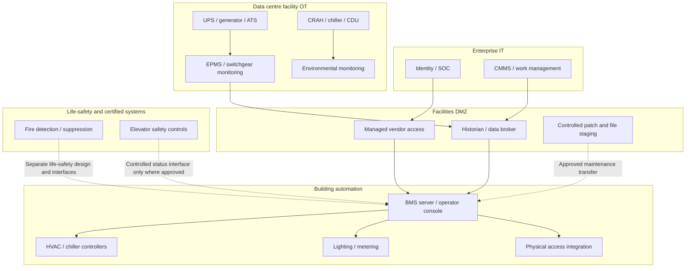
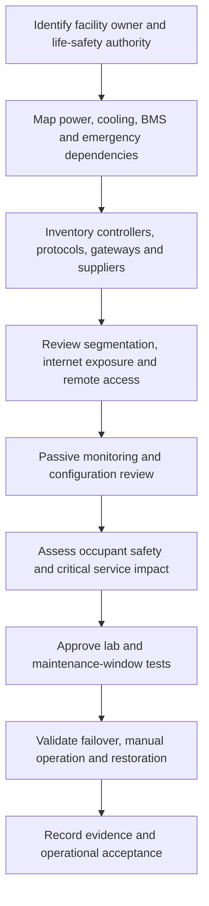

# Building Automation and Data Centre Facilities OT Security Engineering Handbook

## 1. Scope and critical dependencies

This handbook covers building management systems (BMS), HVAC, chillers, boilers, elevators, access control, lighting, fire and life safety, power management, UPS, generators, cooling and data centre facility infrastructure.

Building OT supports occupant safety, environmental conditions, physical security, energy management and continuity of building services. In data centres, facility OT directly supports the availability of IT services. A cyber incident affecting cooling, electrical distribution, generator controls or monitoring can create a facility-level outage even when the IT network remains healthy.

This handbook is not a fire safety design, elevator safety assessment, electrical protection study, data centre certification or facility operating procedure. The responsible facilities, electrical, fire/life safety, elevator and data centre authorities retain decision authority.

## 2. Facility systems and asset model

| System | Representative assets | Operational dependencies | Main consequence |
|---|---|---|---|
| BMS | BMS server, supervisory controller, field controller, operator workstation | HVAC, lighting, alarms, access integration | Loss of building visibility or environmental control |
| HVAC | AHU, VAV, dampers, sensors, actuators | Occupant comfort, pressure, air quality | Environmental and service impact |
| Chilled water | Chillers, pumps, cooling towers, valves | Thermal load, water flow, heat rejection | Cooling loss and equipment shutdown |
| Electrical power | Switchgear, breakers, meters, EPMS, transformers | Utility, UPS, generator, transfer switches | Loss of power monitoring or distribution control |
| UPS and generators | UPS management, battery monitoring, generator PLC, ATS | Critical load continuity | Failure to transfer or sustain load |
| Data centre cooling | CRAH/CRAC, in-row cooling, liquid cooling, CDU, pumps | Rack thermal envelope and IT load | Thermal excursion and IT service disruption |
| Fire/life safety | Fire detection, suppression, smoke control, voice evacuation | Occupant protection and emergency response | Life safety impact |
| Physical security | Access control, CCTV, barriers, visitor systems | Facility entry and security operations | Unauthorized physical access |
| Vertical transport | Elevator and escalator control | Occupant movement and emergency operation | Entrapment or access disruption |
| Facility network | BACnet/IP, gateways, IP controllers, serial networks | Monitoring, control and vendor maintenance | Cross-system compromise |

## 3. Reference architecture and segmentation

This is a conceptual view. Fire alarm, suppression, elevator safety and other certified life-safety systems must be architected and managed according to their applicable safety design and authority requirements. A BMS status interface does not imply that the BMS is permitted to control the certified safety function.

## 4. Protocol and integration considerations

| Technology | Common use | Security engineering concerns |
|---|---|---|
| BACnet/IP | BMS supervisory and field communications | Device discovery, broadcast exposure, network segmentation, write access and secure deployment |
| BACnet Secure Connect (BACnet/SC) | Encrypted BACnet communication over IP infrastructure | Certificate lifecycle, hub design, trust, interoperability and legacy coexistence |
| Modbus TCP/RTU | Meters, chillers, power and facility devices | Restrict write access, gateways and exposed services; protocol commonly lacks native authentication |
| KNX | Building automation and room control | Secure commissioning, device identity, IP gateway and project file protection |
| DALI | Lighting control | Gateway security and separation from enterprise networks |
| OPC UA | Data integration and supervisory interfaces | Certificate trust, endpoint security, user authorization and data direction |
| SNMP | Facility device monitoring | Version, community/credential control, management plane separation |
| Vendor proprietary protocols | Chiller, UPS, generator, elevator and facility control | Document exact model, version, interface, vendor support and safe change constraints |

BACnet/SC is an encrypted data link layer option in the BACnet ecosystem; it complements rather than automatically replaces every legacy BACnet deployment. Assess actual product support, certificate management and network architecture.

## 5. Data centre facility dependency model

A data centre's operational resilience depends on coordinated electrical, mechanical, control, monitoring and human response systems.

| Dependency | Failure or cyber scenario | Potential effect | Assurance evidence |
|---|---|---|---|
| Utility power and switchgear | Unauthorized configuration or loss of monitoring | Power disruption or unsafe switching decisions | Approved settings, event logs, electrical maintenance |
| UPS | Monitoring or control compromise | Reduced ride-through or failed battery response | Battery tests, alarms, configuration baseline |
| Generator and ATS | Start/transfer logic or remote access compromise | Failure to sustain critical load | Test records, controller baseline, transfer test |
| Chillers and heat rejection | Setpoint or control disruption | Cooling degradation | Chiller trends, alarm and failover records |
| CRAH/CRAC and pumps | Controller or sensor compromise | Hot spots and thermal excursions | Air/water flow, temperature trends, control baseline |
| Liquid cooling/CDU | Flow, leak or pump monitoring disruption | Rack cooling interruption or leak risk | Leak detection, flow/pressure telemetry |
| BMS/EPMS monitoring | Loss or manipulation of telemetry | Operators make decisions on inaccurate facility state | Independent measurements, event and alarm logs |
| Remote vendor access | Compromised OEM account | Cross-system access and persistence | Sponsor, time window, session recording |
| Physical security | Access control integration compromise | Unauthorized entry or response delay | Door events, CCTV, guard and incident records |

## 6. Defensive engineering baseline

### 6.1 Asset and network governance
- Inventory controllers, gateways, operator consoles, engineering tools, remote access appliances and facility interfaces.
- Separate BMS, EPMS, data centre cooling, physical security, enterprise and life-safety domains according to the design and risk.
- Restrict BACnet/IP and other building protocols to approved network paths.
- Avoid direct internet exposure of building controllers and management interfaces.
- Control routing between tenant, corporate, facilities and service-provider networks.
- Document which systems are monitoring-only and which can issue control commands.

### 6.2 Identity and vendor access
- Use named accounts and least privilege for operators, facilities engineers and suppliers.
- Use a managed remote access gateway with time-limited approval and session logging.
- Remove default credentials and disable unused accounts and services.
- Separate vendor access by system, site and maintenance scope.
- Review certificates and trust stores for BACnet/SC and other certificate-based integrations.

### 6.3 Configuration and resilience
- Maintain known-good BMS, EPMS, UPS, generator, chiller and cooling controller configurations.
- Require management of change for setpoints, schedules, alarm thresholds, control sequences and network configuration.
- Test backups and restoration with facilities engineering and OEM support.
- Validate local/manual control and failover behavior before changing monitoring or control paths.
- Keep life-safety and emergency systems available during cybersecurity maintenance.

## 7. Monitoring and detection engineering

| Detection use case | Telemetry | Analytic idea | Owner |
|---|---|---|---|
| Unexpected BACnet device | Passive network monitoring, switch logs | New device, object or service outside approved inventory | BMS engineer |
| Critical setpoint change | BMS audit, controller logs, historian | Temperature, pressure or schedule changed outside approved work order | Facilities operations |
| Vendor access anomaly | VPN, jump host, identity and session logs | Session outside approved site, system or time window | Facilities IT |
| Cooling performance anomaly | Chiller, CDU, CRAH, pump, flow and temperature telemetry | Commanded state and physical response diverge | Data centre facilities |
| UPS/generator event | EPMS, UPS, generator and ATS logs | Unexpected mode, alarm suppression or configuration change | Electrical operations |
| Fire/life-safety interface loss | Approved monitoring interface and fire system events | Loss of status/alarm path | Fire/life-safety authority |
| Physical access anomaly | Access control, CCTV and visitor logs | Unusual access to OT rooms or vendor cabinets | Physical security |
| BMS/EPMS network change | Firewall, switch and controller logs | New route, peer, service or remote connection | OT network team |

Detection must account for seasonal schedules, planned maintenance, load changes, generator tests and cooling optimization. Do not automatically translate an alert into a control command.

## 8. Safe assessment workflow

Assessment cautions:
- Start with drawings, asset records, interviews, passive monitoring and configuration review.
- Do not scan, fuzz, write BACnet objects, change setpoints, force outputs or operate breakers on live facilities without explicit authorization and engineering review.
- Do not test fire alarm, suppression, smoke control, elevator safety, emergency power or generator transfer by causing a real life-safety event.
- Use isolated BMS test benches, vendor simulators, digital twins or representative staging environments for active testing.
- Coordinate with facility management, electrical engineers, fire/life-safety authority, data centre operations and OEMs.

## 9. Incident response and recovery

| Phase | Actions | Decision authority |
|---|---|---|
| Prepare | Facility dependency maps, emergency contacts, vendor support, backups and manual procedures | Facilities management |
| Validate | Correlate cyber alerts with alarms, environmental trends, power events and physical observations | OT SOC and facility operations |
| Stabilize | Protect occupants, maintain safe environmental conditions and preserve critical power/cooling | Facility incident commander |
| Contain | Restrict compromised access without disabling essential cooling, power, fire or access functions | Facilities engineering and safety authority |
| Eradicate | Rebuild management servers, revoke access and validate controller configurations | OT engineering |
| Recover | Restore in staged sequence; verify power, cooling, alarms, local control and monitoring | Facilities/data centre operations |
| Review | Root cause, evidence, outage/customer communications and corrective actions | Governance |

For data centres, recovery priority should be based on the approved facility recovery plan and IT load dependencies. Do not assume that all cooling or power subsystems can be restarted simultaneously.

## 10. Engineering deliverables

- Facility and data centre process dependency map.
- BMS, EPMS, cooling, UPS, generator and life-safety asset inventory.
- Network topology, zones/conduits and protocol communication matrix.
- BACnet and other building protocol exposure review.
- Remote vendor access register.
- Setpoint, control sequence and configuration baseline register.
- Power/cooling failure mode and dependency assessment.
- OT SOC detection and telemetry coverage matrix.
- Incident response and facility recovery playbook.
- Backup and restore evidence.
- Life-safety authority review and operational acceptance.
- Remediation plan and residual risk register.

## 11. Metrics

| Metric | Measurement | Caution |
|---|---|---|
| Facility OT inventory coverage | Validated assets / estimated in-scope assets | Include third-party gateways and legacy controllers |
| Internet exposure closure | Publicly reachable facility interfaces removed or formally risk accepted | Check remote vendor portals too |
| Vendor access governance | Sessions tied to named identity, sponsor, system and window | Include emergency access |
| Critical configuration integrity | Critical controllers with approved baseline and restore evidence | Backup alone is not recovery assurance |
| Cooling/power telemetry coverage | Critical dependencies with monitored and tested telemetry | Confirm independent measurement where required |
| Recovery exercise readiness | Approved recovery tests completed | Do not create live facility hazards |
| Life-safety interface assurance | Approved interface tests and evidence maintained by responsible authority | Cyber team must not independently test certified safety systems |

## 12. Standards, guidance and applicability

- NIST SP 800-82 Rev. 3 explicitly includes building automation, transportation, physical access control and environmental monitoring as OT examples.
- ISA/IEC 62443 provides IACS security engineering concepts that may be applied to relevant building and facility control environments based on risk and scope.
- BACnet Secure Connect is a secure encrypted communication option in the BACnet ecosystem; evaluate product support, certificate governance and legacy coexistence.
- Applicable fire, electrical, elevator, building, data centre, occupational safety and privacy requirements are jurisdiction-specific.
- EU NIS2 includes data centre service providers within the digital infrastructure sector when entity scope and national implementation criteria are met. It does not make every data centre facility operator automatically subject to identical obligations.
- Do not treat a building automation protocol feature as proof of end-to-end system security.

## 13. Sources and further reading

- NIST SP 800-82 Rev. 3: https://csrc.nist.gov/pubs/sp/800/82/r3/final
- BACnet International, BACnet Secure Connect: https://bacnetinternational.org/bacnetsc/
- BACnet International, cybersecurity education and resources: https://bacnetinternational.org/tbi/
- ENISA Cybersecurity of Critical Sectors / NIS2: https://www.enisa.europa.eu/topics/cybersecurity-of-critical-sectors
- EU NIS2 Directive FAQs: https://digital-strategy.ec.europa.eu/en/faqs/directive-measures-high-common-level-cybersecurity-across-union-nis2-directive-faqs
- Uptime Institute, Scoping Data Centre Cybersecurity (April 2024): https://intelligence.uptimeinstitute.com/resource/scoping-data-center-cybersecurity
- ISA/IEC 62443 series: https://www.isa.org/standards-and-publications/isa-standards/isa-iec-62443-series-of-standards

## 14. Document control

| Version | Date | Change |
|---|---|---|
| 1.0 | 2026-11-17 | Initial sector reference |
| 1.1 | 2026-11-27 | Expanded facility asset model, BMS/data centre architecture, BACnet/SC, power/cooling dependencies, threats, controls, detections, safe assessment and recovery |

**Limitations:** This handbook is a public engineering reference, not a facility design, electrical safety assessment, fire strategy, elevator safety approval, data centre certification or legal opinion. Obtain qualified facilities, electrical, life-safety, cybersecurity and legal review before applying it to live systems.
