# Industry-Specific OT Security Engineering Playbook
## Process-first security engineering across industrial sectors

**Document ID:** UOTS-07-INDUSTRY | **Version:** 1.0 | **Status:** Engineering reference — illustrative architectures and use cases

**Audience:** OT cybersecurity engineers, control and automation engineers, process engineers, plant managers, safety professionals, CISOs, SOC teams, system integrators, EPCs, auditors, incident responders and industrial technology suppliers.

> **Safety and scope notice:** All architectures, process sequences and attack scenarios in this playbook are representative educational models, not descriptions of a named facility. Real plants differ by process design, vendor, engineering revision, safety case, operating philosophy, jurisdiction and lifecycle. Never use this document as an operating procedure. Do not scan, probe, write to, reconfigure, isolate or otherwise test live OT without written authorization, process-owner approval, safety review, a site-specific method statement, rollback plan and defined stop conditions. Cybersecurity controls must not impair process safety, environmental protection, protective relaying, emergency shutdown, fire and gas, life safety or essential service delivery.

---

# 1. Why industry context changes OT security

An OT security control cannot be selected solely because it is common in enterprise IT. The same device type can have very different consequences depending on the process it controls. A PLC in a packaging cell, a PLC controlling a chemical dosing skid, and a PLC in a mine ventilation system may share a platform but have very different safety, quality, environmental and service consequences.

Security engineering begins with the physical process:
1. What is the industrial service or product?
2. How does the process operate in normal, startup, shutdown, maintenance and emergency states?
3. Which measurements, commands, interlocks and protective functions are essential?
4. What happens if visibility, command integrity, timing, communications, power or control is lost?
5. Which systems and people are authorized to make changes?
6. What safe degraded mode exists?
7. How can cyber risk be reduced without creating a greater operational or safety risk?

## 1.1 Common industrial lifecycle

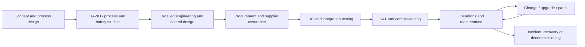

Cybersecurity must be included at each stage, not added after commissioning. Changes to control logic, firmware, network architecture, remote support, process recipes or safety interfaces must pass through the site's approved engineering and management-of-change process.

## 1.2 Industrial consequence model

Assess each scenario across multiple dimensions. Do not collapse everything into a single generic "business impact" score.

| Dimension | Example consequence |
|---|---|
| Personnel safety | Exposure, injury, unsafe movement, loss of protective function |
| Process safety | Loss of containment, pressure/temperature excursion, unsafe sequence |
| Environmental | Release, discharge, emissions, contamination |
| Public health | Water quality, chemical exposure, public service disruption |
| Essential service | Power, water, fuel, transport or communications outage |
| Equipment integrity | Turbine, pump, compressor, robot, conveyor or motor damage |
| Product quality | Invalid recipe, batch deviation, defective or unsafe product |
| Availability | Production stoppage, degraded throughput, service interruption |
| Integrity | False measurement, unauthorized setpoint, corrupted engineering project |
| Confidentiality | Process design, formulas, operational data, customer or personal data |
| Regulatory / contractual | Notification, audit, license, contractual or enforcement consequences |
| Recovery | Time, specialist availability, spares, restoration complexity |

## 1.3 Process-first risk chain

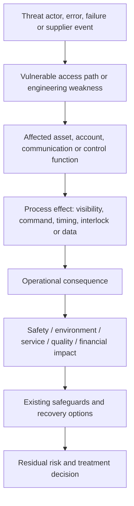

---

# 2. Common reference architecture for industrial sites

This is a conceptual architecture, not a universal Purdue layout. Use zones and conduits based on process risk, required communication, safety boundaries and operational design. A Purdue model is a useful reference, but it is not a security boundary by itself.

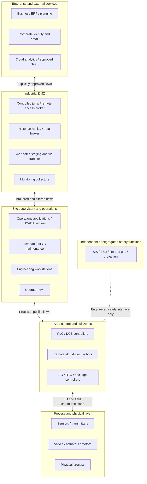

## 2.1 Architecture principles

- Identify zones by business/process function, consequence, trust and operational ownership.
- Define conduits with explicit source, destination, service, direction, purpose, owner and approval.
- Deny unnecessary communications by default, subject to validated operational requirements.
- Avoid direct enterprise-to-controller connectivity.
- Place approved data exchange and remote access services in appropriately designed intermediary zones.
- Separate safety-related systems according to the safety design and risk assessment; do not assume a firewall alone creates independence.
- Use passive monitoring where active interrogation could affect equipment.
- Ensure time synchronization, name resolution, identity, backup and monitoring dependencies are understood.
- Document emergency, local, manual and degraded operating modes.
- Validate architecture against the actual plant and current configuration.

## 2.2 Common trust boundaries

| Boundary | Typical concern | Engineering question |
|---|---|---|
| Internet / external to enterprise | Exposure, phishing, supplier compromise | Which services are intentionally exposed? |
| Enterprise IT to industrial DMZ | Lateral movement and data exchange | Which flows are necessary and brokered? |
| DMZ to site operations | Remote access, historian, file transfer | Who approves and monitors sessions? |
| Site operations to cell/area control | Controller access and process command | Which systems can issue control actions? |
| Cell to cell | Lateral movement and shared engineering | Is communication required between cells? |
| OT to safety-related systems | Independence and common-cause risk | What interfaces are permitted by safety design? |
| Site to remote facility | Radio, cellular, satellite, leased circuits | How are identity, integrity, availability and fallback handled? |
| OT to cloud | Data movement and external dependency | Is cloud read-only, control-affecting, or operationally essential? |
| Vendor to plant | Privileged maintenance | Is access time-limited, approved, recorded and revocable? |

---

# 3. Cross-industry engineering baseline

## 3.1 Asset and process inventory

Inventory more than IP addresses. Include:
- Process unit, line, site, facility and owner.
- Asset role and function in the process.
- Manufacturer, model, firmware, software and support status.
- Controller logic/project revision and approved backup reference.
- Network interfaces, protocols, communication partners and paths.
- Safety, protection, environmental and service criticality.
- Remote access and supplier ownership.
- Dependencies: power, cooling, time, identity, DNS, virtualization, storage and telecom.
- Patch and vulnerability status, known constraints and compensating controls.
- Recovery procedure, spare availability and restoration prerequisites.

## 3.2 Criticality and safety coordination

Use the site's approved process hazard analysis, safety lifecycle, protection coordination and business impact methods. Cybersecurity personnel must not independently assign a safety integrity level or change safety requirements. Coordinate with process safety, functional safety, protection, operations and engineering authorities.

## 3.3 Common control families

| Control family | Engineering outcome |
|---|---|
| Governance | Named owners, approved policy, risk decisions and management oversight |
| Asset management | Current inventory, ownership, criticality and lifecycle |
| Segmentation | Controlled zones, conduits and trust boundaries |
| Identity | Named accounts, least privilege, privileged access review |
| Remote access | Approved, brokered, time-limited, monitored sessions |
| Engineering integrity | Approved logic, settings, firmware and configuration changes |
| Vulnerability management | Risk-based assessment, test, mitigation and exception |
| Endpoint protection | Compatible hardening, application control and malware defense |
| Monitoring | Process-aware visibility, asset context and alert triage |
| Incident response | Joint IT/OT/safety/operations response and escalation |
| Recovery | Verified offline/immutable backups, restoration tests, spares and fallback |
| Supplier assurance | Product, service, remote access and lifecycle requirements |
| Physical security | Site, cabinet, console, removable media and visitor controls |
| Workforce | Role-based competence and operational cyber awareness |
| Change management | Management of change, validation, rollback and records |

## 3.4 Remote access reference workflow

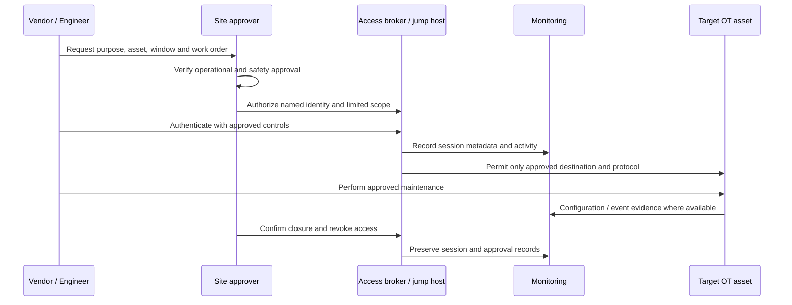

Remote access is a high-risk pathway. Avoid always-on vendor tunnels and shared accounts. Emergency access must be defined, monitored, time-bounded and reviewed after use. The access method must be appropriate to the actual control system and process constraints.

---

# 4. Oil, gas, LNG and petrochemicals

## 4.1 Industry segmentation and process context

### Upstream
Exploration, drilling, well control, offshore platforms, onshore production, gathering, artificial lift, separation, water injection, gas compression and remote production sites.

Representative systems:
- Wellhead and production controllers.
- Drilling control and monitoring.
- PLC, RTU, DCS and package controllers.
- Emergency shutdown (ESD), fire and gas (F&G), process safety systems.
- Compressor, pump, turbine and generator controls.
- Remote telemetry, radio, microwave, satellite and cellular gateways.
- Historian, production optimization and maintenance platforms.

### Midstream
Pipelines, gathering networks, compressor and pump stations, storage, terminals, metering, leak detection and custody transfer.

Representative systems:
- Pipeline SCADA and master stations.
- RTUs and station PLCs.
- Pressure, flow, temperature and metering instrumentation.
- Leak detection and line balance applications.
- Compressor/pump control and station HMI.
- Remote communication and telemetry infrastructure.
- Terminal and tank farm automation.

### Downstream, refining and petrochemicals
Crude processing, fractionation, catalytic processes, utilities, tank farms, gas processing, chemical production and product loading.

Representative systems:
- DCS and process controllers.
- SIS, ESD, burner management and F&G.
- Package units, analyzers and laboratory interfaces.
- Historians, MES, advanced process control and maintenance.
- Loading racks, tank gauging and custody transfer.

### LNG
Gas treatment, liquefaction trains, refrigeration/compression, storage tanks, boil-off gas handling, loading arms, marine interfaces and regasification.

Security engineering must consider continuous process operation, large rotating equipment, cryogenic hazards, tank and loading safety, marine dependencies and complex vendor support.

## 4.2 Representative process flow

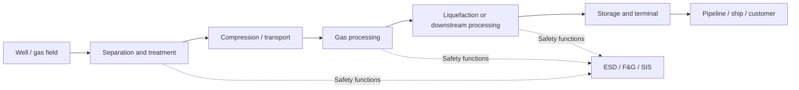

This is a simplified value-chain view. Actual process configuration varies by facility.

## 4.3 High-value cyber scenarios

| Scenario | Potential process effect | Detection opportunities | Defensive engineering |
|---|---|---|---|
| Vendor identity compromise | Unauthorized engineering or maintenance access | Unusual login, session time, destination, account use | Brokered access, MFA where supported, approvals, session monitoring |
| Engineering workstation compromise | Unauthorized logic, configuration or project change | Project hash/change, download event, endpoint alert | Dedicated engineering zones, application control, golden project backups |
| Pipeline telemetry loss or manipulation | Reduced visibility, misleading pressure/flow, delayed response | Data quality, sequence, rate-of-change and communications anomalies | Authenticated paths where feasible, plausibility checks, resilient comms, local procedures |
| DCS support infrastructure ransomware | Loss of HMI, historian or engineering availability | Endpoint, server and network telemetry | Segmentation, tested recovery, offline backups, controlled administration |
| Historian/data broker compromise | Incorrect operational reports or enterprise data propagation | Data integrity checks, unexpected write/source | Replication boundaries, least privilege, read-only exchange where possible |
| Safety engineering path compromise | Potential impact to safety lifecycle or configuration integrity | Change approval, project comparison, access and audit records | Safety governance, independent authorization, strict engineering controls |
| Remote site communications failure | Loss of supervisory visibility or remote command | Link status, stale values, alarm and heartbeat | Defined local fallback, redundant communications where justified |

## 4.4 Oil and gas security requirements

- Maintain process-unit and remote-site asset inventories.
- Separate corporate, industrial DMZ, operations, area control and safety-related environments according to design.
- Govern OEM, EPC, contractor and operations access.
- Protect controller logic, DCS/SIS projects, relay settings and package configurations.
- Monitor engineering downloads, setpoint changes, mode changes and unusual command patterns.
- Maintain resilient communications and tested loss-of-link procedures.
- Ensure process safety and cybersecurity teams jointly assess changes.
- Validate backups and recovery for servers, workstations, controller projects and configuration repositories.
- Protect custody-transfer and measurement integrity.
- Include marine, terminal, pipeline and remote-site dependencies in incident exercises.

## 4.5 Oil and gas assessment use cases

1. Review all remote access paths from vendor to asset, including dormant accounts and temporary modems.
2. Trace a representative measurement from field instrument through controller, SCADA and historian to enterprise reporting.
3. Compare approved engineering project and configuration with the authorized baseline using vendor-supported methods.
4. Review how a communications outage is detected, alarmed, escalated and handled locally.
5. Review a simulated loss of HMI/historian while maintaining safe local control.
6. Test restoration on a representative offline lab or approved recovery environment.
7. Review process safety change approval and cybersecurity review records.

**Never** manipulate pressure, temperature, flow, valve position, compressor speed, ESD or SIS logic in a live plant as a security test.

---

# 5. Power generation, transmission, distribution and substations

## 5.1 Generation

Representative plant types:
- Thermal and combined-cycle generation.
- Hydro generation.
- Nuclear generation, subject to specialized nuclear safety and regulatory controls.
- Solar PV and wind generation.
- Biomass and other generation.
- Battery energy storage systems (BESS).

Typical systems:
- Plant DCS and unit control.
- Turbine, boiler, generator and balance-of-plant controls.
- Excitation and governor systems.
- Protection relays and generator protection.
- Plant historian and performance systems.
- Renewable plant controller and inverter controls.
- BESS energy management, battery management and thermal safety systems.

## 5.2 Grid and substation operations

- Energy management systems (EMS).
- Distribution management systems (DMS).
- SCADA master stations and RTUs.
- Substation automation systems.
- Protection IEDs, bay controllers and merging units.
- IEC 61850 station bus and process bus where deployed.
- GOOSE, MMS and sampled value communications.
- Phasor measurement units and time synchronization.
- Telecom, fiber, microwave and control center WAN.
- Backup control centers and restoration systems.

## 5.3 Representative grid flow

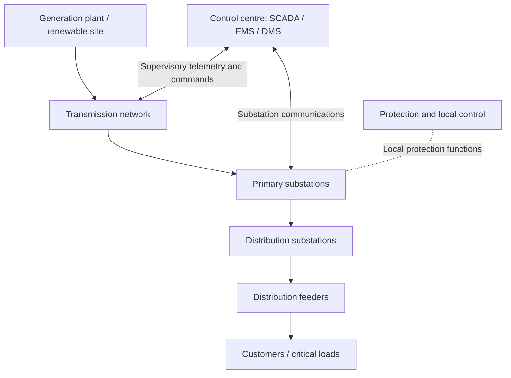

## 5.4 Threat scenarios and safeguards

| Scenario | Potential consequence | Safeguard and evidence |
|---|---|---|
| Unauthorized protection setting change | Incorrect protection behavior or coordination | Controlled settings repository, dual approval, relay event/settings review |
| Engineering workstation compromise | Unauthorized substation or plant configuration | Dedicated engineering access, endpoint controls, project integrity |
| Loss of control centre visibility | Reduced supervisory awareness and remote operation | Redundant control paths, local operation, restoration exercises |
| Time source manipulation or loss | Incorrect event sequence and time-dependent functions | Authenticated/controlled time sources where supported, monitoring and holdover design |
| GOOSE/MMS communication abuse | Unexpected substation data or command behavior | Approved communication matrix, passive monitoring and engineering validation |
| Firmware or supply chain compromise | Integrity or availability risk across devices | Supplier assurance, firmware provenance, staged validation |
| Distributed renewable/BESS compromise | Aggregated impact on generation or grid support | Asset identity, remote access governance, segmentation and operator coordination |

## 5.5 Power sector assessment

- Verify asset and firmware inventories for control centres, plants and substations.
- Review protection engineering access and settings management.
- Validate approved communication relationships and time source dependencies.
- Review remote access and third-party maintenance.
- Examine backup control centre, restoration and local fallback.
- Review BESS/DER aggregator connectivity and command authority.
- Exercise coordinated cyber, grid operations and protection response.
- Validate recovery without disturbing live protection systems.

Never inject packets, alter relay settings, issue control commands or test protection behavior on production systems without formal authorization and an approved protection-engineering test plan.

---

# 6. Renewables and battery energy storage

## 6.1 Solar PV

Process chain:
- PV modules and strings.
- Combiner boxes and DC protection.
- Inverters and plant controllers.
- Weather stations and irradiance sensors.
- SCADA and performance monitoring.
- Substation and grid interconnection.
- OEM monitoring and remote service.

Security focus:
- Inverter configuration and firmware.
- Plant controller command authority.
- OEM remote access and cloud monitoring.
- Grid interface and telemetry integrity.
- Fleet-wide identity and certificate management.
- Loss of monitoring and safe local operation.

## 6.2 Wind

Representative systems:
- Turbine controller and converter.
- Pitch and yaw systems.
- Condition monitoring.
- Turbine network and farm SCADA.
- Substation and grid controller.
- Offshore communications and remote operations.

Security focus:
- Turbine OEM access.
- Fleet and site network boundaries.
- Controller software/firmware provenance.
- Time, condition monitoring and alarm integrity.
- Offshore connectivity resilience and physical access.

## 6.3 Battery energy storage systems

Representative layers:
- Battery cells and modules.
- Battery management system (BMS).
- Rack/container controllers.
- Thermal management and fire detection/suppression.
- Power conversion system (PCS).
- Energy management system (EMS).
- Plant controller and grid interface.

```mermaid
flowchart TB
  CELL["Cells / modules"] --> BMS["Battery management system"]
  BMS --> RACK["Rack / container control"]
  HVAC["Thermal management"] --> RACK
  FIRE["Fire detection / suppression"] -. "Independent safety design" .- RACK
  RACK --> PCS["Power conversion system"]
  PCS --> EMS["Site energy management"]
  EMS --> GRID["Plant controller / grid interface"]
  OEM["OEM service platform"] -->| "Approved limited service path" | EMS
```

Security and safety requirements:
- Separate battery safety functions from ordinary business and analytics paths as designed.
- Protect BMS/PCS/EMS configuration and firmware.
- Govern OEM remote support and fleet management.
- Monitor abnormal command, state-of-charge, alarm and configuration changes.
- Maintain safe shutdown and emergency response procedures.
- Coordinate cyber response with fire, electrical and battery safety authorities.
- Do not use cyber tools to stimulate battery faults or safety trips.

---

# 7. Water and wastewater

## 7.1 Process stages

### Drinking water
1. Source water intake.
2. Screening and pre-treatment.
3. Coagulation/flocculation and clarification where used.
4. Filtration.
5. Disinfection and chemical dosing.
6. Clear-water storage.
7. Pumping and distribution.
8. Water quality sampling and laboratory oversight.

### Wastewater
1. Collection and lift stations.
2. Screening and grit removal.
3. Primary treatment where used.
4. Biological treatment and aeration.
5. Secondary clarification.
6. Disinfection and discharge/reuse.
7. Sludge handling and treatment.
8. Environmental monitoring.

Actual process trains differ by source water, treatment technology, local standards and facility design.

## 7.2 Representative architecture

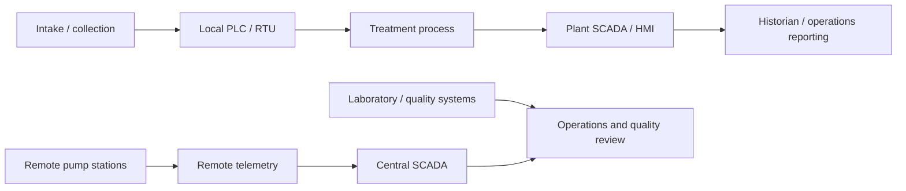

## 7.3 Threat scenarios

- Unauthorized chemical dosing parameter changes.
- Manipulated pH, turbidity, chlorine residual, flow or pressure telemetry.
- Compromised remote pump station access.
- Ransomware affecting SCADA support or operator workstations.
- Loss of telemetry and delayed response to pump or tank alarms.
- Unauthorized PLC logic or HMI project change.
- Supplier compromise through remote maintenance.
- Compromise of laboratory/operational reporting integrity.

## 7.4 Defensive and operational requirements

- Protect process measurement and quality data integrity.
- Inventory remote sites, radio/cellular gateways and field controllers.
- Apply least privilege and monitored remote access.
- Maintain local procedures for communications loss and manual operation.
- Monitor dosing, alarm, logic and setpoint changes.
- Coordinate cyber response with water quality, public health, environmental and operations teams.
- Validate backup and restore processes.
- Maintain safe, approved chemical and process operating procedures independent of cybersecurity documentation.

## 7.5 Water-sector assessment use cases

- Trace a critical quality measurement from sensor to operator display and report.
- Review access to chemical dosing configuration without changing live parameters.
- Review remote pump station access and stale telemetry handling.
- Review alarm escalation for high/low reservoir level and loss of communication.
- Review backup restoration of SCADA configuration in a test environment.
- Exercise incident communication between IT, OT, water quality, public health and emergency management.

EPA's 2024 drinking water and wastewater guidance includes asset inventory, named cybersecurity responsibility, OT-specific responsibility, IT/OT coordination and risk-informed vulnerability mitigation. It recommends MFA as widely as possible and at minimum for remote access to OT. Treat this as US EPA guidance, not a universal legal requirement in other countries.

---

# 8. Manufacturing and smart factories

## 8.1 Discrete manufacturing

Examples:
- Automotive and component assembly.
- Electronics and semiconductor manufacturing.
- Packaging and consumer goods.
- Machine tools and industrial equipment.
- Robotics and automated warehouses.

Representative systems:
- PLC/PAC and remote I/O.
- Robots, cobots, CNC and motion controllers.
- Machine vision and inspection.
- Line HMI and SCADA.
- MES, quality, recipe and batch platforms.
- Industrial edge, IIoT gateways and wireless systems.
- Engineering workstation and OEM support tools.

## 8.2 Process manufacturing

Examples:
- Chemicals, pharmaceuticals, food and beverage, pulp and paper, cement, steel and glass.
- Batch and continuous process control.
- Recipe, formulation, laboratory and quality data.
- Utilities, boilers, compressors and environmental systems.

## 8.3 Manufacturing process and data flow

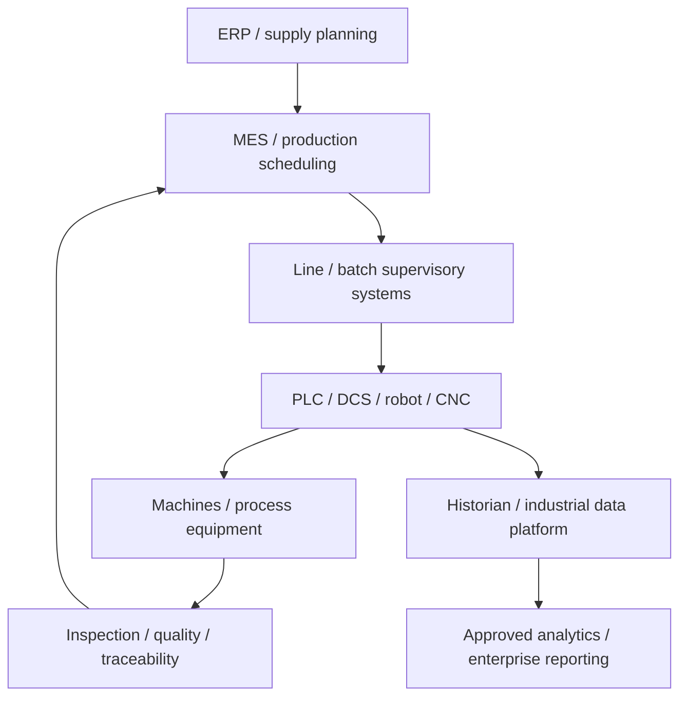

## 8.4 High-value scenarios

| Scenario | Process/business impact | Controls |
|---|---|---|
| Recipe or batch manipulation | Product quality, safety, compliance, scrap | Role separation, approved recipe versions, change traceability |
| Robot/motion program change | Worker safety, equipment damage, production interruption | Engineering authorization, offline simulation, project integrity |
| CNC or machine tool compromise | Product integrity and machine damage | OEM-supported hardening, controlled programs, backup |
| MES/SCADA ransomware | Loss of line visibility and production coordination | Segmentation, recovery, tested manual/controlled fallback |
| Removable media malware | Infection across engineering and production | Controlled media process, scanning station, traceability |
| Vendor remote support compromise | Unauthorized machine access | Brokered access, approved maintenance window, session record |
| Quality data manipulation | Invalid traceability or release decision | Data integrity, audit trail, independent quality controls |
| Flat cell network | Lateral movement across production lines | Cell segmentation and allowlisted communications |

## 8.5 Smart manufacturing and IIoT

Consider:
- Edge gateways and protocol translators.
- Industrial wireless and mobile devices.
- Machine-to-cloud data flows.
- Digital twins and remote diagnostics.
- AI-based process optimization.
- Software updates and containerized edge applications.
- Shared identity and certificates.
- Vendor-managed analytics and fleet platforms.

Every cloud/AI integration must define whether it is monitoring-only, advisory, or able to issue commands. A data analytics service must not gain control authority by accident. Validate model output and command pathways separately.

NIST SP 1800-10 provides a manufacturing ICS example architecture and demonstrates security capabilities such as behavioral anomaly detection, application allowlisting, file integrity checking, change control and authentication/authorization. It is an example implementation, not a mandatory blueprint.

## 8.6 Manufacturing assessment use cases

- Review a recipe approval and change history.
- Compare authorized PLC/robot project revisions in a lab or approved maintenance window.
- Trace production data from machine to MES and quality release.
- Review removable media entry and exit records.
- Review OEM remote access and session evidence.
- Exercise restoration of a representative line supervisory system.
- Validate production fallback and quality quarantine processes.

---

# 9. Mining and metals

## 9.1 Process and system landscape

### Open-pit mining
- Drilling and blasting support systems.
- Excavators, shovels, haul trucks and fleet management.
- Crushers and conveyors.
- Weighbridges and dispatch.
- Plant control and stockpile management.

### Underground mining
- Ventilation and gas monitoring.
- Dewatering and pumping.
- Personnel tracking and communications.
- Conveyors, hoists and access systems.
- Emergency and refuge systems.

### Processing and metals
- Crushing, grinding, flotation and separation.
- Slurry pipelines and tailings.
- Smelting, refining and furnace controls.
- Power distribution and process utilities.
- Environmental monitoring.

## 9.2 Mining process architecture

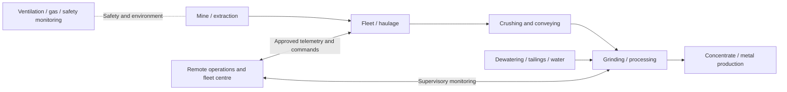

## 9.3 Threat and failure scenarios

- Loss of underground ventilation visibility.
- Loss of gas monitoring or emergency communications.
- Unauthorized conveyor, crusher or hoist configuration change.
- Compromise of autonomous haulage or fleet management.
- Loss of dewatering telemetry and flooding risk.
- Compromise of OEM support or remote operations centre.
- Manipulation of weighbridge, grade or production data.
- Wireless network outage in remote or underground areas.

## 9.4 Security priorities

- Prioritize worker safety, emergency communications and environmental controls.
- Map wireless, mesh, leaky feeder, radio and remote connectivity dependencies.
- Separate fleet management, process control, corporate IT and safety monitoring according to design.
- Protect autonomous vehicle and machine software/configuration.
- Govern contractor/OEM access.
- Maintain local fallback for communications loss.
- Exercise incident response with mine rescue, operations, safety and engineering.

Never test or disrupt ventilation, gas monitoring, hoists, vehicle movement, explosives handling, dewatering or emergency systems on live operations.

---

# 10. Transportation, ports, airports, rail and maritime

## 10.1 Rail and metro

Representative systems:
- Interlocking and signaling.
- Train control and automatic train protection.
- Traction power and SCADA.
- Platform screen doors.
- Station management and passenger information.
- Tunnel ventilation, fire and life safety.
- Operations control centre and radio systems.

Security objectives include signaling integrity, train separation, safe movement, service continuity, emergency communications and controlled maintenance.

## 10.2 Airports

Representative systems:
- Baggage handling and screening interfaces.
- Passenger boarding bridges.
- Runway and airfield lighting.
- Fuel systems and facility utilities.
- Building automation and access control.
- Airport operational databases and service integrations.

Aviation safety and security authorities determine applicable requirements. Do not assume all airport IT systems are OT or that all facility systems are safety-critical.

## 10.3 Ports and maritime terminals

Representative systems:
- Terminal operating systems and yard management.
- Ship-to-shore cranes and automated stacking cranes.
- Gate systems, weighbridges and access control.
- Automated guided vehicles.
- Vessel traffic services and port communications.
- Reefer monitoring and fuel/utility systems.

Security priorities include cargo integrity, crane and vehicle safety, vessel coordination, terminal continuity and third-party dependencies.

## 10.4 Road and tunnel systems

- Traffic signal controllers.
- Tunnel ventilation and environmental sensors.
- Lighting, pumps and drainage.
- Variable message signs.
- Emergency telephones and incident management.
- Roadside communications and control centres.

## 10.5 Transportation threat scenarios

- Unauthorized signaling or movement-related configuration change.
- Compromised maintenance laptop or supplier account.
- Loss of tunnel ventilation or environmental monitoring.
- Malware affecting baggage or terminal operations.
- Unauthorized crane or automated vehicle command.
- Compromised port or vessel data exchange.
- Loss of time, radio or communications dependencies.
- Cross-domain access from passenger, corporate or public networks.

## 10.6 Transportation response model

Safety and movement authorities retain command authority. Cyber responders preserve evidence and coordinate containment with the operator. Isolating a network or device may create a more serious safety risk; use pre-approved response procedures and engineering authority.

---

# 11. Building automation, campuses and data centre facilities

## 11.1 Building automation systems

Typical systems:
- Building management system (BMS).
- HVAC, chillers, boilers and pumps.
- Lighting and energy management.
- Elevators and escalators.
- Physical access control and surveillance.
- Fire detection, alarm and suppression.
- Water, fuel and generator systems.

Building OT frequently has multiple maintenance contractors, shared networks and long asset lifecycles. Separate ordinary building automation from certified life-safety systems and apply the relevant authority's safety and building requirements.

## 11.2 Data centre facility OT

Typical systems:
- Electrical power monitoring and control (EPMS).
- UPS and battery monitoring.
- Generator control and fuel systems.
- Power distribution units and switchgear monitoring.
- Cooling plant, chillers and computer room air conditioning.
- Environmental sensors and leak detection.
- BMS and facility management.
- Fire detection and suppression.
- Physical access and security monitoring.

## 11.3 Facility dependency model

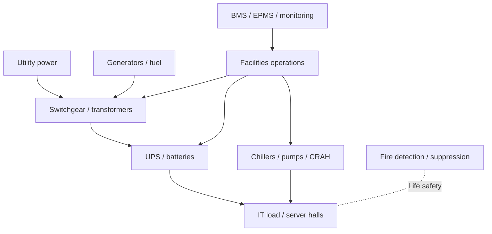

## 11.4 Threat scenarios

- Unauthorized HVAC or cooling setpoint change.
- Loss of UPS or generator monitoring.
- Compromised BMS/EPMS remote access.
- Converged tenant, corporate and facility networks.
- Loss of environmental alarms or leak detection.
- Compromised access control integration.
- Vendor compromise affecting multiple facilities.
- Insecure building protocol or exposed management interface.

## 11.5 Defensive priorities

- Inventory controllers, gateways, management servers and facility dependencies.
- Segment tenant, corporate, facilities and life-safety networks according to design.
- Govern building maintenance vendors and shared service accounts.
- Protect engineering workstations and configuration backups.
- Monitor critical power, cooling, environmental and access changes.
- Define local manual operating modes and emergency escalation.
- Test recovery and facilities continuity.
- Coordinate cyber response with facilities, electrical, mechanical, fire and life-safety authorities.

---

# 12. Cross-industry threat scenario catalogue

Use this catalogue as a starting point for threat modeling, not as proof that a particular threat is present.

| Scenario family | Example affected sectors | Potential effect | Primary control themes |
|---|---|---|---|
| Remote access compromise | All sectors | Unauthorized control or data access | Identity, broker, approval, monitoring |
| Engineering workstation compromise | Process, power, manufacturing, water | Configuration or logic integrity | Dedicated engineering, allowlisting, project integrity |
| Ransomware on support infrastructure | All sectors | Loss of visibility, engineering or production coordination | Segmentation, backups, recovery |
| Controller logic/configuration change | All sectors | Unexpected process behavior | Change control, integrity monitoring, approval |
| Telemetry manipulation | Pipeline, water, power, mining | Incorrect operator decisions | Data plausibility, sequence, independent indication |
| Time synchronization compromise | Power, transport, distributed systems | Event correlation and time-dependent function errors | Source control, monitoring, holdover |
| Supplier/product compromise | All sectors | Fleet-wide or site-level exposure | Supplier assurance, provenance, lifecycle |
| Wireless/radio disruption | Remote sites, mining, utilities | Loss of monitoring or command | Redundancy, local fallback, link monitoring |
| Cloud/edge compromise | Renewables, manufacturing, facilities | Data or command path compromise | Identity, API security, separation of control authority |
| Physical access abuse | All sectors | Device tampering or unauthorized console access | Site access, cabinet protection, monitoring |
| Backup compromise | All sectors | Failed recovery and extended outage | Offline/immutable copies, restore testing |
| Insider misuse or error | All sectors | Unsafe or unauthorized changes | Segregation of duties, approvals, training |

---

# 13. MITRE ATT&CK for ICS and threat-informed engineering

MITRE ATT&CK for ICS can be used to organize adversary behavior and build detection hypotheses. It is not a control standard, a likelihood score, or proof that a technique is feasible in every plant.

For each scenario:
1. Identify the process and asset.
2. Describe the adversary objective and prerequisite access.
3. Map relevant ATT&CK for ICS tactics/techniques using the current official knowledge base.
4. Identify observable events and data sources.
5. Define safe validation in a lab or approved environment.
6. Map preventive, detective, responsive and recovery controls.
7. Record blind spots and assumptions.

Do not hardcode technique IDs from memory. Verify the current ATT&CK for ICS technique name and identifier at https://attack.mitre.org/matrices/ics/ before publishing a detailed mapping.

## 13.1 Threat model template

| Field | Required information |
|---|---|
| Scenario ID | Unique ID |
| Industry/process | Process area and function |
| Asset and zone | Affected system and trust boundary |
| Adversary objective | What outcome is sought |
| Initial access assumption | Supplier, remote access, workstation, physical, etc. |
| Preconditions | Required privileges, reachability, process state |
| Technique mapping | Current ATT&CK for ICS IDs and source |
| Process effect | Visibility, command, integrity, availability |
| Consequence | Safety, environment, service, quality, financial |
| Detection | Event, network, process or physical indicators |
| Prevention | Architecture and control |
| Response | Safe containment and escalation |
| Recovery | Restore, local mode, validation |
| Confidence | Confirmed / plausible / hypothetical |
| Owner and review | Accountable role and date |

---

# 14. Sector-to-standard and regulatory mapping

The following is an applicability research matrix, not a statement that every named standard or law applies to every operator.

| Sector | Technical and management references to evaluate | Regulatory research |
|---|---|---|
| Oil and gas / LNG | ISA/IEC 62443, NIST SP 800-82, ISO/IEC 27019 where relevant, process safety standards | National energy/hydrocarbon regulator, CNI/OT controls, operator/EPC contracts |
| Power and utilities | ISA/IEC 62443, IEC 61850, IEC 62351, NERC CIP where applicable, DOE C2M2 | Grid code, power-sector regulator, CEA/energy regulations, CNI designation |
| Renewables / BESS | ISA/IEC 62443, IEC 61850/62351 where deployed, grid interconnection standards | Energy regulator, grid operator, battery/fire/electrical safety requirements |
| Water / wastewater | ISA/IEC 62443, NIST SP 800-82, EPA guidance as reference | Drinking water, wastewater, public health and environmental regulator |
| Manufacturing | ISA/IEC 62443, NIST SP 1800-10, product and machinery safety standards | Industrial safety, product, quality, privacy and CNI rules |
| Mining / metals | ISA/IEC 62443, NIST SP 800-82, relevant machinery and functional safety standards | Mining safety, environment, critical infrastructure and labor requirements |
| Rail / transport | ISA/IEC 62443 where appropriate, sector safety and railway standards | Rail, transport, aviation, maritime and national critical infrastructure regulators |
| Buildings / data centres | ISA/IEC 62443 where appropriate, BACnet security resources, facility and life-safety standards | Building, fire, electrical, data centre, privacy and CNI requirements |

Always check the exact standard edition, legal adoption, license, scope and system boundary. A technical reference is not automatically a legal obligation.

---

# 15. Sector-specific assessment playbooks

## 15.1 Common assessment phases

**Phase A — Authorization and safety**
- Confirm written scope, owner, sites, assets and test windows.
- Identify process safety and operational authorities.
- Define prohibited actions, stop conditions and emergency contacts.
- Agree passive versus active methods and approved tools.
- Confirm backups, rollback and recovery readiness.

**Phase B — Process understanding**
- Review PFDs, P&IDs, control narratives and cause-and-effect documents as authorized.
- Understand normal, startup, shutdown, maintenance and emergency states.
- Identify critical measurements, commands, alarms and interlocks.
- Identify local/manual fallback and loss-of-communications behavior.

**Phase C — Architecture and inventory**
- Validate asset, software, firmware and communication inventories.
- Review zones, conduits, remote sites and supplier access.
- Identify dependencies and single points of failure.
- Compare approved diagrams with passive observations and configuration evidence.

**Phase D — Control review**
- Identity, access and privilege.
- Remote access and vendor management.
- Engineering change and configuration integrity.
- Vulnerability, patch and exception management.
- Network architecture and monitoring.
- Backup, recovery and continuity.
- Physical security and supplier assurance.

**Phase E — Safe validation**
- Prefer document review, configuration review, passive monitoring and lab reproduction.
- Use active testing only with explicit authorization and engineering/safety approval.
- Never perform uncontrolled fuzzing, scanning, denial-of-service, logic writes, setpoint changes or failover tests on live systems.

**Phase F — Reporting**
- Record evidence, asset scope, process consequence, limitation and confidence.
- Prioritize by safety, essential service, environmental, integrity and availability impact.
- Assign action owner and due date.
- Validate remediation without disrupting operations.

## 15.2 Sector-specific evidence checklist

| Sector | Essential evidence categories |
|---|---|
| Oil and gas | Process and safety boundary, SIS/ESD governance, pipeline/remote telemetry, vendor access, logic backups, loss-of-link procedures |
| Power | Protection settings, IEC 61850 engineering, control centre/backup, time sources, relay access, restoration plans |
| Renewables/BESS | Inverter/PCS/BMS/EMS inventory, OEM access, firmware provenance, grid command paths, battery safety interface |
| Water | Treatment process, dosing governance, water quality monitoring, pump telemetry, remote access, manual fallback |
| Manufacturing | Recipe/batch approvals, robot/CNC projects, MES interfaces, removable media, line recovery and quality quarantine |
| Mining | Ventilation/gas monitoring, fleet and autonomous systems, wireless resilience, dewatering, emergency communications |
| Transport | Signaling/movement safety boundary, maintenance access, tunnel/terminal automation, manual fallback and emergency control |
| Buildings/data centres | BMS/EPMS dependencies, power/cooling, life safety separation, vendor access, facility fallback and restore |

---

# 16. Incident response by industrial consequence

## 16.1 Common response principles

- Protect people and the environment first.
- Maintain safe process control and essential service delivery.
- Bring operations, process safety, engineering, cybersecurity, facilities and legal/regulatory teams together.
- Preserve logs and evidence without delaying urgent safe operation.
- Do not isolate a device or network path without understanding process consequences.
- Use pre-approved containment options and operational decision authority.
- Notify regulators and customers according to the applicable legal and contractual requirements.
- Validate process state and instrument trust before returning to normal operation.

## 16.2 Example scenario: suspected engineering workstation compromise

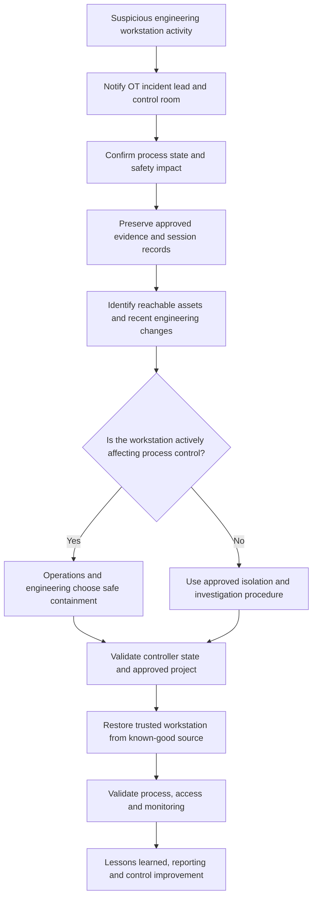

## 16.3 Sector-specific incident considerations

- Oil and gas: process containment, pressure/flow visibility, remote site operations, environmental release and emergency shutdown governance.
- Power: grid stability, protection coordination, control centre authority and restoration.
- Water: water quality, chemical dosing, public health, pressure and continuity.
- Manufacturing: product quarantine, batch integrity, line restart and quality release.
- Mining: worker location, ventilation, emergency communications, vehicle movement and dewatering.
- Transport: passenger safety, movement authority, signaling, tunnel and terminal emergency procedures.
- Buildings/data centres: life safety, power, cooling, fire systems and service continuity.

---

# 17. Recovery engineering and resilience

Recovery must be designed before an incident. A successful backup job is not proof that an industrial process can be restored.

For each critical system define:
- Recovery owner and decision authority.
- Known-good software, firmware and configuration.
- Controller logic, relay settings, HMI and engineering project backups.
- Required licenses, vendor tools, keys and offline installers.
- Hardware spares and compatible replacement versions.
- Identity, time, DNS, virtualization, storage and network prerequisites.
- Restoration order and dependencies.
- Local/manual fallback and safe shutdown options.
- Validation tests and process acceptance criteria.
- RTO/RPO where defined and approved by the business/process owner.
- Evidence of periodic restore exercises.

```mermaid
flowchart LR
  A["Incident contained"] --> B["Confirm safe process state"]
  B --> C["Identify trusted recovery point"]
  C --> D["Restore infrastructure and dependencies"]
  D --> E["Restore control applications and configurations"]
  E --> F["Validate logic, settings, communications and alarms"]
  F --> G["Operations / safety acceptance"]
  G --> H["Controlled return to service"]
  H --> I["Monitor and review residual risk"]
```

---

# 18. AI, digital twins and autonomous agent workflows in industry

AI and agentic systems can support maintenance, anomaly detection, energy optimization, document analysis, engineering assistance and regulatory mapping. They also introduce new trust boundaries and possible command paths.

## 18.1 Classify AI authority

| AI operating mode | Example | Minimum governance |
|---|---|---|
| Read-only analytics | Historian trend summaries | Data provenance, access control, validation |
| Advisory | Maintenance recommendations | Human review, confidence, source traceability |
| Decision support | Suggested operating setpoint | Process engineer approval and approved procedure |
| Supervised action | Operator approves a bounded command | Strong identity, limits, interlocks, audit and rollback |
| Autonomous control | Agent changes process without immediate human approval | Formal safety, hazard, cybersecurity and regulatory assessment; prohibit by default absent engineered authorization |

## 18.2 Reference architecture

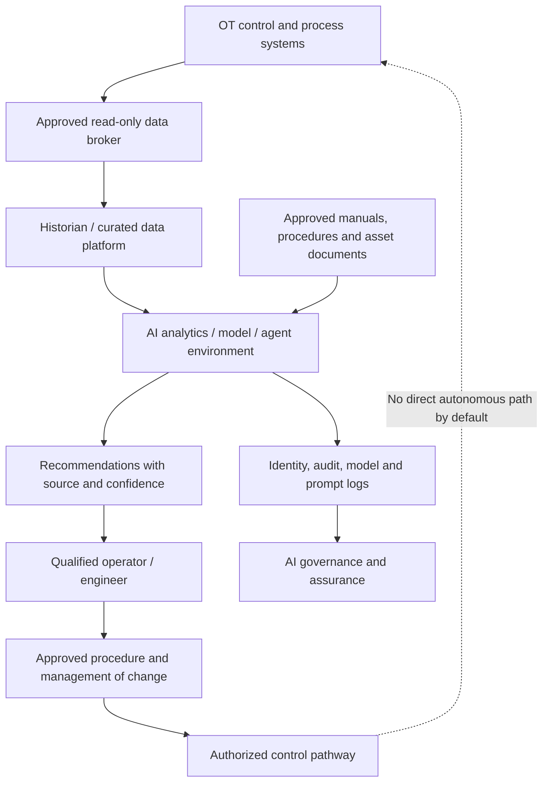

## 18.3 AI security and safety requirements

- Separate AI data access from control authority.
- Treat tool calls, plugins, APIs and agents as privileged identities.
- Prevent prompt injection through untrusted maintenance documents or telemetry text.
- Validate data quality, units, timestamps and asset context.
- Require human approval for consequential control actions.
- Maintain model/version provenance and evaluation evidence.
- Log recommendations, decisions, tool calls and approvals.
- Define fail-safe behavior when AI is unavailable or wrong.
- Do not allow agents to bypass MOC, safety interlocks or operator authority.
- Test models in a digital twin or isolated environment before operational use.
- Evaluate cloud dependencies, data residency and supplier access.

---

# 19. Practical lab and simulation blueprint

Use isolated simulation, emulation, vendor training environments or dedicated test benches. Never use public training labs connected to real plant networks.

| Lab | Environment | Learning objective | Safe success evidence |
|---|---|---|---|
| 01 — Process mapping | Synthetic PFD/P&ID and control narrative | Identify process stages, assets and consequences | Approved process/asset map |
| 02 — Purdue and zones | Virtual network diagrams | Define trust boundaries and conduits | Reviewed architecture and flow matrix |
| 03 — Modbus telemetry | Isolated simulator | Understand read/write distinctions and monitoring | Packet capture and safe simulated events |
| 04 — OPC UA trust | Isolated OPC UA server/client | Certificates, identity and access | Certificate and authorization review |
| 05 — Remote access | Lab jump host and test endpoints | Approval, MFA, session recording and revocation | Access audit trail |
| 06 — Engineering integrity | Dummy PLC project | Compare approved and changed project files | Change report and restoration |
| 07 — OT monitoring | Synthetic PCAP and logs | Build process-aware detection hypotheses | Alert, context and triage record |
| 08 — Water treatment simulation | Simulated treatment process | Understand measurement and dosing dependencies | Safe simulated response |
| 09 — Power substation simulation | IEC 61850 simulator/lab | Understand station bus and protection context | Passive analysis and architecture |
| 10 — Manufacturing cell | Robot/PLC simulation | Recipe, cell segmentation and change control | Change approval and recovery |
| 11 — Incident exercise | Tabletop scenario | Coordinate OT, safety, legal and SOC | Timeline and action register |
| 12 — Recovery exercise | Offline restore environment | Restore known-good configuration | Validated restore record |

Each lab requires a defined scope, synthetic data, learning outcomes, prerequisites, safety note, steps, expected evidence, assessment rubric and cleanup instructions.

---

# 20. Metrics and industry performance indicators

Use metrics that demonstrate risk reduction without incentivizing unsafe operations.

| Metric | Definition | Sector considerations |
|---|---|---|
| Critical asset inventory coverage | Critical assets with owner, function and verified attributes | Include remote and package systems |
| Remote access governance | Approved, named, time-limited sessions / all identified sessions | Include OEM and emergency access |
| Engineering change traceability | Changes with approval and evidence / sampled changes | Logic, recipes, relay settings, firmware |
| Backup restore success | Tested recoveries meeting approved criteria | Controller projects and proprietary systems |
| Critical communications visibility | Critical conduits with documented expected flows and monitoring | Radio, satellite, serial and wireless |
| Vulnerability decision coverage | Advisories with documented risk decision | Compensating controls when patching is unsafe |
| Incident exercise actions | Actions closed and validated | Include operations and safety |
| Supplier assurance coverage | Critical suppliers assessed against defined scope | Include subcontractors and remote access |
| Time to safe containment | Time to approved safe response, not simply network isolation | Process-specific and safety-approved |
| Recovery validation | Systems returned to trusted and accepted state | Operations acceptance required |

---

# 21. Real-world data, incidents and case-study discipline

Use public incident reports, regulator notices, government advisories, court documents, operator disclosures and peer-reviewed research. Never fabricate a facility, attack path, loss amount, root cause or consequence.

Every case study must include:
- Event name and date.
- Country, sector and affected service.
- Primary source and publication date.
- Confirmed affected systems and operational impact.
- What is known versus what remains unconfirmed.
- Root cause only if established by an authoritative investigation.
- Relevant defensive lessons.
- Mapping to standards, ATT&CK for ICS and controls where supported.
- Limitations and conflicting accounts.

Do not use a vendor blog as the sole basis for a major incident claim. Do not attribute an incident to a threat actor unless an authoritative source supports that attribution.

## 21.1 Public source families to monitor

- CISA ICS advisories and incident guidance.
- National CERT and sector CERT advisories.
- NIST OT and sector publications.
- US DOE energy cybersecurity resources and C2M2.
- EPA water and wastewater cybersecurity guidance.
- National energy, water, transport and industrial regulators.
- Public operator post-incident reports and annual reports.
- MITRE ATT&CK for ICS and public threat intelligence.
- Standards bodies and official technical committee publications.

---

# 22. Standards, references and source register

The following are authoritative starting points. Confirm the current edition, scope and local applicability before using them in an assessment.

| Source | Official resource | Use |
|---|---|---|
| NIST SP 800-82 Rev. 3 | https://csrc.nist.gov/pubs/sp/800/82/r3/final | Published OT security guidance |
| NIST SP 800-82 Rev. 4 IPD | https://csrc.nist.gov/pubs/sp/800/82/r4/ipd | Draft update; not final |
| NIST SP 1800-10 | https://csrc.nist.gov/pubs/sp/1800/10/final | Manufacturing ICS reference implementation |
| DOE C2M2 | https://www.energy.gov/ceser/cybersecurity-capability-maturity-model-c2m2 | IT/OT cybersecurity capability maturity |
| C2M2 portal | https://c2m2.doe.gov/ | Model, tools and resources |
| CISA ICS recommended practices | https://www.cisa.gov/topics/industrial-control-systems | ICS defensive guidance and resources |
| CISA remote access practice | https://www.cisa.gov/sites/default/files/recommended_practices/RP_Managing_Remote_Access_S508NC.pdf | Industrial remote access design |
| CISA OT asset inventory guidance | https://www.ic3.gov/CSA/2025/250813.pdf | OT asset inventory foundations |
| EPA water/wastewater guidance | https://www.epa.gov/system/files/documents/2024-08/epa-guidance-on-improving-cybersecurity-at-drinking-water-and-wastewater-systems-1.pdf | US drinking water and wastewater cybersecurity practices |
| MITRE ATT&CK for ICS | https://attack.mitre.org/matrices/ics/ | Threat behavior knowledge base |
| ISA/IEC 62443 | https://www.isa.org/standards-and-publications/isa-standards/isa-iec-62443-series-of-standards | IACS lifecycle and security requirements |
| IEC 62351 | https://www.iec.ch/ | Power system communications security; identify exact parts and editions |
| NERC CIP | https://www.nerc.com/pa/Stand/Pages/CIPStandards.aspx | North American BES applicability only |

## 22.1 Version and draft discipline

At the time of this document's review, NIST SP 800-82 Rev. 4 is available as an Initial Public Draft with a stated comment deadline of 30 November 2026. Rev. 3 remains the final published revision referenced here. Track the draft as a development item; do not represent it as final.

## 22.2 Source use and copyright

- Link to official publications rather than reproducing licensed standards.
- Preserve source title, publisher, edition, publication date and access date.
- Summarize requirements in original wording.
- Use only short quotations where necessary and legally permitted.
- Keep public examples synthetic or redacted.
- Maintain a separate internal evidence repository for customer or facility records.

---

# 23. Document control and required future expansion

## 23.1 Revision history

| Version | Date | Change | Status |
|---|---|---|---|
| 1.0 | 2026-11-17 | Initial process-first industry playbook covering oil and gas, LNG, power, renewables/BESS, water, manufacturing, mining, transport, buildings and data centres; architecture, scenarios, controls, assessment, recovery, AI and labs | Engineering reference |

## 23.2 Specialist review

Before using a sector section for a real facility:
- Process engineer validates process flow and operating states.
- OT/automation engineer validates system architecture and vendor specifics.
- Functional safety or protection specialist validates safety boundaries.
- Operations owner validates manual, degraded and emergency modes.
- Cybersecurity lead validates threats, controls and evidence.
- Legal/regulatory specialist validates jurisdiction-specific requirements.
- Environmental and quality specialists validate relevant consequence paths.
- All source versions and applicability are checked.

## 23.3 Next expansion backlog

This master playbook establishes the common structure. It does not replace dedicated deep sector handbooks. The following need separate, detailed engineering chapters:
1. Oil and gas: upstream, midstream, downstream, LNG and petrochemicals.
2. Power: generation, transmission, distribution, substations and control centres.
3. Renewables: solar, wind, BESS and distributed energy resources.
4. Water: drinking water, wastewater, desalination and remote utilities.
5. Manufacturing: discrete, process, batch, pharmaceutical, food, automotive and semiconductor.
6. Mining: open pit, underground, autonomous haulage, processing and tailings.
7. Transport: rail, metro, ports, airports, maritime, roads and tunnels.
8. Buildings and data centres: BMS, EPMS, power, cooling and life safety.

Each deep handbook must include process engineering, detailed architecture, asset and protocol inventories, trust boundaries, process safety, realistic threat scenarios, control mapping, monitoring use cases, incident response, recovery, safe assessment methods, labs, case studies and official references. Mark unknown facility-specific details as unknown rather than filling them with assumptions.
