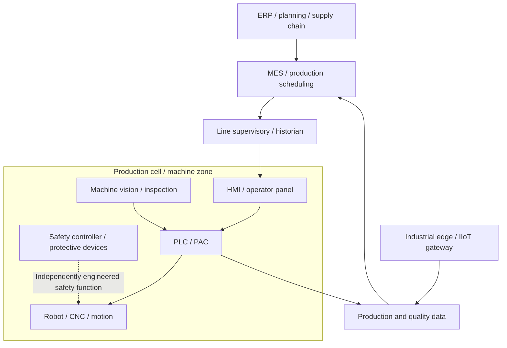
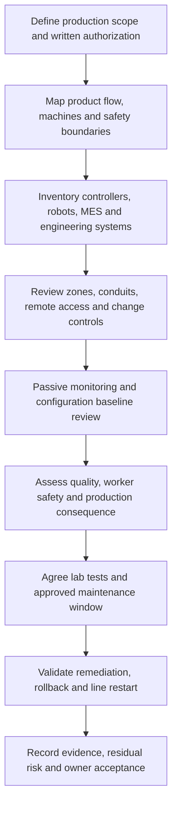

# Manufacturing and Factory OT Security Engineering Handbook

## 1. Scope and manufacturing context

This handbook covers discrete and process manufacturing, assembly, packaging, robotics, machine tools, batch operations, production execution, quality systems, industrial edge platforms and factory utilities.

Manufacturing security must preserve worker safety, product quality, process integrity, production continuity, traceability, intellectual property and equipment availability. A factory may combine modern connected production cells with long-lived machines that cannot be patched or replaced without a major outage. A control that is appropriate for an office endpoint may be unsafe or disruptive on a PLC, robot controller, CNC machine or safety controller.

This is a general engineering reference, not a machine safety assessment, process validation, product quality approval, OEM instruction or site-specific operating procedure.

## 2. Manufacturing models and process flow

| Manufacturing model | Typical production | OT and supporting systems | Key cyber-physical concerns |
|---|---|---|---|
| Discrete assembly | Automotive, electronics, appliances, aerospace | PLC, robot, CNC, machine vision, MES, traceability | Motion, sequence integrity, tooling and quality |
| Continuous process | Chemicals, cement, paper, steel, food ingredients | DCS, PLC, analyzers, historians, process instruments | Process stability, material properties and environmental impact |
| Batch process | Food, beverage, pharma, specialty chemicals | Batch management, recipe control, PLC/DCS, LIMS | Recipe integrity, batch genealogy and validation |
| Packaging | Filling, labeling, palletizing, serialization | PLC, vision, line control, robotics, scanners | Label correctness, product traceability and line safety |
| Semiconductor/electronics | Wafer processing, cleanroom, test and assembly | Equipment controllers, fab automation, MES, environmental controls | Process recipe integrity, contamination and uptime |
| Smart factory | IIoT, edge analytics, digital twins, predictive maintenance | Gateways, brokers, cloud connectors, data platforms | Expanded attack surface and data/control boundary |

### 2.1 Typical production information and control flow

This is a conceptual model. Actual machine safety architecture, production data direction and cell segmentation must be verified at the facility.

## 3. Asset inventory and dependencies

| Asset class | Examples | Required inventory fields | Primary concern |
|---|---|---|---|
| Machine control | PLC, PAC, CNC, motion controller | OEM, model, firmware, program revision, cell, owner, support status | Unauthorized logic or parameter changes |
| Robotics | Industrial robot, cobot, robot cell controller | Robot model, controller, safety interface, program checksum, maintenance path | Unsafe motion or production interruption |
| Machine safety | Safety PLC, light curtain, interlock, safety scanner | Safety function, validation record, lifecycle owner, reset procedure | Cybersecurity change impairing safety function |
| Supervisory | HMI, SCADA, line server, historian | OS, application version, role, redundancy, backup | Loss of visibility or production data |
| Production execution | MES, batch, recipe, scheduling | Interfaces, identity, data flows, change approval | Recipe, batch or sequence manipulation |
| Quality and traceability | Vision, metrology, LIMS, serialization | Calibration, data provenance, interfaces, retention | Incorrect quality disposition or traceability |
| Engineering | Engineering workstation, programming laptop, repository | Authorized user, software, project baseline, removable media | Unauthorized download or malicious project |
| Industrial network | Switches, firewalls, gateways, wireless | Topology, VLAN, ACL, firmware, approved flows | Lateral movement between cells |
| Supplier support | OEM VPN, remote appliance, service laptop | Sponsor, time window, MFA, session record | Persistent third-party access |
| Utilities | Power, compressed air, chilled water, HVAC | Dependency, redundancy, alarm and fallback | Factory-wide loss due to utility failure |

## 4. Threat scenarios and safeguards

| Scenario | Potential consequence | Preventive controls | Detection evidence |
|---|---|---|---|
| Recipe or parameter manipulation | Scrap, quality failure, unsafe process conditions | Role separation, signed/approved recipe, dual review for critical parameters | Recipe version drift, unapproved parameter change |
| PLC or robot program change | Unsafe sequence, collision risk, downtime | Controlled engineering access, project baseline, MOC, offline test | Download event, checksum mismatch, unusual engineering login |
| Ransomware on MES or line server | Production scheduling and traceability disruption | Segmentation, application control, recoverable backups | Encryption behavior, service failure, lateral movement |
| Removable media compromise | Malware introduction into isolated cell | Managed media process, scanning kiosk, approved device list | New USB device, file execution and endpoint events |
| Vendor remote access abuse | Unauthorized machine support access | Named accounts, MFA, time-bound access, sponsor and recording | Session without ticket or outside approved window |
| Machine vision or quality data manipulation | Defective product accepted or good product rejected | Data integrity, calibration controls, independent sampling | Unexpected result distribution, configuration drift |
| OT/IT path misuse | Enterprise compromise reaches production cell | Explicit conduits, allowlisted services, monitored gateways | New east-west connection, unexpected protocol |
| Unsupported legacy equipment | Exploitable device remains on production network | Compensating segmentation, access restriction, replacement plan | Exposure inventory, unusual traffic, advisory match |

## 5. Defensive engineering baseline

### 5.1 Production cell segmentation
- Define zones around production lines, machine cells, process units, engineering, supervisory services and enterprise integration.
- Permit only documented communications required for production, quality, maintenance and safety.
- Avoid broad flat VLANs that allow one compromised machine to reach unrelated cells.
- Place controlled data exchange services between enterprise/MES and machine networks where practical.
- Include wireless scanners, handheld terminals, IIoT gateways and maintenance laptops in the asset and trust model.

### 5.2 Engineering and change control
- Maintain approved PLC, robot, CNC, HMI, recipe and safety configuration baselines.
- Store backups in access-controlled locations with offline or immutable copies.
- Require a change request, process/production owner approval, test evidence, rollback plan and post-change verification.
- Restrict programming tools and privileged access to designated engineering workstations.
- Record who changed a program, what changed, why, when, and which machine or line was affected.

### 5.3 Endpoint and removable media
- Use application control and supported endpoint protection where validated by OEM and production engineering.
- Do not deploy agents or security software to controllers without vendor support and performance testing.
- Establish a managed removable-media workflow: request, ownership, malware scanning, controlled transfer, logging and return.
- Separate engineering laptops from general-purpose office use.

### 5.4 Supply chain and product lifecycle
- Assess OEM remote support, software update process, firmware provenance, vulnerability disclosure and end-of-support timelines.
- Identify single-source spares and proprietary engineering tools.
- Include integrators, machine builders, cloud platforms and managed services in the supplier register.
- Define compensating controls for equipment that cannot be patched or replaced.

## 6. Monitoring and detection engineering

| Detection use case | Telemetry | Analytic idea | Owner |
|---|---|---|---|
| PLC program download | Passive industrial network monitoring, controller audit | Programming activity outside authorized change window | Automation engineer |
| Robot program modification | Robot controller audit, project repository | Program revision differs from approved baseline | Robotics engineering |
| Recipe change | MES, batch and HMI audit | Critical recipe change without approved production change | Process/quality owner |
| New device in production cell | Passive network inventory, switch logs | New MAC/IP or unexpected protocol peer | OT network team |
| Vendor access anomaly | VPN, jump host, identity and session logs | Supplier login without active sponsor/ticket | OT access owner |
| Quality data integrity anomaly | LIMS, vision and historian records | Sudden shift, missing sequence or unexplained override | Quality engineering |
| Engineering workstation compromise | Endpoint telemetry, application logs | Unapproved executable or privileged tool use | OT SOC |
| Line service degradation | SCADA, MES, controller health and alarms | Loss of redundancy or abnormal controller communication | Production operations |

Tune analytics for planned maintenance, shift changes, recipe changeovers, line stops and engineering test activity. Alert volume alone is not a measure of detection quality.

## 7. Safe assessment workflow

Assessment cautions:
- Start with document review, interviews, passive discovery and configuration inspection.
- Do not scan, fuzz, force I/O, alter motion parameters, download controller programs or bypass machine guards on a live line without explicit authorization and an approved test plan.
- Never test safety PLCs, emergency stops, interlocks or protective devices by defeating or triggering real hazardous motion.
- Use offline controller projects, vendor simulators, digital twins or isolated test cells for active testing.
- Coordinate with production, quality, maintenance, machine safety and OEM stakeholders.

## 8. Incident response and production recovery

| Phase | Actions | Decision authority |
|---|---|---|
| Prepare | Line criticality, contacts, known-good projects, spares, recovery sequence and manual work instructions | Plant management and production |
| Validate | Correlate cyber alerts with line alarms, quality events, maintenance and operator observations | OT SOC and automation |
| Stabilize | Protect workers, isolate affected production scope only where safe, preserve quality hold and traceability | Shift/production manager |
| Contain | Revoke compromised access and restrict conduits without disabling required control or safety | Operations and OT engineering |
| Eradicate | Rebuild support systems, remove malicious tooling, verify project and recipe integrity | OT engineering |
| Recover | Restore known-good configuration, dry-run or simulation, verify safety and quality, staged restart | Production, safety and quality |
| Learn | Root cause, product disposition, customer/regulator notification where applicable, corrective actions | Plant governance |

A factory restart is not complete when the HMI becomes available. Confirm machine safety, tooling, recipe integrity, quality checks, traceability and production authorization before returning product to normal release.

## 9. Engineering deliverables

- Production process and machine-cell map.
- Asset inventory with firmware and support status.
- Production cell zone/conduit diagram and communication matrix.
- Engineering workstation and removable-media register.
- OEM and third-party remote access register.
- PLC/robot/CNC/recipe baseline and backup register.
- Machine safety boundary and change approval evidence.
- Vulnerability/advisory disposition register.
- OT SOC detection and telemetry coverage matrix.
- Incident response and line restart playbook.
- Recovery test evidence and product quality acceptance.
- Residual risk and remediation roadmap.

## 10. Metrics

| Metric | Measurement | Interpretation |
|---|---|---|
| Production asset coverage | Validated assets / estimated in-scope assets | Include machines and vendor appliances |
| Baseline integrity | Critical controllers with verified approved project | Verify restore, not merely file presence |
| Vendor access governance | Sessions with named user, sponsor, ticket and window | Include emergency maintenance |
| Cell segmentation coverage | Critical cell boundaries with approved flow matrix | Do not equate VLAN count with effective segmentation |
| Recovery readiness | Successful restore and restart exercises by line type | Include quality and safety acceptance |
| Unsupported asset risk | Unsupported assets with approved compensating controls | Track replacement funding and owner |
| Detection validation | Priority scenarios exercised with telemetry and response owner | Measure response effectiveness |

## 11. Standards, guidance and regulatory applicability

- ISA/IEC 62443 series for IACS security programs, risk assessment, zones/conduits and technical controls.
- NIST SP 800-82 Rev. 3 for OT security guidance.
- NISTIR 8183, Cybersecurity Framework Manufacturing Profile, as a manufacturing-oriented profile reference.
- NIST SP 1800-41 Initial Public Draft (21 May 2026) for manufacturing incident response and recovery architecture; it is a draft practice guide, not a final standard.
- Applicable machinery safety and functional safety standards, including ISO 12100 and IEC 61508/61511 where relevant to the equipment/process. These are not interchangeable with cybersecurity standards.
- EU NIS2 scope includes specified manufacturing subsectors and chemicals, subject to national transposition and entity scope. Do not assume every factory is in scope.
- National critical manufacturing, product safety, environmental, quality and critical infrastructure obligations.

## 12. Sources and further reading

- CISA Critical Manufacturing Sector Cybersecurity Framework Implementation Guidance: https://www.cisa.gov/sites/default/files/publications/Critical_Manufacturing_Sector_Cybersecurity_Framework_Implementation_Guidance_FINAL_508.pdf
- NISTIR 8183, Cybersecurity Framework Manufacturing Profile: https://csrc.nist.gov/pubs/ir/8183/final
- NIST SP 1800-41 Initial Public Draft, 21 May 2026: https://csrc.nist.gov/pubs/sp/1800/41/ipd
- NIST SP 800-82 Rev. 3: https://csrc.nist.gov/pubs/sp/800/82/r3/final
- ENISA, Cybersecurity of Critical Sectors / NIS2: https://www.enisa.europa.eu/topics/cybersecurity-of-critical-sectors
- ISA/IEC 62443 series: https://www.isa.org/standards-and-publications/isa-standards/isa-iec-62443-series-of-standards
- MITRE ATT&CK for ICS: https://attack.mitre.org/matrices/ics/

## 13. Document control

| Version | Date | Change |
|---|---|---|
| 1.0 | 2026-11-17 | Initial sector reference |
| 1.1 | 2026-11-27 | Expanded manufacturing models, asset inventory, architecture, threat scenarios, engineering controls, monitoring, safe assessment, recovery, deliverables, metrics and source status |

**Limitations:** This is a public engineering reference, not a machine safety validation, production process approval, product quality determination or legal opinion. Obtain qualified automation, safety, quality, cybersecurity and legal review before applying it to a live facility.
