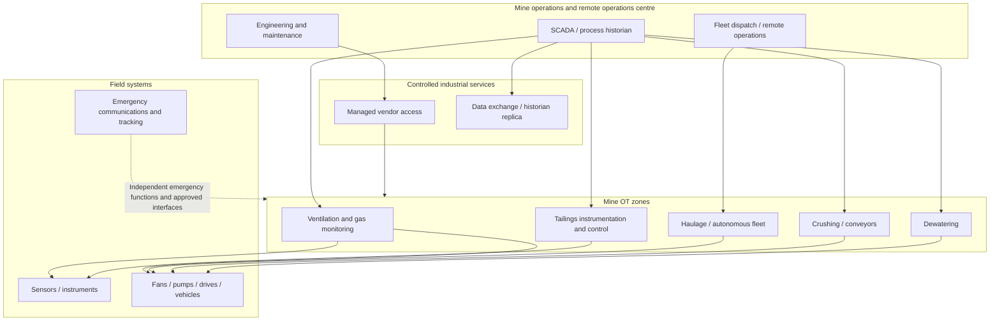
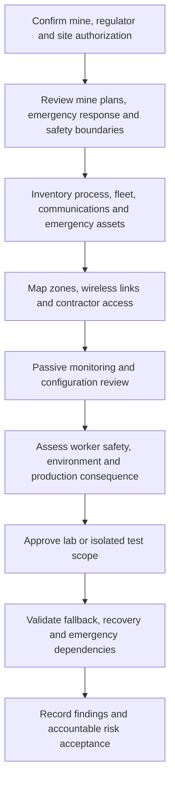

# Mining and Metals OT Security Engineering Handbook

## 1. Scope and safety boundary

This handbook covers open-pit and underground mines, mineral processing, conveyors, crushers, ventilation, dewatering, fleet systems, autonomous equipment, smelters, tailings operations and remote operations centres.

Mining OT is geographically distributed, exposed to harsh environments and often dependent on wireless or intermittently available communications. Cybersecurity decisions can affect worker location awareness, ventilation, gas monitoring, emergency communication, vehicle movement, hoisting, dewatering, explosives processes, tailings stability and environmental protection.

The mine's approved emergency response plan, ventilation plan, ground control plan, explosives procedures, electrical safety rules, statutory requirements and competent mine management authority take precedence. This handbook is not a mine safety plan or a substitute for the applicable mining regulator.

## 2. Mining process and systems landscape

| Operating area | Process functions | Representative OT | High-consequence dependencies |
|---|---|---|---|
| Open-pit extraction | Drilling, blasting, loading, haulage | Drill controllers, fleet management, dispatch, GPS, collision avoidance | Personnel location, vehicle movement, explosives safety |
| Underground extraction | Development, production, hoisting, haulage | PLC/SCADA, hoist control, ventilation, tracking, communications | Ventilation, emergency communications, refuge and evacuation |
| Crushing and conveying | Primary/secondary crushing, conveyors, stockpiles | PLCs, drives, belt scales, pull cords, interlocks | Material flow, fire detection, personnel protection |
| Mineral processing | Grinding, flotation, separation, thickening | DCS/PLC, pumps, analyzers, reagent dosing | Chemical handling, process stability and environmental release |
| Dewatering | Sumps, drainage, pumping | Pump controllers, level sensors, RTUs | Flooding, access routes and equipment protection |
| Tailings | Deposition, reclaim, water management and monitoring | Instrumentation, telemetry, pump control, monitoring platforms | Dam/embankment integrity, water balance, environmental consequences |
| Smelting and metals | Furnaces, casting, gas cleaning, material handling | PLC/DCS, furnace control, gas monitoring, drives | High temperature, molten material, gas exposure and emissions |
| Remote operations | Fleet dispatch, remote equipment, central control | Remote consoles, wireless, video, radio and network services | Communications integrity, latency and safe local fallback |

## 3. Asset inventory and dependency model

| Asset class | Examples | Required attributes | Security/safety concern |
|---|---|---|---|
| Process control | PLC, RTU, DCS, HMI | Vendor, model, firmware, logic revision, process area, redundancy | Unauthorized control changes |
| Ventilation and gas monitoring | Fan controls, airflow sensors, methane/gas sensors, AMS | Sensor location, calibration, alarm path, controller, approved plan mapping | Loss or manipulation of critical safety information |
| Mobile fleet | Haul trucks, loaders, drills, autonomous vehicles | Vehicle ID, controller, software, communication, safe stop behavior | Collision, loss of control or location |
| Hoisting | Winder/hoist controls, braking and monitoring | Safety function, control boundary, maintenance mode, validation record | Personnel transport and equipment safety |
| Emergency systems | Communications, tracking, refuge, alarms | Coverage, power backup, test records, statutory approval | Emergency response failure |
| Conveyor and crushing | Drives, belt control, interlocks, pull cords | Line topology, interlock logic, local stop and restart | Unexpected movement and entrapment |
| Tailings monitoring | Level, pressure, seepage and deformation instrumentation | Instrument location, trend, threshold owner, telemetry path | Delayed recognition of instability |
| Engineering and support | Workstations, OEM gateways, wireless controllers | Authorized users, software, access window, baseline | Vendor compromise and project tampering |
| Communications | Underground leaky feeder, Wi-Fi, radio, fiber, LTE/private network | Coverage map, failover, latency, power and route | Loss of coordination and tracking |

## 4. Representative architecture

This is a conceptual view only. Emergency systems, ventilation controls, tracking and communications may have dedicated or independent architectures. Do not merge them into a general-purpose control network without a formal safety and engineering analysis.

## 5. Threat scenarios and safeguards

| Scenario | Potential consequence | Preventive controls | Detection evidence |
|---|---|---|---|
| Ventilation monitoring loss or manipulation | Unsafe atmospheric conditions or delayed evacuation decision | Sensor calibration, protected telemetry, approved alarm response and independent checks | Sensor dropout, implausible readings, alarm path failure |
| Remote fleet compromise | Unsafe vehicle movement, collision risk or production disruption | Segmented fleet network, authenticated control, safe local mode, vendor access control | Unexpected commands, location mismatch, control session anomaly |
| Hoist control configuration change | Personnel or material transport hazard | Strict engineering access, independent validation, controlled maintenance mode | Logic/configuration drift, unauthorized programming |
| Conveyor logic manipulation | Unexpected movement, entrapment or material flow disruption | Interlock integrity, change control, local stop systems | Program download, interlock state changes, unexpected start |
| Dewatering system disruption | Flooding, equipment loss or access route impact | Redundant pumps, local control, power resilience and tested response | Pump state mismatch, rising sump level, telemetry loss |
| Tailings monitoring integrity compromise | Delayed identification of abnormal conditions | Protect sensor data, independent review, trend validation | Missing data, sudden unexplained discontinuity, sensor disagreement |
| OEM/contractor account compromise | Access to multiple process or fleet zones | Individual accounts, MFA, approved window, session recording | Vendor access outside ticket or scope |
| Malware on maintenance workstation | Disruption or unauthorized configuration changes | Dedicated engineering endpoint, controlled media and allowlisting | New executables, credential access and project changes |

## 6. Defensive engineering requirements

### 6.1 Critical safety and environmental dependencies
- Identify safety-related and emergency functions before defining cybersecurity zones.
- Preserve approved ventilation, gas monitoring, emergency communications, tracking, hoisting, collision avoidance and fire protection behavior.
- Map the approved emergency response plan to the systems and communication paths it depends on.
- Validate power backup, communications coverage, alarm routing and local fallback.
- Do not use cyber controls that suppress or delay statutory safety alarms.

### 6.2 Network and remote access
- Separate fleet, process, engineering, enterprise, contractor and remote operations domains according to risk.
- Govern OEM and contractor access through named identities, sponsor approval, MFA where supported, time limits and session records.
- Restrict wireless infrastructure management and protect access point/controller administration.
- Document disconnected and degraded modes for remote equipment.
- Maintain secure configuration and firmware records for gateways, radios, vehicle systems and controllers.

### 6.3 Configuration and recovery
- Maintain known-good PLC, hoist, fleet, conveyor, ventilation and process configuration baselines.
- Use management of change and qualified engineering approval for changes affecting safety or movement.
- Protect offline backups and validate restoration in a representative environment.
- Maintain spares, vendor support and recovery procedures for proprietary systems.
- Test restoration without placing workers or equipment in hazardous conditions.

## 7. Monitoring and detection engineering

| Detection use case | Telemetry | Analytic idea | Owner |
|---|---|---|---|
| Ventilation/gas sensor data loss | AMS, sensor gateway, SCADA and alarm logs | Missing, stale or implausible readings | Ventilation officer / control room |
| Remote vehicle command anomaly | Fleet controller, dispatch and wireless logs | Command outside authorized operating mode or zone | Fleet operations |
| Hoist configuration change | Controller audit and engineering records | Any unapproved program or parameter change | Hoist engineer |
| Conveyor unexpected start | PLC event, drive telemetry, interlock and operator log | Start command without expected permissive or schedule | Plant operations |
| Dewatering degradation | Sump level, pump state, current and telemetry | Rising level with pump unavailable or no expected response | Mine control room |
| Tailings telemetry gap | Instrument platform, gateway and historian | Missing or discontinuous critical monitoring data | Tailings engineer |
| Contractor remote session anomaly | VPN, jump host and identity logs | Session outside approved scope or time | OT access owner |
| Network topology change | Passive monitoring, switch and wireless logs | New device, peer or route in critical zone | OT network team |

Detection thresholds must be designed with mine operations and the relevant technical authority. Do not use generic thresholds for gas, ventilation, ground movement or process parameters.

## 8. Safe assessment workflow

Assessment guardrails:
- Begin with document review, interviews, passive discovery and configuration inspection.
- Do not actively scan, fuzz, inject traffic or change configurations in ventilation, gas monitoring, hoisting, tracking, emergency communication, autonomous fleet, explosives or tailings systems without written authorization and formal safety review.
- Do not simulate fan outages, gas alarms, emergency evacuation, vehicle movement or hoist trips on live operations for cybersecurity testing.
- Use isolated simulators, vendor test benches and digital twins for protocol and controller exercises.
- Ensure the responsible mine official can immediately stop the assessment.

## 9. Incident response and recovery

| Phase | Actions | Decision authority |
|---|---|---|
| Prepare | Mine emergency contacts, approved emergency response plan, system diagrams, backups, spares and vendor contacts | Mine management |
| Validate | Correlate cyber telemetry with atmospheric monitoring, worker reports, dispatch and process alarms | Control room and OT security |
| Stabilize | Prioritize worker safety, emergency response, ventilation, communications and safe equipment state | Responsible mine official |
| Contain | Restrict compromised access while preserving required safety and emergency functions | Mine management with technical authorities |
| Eradicate | Rebuild support systems, revoke credentials and verify controller/fleet configurations | OT engineering |
| Recover | Restore systems in approved sequence; validate safety, tracking, communications and process operation | Mine operations and safety |
| Review | Preserve evidence, report under applicable rules, investigate and track corrective actions | Mine governance |

Cyber incident response must not override emergency evacuation or mine safety procedures. If a real emergency exists, use the approved emergency response plan first.

## 10. Engineering deliverables

- Mine process and operating area inventory.
- Critical asset and dependency register.
- Ventilation, atmospheric monitoring and emergency communication dependency map.
- Fleet, autonomous equipment and wireless communications inventory.
- Hoist, conveyor, dewatering and tailings control baseline register.
- Zones/conduits and network communication matrix.
- Contractor and OEM remote access register.
- Vulnerability and lifecycle risk register.
- Monitoring use-case and alarm coverage matrix.
- Emergency response and cyber incident coordination playbook.
- Backup, restoration and degraded-mode test evidence.
- Remediation plan with mine safety and operational approval.

## 11. Metrics

| Metric | Measurement | Caution |
|---|---|---|
| Critical OT inventory coverage | Validated assets / estimated assets | Include emergency and wireless infrastructure |
| Emergency communications assurance | Sites/areas with tested approved emergency communications | Cyber test must not substitute for statutory test |
| Ventilation monitoring availability | Verified sensor and alarm path health | Interpret against approved mine plan |
| Fleet remote access governance | Sessions tied to user, sponsor and approved task | Include OEM and contractor accounts |
| Configuration baseline coverage | Critical controllers with verified approved baseline | Include hoist and fleet systems |
| Recovery readiness | Restore exercises completed in approved safe environment | Never create a live safety hazard to test |
| Corrective action closure | High-risk actions validated and closed | Track residual risks explicitly |

## 12. Standards, regulatory and source applicability

- ISA/IEC 62443 and NIST SP 800-82 for OT security engineering guidance where applicable.
- Applicable national mine safety legislation, regulator rules, approved mine plans and emergency response requirements.
- In the United States, MSHA requirements under the Mine Act and relevant 30 CFR provisions govern specified mine safety matters. These include ventilation, atmospheric monitoring, communications and emergency response. Cybersecurity controls must support, not replace, these requirements.
- The US MINER Act and MSHA emergency response plan requirements have specific applicability to underground coal mines; do not generalize them to every mine type or jurisdiction.
- Environmental and tailings requirements are jurisdiction- and facility-specific. Use the applicable regulator and approved facility management system.

## 13. Sources and further reading

- MSHA, MINER Act overview: https://arlweb.msha.gov/MinerAct/2006mineract.pdf
- MSHA, PPL P25-V-01, implementation of Section 2 of the MINER Act (effective 28 August 2025; stated expiry 31 March 2027): https://www.msha.gov/sites/default/files/Directive%20%26%20Guidance/PPLs/P25-V-01%20Implementation%20of%20Section%202%20of%20the%20MINER%20Act%20PPL.pdf
- MSHA, Mine Act ventilation and emergency provisions: https://arlweb.msha.gov/regs/act/act2.htm
- MSHA, mine emergency response guide: https://arlweb.msha.gov/regs/complian/guides/IG-110.pdf
- NIST SP 800-82 Rev. 3: https://csrc.nist.gov/pubs/sp/800/82/r3/final
- ISA/IEC 62443 series: https://www.isa.org/standards-and-publications/isa-standards/isa-iec-62443-series-of-standards
- MITRE ATT&CK for ICS: https://attack.mitre.org/matrices/ics/

## 14. Document control

| Version | Date | Change |
|---|---|---|
| 1.0 | 2026-11-17 | Initial sector reference |
| 1.1 | 2026-11-27 | Expanded mining process taxonomy, safety dependencies, architecture, threats, controls, detections, safe assessment, emergency response, deliverables and source applicability |

**Limitations:** This is a public cybersecurity engineering reference, not a mine plan, statutory safety procedure, ventilation plan, ground control plan or emergency response plan. Qualified mine management, safety and engineering authorities must approve all operational changes.
