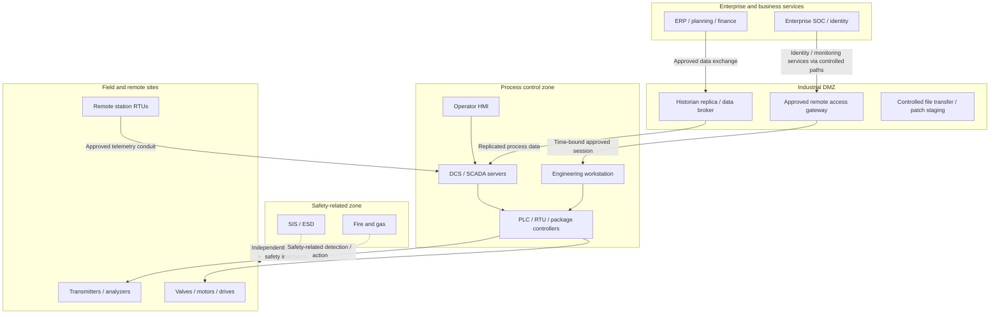
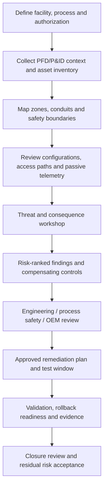

# Oil, Gas, LNG, and Petrochemical OT Security Engineering Handbook

## 1. Scope and engineering boundary

This handbook provides a process-first cybersecurity engineering reference for oil and gas, LNG, gas processing, pipeline, storage, terminal and petrochemical environments. It is intended for OT engineers, process control engineers, cybersecurity teams, process safety professionals, asset owners, EPCs, integrators, maintainers and auditors.

It is not a substitute for a facility's process hazard analysis, HAZOP, LOPA, safety requirements specification, functional-safety lifecycle, operating procedures, emergency response plan, OEM instructions or regulator requirements. Every facility has a different process configuration, safety basis, operating envelope and risk profile. Treat the architectures and scenarios below as representative patterns, not universal designs.

Cybersecurity decisions must preserve:
- Personnel safety and process containment.
- Environmental protection and emissions management.
- Process stability, product quality and production continuity.
- Availability and integrity of operator indications, alarms, interlocks and control functions.
- Safe shutdown, emergency shutdown and recovery capability.
- Evidence integrity for incident investigation and regulatory reporting.

## 2. Industry segmentation and process context

| Segment | Representative processes | Typical OT and control systems | Security-critical dependencies |
|---|---|---|---|
| Upstream onshore | Well pads, artificial lift, separation, gathering, water injection, gas compression | Wellhead controllers, RTUs, PLCs, SCADA, flow computers, ESD, fire-and-gas | Remote telemetry, radio/cellular/satellite, power, well-control and safety functions |
| Upstream offshore | Drilling, well control, production, topside utilities, subsea support | DCS, PLCs, drilling control, subsea control, ESD, F&G, marine systems | Platform communications, safety instrumented systems, vendor support, satellite links |
| Midstream | Pipelines, compressor stations, pump stations, metering, tank farms | Pipeline SCADA, RTUs, PLCs, leak detection, flow computers, terminal automation | Communications availability, time synchronization, pressure/flow measurement, remote sites |
| Refining | Crude distillation, hydrotreating, catalytic cracking, utilities, blending | DCS, PLC, SIS, burner management, analyzer systems, historians | Process interlocks, utilities, instrument air, operator visibility and engineering systems |
| Gas processing | Separation, dehydration, sweetening, compression, fractionation | DCS, PLC, SIS, gas detection, compressor controls | Pressure protection, gas composition measurement, rotating equipment |
| LNG | Liquefaction trains, storage, loading, regasification | DCS, SIS, ESD, BOG compressors, loading control, tank gauging | Cryogenic process integrity, ESD cause-and-effect, custody transfer and marine interfaces |
| Petrochemicals | Polymerization, chemical synthesis, batch and continuous process | DCS, PLC, SIS, package systems, laboratory and manufacturing systems | Recipe integrity, reaction control, quality data, hazardous chemical containment |
| Terminals | Receipt, storage, blending, loading and unloading | Terminal management, tank gauging, PLCs, access control, metering | Truck/rail/ship interfaces, loading permissives, inventory and custody data |

## 3. Process and asset inventory model

A useful inventory connects the asset to the process function and consequence, not just the IP address.

| Asset family | Examples | Required inventory attributes | Security and operational concern |
|---|---|---|---|
| Basic process control | DCS controllers, PLCs, remote I/O | Vendor, model, firmware, logic revision, process unit, redundancy, owner | Unauthorized logic or configuration change |
| Safety systems | SIS, ESD, F&G, burner management | Safety function, SIF reference, lifecycle owner, proof-test status, engineering boundary | Cyber change can affect safety lifecycle and independent protection |
| Supervisory control | SCADA servers, operator stations, HMIs | Site, role, data sources, failover, remote access, OS support | Loss or manipulation of operator visibility |
| Field instrumentation | Pressure, temperature, flow, level, gas detectors | Tag, range, calibration, controller mapping, criticality | Measurement spoofing or loss can mislead control decisions |
| Rotating equipment | Compressor, turbine, pump controls | Package vendor, controller, firmware, trip interfaces, maintenance access | Availability and protection dependencies |
| Pipeline systems | RTUs, leak detection, flow computers, valve controllers | Station, communications path, protocol, time source, valve role | Loss of remote visibility or command integrity |
| Engineering systems | Engineering workstation, configuration server, logic repository | Authorized users, approved software, backup, project checksum | Unauthorized project download or controller programming |
| OT infrastructure | Switches, firewalls, serial gateways, radio, fiber | Topology, ports, firmware, configuration, redundancy | Conduit compromise and communications loss |
| Data systems | Historian, OPC gateway, reporting, laboratory interfaces | Data direction, interface, retention, integrity checks | OT-to-IT pivot or manipulated process history |
| Supplier access | VPN, remote support appliance, jump host | Supplier, sponsor, access window, approval, session recording | Persistent third-party access and shared credentials |

### 3.1 Minimum process context for every critical asset

Record the unit or station, process function, upstream and downstream dependencies, normal and safe operating states, loss-of-communications behavior, local/manual operating capability, safety instrumented function dependencies, recovery method and accountable process owner. Do not publish detailed plant network diagrams, exact IP addresses, credentials, sensitive tag lists or exploitable facility details in this public repository.

## 4. Representative reference architecture

The following is a conceptual pattern. Actual zones, conduits, safety boundaries and security levels must be determined by a site-specific risk assessment and engineering design.

Architecture review questions:
1. Are enterprise, DMZ, process control, safety-related and remote-site boundaries explicit?
2. Are data flows documented in both directions, including vendor and temporary connections?
3. Does remote access terminate in a controlled intermediary with individual identity and session accountability?
4. Are safety-related networks and engineering paths protected according to the safety design and site risk assessment?
5. Are historian, OPC, file transfer and patch staging paths restricted to necessary protocols and destinations?
6. Can local operators maintain safe control if WAN, remote access or enterprise identity services are unavailable?
7. Are redundant paths genuinely independent or do they share power, switches, credentials or management planes?

## 5. High-value cyber and operational scenarios

| Scenario | Attack or failure path | Potential consequence | Preventive controls | Detection and evidence |
|---|---|---|---|---|
| Vendor access compromise | Stolen supplier identity or unmanaged remote appliance | Unauthorized access to control or engineering systems | Named accounts, MFA, sponsor approval, just-in-time access, gateway, session recording | New supplier login, unusual source, off-hours access, session and gateway logs |
| Engineering workstation compromise | Phishing, removable media, vulnerable support software | Unauthorized project change or loss of engineering availability | Dedicated engineering access, allowlisting, application control, offline project backups | Project checksum drift, new tools, controller download, unexpected admin activity |
| Pipeline SCADA loss | WAN outage, compromised radio gateway, denial of service | Loss of visibility, delayed response, inability to operate remote stations | Diverse communications, local autonomy, fail-safe design, tested fallback | Link-state change, telemetry gaps, sequence-of-events anomalies |
| Process measurement manipulation | Unauthorized write or spoofed telemetry | Incorrect operator decisions, process deviation | Command authorization, protocol-aware monitoring, independent measurements | Setpoint and measurement divergence, unusual write operations |
| Ransomware in support services | Compromise of Windows server, historian or file services | Loss of visibility, engineering support or production reporting | Segmentation, backups, endpoint controls, least privilege | Encryption behavior, mass file changes, service outages |
| Safety engineering path compromise | Unauthorized access to SIS engineering or support route | Potential impairment of safety lifecycle or protection function | Strict separation, change authorization, dual control, safety engineering review | Logic/configuration change, project mismatch, engineering login |
| Time source compromise | NTP/PTP source manipulation or loss | Event ordering and sequence-of-events uncertainty | Trusted time sources, protected distribution, holdover design | Time drift, source change, timestamp discontinuity |
| Terminal loading manipulation | Compromise of permissives, metering or tank gauging | Overfill, incorrect transfer, product loss or safety incident | Independent high-high protection, controlled recipes, reconciled measurements | Alarm suppression, permissive changes, meter/tank discrepancy |

Scenarios are risk-analysis prompts. They are not claims that a particular operator has experienced the event.

## 6. Defensive engineering requirements

### 6.1 Identity and remote maintenance
- Use named accounts and prohibit shared interactive accounts where technically feasible.
- Require MFA at the remote access boundary where supported and safe to operate.
- Use a managed jump host or equivalent controlled access gateway in the industrial DMZ.
- Bind each session to a business sponsor, asset scope, reason, approved time window and accountable operator.
- Disable access when the work window ends; review persistent vendor tunnels and unattended modems.
- Record session metadata and retain evidence according to policy and applicable law.
- Provide a break-glass process that is tested, logged and controlled by operations.

### 6.2 Engineering and configuration integrity
- Maintain approved controller logic, HMI, DCS, SIS and network configuration baselines.
- Store known-good project files in access-controlled, offline or immutable backup locations.
- Compare deployed logic and configuration against approved baselines after authorized changes.
- Require management of change, process owner approval, test evidence and rollback plan.
- Validate OEM supportability and process safety impact before patches, firmware changes or configuration modifications.

### 6.3 Network and communications
- Apply risk-based zones and conduits; deny unnecessary inter-zone flows by default.
- Permit only documented source, destination, protocol and service combinations.
- Monitor critical conduits passively where possible.
- Secure remote-site communications and document loss-of-link behavior.
- Treat serial gateways, radio, cellular routers, satellite links and engineering modems as managed assets.
- Avoid deploying inline inspection or active discovery devices without performance and failover validation.

### 6.4 Vulnerability and patch management
1. Identify affected product, model, firmware, configuration and exposure.
2. Verify the advisory against vendor and CISA/ICS sources.
3. Determine process consequence, exploitability, reachable interfaces and compensating controls.
4. Consult operations, process safety, OEM and asset owner.
5. Test in a representative lab or staging environment.
6. Approve a maintenance window, rollback and contingency plan.
7. Apply the change and verify process and security function.
8. Record deferral rationale and interim controls if patching is not safe or supported.

A CVSS score is one input, not the complete OT risk decision.

## 7. OT monitoring and detection use cases

| Detection use case | Telemetry | Example analytic logic | Response owner |
|---|---|---|---|
| Unexpected controller programming | Passive network metadata, engineering logs, controller audit | Programming or download event outside approved change window | Control engineer and OT security |
| Vendor remote access outside window | VPN, jump host, identity provider | Supplier session without matching approved ticket or sponsor | OT access owner |
| New device or communication peer | Passive network monitoring, switch logs | Previously unseen device or new conduit relationship | OT network engineer |
| Process setpoint deviation | Historian, alarm/event data, control logs | Critical setpoint change without approved MOC | Process control engineer |
| Safety system configuration change | SIS engineering audit and project baseline | Any unapproved change or mismatch | Functional safety owner |
| Loss of remote station telemetry | SCADA, radio/cellular gateway and WAN logs | Repeated link failures or missing expected updates | Pipeline/remote operations |
| Time synchronization anomaly | NTP/PTP monitoring, controller timestamps | Source change or drift beyond site threshold | OT infrastructure owner |
| Historian/data broker unusual transfer | Firewall, proxy, broker and host logs | New destination, unexpected volume or protocol | OT SOC and data owner |

Detection thresholds must be tuned to the actual process, polling cycle, redundancy design and operating mode. Do not block control traffic solely because an alert fired.

## 8. Safe assessment workflow

Assessment guardrails:
- Begin with document review, interviews, passive discovery and configuration review.
- Do not scan, fuzz, inject packets, change setpoints, download logic, force I/O, trip equipment or isolate networks on live production without explicit authorization and an approved engineering test plan.
- Do not test SIS, ESD, fire-and-gas or burner management by causing real process trips.
- Use a representative offline lab, digital twin or vendor test environment for active protocol and controller testing.
- Ensure operations can stop the assessment immediately and restore the known-safe state.

## 9. Incident response and recovery

| Phase | Required actions | Industrial decision authority |
|---|---|---|
| Prepare | Maintain contact tree, process criticality, backup records, manual fallback, vendor and regulator contacts | Asset owner and operations |
| Detect and validate | Correlate cyber telemetry with process alarms, operator observations and engineering change records | OT SOC with control engineer |
| Stabilize | Preserve safe process control; assess local/manual operation, process deviation and safety function status | Shift supervisor / incident commander |
| Contain | Choose containment that does not remove required control, protection or visibility | Operations, OT engineering and safety |
| Eradicate | Rebuild affected support assets, revoke compromised access, validate project integrity | OT engineering and cybersecurity |
| Recover | Restore from known-good configurations, verify controller logic and field indications, staged return to service | Operations and engineering |
| Learn | Root cause, evidence preservation, regulatory/contractual reporting, corrective actions and exercise updates | Incident governance |

Never assume that disconnecting a compromised controller, blocking a protocol or shutting down a remote station is the safest response. The correct action depends on the process, safety basis, operating procedure and local authority.

Recovery evidence should include approved baseline, backup provenance, restore test, firmware and logic verification, process validation, operator acceptance, outstanding risks and change approval.

## 10. Engineering deliverables and evidence

A facility assessment should produce, at minimum:
- Process and facility scope statement.
- Process-to-asset criticality register.
- OT asset and firmware inventory.
- Network communication matrix and zones/conduits diagram.
- Remote access and third-party register.
- Controller logic and configuration baseline register.
- Safety-related system boundary and approval record.
- Vulnerability/advisory register with risk-based decisions.
- Monitoring use-case and telemetry coverage matrix.
- Incident response and recovery playbooks.
- Backup and restoration test evidence.
- Remediation plan, residual risk and accountable approvals.

## 11. Sector-specific metrics

| Metric | Suggested measurement | Interpretation caution |
|---|---|---|
| Asset inventory coverage | Known in-scope assets / validated estimated assets | Validate against site walkdown and engineering records |
| Remote access governance | Sessions linked to sponsor, ticket and approved window | A high percentage does not prove session activity was safe |
| Critical configuration integrity | Baselines verified within approved review cycle | Define which systems are in scope |
| Backup recoverability | Successful restore tests by asset class | Backup completion is not restore assurance |
| Vulnerability treatment | Risk-reviewed advisories with documented disposition | Do not use patch percentage alone |
| Detection coverage | Critical scenarios with validated telemetry and owner | Alert count is not detection effectiveness |
| Exercise readiness | Exercises completed and corrective actions closed | Include process and safety stakeholders |

## 12. Standards, regulatory and reference mapping

Use these as reference families, then determine local applicability:
- ISA/IEC 62443 series for IACS security programs, system risk assessment, zones/conduits and product/service lifecycle.
- NIST SP 800-82 Rev. 3 for OT security guidance; monitor Rev. 4 draft separately until final publication.
- MITRE ATT&CK for ICS for threat-informed scenario development.
- ISO/IEC 27019 where energy utility information security guidance is relevant to the organization and sector.
- IEC 61508 and IEC 61511 for functional-safety lifecycle coordination; these are not cybersecurity standards.
- National critical infrastructure, petroleum, gas, pipeline, environmental, process safety and energy regulator instruments.
- Operator, EPC, OEM and customer requirements where legally or contractually applicable.

### 12.1 United States example

TSA's pipeline security directive series has applied to specified owners/operators notified by TSA that their pipeline system or LNG facility is critical. The 2025 Pipeline-2021-01E document states incident reporting, 24/7 cybersecurity coordinator, vulnerability assessment and remediation-related requirements for its covered entities, with an expiry date of 2 May 2026. Because that date has passed, do not cite that specific version as a current obligation without checking the latest TSA directive, renewal memorandum and entity notification.

The US Department of Energy's CESER reported in June 2026 that it was conducting cyber and physical security exercises for oil and natural gas operators, emphasizing emergency mechanisms and coordination. This is useful sector preparedness context, not a universal legal requirement.

## 13. Sources and further reading

- NIST SP 800-82 Rev. 3: https://csrc.nist.gov/pubs/sp/800/82/r3/final
- NIST SP 800-82 Rev. 4 Initial Public Draft: https://csrc.nist.gov/pubs/sp/800/82/r4/ipd
- ISA/IEC 62443 series catalogue: https://www.isa.org/standards-and-publications/isa-standards/isa-iec-62443-series-of-standards
- MITRE ATT&CK for ICS: https://attack.mitre.org/matrices/ics/
- TSA Pipeline Security Directive 2021-01E (historical version; expiry 2026-05-02): https://www.tsa.gov/sites/default/files/tsa-security-directive-pipeline-2021-01e-and-memo-508c.pdf
- US Department of Energy CESER, oil and natural gas security exercises, 22 June 2026: https://www.energy.gov/ceser/articles/ceser-supports-oil-and-natural-gas-subsector-critical-energy-security-exercises

## 14. Document control

| Version | Date | Change |
|---|---|---|
| 1.0 | 2026-11-17 | Initial sector reference |
| 1.1 | 2026-11-27 | Expanded process and asset model, architecture, threat scenarios, engineering controls, detections, assessment, response, recovery, evidence, metrics and source status |

**Limitations:** This handbook is a public engineering reference. It does not establish the security posture or legal obligations of a specific operator. Obtain qualified process, functional-safety, cybersecurity and legal review before applying it to a live facility.
