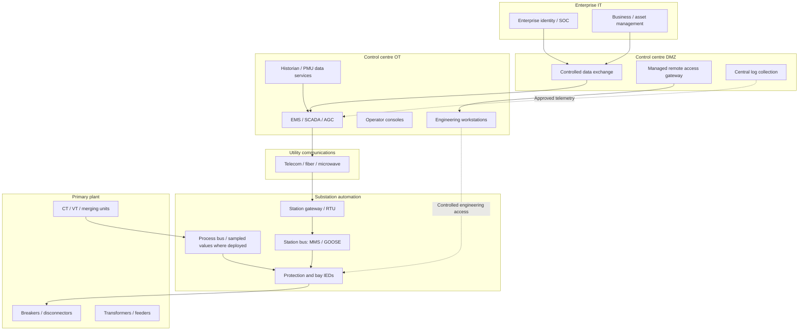
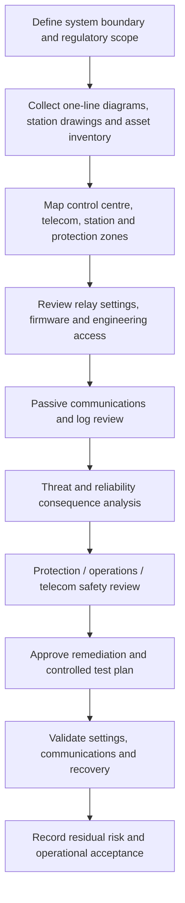

# Power Generation, Grid, and Substation OT Security Engineering Handbook

## 1. Scope and reliability boundary

This handbook covers generation, transmission, distribution, substations, control centres, protection and automation systems, renewable generation, battery energy storage and distributed energy resources.

The primary engineering objectives are to preserve:
- Personnel and public safety.
- Grid stability, frequency and voltage control, and reliable power delivery.
- Protection coordination and correct operation of relays and remedial schemes.
- Integrity and availability of control commands, measurements, time and event records.
- Safe local operation, restoration and black-start capability where applicable.
- Physical security and cyber resilience of critical substations and control facilities.

A cybersecurity action can affect protection, dispatch, switching, restoration or stability. Do not treat an OT alert as automatic authority to block traffic, isolate an IED, disable a control path or change a relay setting. System operators, protection engineers and the responsible operational authority must determine the safe action.

This document is not a substitute for grid codes, protection coordination studies, operating procedures, safety rules, OEM instructions, system restoration plans or jurisdiction-specific reliability standards.

## 2. Power system and control landscape

| Layer / function | Representative assets | Security-critical attributes |
|---|---|---|
| Generation plant | Turbine/governor control, excitation, generator protection, plant DCS, unit PLCs | Dispatchability, unit protection, trip paths, local/remote mode |
| Control centre | EMS, SCADA master, AGC, ICCP gateways, operator consoles, alarm/event servers | Command authority, operator visibility, redundancy, trusted time |
| Transmission | Substation RTUs, bay controllers, protection relays, breakers, transformers | Protection settings, interlocking, switching control, fault clearing |
| Distribution | DMS, feeder automation, reclosers, capacitor banks, voltage regulators | Outage response, distributed automation, field communications |
| Substation automation | IEDs, station bus, process bus, merging units, gateways | GOOSE/MMS/Sampled Values, time synchronization, network determinism |
| Protection engineering | Relay configuration tools, settings repositories, test sets | Approved settings, version integrity, controlled engineering access |
| Time and measurement | GPS clocks, PTP/NTP, PMUs, phasor data concentrators | Time source integrity, sequence-of-events accuracy, synchrophasor quality |
| Renewable generation | Inverter controllers, plant power controller, wind turbine controllers | Active/reactive power control, grid support functions, remote vendor access |
| Battery storage | BMS, PCS, EMS, thermal management, fire detection/suppression | Cell safety, thermal runaway controls, dispatch and state-of-charge integrity |
| Telecom | Fiber, microwave, leased circuits, carrier networks, serial gateways | Path diversity, latency, availability, protection signalling dependencies |

## 3. Reference architecture and trust boundaries

The following is conceptual. Actual control centre, station bus, process bus, protection and telecom architectures differ by utility and substation design.

### 3.1 Architecture review questions

- Are control centre, enterprise, substation, protection and vendor access boundaries documented?
- Are station bus, process bus and protection communications treated according to their distinct timing and availability needs?
- Are protection functions independent where the engineering design requires independence?
- Are remote access paths mediated, time-limited, attributable and monitored?
- Are telecom providers, leased links and remote maintenance dependencies included in the threat model?
- Are time sources, holdover behavior and loss-of-time alarms understood?
- Are redundant systems independent across power, network, management plane and credentials?
- Are local control and manual operating options documented and periodically exercised?

## 4. Security objectives and engineering controls

### 4.1 Asset and configuration integrity
- Maintain a verified inventory of control centre, substation, protection, telecom and engineering assets.
- Record manufacturer, model, firmware, settings revision, station/bay, criticality, communication interfaces and lifecycle support.
- Maintain approved relay settings, logic, controller configuration and engineering project baselines.
- Require a documented change request, protection engineering review, operations approval, test plan and rollback.
- Verify post-change settings and configuration against the approved baseline.

### 4.2 Network security and access
- Segment enterprise, control centre, substation, station bus, process bus, protection engineering and supplier paths according to risk and engineering design.
- Restrict inter-zone flows to approved endpoints, protocols and purposes.
- Use managed remote access with individual identity, MFA where supported, time-bounded authorization and session accountability.
- Remove unused services and dormant access paths after engineering review.
- Monitor telecom and third-party dependencies; do not assume leased or private circuits are inherently trusted.

### 4.3 Protection and time integrity
- Protect relay settings and logic from unauthorized modification.
- Maintain trusted time sources and monitor drift, source change and holdover status.
- Retain sequence-of-events records and preserve timestamp provenance during incident response.
- Validate protection communications and time dependencies during design and maintenance.
- Do not introduce inline security devices or active inspection into protection paths without latency, failover and OEM validation.

## 5. Threat scenarios and response priorities

| Scenario | Potential effect | Preventive controls | Detection evidence |
|---|---|---|---|
| Unauthorized relay setting change | Incorrect protection behavior or loss of coordination | Role-based engineering access, approved settings baseline, dual review | Settings checksum/configuration comparison, engineering audit |
| Engineering workstation compromise | Unauthorized IED configuration or malicious software transfer | Dedicated workstation, allowlisting, controlled media, privileged access | New executable, unusual login, unexpected relay session |
| Loss of SCADA visibility | Reduced operator awareness and remote control | Diverse telecom, local fallback, resilient control centre | Telemetry gaps, link state, stale values, alarm flood |
| GOOSE/MMS misuse | Unintended or unauthorized station communications | VLAN/ACL design, approved communication matrix, IED configuration control | New publisher/subscriber relationship, unexpected service or message pattern |
| Time synchronization compromise | Misordered events, protection or measurement uncertainty | Trusted source, protected time distribution, redundancy | Time-source changes, offset/drift, timestamp discontinuity |
| Contractor remote access abuse | Unauthorized access to control or engineering systems | Sponsor, ticket, MFA, time-bound session and recording | Session without approval, off-hours connection, unusual destination |
| Supply chain or firmware compromise | Compromised IED, gateway or engineering tool | Supplier assurance, signed firmware where supported, controlled update | Firmware mismatch, integrity check failure, vendor advisory |
| Physical attack on substation | Damage, loss of equipment or forced outage | Site security, surveillance, access control, coordinated response | Access alarms, tamper sensors, physical incident reports |
| Renewable/BESS controller compromise | Unintended dispatch, power quality or battery safety impact | Segmented vendor access, secure configuration, independent safety controls | Setpoint drift, unexpected operating mode, BMS/PCS alarms |

## 6. Protocol and communications considerations

| Technology | Typical use | Security engineering concern |
|---|---|---|
| IEC 61850 MMS | Client/server station automation and supervisory data | Authentication, access control, engineering configuration, gateway boundaries |
| IEC 61850 GOOSE | Time-sensitive event and interlocking messages | Publisher/subscriber integrity, VLAN design, message authorization and monitoring |
| IEC 61850 Sampled Values | Process bus sampled measurement streams | Timing, multicast behavior, latency and engineering configuration |
| DNP3 | SCADA telemetry and control in utility environments | Authentication profile support, command authorization, serial/IP gateway security |
| Modbus | Legacy monitoring and control | Lack of native authentication in common deployments; strict segmentation and command monitoring |
| ICCP/TASE.2 | Control centre data exchange | Peer trust, gateway hardening, access control and data integrity |
| PTP/NTP | Time distribution | Source integrity, path resilience, monitoring of offset and failover |
| Proprietary relay protocols | Vendor-specific engineering and protection operations | Document exact versions, services, ports and vendor-supported security controls |

Do not assume every IEC 61850 deployment uses all three of MMS, GOOSE and Sampled Values. Confirm the station design, edition, profile, engineering files and vendor implementation. Test only in a representative lab or approved maintenance window.

## 7. OT SOC and detection engineering

| Detection use case | Required telemetry | Example analytic | Owner |
|---|---|---|---|
| Relay settings changed | IED audit, engineering logs, configuration repository | Settings change without approved change ticket | Protection engineering |
| New station bus communication | Passive network monitoring, switch configuration | New publisher, subscriber, endpoint or service | Substation OT network |
| GOOSE publisher anomaly | Passive station bus monitoring | Unexpected source, dataset or message rate | Protection engineer and OT SOC |
| SCADA command anomaly | EMS/SCADA audit, gateway logs | Command outside approved operating pattern or authority | Control centre operations |
| Remote access anomaly | VPN, jump host, identity and session logs | Vendor session without sponsor, ticket or approved window | OT access owner |
| Time integrity alert | PTP/NTP logs, clock status, PMU timestamps | Source switch or drift beyond engineering threshold | Telecom/time engineer |
| Relay firmware or project drift | Configuration management, firmware inventory | Baseline mismatch or unsupported firmware | Asset owner |
| Control centre service degradation | Server logs, application health, network telemetry | Loss of redundancy, service failure or abnormal resource use | Control centre engineering |
| BESS operating mode change | EMS, PCS and BMS event data | Unexpected mode, setpoint or safety alarm | DER/BESS operator |

Correlate cyber alerts with grid conditions, switching schedules, protection events, weather, maintenance and operator actions. Detection logic must account for planned testing and automatic protection behavior.

## 8. Safe assessment workflow

Assessment guardrails:
- Prefer document review, interviews, configuration inspection and passive monitoring.
- Do not scan or inject traffic into protection networks without explicit authorization and a validated test plan.
- Do not force relay outputs, operate breakers, alter settings or simulate faults on a live grid.
- Coordinate any testing with the system operator, protection engineer, control room and site safety authority.
- Use relay test sets, hardware-in-the-loop, digital twins or isolated station test beds for active validation.
- Preserve approved settings and verified restoration procedures before any maintenance activity.

## 9. Incident response and restoration

| Phase | Actions | Required authority |
|---|---|---|
| Prepare | Contact tree, grid operating procedures, asset criticality, backup settings, restoration plans, telecom contacts | Utility management and operations |
| Validate | Correlate alerts with switching, relay events, outage, telecom and physical security data | OT SOC and control room |
| Stabilize | Assess grid condition, protection availability, safe switching and local operation | System operator |
| Contain | Choose containment that does not impair protection, control or restoration | System operator with protection and telecom engineering |
| Eradicate | Rebuild support systems, revoke access, validate firmware and configuration | OT engineering and cybersecurity |
| Restore | Verify relay settings, control paths, time, telemetry, alarms and local fallback before return | Operations and protection engineering |
| Review | Preserve evidence, determine reporting duties, lessons learned and corrective actions | Incident governance |

A cyber incident may coincide with a genuine electrical fault. Do not delay protection response while attempting to prove cyber attribution. Conversely, do not assume a relay event is malicious without engineering analysis.

Recovery should include:
- Verified configuration and relay settings restoration.
- Validation of time source and sequence-of-events integrity.
- End-to-end communications checks.
- Confirmation of protection coordination and interlocking.
- Control room visibility and alarm validation.
- Local/manual fallback readiness.
- Operational authorization to return to service.

## 10. Standards and regulatory applicability

### 10.1 NERC CIP: United States and applicable North American BES entities

NERC CIP standards are not a universal requirement for every power utility or every substation worldwide. Determine the responsible entity, BES definition, functional registration, facility/system scope, impact categorization, jurisdictional adoption and applicable effective dates.

The NERC CIP standards catalogue distinguishes standards that are mandatory and subject to enforcement from standards subject to future enforcement. As checked on 27 November 2026:
- CIP-002-5.1a is listed as mandatory and subject to enforcement; it addresses identification and categorization of BES Cyber Systems.
- CIP-007-6 is listed as mandatory and subject to enforcement; it addresses system security management.
- CIP-010-4 is listed as mandatory and subject to enforcement; it addresses configuration change management and vulnerability assessments.
- CIP-013-2 is listed as mandatory and subject to enforcement; it addresses supply chain risk management.
- CIP-003-10 is listed as subject to future enforcement from 1 July 2028. Do not describe that future-effective standard as already enforceable.
- FERC approved NERC CIP-014-4 on 10 September 2026 for physical security. Verify its effective date and implementation plan before treating it as an active obligation.

Official NERC catalogue: https://www.nerc.com/standards/reliability-standards/cip

### 10.2 International reference families

- IEC 61850 for communication networks and systems for power utility automation.
- IEC 62351 for cybersecurity of power system communications and related functions, where relevant.
- ISA/IEC 62443 for IACS security program, system risk and technical control engineering.
- NIST SP 800-82 Rev. 3 for OT security guidance.
- MITRE ATT&CK for ICS for threat-informed scenario development.
- Applicable national electricity laws, grid codes, regulator cybersecurity requirements, critical infrastructure controls and utility rules.

A standards crosswalk is not a legal applicability determination or proof of compliance. Preserve exact edition, jurisdiction, entity scope and assessment evidence.

## 11. Engineering deliverables and evidence

- Power system and control centre boundary statement.
- Asset inventory covering control centre, generation, substation, protection, telecom, renewable and BESS assets.
- BES and jurisdictional applicability assessment where relevant.
- One-line diagrams, station architecture and network communication matrix.
- Zone/conduit and remote access register.
- Relay settings, firmware and engineering project baseline register.
- Time synchronization and telecom dependency map.
- Supplier and firmware lifecycle register.
- Detection use-case and telemetry coverage matrix.
- Incident response, restoration and black-start dependency playbooks where relevant.
- Backup and restore test records.
- Approved change, test and return-to-service evidence.
- Residual risk register and operational acceptance.

## 12. Performance and assurance metrics

| Metric | Measurement | Notes |
|---|---|---|
| Critical asset inventory coverage | Validated assets / estimated in-scope assets | Include telecom, protection and remote access components |
| Settings baseline coverage | Critical IEDs with verified approved settings | Define baseline owner and review frequency |
| Remote access accountability | Sessions linked to individual, sponsor, ticket and time window | Include suppliers and emergency access |
| Time-source health | Critical sites with monitored time source and drift | Include holdover and failover testing |
| Backup restore assurance | Successful restoration tests by asset class | A backup job success is not a restore test |
| Detection coverage | Critical scenarios with tested telemetry and response owner | Measure quality, not raw alert volume |
| Corrective action closure | Risk-ranked actions closed and validated | Track accepted residual risks separately |

## 13. Sources and further reading

- NERC CIP standards catalogue: https://www.nerc.com/standards/reliability-standards/cip
- NERC CIP-002-5.1a: https://www.nerc.com/standards/reliability-standards/cip/cip-002-5.1a
- NERC CIP-003-10: https://www.nerc.com/standards/reliability-standards/cip/cip-003-10
- NERC CIP-007-6: https://prod.nerc.com/standards/reliability-standards/cip/cip-007-6
- NERC CIP-010-4: https://www.nerc.com/standards/reliability-standards/cip/cip-010-4
- NERC CIP-013-2: https://www.nerc.com/standards/reliability-standards/cip/cip-013-2
- NERC, FERC approves CIP-014-4, 10 September 2026: https://www.nerc.com/newsroom/ferc-approves-reliability-standard-for-physical-security
- NERC Critical Infrastructure Protection Roadmap, January 2026: https://www.nerc.com/globalassets/our-work/reports/special-reports/nerc_cip_roadmap_01122026.pdf
- NIST SP 800-82 Rev. 3: https://csrc.nist.gov/pubs/sp/800/82/r3/final
- DOE OT Cybersecurity for Energy Systems: https://www.energy.gov/cmei/femp/operational-technology-cybersecurity-energy-systems
- MITRE ATT&CK for ICS: https://attack.mitre.org/matrices/ics/
- IEC 61850: https://www.iec.ch/
- IEC 62351: https://www.iec.ch/

## 14. Document control

| Version | Date | Change |
|---|---|---|
| 1.0 | 2026-11-17 | Initial sector reference |
| 1.1 | 2026-11-27 | Expanded power system architecture, assets, threats, controls, protocol considerations, detection, safe assessment, restoration, NERC applicability and source tracking |

**Limitations:** This is a public engineering reference. It is not a grid operating procedure, protection study, compliance determination or site-specific engineering approval. All changes affecting live power systems require the responsible operational and engineering approvals.
