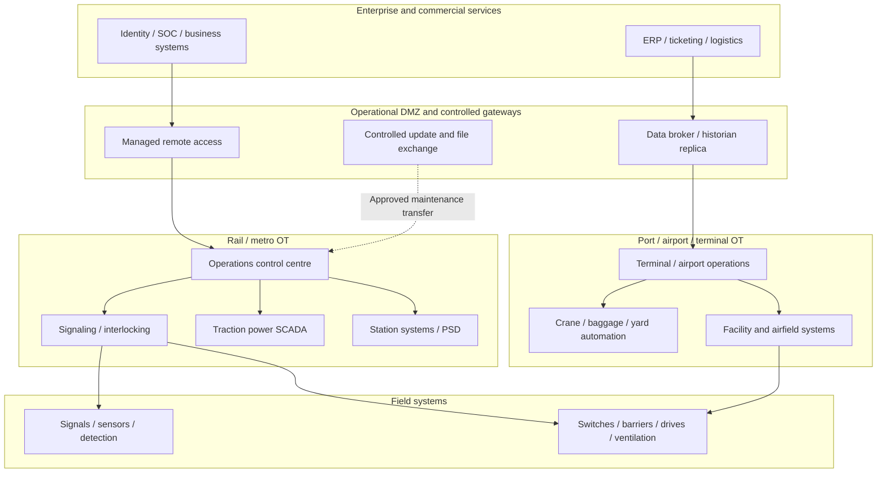
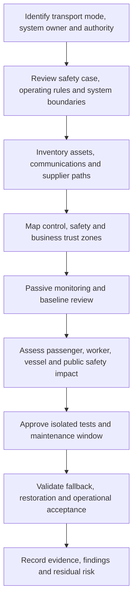

# Transportation, Ports, Airports, Rail and Maritime OT Security Engineering Handbook

## 1. Scope and safety boundary

This handbook covers rail and metro systems, signaling, interlocking, train control, traction power, airports, baggage handling, runway and airfield facilities, port automation, cranes, vessel traffic services, maritime systems, tunnels, road traffic control and logistics infrastructure.

Transport cybersecurity has direct safety and public-service implications. A cyber incident can affect passenger movement, train separation, runway operations, vessel movement, crane operations, traffic flow, tunnel ventilation, emergency response and cargo integrity. Cybersecurity actions must not compromise certified safety functions or operational authority.

This is a general engineering reference, not a safety case, railway rule book, air navigation procedure, port operating procedure, vessel safety management system or regulator compliance opinion.

## 2. Transport subsectors and OT systems

| Subsector | Representative systems | Safety/operational consequence |
|---|---|---|
| Rail and metro | Interlocking, signaling, train control, ATP/ATO, SCADA, traction power, platform screen doors | Train separation, movement authority, passenger safety and service continuity |
| Airports | Baggage handling, passenger boarding bridges, airfield lighting, runway systems, fuel systems, HVAC, access control | Aircraft/ground movement support, passenger safety and airport continuity |
| Ports and terminals | Cranes, terminal operating systems, yard automation, gates, reefer monitoring, access control | Cargo handling, vessel turnaround, worker safety and logistics continuity |
| Maritime | Vessel navigation support, propulsion/auxiliary control, cargo handling, engine automation, shore links | Safe navigation, ship operation, cargo and environmental protection |
| Roads and tunnels | Traffic signals, variable message signs, tunnel ventilation, pumps, barriers and incident detection | Road user safety, emergency access and tunnel environmental conditions |
| Logistics | Automated storage, conveyors, sorting, fleet and warehouse systems | Worker safety, cargo integrity and supply chain continuity |

## 3. Architecture and trust boundaries

This is a conceptual multi-subsector view, not a common architecture to deploy. Rail signaling, airport airfield systems, maritime navigation and port cranes require separate safety and operational boundaries.

## 4. Asset and dependency inventory

| Asset family | Examples | Required inventory fields | Concern |
|---|---|---|---|
| Signaling and train control | Interlocking, ATP/ATO, trackside controller, balise, axle counter | Safety function, route, vendor, firmware, interface, validation record | Movement authority and train separation |
| Traction power | Substation RTU, SCADA, protection, breaker control | Electrical boundary, remote/local mode, protection settings | Power availability and safe switching |
| Station systems | Platform screen doors, lifts, escalators, passenger information | Interface, safety certification, fail state, support status | Passenger safety and station operations |
| Airport systems | Airfield lighting, boarding bridge, baggage control, fuel automation | Operational owner, safety boundary, vendor path | Aircraft/ground operations and passenger flow |
| Port automation | Ship-to-shore crane, RTG, AGV, gate, yard system | Controller, motion safety, remote control, radio link | Worker safety and cargo movement |
| Maritime systems | Bridge, navigation support, engine/auxiliary, cargo systems | Vessel role, interface, update path, shore connection | Safe navigation and vessel operation |
| Road/tunnel systems | Traffic controller, tunnel ventilation, fire/life safety, pumps | Location, emergency mode, local control, communications | Incident response and road user safety |
| Telecom and timing | Radio, fiber, GNSS, PTP/NTP, carrier links | Route, redundancy, time source, coverage | Control integrity and operational coordination |
| Remote maintenance | OEM VPN, service laptop, vendor portal | Sponsor, access scope, time window, logs | Third-party compromise |

## 5. Threat scenarios and safeguards

| Scenario | Potential consequence | Preventive controls | Detection evidence |
|---|---|---|---|
| Signaling configuration compromise | Unsafe or unavailable rail service | Strict engineering access, validated baselines, dual approval and safety case | Configuration checksum drift, unauthorized engineering session |
| Train control communication loss | Degraded operations or service suspension | Resilient communications, safe degraded modes and approved operating rules | Link loss, repeated retransmission, system health alarms |
| Traction power SCADA compromise | Unsafe switching or service outage | Segmented control paths, command authorization, protected settings | Unusual command, breaker status mismatch, remote access anomaly |
| Airport baggage/terminal ransomware | Baggage delays and airport disruption | Segmentation, recoverable backups, supplier governance | Malware behavior, queue and service degradation |
| Runway/airfield facility system disruption | Airfield operational impact | Strict access control, local fallback and operational coordination | Configuration change, alarm loss, system availability |
| Port crane/AGV control abuse | Worker injury, equipment damage, cargo disruption | Motion safety, authenticated access, network segmentation, local stop | Unexpected command, safety interlock state, controller change |
| Vessel/shore link compromise | Maritime operational or safety disruption | Segregated ship/shore networks, access control, incident procedures | New shore connection, navigation or engine system anomalies |
| Tunnel ventilation monitoring loss | Reduced ability to manage tunnel incident | Independent life-safety design, tested fallback, protected telemetry | Sensor/PLC communication loss, alarm path failure |
| Supplier compromise | Access across multiple operational sites | Individual accounts, time-bound access, vendor risk management | Unapproved session, shared credentials, unusual source |

## 6. Defensive engineering baseline

### 6.1 Safety and operational authority
- Identify the certified safety functions and the competent operational authority for each system.
- Maintain separation between business IT, operational control, signaling, movement, facility and supplier zones.
- Preserve emergency modes, local control, interlocks and approved degraded operation.
- Coordinate cybersecurity incident response with transport operations and emergency services.
- Never assume that blocking a network flow or isolating an endpoint is safe during live transport operations.

### 6.2 Engineering and supplier access
- Maintain approved configuration baselines and signed/validated change records where supported.
- Require an operational sponsor, defined work scope, time window, named identity and session logging for suppliers.
- Use controlled engineering workstations and restrict removable media.
- Review maintenance laptops, remote gateways, wireless networks and third-party managed systems.
- Validate firmware and software updates in representative staging environments.

### 6.3 Communications, time and availability
- Document communications dependencies and safe degraded modes.
- Protect time sources used for event correlation, control and operational records.
- Monitor redundant paths and ensure redundancy does not share a single management plane or credential set.
- Validate local fallback, backup power and recovery procedures.
- Protect data exchange between ticketing, logistics, terminal systems and operational control.

## 7. Monitoring and detection engineering

| Detection use case | Telemetry | Analytic idea | Owner |
|---|---|---|---|
| Signaling configuration change | Engineering audit, interlocking logs, baseline repository | Change without approved safety and maintenance record | Signaling engineering |
| Train control communication degradation | Control centre, radio and network telemetry | Loss of expected messages or increasing link failures | Rail operations |
| Traction power command anomaly | SCADA audit, relay logs, gateway records | Remote command outside approved operational sequence | Electrical control |
| Crane/AGV motion anomaly | PLC/drive logs, fleet telemetry, safety system status | Unexpected mode or command | Terminal operations |
| Airfield facility system change | BMS/airfield controller logs, maintenance records | Unapproved configuration or remote session | Airport facilities |
| Tunnel ventilation alarm path loss | Sensor, PLC, SCADA and fire system telemetry | Missing data or unavailable alarm path | Road/tunnel operations |
| Vendor remote access anomaly | VPN, jump host, identity and session records | Session outside approved work order or site scope | OT access owner |
| Maritime shore connection anomaly | Vessel firewall, remote access and system logs | New or unexpected connection to operational network | Vessel/shore IT and engineering |

Use operational context: train schedules, possession windows, aircraft movement periods, port calls, maintenance blocks and emergency drills. Alert logic must distinguish authorized engineering activity from abnormal behavior.

## 8. Safe assessment workflow

Assessment cautions:
- Start with records, interviews, architecture, configuration and passive network review.
- Do not scan, fuzz, inject traffic, change signaling logic, operate switches, move cranes, manipulate runway systems or test vessel movement on live operations without formal authorization and validated safety plan.
- Use simulators, hardware-in-the-loop, test tracks, lab interlock racks and isolated terminal equipment for active tests.
- Coordinate with safety assurance, operations, maintainers, OEMs and regulators.
- Maintain a clear stop-work process and approved rollback.

## 9. Incident response and recovery

| Phase | Actions | Decision authority |
|---|---|---|
| Prepare | Mode-specific contact tree, safety case, operating procedures, backups, alternate operations and supplier contacts | Transport operator |
| Validate | Correlate cyber alerts with operations, safety alarms, schedules, weather and maintenance | OT SOC and operations |
| Stabilize | Protect people and safe movement; use approved degraded mode or service restriction | Authorized transport controller |
| Contain | Restrict access without impairing signaling, movement, emergency or life-safety functions | Operations with engineering and safety |
| Eradicate | Rebuild support systems, revoke access and verify configuration integrity | OT engineering |
| Recover | Test and validate control, interlocking, movement, communications and local fallback before return | Safety/operations authority |
| Communicate | Follow regulator, law enforcement, passenger, port, aviation or maritime reporting processes | Authorized management |
| Improve | Root cause, evidence, corrective action and exercise updates | Governance |

## 10. Sector and jurisdiction mapping

### 10.1 European Union
NIS2 includes transport modes (air, rail, water and road) within its high-criticality sectors. Entity classification, size thresholds, national transposition, competent authority and specific obligations must be checked in the applicable Member State. Do not assume every transport supplier or operator is automatically in scope.

### 10.2 United States
TSA security directives apply to specified owner/operators and designated entities in covered transport modes. A published TSA passenger railroad directive version may have an explicit expiry date; verify the latest renewal, applicability notice and current directive before using it as a current obligation. The Federal Transit Administration maintains cybersecurity resources and points operators to TSA directives and toolkits.

### 10.3 Maritime
IMO's maritime cyber risk management guidance supports incorporating cyber risk into existing safety management practices. Resolution MSC.428(98) encourages administrations to ensure cyber risks are appropriately addressed in safety management systems. Flag-state, port-state, vessel class, company and applicable maritime requirements must be checked.

## 11. Engineering deliverables

- Transport mode and system boundary statement.
- Asset and operational dependency inventory.
- Safety function and authority register.
- Zone/conduit diagrams and communications matrix.
- Remote access and supplier register.
- Engineering configuration and baseline register.
- Vulnerability and lifecycle risk register.
- OT SOC detection and telemetry matrix.
- Mode-specific incident response and degraded operation playbooks.
- Recovery, test and return-to-service evidence.
- Regulator applicability and reporting register.
- Remediation plan and residual risk acceptance.

## 12. Metrics

| Metric | Measurement | Caution |
|---|---|---|
| Critical system inventory coverage | Validated assets / estimated assets | Include remote sites and suppliers |
| Configuration integrity | Critical systems with verified approved baselines | Include safety engineering records |
| Supplier access accountability | Sessions linked to identity, sponsor, work order and time window | Include emergency access |
| Communications resilience | Critical links with tested approved failover | Do not test failover live without authority |
| Recovery readiness | Mode-specific recovery exercises completed | Include safety assurance and operations |
| Detection coverage | Critical scenarios with tested telemetry and response owner | Measure operational response, not alert count |

## 13. Sources and further reading

- IMO Maritime Cyber Risk: https://www.imo.org/en/ourwork/security/pages/cyber-security.aspx
- IMO MSC-FAL.1/Circ.3/Rev.4 Guidelines on Maritime Cyber Risk Management: https://www.imo.org/en/ourwork/security/pages/cyber-security.aspx
- OCIMF, Guidelines on Cyber Security onboard Ships, 5th edition, 2024: https://www.ocimf.org/publications/information-papers/the-guidelines-on-cybersecurity-onboard-ships
- ENISA Cybersecurity of Critical Sectors / NIS2: https://www.enisa.europa.eu/topics/cybersecurity-of-critical-sectors
- ENISA Transport sector: https://www.enisa.europa.eu/topics/cybersecurity-of-critical-sectors/transport
- US FTA Cybersecurity Resources for Transit Agencies: https://www.transit.dot.gov/regulations-and-programs/safety/cybersecurity-resources-transit-agencies
- TSA passenger railroad Security Directive 1582-21-01C (published version states expiry 24 October 2025; historical reference, verify renewal): https://www.tsa.gov/sites/default/files/security_directive_1582-21-01c_and_memo_508c.pdf
- NIST SP 800-82 Rev. 3: https://csrc.nist.gov/pubs/sp/800/82/r3/final
- ISA/IEC 62443 series: https://www.isa.org/standards-and-publications/isa-standards/isa-iec-62443-series-of-standards

## 14. Document control

| Version | Date | Change |
|---|---|---|
| 1.0 | 2026-11-17 | Initial sector reference |
| 1.1 | 2026-11-27 | Expanded transport subsectors, architecture, assets, threat scenarios, controls, monitoring, assessment, response, regulatory context and sources |

**Limitations:** This handbook is a public engineering reference, not a transport safety case, railway operating rule, air navigation procedure, vessel safety management system or port operating approval. Obtain qualified safety, operational, engineering, cybersecurity and legal review before applying it to live systems.
