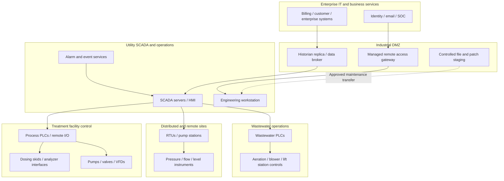
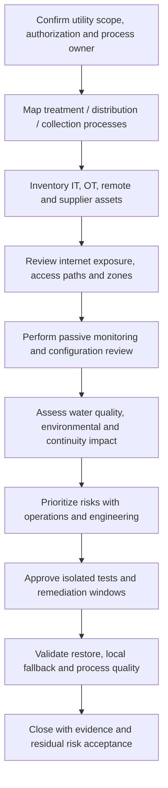

# Water and Wastewater OT Security Engineering Handbook

## 1. Scope and public-health boundary

This handbook covers drinking water intake and treatment, pumping, storage, distribution, wastewater collection and treatment, water reuse, telemetry and remote facilities.

Water and wastewater cybersecurity is a public-health, environmental and essential-service resilience discipline. Cyber incidents can affect water quality, chemical handling, pressure, flood prevention, environmental discharge, service continuity and operator visibility. A cyber response must be coordinated with the utility's operations, water quality, process engineering, public health, environmental and emergency management functions.

This document is not a substitute for drinking water or wastewater operating procedures, process engineering, chemical safety plans, environmental permits, public health requirements, emergency response plans or applicable regulator instructions. Process trains, treatment chemistry, monitoring requirements and legal obligations vary by jurisdiction and facility.

## 2. Process and service model

| Process area | Representative functions | OT and supporting systems | Key consequences |
|---|---|---|---|
| Source and intake | Raw water abstraction, screening, intake pumping | Intake gates, pump PLCs, flow meters, level sensors, RTUs | Loss of supply, flooding or equipment damage |
| Treatment | Coagulation, flocculation, clarification, filtration | PLCs, process instruments, dosing skids, analyzers, SCADA | Water quality deviation and public-health impact |
| Disinfection | Chlorination, UV, ozone or other approved process | Dosing controls, residual analyzers, gas detection, safety interlocks | Under-treatment, over-dosing or chemical exposure |
| Clear-water storage | Reservoir and tank management | Level transmitters, valves, pumps, high/low alarms | Overflow, depletion or pressure instability |
| Distribution | Pumping, pressure management, district metering | Booster stations, RTUs, pressure sensors, valve control | Loss of pressure, service disruption, contamination ingress risk |
| Collection | Sewer networks, lift stations and wet wells | Level sensors, pump controllers, telemetry | Sewer overflow, flooding and environmental release |
| Wastewater treatment | Screening, biological treatment, aeration, clarification, sludge handling | PLC/DCS, blower control, DO/pH/ORP instruments, lab systems | Permit exceedance, discharge quality and environmental impact |
| Reuse and desalination | Membrane, filtration, remineralization and reuse processes | PLCs, high-pressure pumps, conductivity and quality instruments | Equipment damage, water quality or supply impact |
| Utility support | Power, generators, building systems, communications | EPMS, generator PLCs, BMS, UPS, radio/cellular/fiber | Loss of process control or remote visibility |

## 3. OT asset and dependency taxonomy

The CISA-led multi-agency OT asset inventory guidance includes a water and wastewater taxonomy organized around collection, water treatment, distribution, reuse water, data management/enterprise integration, wastewater treatment and communications infrastructure. Use it as a starting taxonomy, then validate against site-specific process drawings, asset records and physical walkdowns.

| Asset family | Examples | Inventory and assurance attributes |
|---|---|---|
| Process controllers | PLCs, RTUs, remote I/O, packaged controllers | Vendor, model, firmware, logic revision, process area, owner, support status |
| Operator systems | HMI, SCADA, historian, alarm servers | Role, data sources, redundancy, OS lifecycle, backup and recovery |
| Process instrumentation | pH, turbidity, chlorine residual, conductivity, flow, pressure, level, DO, ORP | Tag, range, calibration, process function, criticality and alarm limits |
| Chemical systems | Dosing pumps, storage, gas detection, containment and interlocks | Chemical, process safety boundary, setpoint approval, maintenance owner |
| Mechanical systems | Pumps, motors, VFDs, blowers, valves, gates | Duty/standby relationship, local mode, interlock and fail position |
| Telemetry and communications | Radio, cellular, fiber, microwave, serial/IP gateways | Carrier, route, protocol, failover, access path, remote-site owner |
| Electrical support | UPS, generator, switchgear, EPMS | Runtime, load, transfer logic, maintenance and restoration dependency |
| Laboratory and reporting | LIMS, sample systems, quality reporting | Data provenance, interface, account and change control |
| Supplier access | VPN, remote support, managed service, cloud portal | Sponsor, time window, MFA, session logs, access revocation |

### 3.1 Asset criticality dimensions

Assess each asset by its impact on:
- Drinking water quality and treatment barriers.
- Chemical dosing and safe chemical handling.
- Distribution pressure and continuity.
- Wastewater discharge, environmental protection and overflow prevention.
- Operator visibility, alarm delivery and manual fallback.
- Recovery time and availability of spare parts or vendor support.
- Dependencies on power, telecommunications, identity services and external providers.

Do not assume a low-impact device because it is small, old or located at a remote station. A single PLC may control a critical pump, chemical dosing function or pressure zone.

## 4. Representative architecture

The diagram is illustrative, not a recommended universal topology. Determine actual zones and conduits from process dependencies, risk, operational constraints and applicable engineering standards.

## 5. High-priority threat scenarios

| Scenario | Potential consequence | Preventive controls | Detection and evidence |
|---|---|---|---|
| Internet-exposed PLC or controller | Unauthorized command, setpoint change or loss of control | Remove direct public exposure; use approved mediated access; inventory all interfaces | External exposure review, firewall records, controller logs |
| Remote pump station compromise | Pressure loss, flooding or service disruption | Segmented telemetry, MFA, time-limited vendor access, local fallback | Unusual remote login, telemetry anomaly, pump state mismatch |
| Chemical dosing manipulation | Water quality deviation, chemical over/under-dose or exposure | Dual approval for critical setpoints, process alarms, independent quality verification | Setpoint changes, dose-to-flow mismatch, analyzer discrepancy |
| Measurement spoofing | Operator decisions based on false process values | Secure instrument paths, plausibility checks, independent sampling | Cross-sensor comparison, historian anomalies, alarm suppression |
| Ransomware in SCADA support systems | Loss of HMI, historian, alarm or engineering support | Segmentation, allowlisting, backups, controlled admin access | File encryption, service failure, unusual lateral movement |
| Telemetry loss | Loss of visibility across remote stations | Diverse communications, local control, tested loss-of-link behavior | Missing polling, stale values, radio/cellular link events |
| Unauthorized controller logic change | Unintended process sequence or equipment behavior | Engineering access controls, logic baseline, MOC and approval | Logic checksum drift, programming session, controller audit |
| Supplier or shared-service compromise | Repeated access across multiple utility customers | Supplier segmentation, unique accounts, least privilege, contract controls | Shared infrastructure indicators, new remote paths, anomalous vendor sessions |
| Backup failure or tampering | Prolonged outage and unsafe restoration | Offline/immutable backups, restore testing, separate credentials | Backup job anomalies, integrity check failure, restore exercise |

## 6. Defensive engineering baseline

### 6.1 Reduce exposure and govern remote access
- Do not expose PLC, RTU, HMI or engineering interfaces directly to the public internet.
- Use an approved remote access architecture with a managed gateway, individual accounts, strong authentication, time-bounded authorization and session logging.
- Require a named internal sponsor for vendor and integrator sessions.
- Disable unused services, modem paths and dormant accounts after operations review.
- Separate corporate IT, SCADA, treatment, distribution, wastewater and remote-site communications according to risk and process needs.
- Review externally reachable assets and third-party connectivity regularly.

### 6.2 Process and configuration integrity
- Maintain a current inventory of IT and OT assets, including third-party and legacy equipment.
- Maintain original and current configurations, software and firmware versions for critical assets.
- Control dosing parameters, pump sequences, valve logic, alarm thresholds and controller programs through management of change.
- Require process owner approval and independent verification for changes to chemical dosing or critical quality limits.
- Protect backups of PLC logic, HMI/SCADA configurations, network devices and engineering drawings.

### 6.3 Water quality and safety controls
- Preserve independent quality monitoring and operator verification.
- Maintain alarms and interlocks for critical chemical, pressure, level and process conditions.
- Confirm local/manual operating procedures for loss of communications or HMI.
- Coordinate cybersecurity controls with chemical safety, gas detection, environmental and public health plans.
- Never assume a cyber containment action is safe if it removes quality measurement, alarm visibility or process control.

### 6.4 Vulnerability and patch management
- Identify the exact controller model, firmware, exposure and affected interface.
- Check vendor advisory and relevant CISA ICS advisories.
- Assess process consequence and compensating controls.
- Test in a lab or representative staging system.
- Obtain operations and process engineering approval before maintenance.
- Record deferral rationale and interim safeguards when patching cannot be safely performed.

## 7. Monitoring and detection engineering

| Detection use case | Telemetry | Example analytic | Response owner |
|---|---|---|---|
| PLC internet exposure | External attack surface, firewall and router configuration | Any direct public route to a controller or engineering service | Network owner and OT lead |
| Unauthorized PLC programming | Passive protocol monitoring, controller audit, engineering logs | Programming command outside approved maintenance window | Control engineer |
| Chemical setpoint change | HMI audit, PLC event, historian and dosing records | Critical setpoint changed without approved work order | Process engineer / water quality lead |
| Pump state mismatch | SCADA, motor/VFD status, flow and pressure instruments | Commanded state differs from feedback or process response | Operations |
| Telemetry loss | SCADA polling, radio/cellular and gateway logs | Stale values or repeated communications failures | Remote operations |
| Quality sensor discrepancy | Analyzer values, laboratory samples, historian | Unexpected divergence between independent measurements | Water quality team |
| Remote access anomaly | VPN, gateway, identity and session records | Supplier access without ticket, sponsor or time window | OT access owner |
| Backup integrity issue | Backup server, storage audit and restore tests | Failed backup, unexpected deletion or checksum mismatch | OT infrastructure owner |
| Alarm suppression or configuration drift | Alarm server, HMI audit, PLC project baseline | Critical alarm disabled or altered without approval | Control engineer and shift supervisor |

Use process-aware detection. Thresholds must account for normal treatment stages, pump duty cycles, demand variation, maintenance and seasonal conditions.

## 8. Safe assessment workflow

Assessment cautions:
- Start with interviews, drawings, asset records, passive monitoring and configuration review.
- Do not run intrusive scans, fuzzing, controller writes or active protocol tests against live water or wastewater processes without explicit written authorization and an approved test plan.
- Do not manipulate chemical dosing, chlorine residual, valve state, pump operation, pressure controls or telemetry failover on live systems for testing.
- Use isolated PLC benches, simulation, hardware-in-the-loop or digital twins for active exercises.
- Keep water quality and environmental monitoring available throughout approved work.
- Ensure the utility can stop the assessment and return to the known-safe operating state.

## 9. Incident response and service continuity

| Phase | Actions | Operational decision authority |
|---|---|---|
| Prepare | Maintain cyber incident plan, process contact tree, supplier contacts, manual fallback, backup and recovery instructions | Utility leadership and operations |
| Detect and validate | Correlate cyber telemetry with operator observations, process alarms, quality data and maintenance | OT SOC and shift supervisor |
| Stabilize | Determine whether treatment, distribution, collection or discharge is affected; preserve quality and safety monitoring | Operations and water quality |
| Contain | Select containment that does not remove essential process control, alarm or measurement | Utility incident commander with process engineering |
| Eradicate | Rebuild support systems, revoke compromised access and verify controller project integrity | OT engineering and cybersecurity |
| Recover | Restore known-good configurations, verify process values, sample quality and validate local/remote control | Operations, engineering and water quality |
| Communicate | Follow jurisdictional reporting, public health, environmental, regulator and emergency communications procedures | Authorized utility leadership |
| Improve | Root cause, evidence preservation, corrective actions and exercise updates | Governance and risk owner |

### 9.1 Manual operation and fallback

For critical sites, document:
- Which functions can be operated locally and by whom.
- Which process measurements remain available during SCADA loss.
- How local/manual mode affects interlocks, alarms and safety.
- How long the site can operate under fallback conditions.
- How communications and remote control are safely restored.
- How operators confirm process quality after restoration.

Manual fallback is not automatically safer. It requires trained personnel, approved procedures, sufficient staffing, safe access and current process information.

## 10. Recovery and backup assurance

Back up, as applicable:
- PLC and RTU logic, HMI and SCADA configurations.
- Network device configurations and firewall rules.
- Historian configuration and critical process records.
- Engineering drawings, control narratives, cause-and-effect matrices and alarm rationalization records.
- Identity and access configuration needed for controlled restoration.
- Vendor software, licensed installers and compatible firmware packages.

Maintain offline or immutable copies, separate backup credentials and documented recovery priorities. Test restoration in a lab or approved maintenance environment. A successful backup job does not prove that a controller project can be restored or that a process can safely resume.

## 11. Regulatory and authoritative guidance

### 11.1 United States examples

EPA's August 2024 guidance for drinking water and wastewater systems recommends maintaining an updated IT/OT asset inventory, assigning named cybersecurity responsibility, coordinating IT and OT, risk-informed vulnerability mitigation, MFA at least for remote OT access, network segmentation, configuration documentation, incident response exercises and tested backups. These are EPA recommendations; do not automatically treat them as universal legal obligations outside their stated US context.

For community water systems serving more than 3,300 people, EPA explains that America's Water Infrastructure Act (AWIA) / Safe Drinking Water Act Section 1433 requires risk and resilience assessments to include electronic, computer and automated systems, including cybersecurity, and requires certification to EPA. Confirm current statutory and EPA guidance for the particular utility.

EPA's wastewater emergency response plan resources are guidance; EPA notes that wastewater utilities are not required to develop ERPs under SDWA Section 1433, while recommending use of the templates voluntarily.

### 11.2 International application

For utilities outside the United States, identify the competent drinking water, wastewater, environmental, public health, energy, telecom and critical infrastructure authorities. Use ISA/IEC 62443 and NIST SP 800-82 as technical references where suitable, but do not present US EPA recommendations or US legal duties as global obligations.

## 12. Recent threat and engineering context

On 30 July 2026, the FBI and EPA warned that malicious actors were targeting internet-facing PLCs used by water and wastewater utilities. The advisory described incidents reported in at least seven US states since 27 July 2026 and operational effects that included loss of pressure and flooding. It highlighted that impact depended on the PLC's function, the equipment and the utility's ability to switch to manual operations.

Engineering lessons:
- Inventory and remove direct public exposure of PLCs and related services.
- Distinguish monitoring-only controllers from controllers that operate physical equipment.
- Verify pressure, flow and quality consequences when control or telemetry is lost.
- Test local/manual fallback and recovery, not merely whether a backup exists.
- Examine common third-party network and hardware configurations across multiple customer sites.

This is a dated US incident advisory, not evidence that every water utility uses the affected equipment or has the same exposure.

## 13. Engineering deliverables and evidence

- Utility process and service scope.
- Process flow and asset taxonomy.
- OT/IT and third-party asset inventory.
- Criticality and consequence register.
- Network topology, zones/conduits and communication matrix.
- Internet exposure and remote access register.
- Controller logic and configuration baseline register.
- Chemical dosing and critical setpoint change register.
- Water quality and process monitoring coverage matrix.
- Vulnerability and advisory register with risk decisions.
- Incident response and emergency communication plan.
- Manual fallback and loss-of-communications procedure.
- Backup and restore test evidence.
- Remediation plan, residual risk and accountable approvals.

## 14. Metrics and assurance

| Metric | Measurement | Caution |
|---|---|---|
| OT inventory coverage | Validated OT assets / estimated OT assets | Include legacy, remote and third-party assets |
| Public exposure closure | Publicly reachable OT services remediated or formally risk accepted | Verify from external and internal views |
| Remote access governance | Sessions with named user, sponsor, MFA and approved time window | Include emergency access |
| Critical configuration baseline | Critical controllers with verified logic/configuration backups | Verify restore, not just backup completion |
| Water quality monitoring resilience | Critical quality variables with verified monitoring and fallback | Defined by process and regulator |
| Restore test success | Tested assets restored to approved known-good state | Include process validation |
| Exercise action closure | High-risk exercise findings corrected and retested | Include operations and public health roles |

## 15. Sources and further reading

- EPA Guidance on Improving Cybersecurity at Drinking Water and Wastewater Systems, revised August 2024: https://nepis.epa.gov/Exe/ZyPURL.cgi?Dockey=P101B9KL.txt
- EPA Cybersecurity Planning and incident response templates: https://www.epa.gov/cyberwater/cybersecurity-planning
- EPA Cybersecurity Assessments and AWIA resources: https://www.epa.gov/cyberwater/cybersecurity-assessments
- CISA/EPA/NSA/FBI and international partners, Foundations for OT Cybersecurity: Asset Inventory Guidance for Owners and Operators: https://www.epa.gov/system/files/documents/2025-09/joint-guide-foundations-for-ot-cybersecurity-asset-inventory-guidance_508c.pdf
- FBI/EPA Public Service Announcement, 30 July 2026, internet-facing PLC targeting: https://www.fbi.gov/investigate/cyber/alerts/2026/malicious-cyber-actors-targeting-water-and-wastewater-sector-internet--facing-programmable-logic-controllers-causing-operational-disruptions
- NIST, Securing Water and Wastewater Operational Technology Environments, 1 October 2026: https://www.nist.gov/blogs/cybersecurity-insights/securing-water-and-wastewater-operational-technology-environments
- NIST SP 1800-45, Cybersecurity for the Water and Wastewater Sector: https://www.nccoe.nist.gov/projects/cybersecurity-water-and-wastewater-sector
- NIST SP 800-82 Rev. 3: https://csrc.nist.gov/pubs/sp/800/82/r3/final
- MITRE ATT&CK for ICS: https://attack.mitre.org/matrices/ics/
- ISA/IEC 62443 series: https://www.isa.org/standards-and-publications/isa-standards/isa-iec-62443-series-of-standards

## 16. Document control

| Version | Date | Change |
|---|---|---|
| 1.0 | 2026-11-17 | Initial sector reference |
| 1.1 | 2026-11-27 | Expanded water process taxonomy, architecture, asset criticality, threat scenarios, controls, detection, assessment, incident response, recovery, regulatory context and 2026 threat advisory |

**Limitations:** This handbook is a public engineering reference, not a utility-specific risk assessment, legal opinion, water quality determination or emergency operating procedure. Obtain qualified process, water quality, cybersecurity, environmental and legal review before applying it to an operating utility.
