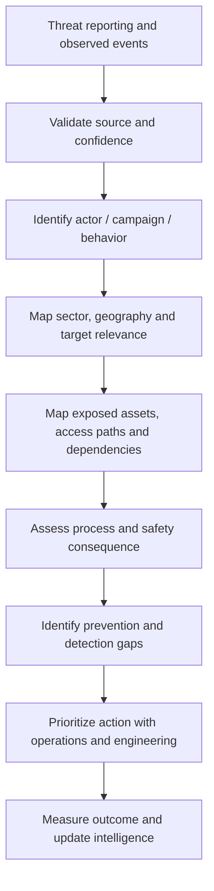
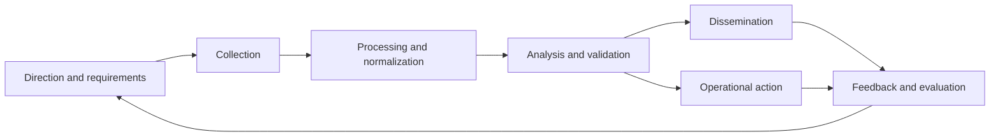
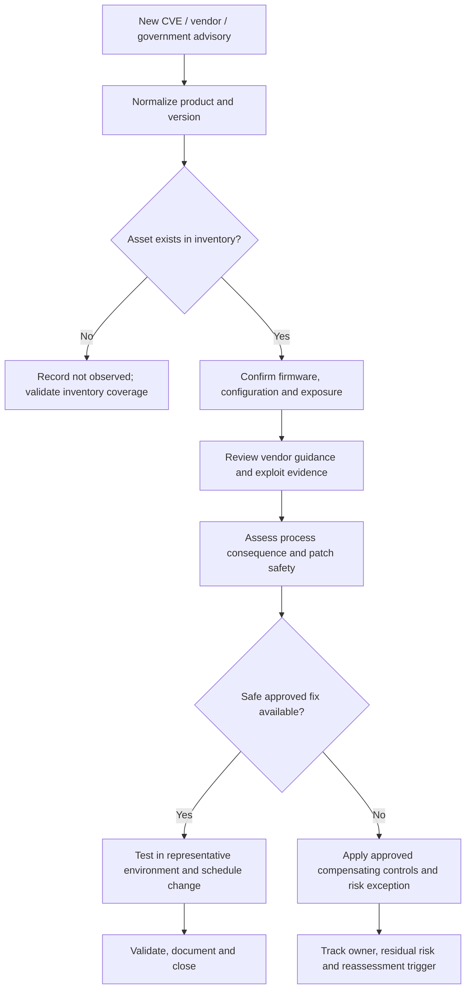
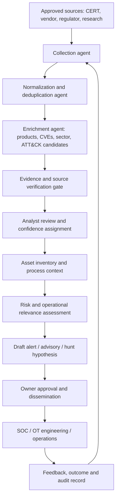
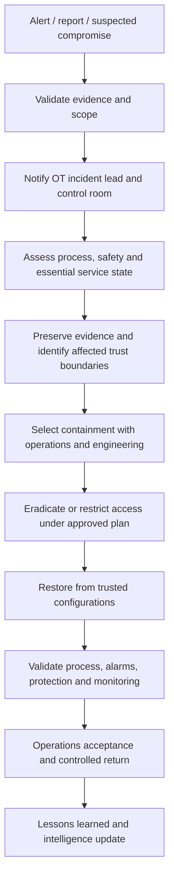

# OT Threat Landscape, Threat Intelligence and Adversary Engineering
## Threat-informed defence for industrial control systems and critical infrastructure

**Document ID:** UOTS-08-THREAT | **Version:** 1.0 | **Status:** Research and engineering reference

**Audience:** OT security teams, threat intelligence analysts, SOC analysts, incident responders, control engineers, asset owners, operators, risk managers, CISOs, regulators, system integrators and industrial suppliers.

> **Safety notice:** This playbook is for defensive research, threat modeling, monitoring, incident preparation and authorized validation. It does not authorize testing of live industrial systems. Do not execute exploit code, malware, scanning, fuzzing, denial-of-service, credential testing, controller writes, process manipulation or safety-system testing against production OT. Use isolated simulations, approved test benches and documented authorization. Operational and safety authorities retain control of process decisions.

---

# 1. Purpose and scope

This chapter establishes a repeatable method to understand threats to operational technology (OT), industrial control systems (ICS), supervisory control and data acquisition (SCADA), industrial automation and critical infrastructure.

It connects five disciplines:
1. **Threat intelligence:** What is known about adversaries, campaigns, malware, vulnerabilities and targeting?
2. **Industrial context:** Which processes, assets, dependencies and safety functions could be affected?
3. **Adversary engineering:** How could a threat actor move from access to an operational effect?
4. **Detection engineering:** What evidence could reveal the behavior before process impact?
5. **Defensive response:** What safe actions reduce risk, preserve evidence and restore trusted operation?

This is not a list of threat actor names. It is a process for converting evidence into operationally useful decisions.

## 1.1 What this chapter covers

- OT threat landscape and threat categories.
- Threat actor motivations and capability assessment.
- IT-to-OT and direct-to-OT attack paths.
- MITRE ATT&CK for ICS use and limitations.
- Industrial malware and disruptive activity.
- Public incident analysis and evidence discipline.
- Vulnerability and advisory intelligence.
- Collection, validation, enrichment and dissemination.
- OT threat hunting and detection hypotheses.
- Industry-specific threat models.
- AI-assisted intelligence workflows and agent governance.
- Defensive control mapping, incident preparation and metrics.

## 1.2 What this chapter does not claim

- A named actor is responsible for an event unless reliable public evidence supports attribution.
- Every exposed or vulnerable product is exploitable in a particular plant.
- Every ATT&CK technique is feasible in every control environment.
- A CVSS score alone represents OT risk.
- A public incident report reveals the complete attack chain.
- A threat feed or AI-generated summary is verified intelligence.
- A security action is safe merely because it is common in enterprise IT.

---

# 2. OT threat landscape

OT threat analysis must account for the physical process and the consequence of an action. Confidentiality remains important, but availability, integrity, safety, environmental protection and recoverability may dominate operational decisions.

## 2.1 Threat categories

| Threat category | Typical objective | OT relevance |
|---|---|---|
| State-sponsored / strategic | Espionage, pre-positioning, disruption, strategic leverage | Long dwell time, critical infrastructure access, supply chain |
| Ransomware and extortion | Financial gain, data theft, operational pressure | Enterprise disruption can interrupt OT support and production |
| Cybercrime access brokers | Sell access, credentials or footholds | Valid accounts and remote access may create paths toward OT |
| Hacktivists | Publicity, disruption, ideological objectives | Opportunistic targeting, exposed interfaces, claims that need verification |
| Insider threat | Sabotage, theft, unauthorized changes, negligence | Privileged engineering knowledge and trusted access |
| Supplier / supply chain | Compromise through products, updates, services or support | Shared tools, remote maintenance, software and firmware provenance |
| Opportunistic scanning | Discover exposed services and weak configurations | Internet-exposed OT interfaces and gateways |
| Accidental / operational error | Misconfiguration, unsafe change, failed update | Can create consequences similar to malicious activity |
| Physical threat | Unauthorized access, tampering, theft | Cabinets, engineering ports, removable media, field devices |
| Hybrid / converged threat | Combine cyber, physical, information and operational actions | Distributed sites, telecom, facilities and third parties |

## 2.2 Threat actor assessment dimensions

Do not treat a group label as a risk score. Assess:

- **Intent:** espionage, disruption, extortion, sabotage, influence, theft.
- **Capability:** demonstrated tools, access, operational knowledge and resources.
- **Opportunity:** exposure, supplier relationship, identity weakness, reachable paths.
- **Target relevance:** sector, geography, process and strategic value.
- **Persistence:** evidence of sustained access or repeat activity.
- **Operational understanding:** demonstrated knowledge of control systems and process effects.
- **Confidence:** strength and provenance of evidence.
- **Time relevance:** current campaign activity and observed recency.

A group may be capable but not targeting a given operator. A vulnerability may be severe but unreachable from the relevant zone. Record these distinctions.

## 2.3 Threat assessment model

---

# 3. Industrial attack surface and trust boundaries

Threat intelligence becomes useful when it is connected to assets and reachable paths.

## 3.1 Common entry and movement paths

- Corporate identity, email and endpoint compromise.
- Remote access portals, VPNs, jump hosts and vendor support.
- Exposed remote desktop or management services.
- Compromised engineering workstations.
- Shared administrator accounts and service identities.
- Removable media and maintenance laptops.
- Software, firmware and update supply chains.
- Cloud management, industrial IoT gateways and remote monitoring.
- Wireless, radio, cellular, satellite and leased communications.
- Physical access to cabinets, consoles, network ports and field equipment.
- Misconfigured data brokers, historians and file transfer services.
- Unpatched or unsupported infrastructure.

These are investigation hypotheses, not proof of a compromise.

## 3.2 Illustrative IT-to-OT attack path

```mermaid
flowchart LR
  A["External phishing / stolen identity"] --> B["Corporate endpoint or identity"]
  B --> C["Enterprise network access"]
  C --> D["Poorly controlled IT / OT boundary"]
  D --> E["Industrial DMZ or shared service"]
  E --> F["Operations workstation / server"]
  F --> G["Engineering or supervisory access"]
  G --> H["Potential process-relevant action"]
  H --> I["Operational consequence"]
```

A defender should identify and remove unnecessary transitions, not assume every stage exists. Many environments have different architectures and controls.

## 3.3 Direct-to-OT and remote-site paths

Threats may reach industrial environments without first compromising corporate IT. Examples include exposed remote access, insecure cellular gateways, supplier infrastructure, compromised field laptops, wireless access, misconfigured cloud services and physical access.

For distributed assets, map:
- Remote site identity and communications.
- Central control and telemetry dependencies.
- Local operating capability during communications loss.
- Shared supplier and managed service paths.
- Authentication and certificate dependencies.
- Recovery access when primary communications are unavailable.

## 3.4 Attack surface inventory

| Surface | Questions to answer | Evidence |
|---|---|---|
| Internet exposure | Are control, management or remote access services exposed? | Approved external inventory and firewall/NAT records |
| Remote access | Who can connect, when, to which asset and through what broker? | Access policy, session records, approvals |
| Identity | Are accounts named, unique, reviewed and least privilege? | IAM/PAM exports, account review |
| Engineering | Which workstations can change controller or relay configuration? | Engineering asset list, access matrix |
| Supplier | Which OEMs, integrators and subcontractors have access? | Contract, vendor inventory, session logs |
| Data exchange | Which historian, API, file transfer and cloud paths exist? | Flow matrix, broker configuration |
| Wireless | Which radio, Wi-Fi, cellular, mesh and satellite links are used? | RF/network inventory, configuration |
| Physical | Who can access cabinets, consoles and maintenance ports? | Site access and visitor records |
| Lifecycle | Which assets are unsupported or difficult to patch? | Asset lifecycle and exception register |

---

# 4. MITRE ATT&CK for ICS: defensive application

MITRE ATT&CK for ICS is a knowledge base of adversary behavior in industrial environments. It helps structure threat models, detection hypotheses, exercises and coverage analysis. It is not a risk assessment, a control standard, a vulnerability catalogue or proof that a technique applies to a particular installation.

Official matrix: https://attack.mitre.org/matrices/ics/

## 4.1 How to use ATT&CK responsibly

1. Start with an industrial process and an asset, not a technique list.
2. Define a plausible adversary objective and required access.
3. Select techniques only when supported by evidence or a clearly stated hypothesis.
4. Verify technique names, IDs, descriptions and mitigations in the current official matrix.
5. Identify relevant telemetry and data sources.
6. Design detection logic around the environment's normal behavior.
7. Validate detection using synthetic events, replay data or an isolated lab.
8. Record blind spots and confidence.
9. Map mitigations to actual architecture and operating procedures.
10. Revisit mappings when the matrix or plant changes.

## 4.2 Tactic-oriented defender view

The table below is a high-level organizing view. It is not a substitute for the current ATT&CK matrix and intentionally avoids hardcoding technique IDs that may change or be misremembered.

| Adversary objective phase | Defender questions |
|---|---|
| Initial access | Which external, supplier, identity or physical paths are reachable? |
| Execution | Which systems can run unapproved code or scripts? |
| Persistence | Which accounts, services, scheduled tasks or remote paths survive restarts? |
| Privilege escalation | Where are local, domain, application and engineering privileges excessive? |
| Evasion | Can logs, monitoring, endpoint controls or process visibility be disabled? |
| Discovery | Can an intruder enumerate assets, zones, protocols and engineering services? |
| Lateral movement | Which conduits allow movement between enterprise, DMZ, operations and cells? |
| Collection | Which engineering projects, process data, recipes or credentials are accessible? |
| Command and control | Which outbound channels and remote support paths exist? |
| Inhibit response function | Could alarms, monitoring, safety support or operator visibility be impaired? |
| Impair process control | Which unauthorized commands or configuration changes could affect the process? |
| Impact | What physical, service, safety, environmental or production consequences are plausible? |

## 4.3 ATT&CK mapping record

| Field | Required value |
|---|---|
| Mapping ID | Unique reference |
| Process / sector | Industrial process and facility type |
| Asset / zone | Specific asset role and trust zone |
| Adversary objective | Desired outcome |
| Technique | Current official name and identifier |
| Source | Official ATT&CK page and supporting intelligence |
| Preconditions | Access, privilege, reachability, operating state |
| Observable behavior | Host, network, identity, process or physical evidence |
| Detection hypothesis | What should be detected and why |
| Mitigation | Architecture, identity, process or engineering control |
| Validation method | Lab, simulation, replay or approved passive review |
| Confidence | Confirmed, assessed, plausible or speculative |
| Owner / review | Responsible person and review date |

---

# 5. Industrial malware and disruptive capabilities

Malware names are not enough to understand industrial risk. Determine which platform is affected, what access is required, what behavior was observed, whether process interaction was confirmed, and what impact is established by the source.

## 5.1 Families and publicly documented examples

| Name / category | Publicly reported relevance | Defensive lesson |
|---|---|---|
| Stuxnet | Highly specialized malware associated with disruption of industrial control processes | Protect engineering assets, project integrity, removable media and process-specific monitoring |
| Industroyer / CrashOverride | Malware designed to interact with electric power system environments | Understand protocol-aware threats, protection operations and restoration |
| Industroyer2 | Malware associated with attempted disruption of Ukrainian energy infrastructure in 2022 | Maintain control system visibility, response readiness and recovery capability |
| TRITON / TRISIS | Malware targeted a safety instrumented system environment | Treat safety engineering assets and SIS configuration integrity as critical |
| PIPEDREAM / INCONTROLLER | Publicly described modular ICS-focused capability | Monitor engineering and control environments; use authoritative advisories |
| EKANS / Snake-style ransomware claims | Ransomware reporting involving industrial environments; capabilities and impact vary by case | Separate ransomware on enterprise support systems from demonstrated process manipulation |
| BlackEnergy | Associated in public reporting with Ukrainian power sector operations | Prepare for coordinated IT disruption and operational response |
| Ransomware families | Often disrupt enterprise systems that support industrial operations | Segment, back up, rehearse and coordinate safe recovery |

Do not infer that a malware family is active in a particular country or sector merely because it appears in this table. Check current advisories, campaign dates and evidence.

## 5.2 Malware analysis questions for OT

- What is the initial access vector and source confidence?
- Which operating systems, products or controller families are affected?
- Does the sample contain industrial protocol functionality?
- Was the capability observed in real operations or only in analysis?
- Does it require engineering credentials or physical access?
- Which configuration, logic or process functions could be affected?
- Which safety and protective functions are independent?
- What indicators are stable enough for detection?
- What containment actions could interrupt a process?
- What recovery and validation steps are needed?

## 5.3 Malware response boundary

Do not execute suspicious samples on production systems. Analyze in isolated malware labs with controlled networking and snapshots. For OT-specific malware, involve control engineers and safety specialists before deciding whether to isolate a host, block traffic, revoke credentials or stop a process.

---

# 6. Public incident analysis and lessons

Public incident reports vary in detail and reliability. The summaries below distinguish widely reported facts from the limits of public knowledge. They are learning cases, not claims that the same attack path exists in another facility.

## 6.1 Ukraine power grid cyber incidents, 2015 and 2016

**Sector:** Electricity distribution and energy infrastructure  
**Country:** Ukraine  
**Publicly documented lesson:** The 2015 incident involved malicious activity affecting distribution operations and customer electricity service. Subsequent public reporting described destructive and disruptive activity affecting energy infrastructure in 2016. The events demonstrate the need to coordinate cyber incident response with grid operations, control room procedures, communications and restoration.

**Defensive lessons**
- Protect remote access and operator/engineering credentials.
- Monitor access and control activity across enterprise and control environments.
- Prepare manual and local operating procedures.
- Maintain restoration capability and trusted configurations.
- Exercise communications between cyber responders and grid operators.

**Limitations:** Public reporting does not expose every facility detail, all technical evidence or every causal factor. Do not generalize one architecture to all power utilities.

## 6.2 TRITON / TRISIS safety system incident, 2017

**Sector:** Industrial process facility  
**Publicly documented lesson:** Malware targeted a safety instrumented system engineering environment. Public reporting described an event that caused a safety system to enter a fail-safe state and interrupted operations. This case illustrates that safety-system engineering workstations, project files and configuration paths require strong protection.

**Defensive lessons**
- Identify SIS engineering workstations and project repositories.
- Govern privileged engineering access and configuration changes.
- Maintain known-good project backups and validation procedures.
- Monitor engineering activity and unusual communications.
- Coordinate cybersecurity with functional safety engineering.

**Limitations:** Do not assume all SIS architectures or safety controllers are affected in the same way. Site-specific safety design governs.

## 6.3 Norsk Hydro ransomware incident, 2019

**Sector:** Aluminium manufacturing  
**Country:** Norway and international operations  
**Publicly documented lesson:** Norsk Hydro publicly reported a cyberattack that affected operations and required manual workarounds at some facilities. The incident is a useful example of enterprise and production dependencies, crisis communications and operational resilience.

**Defensive lessons**
- Maintain business continuity and manual workarounds.
- Prepare cross-site incident coordination.
- Ensure backups and recovery procedures are tested.
- Understand identity, endpoint and network dependencies of production.
- Communicate transparently with customers, staff and stakeholders.

**Limitations:** Public corporate reporting is not a complete technical forensic record. Avoid attributing specific OT compromise mechanisms unless the source confirms them.

## 6.4 Oldsmar water treatment incident, 2021

**Sector:** Drinking water treatment  
**Country:** United States  
**Publicly reported lesson:** An unauthorized remote access event was reported in which an operator observed an attempted change to a chemical treatment parameter and reversed it. Public accounts and subsequent statements have differed in details. It is an important case for remote access, account governance, operator visibility and verification of process measurements.

**Defensive lessons**
- Remove or tightly govern legacy remote access tools.
- Use named accounts and strong authentication.
- Monitor remote sessions and high-consequence parameter changes.
- Ensure operators can validate critical measurements independently.
- Exercise water quality incident escalation.

**Limitations:** Do not repeat disputed technical details as settled facts. Consult official local and federal records and note discrepancies.

## 6.5 Unitronics PLC targeting, 2023

**Sector:** Water and wastewater and other exposed environments  
**Publicly reported lesson:** CISA and partner agencies issued advisories concerning malicious activity targeting internet-exposed Unitronics Vision Series PLCs, including devices associated with water and wastewater systems. This illustrates exposure management and secure remote access.

**Defensive lessons**
- Remove direct internet exposure where not required.
- Change default credentials and use secure access methods.
- Inventory exposed devices and verify firmware/security guidance.
- Coordinate remediation with the process owner and vendor.
- Monitor remote access and controller changes.

**Limitations:** Advisory targeting does not establish that every affected product instance was compromised or that process impact occurred at every site.

## 6.6 KA-SAT / Viasat incident, 2022

**Sector:** Satellite communications and dependent services  
**Region:** Europe and Ukraine-related impact  
**Publicly reported lesson:** The incident disrupted satellite broadband service and affected users beyond a single organization, illustrating the dependency of remote infrastructure on telecom providers and shared communications services.

**Defensive lessons**
- Map telecom and satellite dependencies.
- Define local operation during communications loss.
- Establish alternate communication and recovery paths where justified.
- Include third-party infrastructure in continuity exercises.
- Clarify supplier incident notification and restoration commitments.

**Limitations:** A communications outage is not the same as direct compromise of industrial controllers. Separate service dependency impact from control-system impact.

## 6.7 Incident analysis template

For every new incident, capture:

| Field | Required content |
|---|---|
| Case ID | Unique identifier |
| Event / campaign | Exact public name, if established |
| Date and timeline | Event date and source publication date |
| Country / sector | Jurisdiction and industrial sector |
| Operator / affected service | Only when publicly confirmed |
| Primary sources | Regulator, CERT, operator or investigation |
| Confirmed facts | Directly supported statements |
| Reported but unconfirmed | Claims requiring qualification |
| Unknowns | Evidence not available publicly |
| Initial access | Confirmed or unknown |
| Affected IT/OT assets | Confirmed systems only |
| Process impact | Verified operational or physical consequence |
| Attribution | Only if official source supports it; include confidence |
| ATT&CK mapping | Verified current technique references |
| Defensive lessons | Controls tied to the event evidence |
| Review date | Date this entry was checked |

---

# 7. Threat intelligence lifecycle

Threat intelligence is a governed process, not simply collecting feeds or forwarding headlines.

## 7.1 Intelligence lifecycle

## 7.2 Intelligence requirements

Define priority intelligence requirements (PIRs) around decisions the organization must make.

Examples:
- Are critical remote access technologies being actively exploited?
- Is a supplier or product used in the environment affected by a credible advisory?
- Are there credible campaigns targeting the operator's sector or region?
- Are exposed assets reachable from the internet or untrusted networks?
- Are new vulnerabilities present in deployed firmware or engineering software?
- Are communications providers or managed service providers experiencing incidents?
- Are there indicators of unauthorized engineering changes?
- Is a threat likely to affect safe operation or essential service continuity?

Each PIR needs an owner, decision use, scope, review cadence and escalation threshold.

## 7.3 Collection sources

| Source type | Examples | Validation considerations |
|---|---|---|
| Government advisories | CISA, national CERTs, sector CERTs | Scope, publication date, confidence, affected versions |
| Vendor advisories | PLC, DCS, network, server and software vendors | Product mapping, firmware range, mitigation, safety caveats |
| Standards bodies | NIST, ISA, IEC and sector bodies | Edition, status, scope, licensing |
| Operator disclosures | Annual reports, incident statements | Public disclosure limitations |
| Regulatory notices | Enforcement, alerts, mandatory reporting | Jurisdiction and legal applicability |
| Threat research | Peer-reviewed papers and reputable research teams | Reproducibility, methodology and evidence |
| Vulnerability databases | CVE, NVD, vendor PSIRT | Product identity and applicability |
| Passive telemetry | DNS, firewall, proxy, endpoint, OT monitoring | Collection legality, time accuracy, context |
| Sector information sharing | ISACs and trusted communities | Sharing rules and handling restrictions |
| Supplier communications | Integrators, OEMs, managed services | Authenticity, scope and coordinated disclosure |

Do not place confidential customer logs, personal data or restricted operational details into public threat feeds or unapproved AI services.

## 7.4 Intelligence confidence

Use explicit confidence labels:

- **Confirmed:** Directly supported by primary evidence or authoritative reporting.
- **High confidence:** Multiple reliable sources with consistent evidence.
- **Moderate confidence:** Credible source but incomplete or indirect evidence.
- **Low confidence:** Single weak source, uncorroborated claim or uncertain interpretation.
- **Unknown:** Insufficient evidence to assess.

Confidence is not the same as severity or priority.

## 7.5 Source reliability and information credibility

Assess separately:
- Source reliability: track record, expertise, provenance, potential bias.
- Information credibility: corroboration, technical evidence, internal consistency, recency.
- Relevance: match to actual products, versions, sector and geography.
- Actionability: whether the information supports a safe decision.

A reputable source can publish incomplete information. A technically detailed post can still be wrong.

---

# 8. Vulnerability intelligence for OT

A CVE is a vulnerability identifier, not a complete operational risk assessment.

## 8.1 OT vulnerability triage

1. Identify the exact product, model, version, firmware and configuration.
2. Confirm whether the asset is actually deployed.
3. Identify network reachability and required privileges.
4. Determine whether the vulnerable component is enabled and used.
5. Review vendor advisory and mitigation instructions.
6. Assess exploit status and evidence of exploitation.
7. Consider process consequence and safety constraints.
8. Determine patch feasibility and test requirements.
9. Select mitigation or compensating control where patching is not currently safe.
10. Record owner, due date, residual risk and review trigger.

## 8.2 OT-specific triage dimensions

| Dimension | Question |
|---|---|
| Asset criticality | What process function does the product support? |
| Exposure | Is it internet-facing, enterprise-reachable, DMZ-reachable or isolated? |
| Exploit prerequisites | Authentication, adjacent network, local access, user interaction? |
| Exploit evidence | Proof of concept, active exploitation, vendor confirmation? |
| Process consequence | Safety, environment, essential service, production, quality? |
| Operational constraints | Can patching or restart affect operation? |
| Vendor support | Is a fix available and supported for the deployed version? |
| Compensating controls | Segmentation, access restriction, monitoring, service disablement? |
| Recovery | Can the system be restored if update fails? |
| Decision | Patch, mitigate, accept temporarily, isolate by approved plan, replace? |

## 8.3 CVSS, EPSS and KEV

Use these as inputs, not final decisions:
- **CVSS:** Technical severity under a defined scoring version and assumptions.
- **EPSS:** Estimated probability of exploitation activity in the near term; not a probability that a particular asset will be compromised.
- **CISA KEV:** Known exploited vulnerability catalogue; inclusion signals observed exploitation and should trigger prompt risk review.
- **Vendor advisory:** Often the most important source for affected models, firmware, mitigations and operational warnings.
- **Site context:** Reachability, process consequence, exposure, compensating controls and recovery.

Never sort OT remediation solely by CVSS. A lower-scored issue on an exposed, safety-relevant remote access path may deserve faster action than a higher-scored issue on a non-reachable, non-critical asset.

## 8.4 Advisory workflow

---

# 9. Threat hunting in industrial environments

Threat hunting is a hypothesis-driven search for suspicious behavior. It must respect operational safety and the limitations of available telemetry.

## 9.1 Hunting principles

- Begin with a question tied to a process, asset or access path.
- Use passive network data and existing logs wherever possible.
- Establish normal behavior before defining anomalies.
- Include engineering, operations and vendor context.
- Avoid active probing of fragile or safety-relevant devices.
- Preserve time synchronization and evidence integrity.
- Document false positives and visibility gaps.
- Escalate findings through the site's OT incident process.

## 9.2 Hunt hypotheses

| Hunt ID | Hypothesis | Potential data | Investigation focus |
|---|---|---|---|
| H-01 | An engineering workstation communicated with an unapproved external host | Firewall, proxy, DNS, endpoint, remote access logs | Destination, time, owner, approved work order |
| H-02 | A new or unusual remote session reached an OT zone | VPN, jump host, PAM, firewall | Identity, approval, target, duration |
| H-03 | A controller or relay configuration changed outside an approved window | Engineering logs, project repository, controller audit where available | Change ticket, project version, engineer |
| H-04 | A new asset appeared in a control zone | Passive network monitoring, switch inventory | Owner, function, change approval |
| H-05 | A historian or data broker began sending unexpected data | Firewall, broker logs, historian audit | Source, destination, data direction |
| H-06 | A service account is used interactively or from a new location | Identity, Windows/Linux, PAM | Account purpose and expected behavior |
| H-07 | Monitoring or logging stopped unexpectedly | Collector health, endpoint, network sensor | Maintenance event, tampering, failure |
| H-08 | A remote site is producing stale or implausible telemetry | SCADA quality flags, communications logs, process context | Link state, timestamp, sensor health |
| H-09 | An engineering project differs from the approved baseline | Signed/hash-controlled repository and approved comparison tools | Authorized change and rollback |
| H-10 | An OT asset is resolving new external domains | Passive DNS, resolver logs, egress records | Vendor update, approved service, suspicious beaconing |

## 9.3 Detection engineering lifecycle

```mermaid
flowchart LR
  A["Threat intelligence / incident / risk"] --> B["Detection hypothesis"]
  B --> C["Required telemetry and data quality"]
  C --> D["Rule or analytic design"]
  D --> E["Lab / replay validation"]
  E --> F["False-positive and process impact review"]
  F --> G["Controlled production deployment"]
  G --> H["SOC runbook and escalation"]
  H --> I["Measure coverage and tune"]
```

## 9.4 OT detection content requirements

Every detection should define:
- Name and unique ID.
- Threat or risk rationale.
- Relevant assets, zones and process context.
- Data sources and required fields.
- Logic or behavioral description.
- Baseline and known benign activity.
- Severity and confidence.
- False-positive conditions.
- Triage steps and owner.
- Safety and operational escalation.
- Validation method and test evidence.
- Version, change history and review date.

Do not publish untested detection rules as production-ready. Use synthetic logs or replay data for examples.

---

# 10. Sector-specific threat intelligence requirements

| Sector | Priority intelligence requirements |
|---|---|
| Oil, gas and LNG | Pipeline SCADA exposure, compressor/terminal systems, supplier remote access, DCS/SIS engineering, satellite links, process-specific malware |
| Power and grid | Control centre access, protection engineering, relay setting integrity, IEC 61850 environments, time synchronization, grid communications |
| Renewables and BESS | Inverter and plant controller vulnerabilities, OEM fleet access, BMS/PCS/EMS advisories, cloud and aggregator dependencies |
| Water and wastewater | Exposed PLC/RTU products, remote pump station access, dosing integrity, water-sector advisories, telemetry manipulation |
| Manufacturing | Engineering workstations, robot/CNC vendors, MES dependencies, ransomware, recipe and batch integrity, industrial edge |
| Mining | Fleet/autonomous equipment, underground communications, ventilation monitoring, OEM access, dewatering and process control |
| Transport | Signaling, interlocking, terminal automation, cranes, tunnel systems, supplier maintenance and radio dependencies |
| Buildings and data centres | BMS/EPMS vulnerabilities, HVAC and cooling dependencies, UPS/generator management, access control and life-safety interfaces |

A sector PIR should be customized to the operator's actual technology, geography, suppliers and process dependencies.

---

# 11. Threat intelligence products and reporting

Intelligence must be delivered in a form that supports a decision.

## 11.1 Product types

| Product | Audience | Typical cadence | Purpose |
|---|---|---|---|
| Strategic assessment | CISO, executive, risk committee | Quarterly / material change | Trends, exposure, investment and risk |
| Operational threat brief | OT security and operations leadership | Monthly / event-driven | Sector and campaign relevance |
| Tactical alert | SOC, engineering, asset owners | As needed | Immediate action on a relevant threat |
| Vulnerability advisory | Asset owners and change authority | Event-driven | Product/version and mitigation decision |
| Hunt report | SOC and OT engineering | Planned cycle | Hypothesis, evidence and findings |
| Incident intelligence note | Incident command | During incident | Known facts, uncertainty and response options |
| Supplier threat notice | Procurement, engineering, security | Event-driven | Third-party risk and required coordination |

## 11.2 One-page OT threat advisory template

**Title:**  
**Advisory ID:**  
**Date/time and timezone:**  
**Source and publication date:**  
**Affected sector / geography:**  
**Affected products and versions:**  
**What is confirmed:**  
**What is not confirmed:**  
**Threat behavior / ATT&CK mapping:**  
**Relevance to our asset inventory:**  
**Potential process consequence:**  
**Recommended safe actions:**  
**Actions requiring engineering approval:**  
**Owner and deadline:**  
**References:**  
**Confidence and next review:**

## 11.3 Executive reporting

Executives need:
- Which critical services and business processes are relevant?
- What changed since the last report?
- What is confirmed versus uncertain?
- Which assets or suppliers are exposed?
- What is the plausible operational consequence?
- What decision or investment is required?
- Who owns the action and by when?
- What residual risk remains?

Avoid threat actor name-dropping, raw IOC dumps and uncontextualized CVE counts.

---

# 12. AI-assisted threat intelligence and agent workflows

AI can accelerate collection, normalization, translation, clustering, summarization, ATT&CK mapping suggestions and report drafting. It must not become an unverified source of truth or an autonomous operator of industrial systems.

## 12.1 Reference agent workflow

## 12.2 Agent roles and boundaries

| Agent | Permitted task | Prohibited without separate authorization |
|---|---|---|
| Collector | Retrieve approved public sources and internal approved feeds | Access restricted systems or bypass controls |
| Parser | Extract advisory fields and normalize formats | Treat untrusted text as executable instructions |
| Enrichment | Suggest product, CVE, sector and ATT&CK relationships | Assert unverified attribution or exploitability |
| Correlation | Compare advisory against approved asset inventory | Exfiltrate inventory to unapproved services |
| Analyst assistant | Draft summaries, questions and hypotheses | Make final risk acceptance or regulatory decisions |
| Detection assistant | Draft detection logic for lab review | Deploy rules or run active tests in production |
| Reporting assistant | Produce source-linked reports | Send external communications without approval |
| Workflow orchestrator | Route work and track approvals | Issue process commands or modify controller configuration |

## 12.3 AI security requirements

- Treat all retrieved content as untrusted data.
- Defend against prompt injection in web pages, PDFs, advisories and tickets.
- Keep secrets, credentials and sensitive plant diagrams out of unapproved model contexts.
- Use least-privilege, scoped service identities.
- Separate read-only intelligence systems from OT control networks.
- Require human review of source accuracy, product matching and ATT&CK mapping.
- Preserve citations, timestamps, model version and transformation history.
- Log tool calls and decisions.
- Test for hallucination, false correlation, data leakage and poisoned content.
- Define safe fallback if AI or cloud services are unavailable.
- Do not permit autonomous agents to change process setpoints, logic, protection settings, safety configurations or firewall rules.
- Require formal management of change for any operational deployment.

## 12.4 AI output validation checklist

Before publishing an AI-assisted intelligence product:
1. Does every material claim have a source?
2. Is the source authoritative and current?
3. Are product names and affected versions exact?
4. Are facts separated from inference?
5. Is attribution supported?
6. Are ATT&CK technique names and IDs verified?
7. Is asset applicability checked against inventory?
8. Is process consequence reviewed by an engineer?
9. Are recommended actions safe and authorized?
10. Is confidential information handled appropriately?
11. Has a named analyst approved the output?
12. Is the audit trail retained?

---

# 13. Threat intelligence platform and data model

A threat intelligence platform (TIP) should integrate with asset management, vulnerability management, SOC, incident management and supplier risk processes without creating uncontrolled paths into OT.

## 13.1 Core data objects

| Object | Key fields |
|---|---|
| Source | Publisher, URL, publication date, retrieval time, reliability |
| Report | Title, summary, classification, confidence, source links |
| Threat actor | Name/aliases, motivation, capability evidence, attribution confidence |
| Campaign | Dates, target sector, geography, behavior, source |
| Malware/tool | Name, type, platform, observed behavior, source |
| Indicator | Type, value, first/last seen, confidence, expiry, handling |
| Vulnerability | CVE, vendor advisory, affected product/version, exploit status |
| Technique | ATT&CK domain, technique ID/name, source version |
| Asset match | Internal asset ID, product/version, owner, location/zone |
| Risk assessment | Exposure, consequence, likelihood rationale, confidence |
| Detection | Rule ID, data source, test evidence, owner |
| Response action | Approval, owner, status, due date, result |

## 13.2 Indicator handling

Indicators of compromise (IOCs) are time-sensitive and can be shared, reused, benign or misleading. Every indicator needs:
- Source and context.
- First seen and last seen.
- Confidence and expiry.
- Type and normalization.
- Relevant sector/campaign.
- Safe handling instructions.
- False-positive and shared-infrastructure considerations.
- Validation before blocking.

Do not automatically block an IP address or domain in an OT environment solely because it appears in a feed. Confirm business dependencies, ownership and process impact.

## 13.3 STIX and TAXII

STIX and TAXII are standards commonly used to represent and exchange cyber threat intelligence. Select versions, profiles and sharing arrangements deliberately. Validate object provenance, confidence, markings, handling rules and interoperability. Do not assume that importing a STIX object makes it accurate or operationally relevant.

Official OASIS resources: https://oasis-open.github.io/cti-documentation/

---

# 14. Intelligence sharing, privacy and information handling

- Establish sharing agreements and approved communities.
- Apply TLP markings according to current FIRST guidance.
- Respect contractual, legal, privacy and national security restrictions.
- Remove facility-sensitive details from public reports.
- Separate public indicators from confidential incident evidence.
- Validate recipients before sharing.
- Preserve chain of custody for evidence.
- Use approved channels for regulator and CERT notification.
- Record what was shared, with whom, when and under which handling rules.

FIRST Traffic Light Protocol: https://www.first.org/tlp/

---

# 15. Threat-informed incident response

Threat intelligence supports incident response but does not replace process-specific command authority.

## 15.1 Response workflow

## 15.2 Response decision matrix

| Finding | Do not assume | Required coordination |
|---|---|---|
| Suspicious vendor session | That immediate network isolation is safe | Vendor owner, operations, engineering, incident lead |
| Malware on engineering workstation | That shutting it down preserves evidence or is safe | Engineering, endpoint response, control room |
| Unknown controller communications | That it is malicious or safe to block | Automation engineer, network owner, process owner |
| Ransomware on corporate IT | That OT is unaffected or directly compromised | IT, OT, business continuity, operations |
| Suspected logic change | That a controller reset or rollback is safe | Process/control engineer and safety authority |
| Loss of monitoring | That the process itself has stopped | Operations, instrumentation and communications teams |

## 15.3 Intelligence during an incident

- Track confirmed facts and hypotheses separately.
- Keep a timeline with timezone and source.
- Identify affected products and versions.
- Correlate external advisories with internal telemetry.
- Validate indicators before operational blocking.
- Assess whether the incident affects supplier or peer organizations.
- Update executive and regulator communications through approved channels.
- Retain original evidence and analyst reasoning.

---

# 16. Metrics and program maturity

Measure decision quality and operational outcomes, not the number of feeds or alerts.

| Metric | Definition | Caution |
|---|---|---|
| PIR coverage | Priority intelligence requirements with current collection and owner | Review whether PIRs still support decisions |
| Source quality | Material intelligence products with provenance and confidence | Avoid scoring only by source count |
| Asset relevance | Advisories assessed against known asset inventory | Incomplete inventory reduces confidence |
| Time to triage | Time from receipt to applicability decision | Include engineering/safety review time |
| Action completion | Approved actions completed by due date | Do not reward unsafe emergency changes |
| Detection coverage | Validated detections for prioritized scenarios | A mapped ATT&CK technique is not proof of detection |
| False positive rate | Alerts reviewed and determined benign | Consider missed detections and data gaps |
| Exercise effectiveness | Actions and lessons closed after exercises | Measure real improvements |
| Recovery readiness | Critical restoration scenarios tested successfully | Backup existence is not restore proof |
| Intelligence accuracy | Material claims corrected or confirmed after review | Encourage transparent correction |

---

# 17. Practical labs and exercises

All exercises must use synthetic data, isolated networks, simulation or an approved test bench.

| Lab | Scenario | Learning outcome | Evidence |
|---|---|---|---|
| 01 | Threat intelligence source validation | Distinguish primary and secondary sources | Source assessment |
| 02 | OT advisory triage | Match product/version to an asset inventory | Applicability decision |
| 03 | ATT&CK for ICS mapping | Map a documented behavior without overclaiming | Technique mapping record |
| 04 | IT/OT attack-path modeling | Identify trust boundary and control gaps | Attack-path diagram |
| 05 | Synthetic OT PCAP hunt | Identify unusual communications in replay data | Hunt report |
| 06 | Remote access review | Assess approval and session evidence | Access governance findings |
| 07 | Engineering change integrity | Compare dummy project baselines | Change evidence |
| 08 | Ransomware tabletop | Coordinate IT, OT, safety and business response | Timeline and action register |
| 09 | Threat advisory writing | Produce a concise, source-linked OT alert | Approved advisory |
| 10 | AI intelligence pipeline | Test extraction, citation and human review | Validation and audit report |
| 11 | Indicator handling | Assess confidence, expiry and blocking risk | IOC disposition |
| 12 | Sector-specific scenario | Connect threat to process consequence | Threat model and response plan |

Each lab should include prerequisites, network diagram, synthetic input files, step-by-step procedure, expected output, evaluation rubric, safety boundary and cleanup instructions.

---

# 18. Operational templates

## 18.1 Priority intelligence requirement register

| PIR ID | Decision supported | Sector / asset scope | Collection sources | Owner | Review cadence | Escalation threshold |
|---|---|---|---|---|---|---|
| PIR-001 | To be defined | To be defined | To be defined | To be assigned | To be set | To be approved |

## 18.2 Threat scenario register

| ID | Threat scenario | Asset / process | Preconditions | Potential consequence | Evidence | Confidence | Owner |
|---|---|---|---|---|---|---|---|
| TS-001 | To be defined | To be defined | To be assessed | To be assessed | To be collected | Unknown | To be assigned |

## 18.3 Intelligence source register

| Source ID | Publisher | Source type | Official URL | Reliability review | Last checked | Notes |
|---|---|---|---|---|---|---|
| SRC-001 | CISA | Government advisory | https://www.cisa.gov/news-events/cybersecurity-advisories | Verify per item | To be recorded | US government source |
| SRC-002 | MITRE | Knowledge base | https://attack.mitre.org/matrices/ics/ | Verify current matrix | To be recorded | ATT&CK for ICS |
| SRC-003 | NIST | Technical guidance | https://csrc.nist.gov/publications | Verify publication status | To be recorded | Standards and guidance |
| SRC-004 | National CERT / sector CERT | Government / sector | Jurisdiction-specific | Verify issuer | To be recorded | Local applicability |
| SRC-005 | Vendor PSIRT | Product advisory | Vendor-specific | Verify vendor authenticity | To be recorded | Product/version match required |

## 18.4 Intelligence assessment record

**Assessment ID:**  
**Question:**  
**Decision owner:**  
**Time period:**  
**Sources reviewed:**  
**Confirmed facts:**  
**Analytic judgments:**  
**Alternative explanations:**  
**Confidence:**  
**Asset relevance:**  
**Process consequence:**  
**Recommended action:**  
**Approval required:**  
**Next review trigger:**  

---

# 19. Standards, frameworks and official references

Use current official pages and verify publication status, scope and edition before relying on them. The references below are starting points, not an exhaustive bibliography.

| Source | Official URL | Relevance |
|---|---|---|
| MITRE ATT&CK for ICS | https://attack.mitre.org/matrices/ics/ | Industrial adversary behavior |
| CISA Industrial Control Systems | https://www.cisa.gov/topics/industrial-control-systems | ICS advisories and guidance |
| CISA Cybersecurity Advisories | https://www.cisa.gov/news-events/cybersecurity-advisories | Threat and vulnerability alerts |
| CISA Known Exploited Vulnerabilities | https://www.cisa.gov/known-exploited-vulnerabilities-catalog | Exploitation evidence |
| CISA ICS advisories | https://www.cisa.gov/news-events/ics-advisories | Industrial product advisories |
| NIST SP 800-82 Rev. 3 | https://csrc.nist.gov/pubs/sp/800/82/r3/final | OT security guidance |
| NIST Cybersecurity Framework 2.0 | https://www.nist.gov/cyberframework | Cyber risk governance |
| FIRST EPSS | https://www.first.org/epss/ | Exploitation probability estimates |
| FIRST TLP | https://www.first.org/tlp/ | Information sharing markings |
| OASIS CTI documentation | https://oasis-open.github.io/cti-documentation/ | STIX/TAXII |
| CVE Program | https://www.cve.org/ | Vulnerability identifiers |
| NVD | https://nvd.nist.gov/ | Vulnerability enrichment |
| CISA Secure by Design | https://www.cisa.gov/securebydesign | Product security principles |
| ENISA Threat Landscape | https://www.enisa.europa.eu/topics/cyber-threats/threat-landscape | European threat research |
| UK NCSC | https://www.ncsc.gov.uk/ | National guidance and advisories |
| Australian Cyber Security Centre | https://www.cyber.gov.au/ | National advisories and guidance |
| Singapore CSA | https://www.csa.gov.sg/ | National cyber advisories |
| CERT-In | https://www.cert-in.org.in/ | Indian national advisories |
| Saudi NCA | https://nca.gov.sa/ | Saudi cybersecurity requirements and publications |
| UAE Cybersecurity Council | https://csc.gov.ae/ | UAE national cybersecurity information |
| Qatar NCSA | https://ncsa.gov.qa/ | Qatar national cybersecurity information |

## 19.1 Source verification requirements

For each material threat claim, record:
- Original publisher and exact URL.
- Title and publication date.
- Date accessed.
- Whether it is a primary or secondary source.
- Exact affected product, version, sector or geography.
- Confirmed versus assessed statements.
- Any known corrections or superseding advisories.

If a source is inaccessible, do not imply it was reviewed. If the source does not establish attribution, process impact or exploitability, label that information unknown.

---

# 20. Governance, quality assurance and document control

## 20.1 Review roles

- Threat intelligence lead: source quality, confidence and reporting.
- OT security lead: asset relevance and security controls.
- Control/automation engineer: process and technology accuracy.
- Operations owner: operational consequence and response constraints.
- Functional safety / protection authority: safety boundary and approval.
- Legal/regulatory owner: notification and jurisdictional requirements.
- CISO or delegated risk owner: risk acceptance and resourcing.

## 20.2 Review triggers

Review this chapter when:
- A major industrial campaign or incident is confirmed.
- MITRE ATT&CK for ICS changes materially.
- A critical supplier advisory affects deployed assets.
- A new regulatory or national CERT requirement is issued.
- The organization's asset inventory or architecture changes.
- A tabletop or real incident identifies a control gap.
- AI workflow or threat intelligence data handling changes.

## 20.3 Revision history

| Version | Date | Change | Status |
|---|---|---|---|
| 1.0 | 2026-11-17 | Initial threat landscape, intelligence lifecycle, ATT&CK application, incident cases, vulnerability triage, hunting, AI workflow, labs and templates | Research and engineering reference |

## 20.4 Next research backlog

1. Individual actor and campaign dossiers with source-backed confidence.
2. Dedicated industrial malware technical profiles.
3. Deep case studies with primary incident reports and timelines.
4. Sector-specific threat intelligence requirements for GCC, Asia-Pacific, Europe, Africa and the Americas.
5. ATT&CK for ICS technique-by-technique detection catalogue, verified against current matrix.
6. OT threat hunting library with synthetic PCAPs and log datasets.
7. Vulnerability intelligence pipeline and product-to-asset matching model.
8. AI agent implementation design with access controls, evaluation and audit evidence.
9. Supplier and managed service threat intelligence model.
10. Incident exercise packs for oil and gas, power, water, manufacturing, mining and transport.

This chapter is a baseline. Each research dossier must be source-verified, versioned and reviewed by relevant industrial specialists before being treated as an operational reference.
