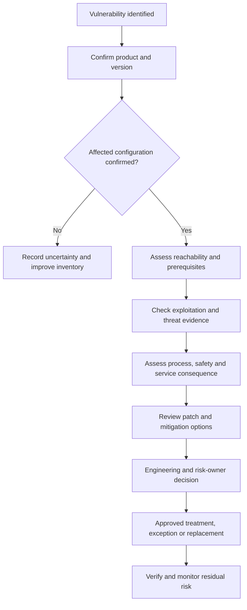
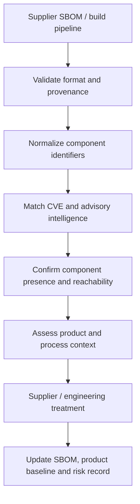
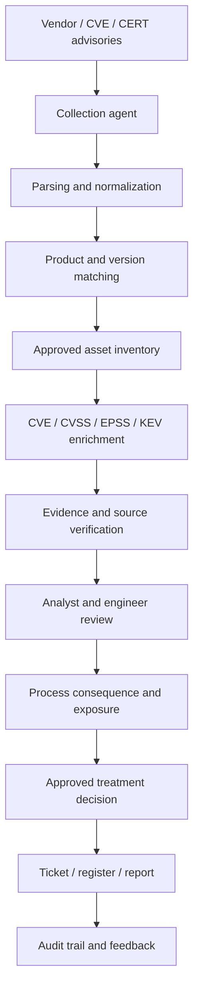

# OT Vulnerability Management, CVE Intelligence and Industrial Product Security

**Document ID:** UOTS-09-VULN | **Version:** 1.0 | **Status:** Engineering reference

**Audience:** OT security engineers, product security teams, PSIRT, vulnerability management, control and automation engineers, asset owners, SOC, procurement, system integrators, OEMs, risk owners and auditors.

> **Safety notice:** This playbook supports defensive vulnerability management. It does not authorize active scanning, exploitation, fuzzing, denial-of-service, firmware modification, controller writes or testing of live OT. Use vendor-approved methods, isolated test environments and documented authorization. Operations, engineering and functional safety authorities must approve any action that can affect production or protective functions.

---

# 1. Purpose and principles

OT vulnerability management is the disciplined process of identifying, validating, prioritizing, treating and monitoring weaknesses in industrial assets, software, firmware, networks, products and supporting services.

It differs from ordinary IT vulnerability management because:
- Assets may operate continuously and cannot be restarted on demand.
- A patch may change timing, communications, deterministic behavior or vendor support.
- Vulnerability scanners can disrupt fragile devices or networks.
- Product versions and firmware may be difficult to identify remotely.
- Safety, environment and essential services may depend on the affected system.
- Vendor fixes may require a shutdown, engineering validation or replacement.
- Compensating controls may be the safest interim treatment.
- An asset may be technically vulnerable but unreachable, or reachable through a critical trust boundary.

**Core rule:** Never equate a CVSS score, scanner finding or public proof of concept with the final risk to a specific industrial process.

## 1.1 Objectives

1. Maintain an accurate inventory of products, versions, firmware and dependencies.
2. Receive and validate vulnerability intelligence from trusted sources.
3. Determine whether affected products and configurations exist in the environment.
4. Understand exposure, exploit prerequisites and process consequence.
5. Prioritize treatment using technical evidence and operational context.
6. Coordinate patching, mitigation, replacement and exceptions safely.
7. Verify remediation and retain evidence.
8. Feed lessons into procurement, secure design, supplier assurance and product lifecycle governance.

## 1.2 Lifecycle

```mermaid
flowchart LR
  A["Discover assets"] --> B["Collect advisories and findings"]
  B --> C["Normalize and match products"]
  C --> D["Validate affected versions and exposure"]
  D --> E["Assess exploitability and process consequence"]
  E --> F["Approve treatment decision"]
  F --> G["Test patch or compensating control"]
  G --> H["Deploy through change management"]
  H --> I["Verify and close"]
  I --> J["Monitor, report and improve"]
  J --> B
```

---

# 2. OT vulnerability taxonomy

Classify the weakness before deciding how to treat it.

| Category | Examples | OT considerations |
|---|---|---|
| Software vulnerability | Memory corruption, injection, authentication bypass | Product role, reachable service, privilege required |
| Firmware vulnerability | Embedded web server flaw, insecure update, hardcoded credential | Device lifecycle, vendor patch availability, update process |
| Configuration weakness | Default password, exposed service, weak protocol configuration | Actual exposure and safe configuration options |
| Architecture weakness | Flat network, excessive trust, direct remote access | Reachable path and process consequence |
| Identity weakness | Shared accounts, weak authentication, excessive privilege | Engineering and vendor access |
| Cryptographic weakness | Weak TLS, invalid certificate handling, obsolete algorithms | Device compatibility and management plane |
| Supply chain weakness | Compromised build, update, library or supplier | Provenance, SBOM, signing and supplier assurance |
| Unsupported component | End-of-life OS, firmware or appliance | No patch path, replacement and compensating controls |
| Physical weakness | Unprotected console, debug port, removable media | Site access and physical process |
| Operational weakness | Uncontrolled changes, missing backups, unsafe maintenance | Governance and recovery |

Do not label a missing security feature as a CVE unless a valid vulnerability record exists. Track configuration and architecture findings separately but connect them to the risk register.

---

# 3. Product and asset coverage

## 3.1 Industrial technology categories

| Asset class | Product details to capture | Vulnerability considerations |
|---|---|---|
| PLC / PAC | Vendor, model, CPU, firmware, modules, engineering suite | Firmware, protocol services, engineering access |
| RTU | Model, firmware, communications, remote interfaces | Remote exposure, serial/cellular gateways |
| DCS | Platform, controller, server, console, firmware | Vendor advisories, dependencies, availability |
| SCADA | Master station, server, client, version, plugins | OS, application, database, remote access |
| HMI | Panel/PC model, OS, runtime, project version | Embedded OS, runtime libraries, access |
| SIS / safety controller | Platform, firmware, engineering tools, safety lifecycle | Safety vendor advisories and strict change validation |
| IED / protection relay | Model, firmware, settings software, interfaces | Protocol, management access, settings integrity |
| Industrial switch/router | Model, OS, firmware, modules, management plane | Management interface, routing, protocol services |
| Historian / MES | Product, version, database, connectors | Data broker, APIs, server dependencies |
| Engineering workstation | OS, tools, libraries, project repositories | Privileged access, application and OS vulnerabilities |
| Industrial PC / edge | OS image, BIOS, drivers, containers | Firmware, remote management, software supply chain |
| IIoT gateway | Model, firmware, cloud endpoint, protocols | Identity, API, update, remote management |
| Wireless / telecom | Access point, radio, modem, firmware | Remote reachability and supplier lifecycle |
| Virtualization / storage | Hypervisor, firmware, management plane | Shared dependency and recovery blast radius |
| Cloud integration | Tenant, service, API, connector, identity | Cloud identity, tokens, data and command boundaries |

## 3.2 Minimum asset record

- Unique asset ID and hostname/tag.
- Site, plant, process unit, area and zone.
- Asset owner and technical custodian.
- Manufacturer, product family, exact model and hardware revision.
- OS, software, firmware and build versions.
- Installed modules, plugins and optional components.
- Network interfaces, IP/MAC where appropriate, protocols and communication partners.
- Internet, enterprise, DMZ, remote and supplier reachability.
- Criticality and process function.
- Safety, environmental and essential-service dependency.
- Vendor support status and end-of-life date.
- Patch constraints and maintenance window.
- Approved configuration baseline and backup reference.
- Vulnerability status, exception and last validation date.

## 3.3 Product identity matching

A product match is not reliable if it uses only a vendor name or broad product family. Match:
1. Manufacturer.
2. Exact product and model.
3. Hardware revision, if relevant.
4. Software/firmware version and build.
5. Installed component or optional feature.
6. Configuration and service state.
7. Advisory's affected and fixed ranges.
8. Vendor-specific exclusions and mitigation notes.

When exact version is unknown, classify the match as **potentially affected**, not confirmed affected.

---

# 4. Vulnerability intelligence sources

## 4.1 Source hierarchy

Prefer original and authoritative sources:
1. Product vendor PSIRT/security advisory and release notes.
2. National CERT, sector CERT and government ICS advisories.
3. CVE Program record and CNA publication.
4. CISA Known Exploited Vulnerabilities (KEV) and ICS advisories.
5. NIST National Vulnerability Database (NVD).
6. Standards bodies and trusted sector information-sharing communities.
7. Reputable independent research with reproducible evidence.
8. Secondary news and vendor commentary as leads, not sole evidence.

Useful official sources:

| Source | Official URL | Primary use |
|---|---|---|
| CVE Program | https://www.cve.org/ | CVE identifiers and records |
| NVD | https://nvd.nist.gov/ | Vulnerability enrichment and references |
| CISA KEV | https://www.cisa.gov/known-exploited-vulnerabilities-catalog | Known exploited vulnerabilities |
| CISA ICS Advisories | https://www.cisa.gov/news-events/ics-advisories | Industrial product advisories |
| CISA Cybersecurity Advisories | https://www.cisa.gov/news-events/cybersecurity-advisories | Threat and vulnerability alerts |
| FIRST EPSS | https://www.first.org/epss/ | Exploitation probability estimates |
| FIRST CVSS | https://www.first.org/cvss/ | Scoring specifications |
| MITRE CWE | https://cwe.mitre.org/ | Weakness taxonomy |
| MITRE ATT&CK for ICS | https://attack.mitre.org/matrices/ics/ | Adversary behavior context |
| Vendor PSIRT | Vendor-specific official security portal | Affected models, versions and mitigations |

## 4.2 Advisory record

Capture:
- Advisory ID and CVE ID(s).
- Vendor and exact product.
- Advisory title, publication and update dates.
- Affected and fixed versions.
- Vulnerability description and CWE, if assigned.
- Attack vector and prerequisites.
- Authentication and privilege requirements.
- User interaction requirements.
- Impact on confidentiality, integrity and availability.
- Exploit code or active exploitation evidence.
- Vendor mitigations, workarounds and safety warnings.
- Patch availability and compatibility notes.
- References, source confidence and review date.

## 4.3 Advisory change monitoring

Vendor advisories can be revised. Track:
- Initial publication.
- Added affected products.
- Corrected version ranges.
- New mitigations.
- Exploitation status updates.
- Patch withdrawal or superseding release.
- End-of-support clarification.

Do not close a finding based on an old advisory snapshot if the vendor has updated the guidance.

---

# 5. CVE, CWE, CVSS, EPSS and KEV

These systems answer different questions and must not be conflated.

| System | What it represents | What it does not tell you |
|---|---|---|
| CVE | Public identifier for a disclosed vulnerability | Whether a particular plant is affected or exposed |
| CWE | Category of software weakness | Severity or exploitability of a specific instance |
| CVSS | Technical severity under a defined scoring version and metrics | Site-specific process risk or patch priority by itself |
| EPSS | Estimated probability of exploitation activity over a near-term horizon | Probability that a particular asset will be compromised |
| CISA KEV | Vulnerabilities known to have been exploited in the wild | That every deployment is vulnerable or compromised |
| Vendor advisory | Product-specific affected ranges and mitigation | Whether the asset is reachable in a particular architecture |
| Asset context | Local product, version, exposure and consequence | Global exploitation activity on its own |

## 5.1 CVSS interpretation

Always record:
- CVSS version.
- Base score and vector.
- Whether environmental or threat metrics are used.
- Source of the score.
- Whether vendor and NVD scores differ.
- Any assumptions and missing data.

Do not silently mix CVSS v3.1 and v4.0 values or compare them as if they were identical scales with identical semantics.

Official specification: https://www.first.org/cvss/

## 5.2 EPSS interpretation

EPSS is a model estimate of the likelihood that a published CVE will be exploited in the wild in the near term. It is useful for threat-informed prioritization, not a prediction of compromise for one asset.

Official resource: https://www.first.org/epss/

## 5.3 KEV interpretation

KEV inclusion is an important signal that exploitation has been observed. Verify:
- Whether the exact product/version is deployed.
- Whether the affected component is enabled.
- Whether the attack path is reachable.
- Whether the vendor has a safe mitigation.
- Whether local regulatory or contractual deadlines apply.

Official catalogue: https://www.cisa.gov/known-exploited-vulnerabilities-catalog

---

# 6. OT-specific risk prioritization

## 6.1 Multi-dimensional assessment

Assess at least:

**Technical factors**
- Vulnerability severity and attack vector.
- Required privileges and user interaction.
- Exploit maturity and observed exploitation.
- Product version and configuration.
- Network reachability and trust boundaries.
- Availability of vendor patch or workaround.

**Operational factors**
- Process criticality and operating state.
- Safety and environmental consequences.
- Essential service and public impact.
- Equipment damage and production interruption.
- Recovery complexity and spares availability.
- Patch feasibility and maintenance windows.
- Vendor support and engineering validation.

## 6.2 Decision model

## 6.3 Suggested prioritization bands

These are internal triage suggestions, not a replacement for a regulator's deadline or an operator's approved risk method.

| Band | Typical condition | Expected handling |
|---|---|---|
| Critical | Confirmed affected, reachable or active exploitation, severe process consequence | Immediate coordinated assessment and approved containment/treatment plan |
| High | Confirmed affected with credible exploit path or significant consequence | Prioritized engineering review and time-bound treatment |
| Medium | Affected but limited reachability or mitigated exposure | Planned remediation and monitoring |
| Low | Limited consequence, no practical path, or strong compensating controls | Track, validate assumptions and review periodically |
| Unknown | Product/version or exposure cannot be confirmed | Inventory and evidence improvement task; do not label safe |

Do not assign a universal number of days without considering legal obligations, vendor guidance, operating constraints and the organization's risk appetite.

## 6.4 Risk record

| Field | Required content |
|---|---|
| Finding ID | Unique reference |
| CVE/advisory | Identifier and source |
| Asset | Exact asset ID and location |
| Product match | Confirmed, potential, not affected |
| Version evidence | Observed version and collection date |
| Exposure | Network path and trust zone |
| Exploit status | None known, PoC, observed exploitation, uncertain |
| Technical severity | CVSS version, score and vector |
| Threat context | EPSS date/value, KEV status, campaign relevance |
| Process consequence | Safety, environment, service, production, integrity |
| Existing controls | Segmentation, access, monitoring, compensating controls |
| Treatment | Patch, mitigate, replace, accept temporarily |
| Approvals | Engineering, operations, safety, risk owner |
| Due date | Approved date and rationale |
| Residual risk | Remaining exposure |
| Verification | Evidence and closure date |

---

# 7. Safe vulnerability discovery and assessment

## 7.1 Discovery methods

Use the least disruptive source that can answer the question.

| Method | Typical use | OT caution |
|---|---|---|
| CMDB / asset register | Existing inventory | Data may be stale |
| Vendor management tools | Product and firmware data | Validate compatibility and permissions |
| Configuration exports | Installed components and settings | Secure handling of sensitive files |
| Passive network monitoring | Observed devices and protocols | Coverage depends on sensor placement |
| Switch/router records | Connected devices and topology | MAC/IP does not prove product identity |
| Engineering workstation records | Tool and project versions | Protect proprietary project files |
| Procurement / maintenance records | Model, serial and lifecycle | Confirm installed configuration |
| Vendor advisory matching | Affected version comparison | Exact model and version required |
| Authenticated assessment | Approved host/service configuration review | Requires written scope and safety review |
| Active network scanning | Authorized discovery in suitable environments | Can disrupt fragile or legacy devices; never assume safe |

## 7.2 Passive-first assessment workflow

1. Obtain authorization, scope and asset-owner approval.
2. Identify the process area and prohibited actions.
3. Review architecture, asset inventory and vendor documentation.
4. Collect passive network and existing configuration evidence.
5. Match exact product and version to official advisories.
6. Identify uncertainty and request vendor/engineering confirmation.
7. Assess exposure and process consequence.
8. Recommend treatment and validation.
9. Retain evidence and update the asset record.

## 7.3 Active testing gate

Before any active scan or validation, document:
- Written authorization and exact target scope.
- Asset owner and process owner approval.
- Vendor confirmation where required.
- Functional safety and operational review.
- Test method, rate limits and excluded checks.
- Maintenance window and communications plan.
- Backups, rollback and recovery readiness.
- Monitoring and stop conditions.
- Emergency contact and authority to stop.
- Post-test validation and evidence handling.

If these conditions are not met, use passive methods or an isolated replica.

---

# 8. Patch management for 24/7 industrial operations

Patching is a controlled engineering change, not a routine endpoint update.

## 8.1 Patch lifecycle

```mermaid
flowchart LR
  A["Vendor release / advisory"] --> B["Applicability and risk review"]
  B --> C["Vendor compatibility review"]
  C --> D["Representative lab validation"]
  D --> E["Operations and safety approval"]
  E --> F["Maintenance window and rollback plan"]
  F --> G["Controlled deployment"]
  G --> H["Functional and security verification"]
  H --> I["Evidence and baseline update"]
```

## 8.2 Pre-deployment checklist

- Confirm exact product, model, version and patch applicability.
- Read vendor release notes, prerequisites and known issues.
- Check dependencies, licenses, drivers and firmware compatibility.
- Confirm patch source authenticity and integrity.
- Review backup and recovery procedure.
- Test in a representative environment where feasible.
- Validate controller, HMI, historian, engineering and communications dependencies.
- Review safety and process impact with responsible engineers.
- Obtain management-of-change approval.
- Agree maintenance window, rollback and stop conditions.
- Confirm vendor support and escalation path.

## 8.3 Deployment controls

- Use approved and authenticated update packages.
- Restrict update privileges.
- Record operator, date, asset and package version.
- Avoid simultaneous changes across redundant or critical components unless approved.
- Monitor process and system state.
- Stop if unexpected alarms, timing changes, communication faults or functional anomalies occur.
- Follow vendor and site rollback instructions.

## 8.4 Post-deployment validation

- Confirm installed version and package integrity.
- Verify expected services and communications.
- Validate alarms, historian data, time synchronization and operator visibility.
- Confirm controller and engineering project integrity as applicable.
- Check safety/protection status through authorized specialist procedures.
- Confirm process owner acceptance.
- Update inventory, vulnerability register and baseline.
- Retain test and approval evidence.

## 8.5 Patch unavailable or unsafe

Possible treatment options, subject to engineering approval:
- Restrict network reachability.
- Remove unnecessary services or interfaces using vendor-approved configuration.
- Limit access to named users and approved maintenance windows.
- Strengthen monitoring and alerting.
- Place behind an appropriate industrial security boundary.
- Disable affected functionality only if the process owner and vendor confirm safety.
- Plan replacement or upgrade.
- Apply a time-bound risk exception with owner and review trigger.

A compensating control reduces risk; it does not make the vulnerability disappear.

---

# 9. Vulnerability exceptions and risk acceptance

An exception must be explicit, time-bound and owned. "Cannot patch because OT" is not an adequate justification.

Required fields:
- Asset and vulnerability identifiers.
- Technical and process risk.
- Why patching or replacement is currently unsafe or infeasible.
- Vendor position and supporting evidence.
- Existing controls and residual risk.
- Additional mitigation and monitoring.
- Process owner and engineering approval.
- Functional safety approval where relevant.
- Risk owner authorized to accept residual risk.
- Expiry date and reassessment trigger.
- Replacement or remediation roadmap.
- Evidence of periodic review.

Exceptions must be reopened when exploit status, exposure, asset use, vendor guidance or process consequence changes.

---

# 10. Firmware and embedded device security

Firmware security requires lifecycle and provenance controls, not just a version check.

## 10.1 Firmware assurance questions

- Is the firmware from the authentic manufacturer?
- Is the package signed or otherwise integrity-protected?
- Is signature validation supported and enabled?
- Is secure boot available and correctly configured?
- Are debug and maintenance interfaces controlled?
- Can firmware be downgraded to a vulnerable version?
- Is rollback supported and safe?
- Are cryptographic keys protected?
- Is the update mechanism authenticated?
- Does the vendor publish a security advisory process?
- Is the device still supported?
- Are firmware dependencies and third-party components disclosed?

## 10.2 Firmware update governance

1. Obtain package from official supplier channel.
2. Verify checksum/signature using vendor instructions.
3. Confirm exact hardware revision and compatible release.
4. Review release notes and known issues.
5. Test on representative hardware or vendor-approved simulator.
6. Obtain operational and safety approval.
7. Back up configuration and record current version.
8. Apply in approved maintenance window.
9. Verify device health and function.
10. Retain package, verification evidence and approval record.

Do not extract, modify, reflash or downgrade production firmware as an ad hoc security test.

---

# 11. SBOM and software supply chain security

A software bill of materials (SBOM) is a structured inventory of software components. It supports dependency visibility but does not by itself prove a product is secure or vulnerable.

## 11.1 SBOM contents

Depending on format and profile:
- Supplier and component name.
- Version and unique identifiers.
- Package URL (purl), CPE or other identifiers where available.
- Dependency relationships.
- License information.
- Author and timestamp.
- Hashes and provenance metadata.
- Known vulnerability references.

Common formats include SPDX and CycloneDX. Confirm the format version and profile required by the customer or regulator.

Official resources:
- SPDX: https://spdx.dev/
- CycloneDX: https://cyclonedx.org/
- NTIA SBOM resources: https://www.ntia.gov/page/software-bill-materials

## 11.2 SBOM operational workflow

## 11.3 SBOM limitations

- May be incomplete or stale.
- May omit firmware or proprietary components.
- Component identifiers may not map cleanly to vulnerability databases.
- Presence of a library does not prove the vulnerable code path is reachable.
- Absence from an SBOM does not prove absence from the product.
- Transitive dependencies can complicate matching.
- A vulnerability may be fixed by backporting without an obvious version change.

Require supplier evidence and product-specific applicability analysis.

---

# 12. Secure product development and PSIRT

Industrial product security starts before deployment and continues through end of life.

## 12.1 Secure product lifecycle

```mermaid
flowchart LR
  A["Security requirements"] --> B["Threat modeling and architecture"]
  B --> C["Secure implementation"]
  C --> D["Code and dependency analysis"]
  D --> E["Verification and product security testing"]
  E --> F["Release and provenance"]
  F --> G["Deployment and vulnerability response"]
  G --> H["Maintenance and security updates"]
  H --> I["End-of-life and customer transition"]
```

## 12.2 Product security controls

- Security requirements and abuse cases.
- Threat modeling for interfaces, trust boundaries and update paths.
- Secure coding and code review.
- SAST, SCA, secrets scanning and build pipeline protection.
- DAST and protocol testing in representative lab environments.
- Authentication, authorization and secure defaults.
- Cryptographic key and certificate lifecycle.
- Signed updates and integrity validation.
- SBOM generation and dependency management.
- Security testing and independent review.
- Vulnerability disclosure policy and PSIRT ownership.
- Security advisory and customer notification process.
- Supported lifecycle and end-of-life communication.

## 12.3 PSIRT workflow

A Product Security Incident Response Team (PSIRT) coordinates vulnerability reports affecting a vendor's products.

1. Receive report through an authenticated, published channel.
2. Acknowledge receipt and assign case ID.
3. Protect reporter and customer confidentiality.
4. Validate the reported product, version and behavior.
5. Reproduce in an isolated environment.
6. Assess impact, affected releases and exploitability.
7. Coordinate with engineering, suppliers and affected parties.
8. Develop and validate fix or mitigation.
9. Coordinate disclosure and customer communication.
10. Publish advisory with affected versions and mitigations.
11. Track customer remediation and follow-up.
12. Conduct lessons learned.

Define coordinated vulnerability disclosure timelines based on applicable law, contractual commitments, sector policy and risk. Do not promise a universal disclosure deadline.

## 12.4 Vulnerability disclosure intake

Provide:
- Security contact and encryption option.
- Supported products and versions.
- Safe harbor / testing policy where applicable.
- Requested report details and evidence.
- Acknowledgement process.
- Confidentiality and disclosure coordination.
- Escalation for actively exploited or safety-relevant issues.

---

# 13. Supplier and procurement security

Procurement decisions influence the security posture for the entire product lifecycle.

## 13.1 Supplier questionnaire themes

- Product security development lifecycle.
- Published PSIRT and vulnerability disclosure policy.
- Security advisory publication and notification.
- SBOM availability and update frequency.
- Firmware signing and update integrity.
- Authentication and secure default configuration.
- Supported versions and end-of-life policy.
- Remote support architecture and session logging.
- Vulnerability remediation commitments.
- Third-party component management.
- Security testing and independent assurance.
- Incident notification and coordinated response.
- Data handling, access and subcontractors.
- Secure decommissioning and credential revocation.

## 13.2 Contractual requirements to consider

Have legal, procurement, engineering and security teams determine appropriate clauses for:
- Vulnerability disclosure and response.
- Security advisory notification.
- Patch and mitigation support.
- Product support lifecycle.
- Remote access approvals and logging.
- SBOM and component transparency.
- Secure update provenance.
- Incident notification.
- Evidence and audit rights.
- Subcontractor access and flow-down.
- End-of-life transition and data removal.

This is a control-design checklist, not legal wording.

---

# 14. Industry-specific vulnerability considerations

| Sector | High-value assets and product families | Priority context |
|---|---|---|
| Oil and gas / LNG | DCS, SIS, ESD, F&G, compressor controls, pipeline RTUs, terminal systems | Process safety, remote sites, continuous operation, vendor access |
| Power and grid | EMS, SCADA, RTUs, IEDs, protection relays, substation switches, time sources | Grid stability, protection coordination, restoration |
| Renewables / BESS | Inverters, plant controllers, BMS, PCS, EMS, OEM gateways | Fleet access, grid interface, battery safety |
| Water / wastewater | PLCs, RTUs, dosing controllers, telemetry, SCADA, remote pump stations | Water quality, public health, remote access |
| Manufacturing | PLCs, robots, CNC, MES, HMI, industrial PCs, machine vision | Worker safety, recipe integrity, production and quality |
| Mining | Fleet systems, ventilation, gas monitoring, hoists, conveyors, dewatering | Worker safety, remote communications, environment |
| Transport | Signaling, interlocking, terminal automation, cranes, tunnel systems | Passenger safety, movement authority, continuity |
| Buildings / data centres | BMS, EPMS, UPS, generator, cooling, fire and access systems | Life safety, power, cooling, facility continuity |

## 14.1 Sector-specific assessment questions

**Oil and gas**
- Are affected DCS/SIS/ESD products deployed and supported?
- Are remote telemetry and vendor service paths exposed?
- Does vendor mitigation require a process shutdown?

**Power**
- Are protection IEDs, engineering tools or substation gateways affected?
- Could remediation affect protection coordination or grid operations?
- Are approved settings and firmware baselines available?

**Water**
- Could the weakness affect measurement, dosing, pumping or telemetry?
- Is the product reachable from an untrusted network?
- Is there a safe local operating procedure?

**Manufacturing**
- Does the vulnerability affect robot, CNC, recipe, batch or quality systems?
- Can the patch be tested on representative equipment?
- Is production restart and quality validation defined?

**Mining**
- Could the weakness affect ventilation, tracking, communications, hoists or dewatering?
- Is remote-site access dependent on shared telecom?

**Transport**
- Does the affected system support signaling, movement, terminal automation or life safety?
- Who is authorized to approve maintenance and return to service?

**Buildings and data centres**
- Could the weakness affect cooling, power, fire or access control?
- Are facility and tenant networks appropriately separated?

---

# 15. OT vulnerability management operating model

## 15.1 Roles and responsibilities

| Role | Responsibility |
|---|---|
| Vulnerability management lead | Process, register, reporting and coordination |
| OT asset owner | Product identity, criticality and treatment ownership |
| Control/automation engineer | Technical validation and compatibility |
| Operations manager | Maintenance window and operational approval |
| Functional safety / protection authority | Safety-impact review where applicable |
| OT security architect | Exposure, segmentation and compensating controls |
| Vendor / OEM | Product-specific advisory, fix and support guidance |
| Procurement / supplier risk | Contract and lifecycle obligations |
| Risk owner / CISO delegate | Residual risk acceptance within authority |
| Auditor / assurance | Evidence and process effectiveness |

## 15.2 RACI example

R = Responsible, A = Accountable, C = Consulted, I = Informed.

| Activity | VM lead | Asset owner | Engineering | Operations | Safety | Risk owner |
|---|---|---|---|---|---|---|
| Advisory intake | A/R | I | C | I | I | I |
| Asset match | R | A | R | C | I | I |
| Technical validation | C | A | R | C | C | I |
| Process consequence | C | A | R | R | C | I |
| Treatment proposal | R | A | R | C | C | I |
| Patch approval | C | A | R | R | C | I |
| Risk exception | R | C | C | C | C | A |
| Closure verification | R | A | R | C | C | I |

Adapt the RACI to the site's governance and legal obligations.

## 15.3 Vulnerability register minimum fields

| Field | Description |
|---|---|
| Record ID | Unique finding |
| Source ID | Advisory/CVE/source |
| Asset ID | Inventory reference |
| Product match | Exact product and version |
| Status | New, validating, affected, not affected, treatment, exception, closed |
| Severity | CVSS version and score |
| Exploitation | EPSS snapshot, KEV and source evidence |
| Exposure | Zone and path |
| Process consequence | Safety/service/environment/production |
| Treatment | Patch, mitigate, replace, accept |
| Owner | Named role/person |
| Approval | Required sign-offs |
| Due date | Approved date |
| Exception expiry | If applicable |
| Verification evidence | Test and closure proof |
| Last reviewed | Date |

---

# 16. Metrics and assurance

Measure coverage, decision quality and risk reduction.

| Metric | Definition | Interpretation |
|---|---|---|
| Asset version coverage | Critical assets with verified product/version | Low coverage means uncertainty, not low risk |
| Advisory triage coverage | Relevant advisories assessed against inventory | Track missed or delayed advisories |
| Time to applicability decision | Receipt to confirmed match status | Separate technical wait time from workflow delay |
| KEV review coverage | Relevant KEV entries reviewed for deployed products | Does not mean every entry is applicable |
| Patch validation success | Approved patches passing representative tests | Include failures and rollback |
| Exception age | Time since risk exception approval | Expired exceptions require escalation |
| Compensating control verification | Controls periodically checked | A documented control may not be effective |
| Unsupported asset exposure | Unsupported assets with approved treatment plans | Prioritize replacement planning |
| Remediation verification | Findings with evidence after change | Closure must be evidence-based |
| Supplier response performance | Supplier advisory and remediation response | Contractual and lifecycle context |

---

# 17. Practical labs and simulations

All labs use isolated test equipment, synthetic data or vendor-approved simulations.

| Lab | Objective | Safe evidence |
|---|---|---|
| 01 — CVE record analysis | Interpret CVE fields and references | Structured advisory summary |
| 02 — CVSS interpretation | Read vector and scoring version | Reproducible score explanation |
| 03 — EPSS and KEV triage | Compare threat signals | Dated prioritization note |
| 04 — Product/version matching | Match synthetic inventory to vendor advisory | Confirmed/potential/not affected decision |
| 05 — Passive asset identification | Analyze synthetic PCAP | Asset observations and confidence |
| 06 — Vulnerability risk assessment | Include process consequence | Completed risk record |
| 07 — Patch management tabletop | Plan safe maintenance and rollback | Change plan and approval |
| 08 — SBOM analysis | Identify components and dependency relationships | Component inventory and match limitations |
| 09 — Firmware provenance | Verify a vendor-provided test package | Signature/hash verification record |
| 10 — PSIRT intake | Process a synthetic disclosure | Case timeline and response |
| 11 — Exception management | Document a patch deferral | Approved time-bound exception |
| 12 — AI advisory triage | Validate extracted claims and citations | Human-reviewed report |

Every lab requires prerequisites, scope, diagram, steps, expected results, evidence, evaluation rubric and cleanup procedure.

---

# 18. AI-assisted vulnerability intelligence

AI can help extract advisory data, compare product names, cluster reports, draft risk summaries and propose asset matches. It must not make unreviewed operational decisions.

## 18.1 Reference workflow

## 18.2 Agent roles and restrictions

| Agent | Allowed | Not allowed by default |
|---|---|---|
| Advisory collector | Retrieve approved public advisories | Access restricted plant systems |
| Parser | Extract identifiers, products and dates | Treat source content as trusted instructions |
| Product matcher | Suggest product/version matches | Declare affected status without evidence |
| Enrichment agent | Retrieve CVSS, EPSS, KEV and CWE data | Treat scores as final OT risk |
| Asset correlation agent | Compare with approved inventory | Export sensitive inventory to unapproved services |
| Risk assistant | Draft consequence and treatment questions | Accept risk or approve changes |
| Ticket agent | Prepare draft remediation records | Deploy patches or alter production systems |
| Reporting agent | Draft source-linked summaries | Publish externally without approval |

## 18.3 AI validation requirements

- Cite every material claim.
- Record retrieval and advisory revision dates.
- Validate product model and version.
- Preserve original vendor wording where needed for exact technical interpretation.
- Distinguish confirmed match from inferred match.
- Recalculate or verify scores from authoritative records.
- Identify stale, duplicate and superseded advisories.
- Protect confidential asset inventories.
- Require engineer review of process consequences.
- Require formal approval for all operational changes.
- Retain model, prompt, tool and reviewer audit information where appropriate.

---

# 19. Reporting templates

## 19.1 Vulnerability assessment finding

**Finding ID:**  
**Title:**  
**Asset / process:**  
**Vendor and product:**  
**Model / firmware / version:**  
**CVE / advisory:**  
**Source and date:**  
**Affected version evidence:**  
**Exposure and prerequisites:**  
**CVSS version, score and vector:**  
**EPSS snapshot and date:**  
**KEV status:**  
**Exploit evidence:**  
**Process consequence:**  
**Existing controls:**  
**Recommended treatment:**  
**Vendor guidance:**  
**Operational constraints:**  
**Required approvals:**  
**Verification method:**  
**Residual risk:**  
**References:**

## 19.2 Patch exception request

**Exception ID:**  
**Asset:**  
**Vulnerability:**  
**Reason patch is deferred:**  
**Vendor evidence:**  
**Process and safety impact:**  
**Existing and additional controls:**  
**Residual risk:**  
**Replacement/remediation plan:**  
**Owner:**  
**Approvals:**  
**Expiry date:**  
**Reassessment triggers:**

## 19.3 Monthly vulnerability report

- Critical assets inventoried and version-verified.
- New relevant advisories.
- Confirmed affected assets.
- Potential matches requiring investigation.
- KEV items assessed.
- Active exploitation evidence relevant to the estate.
- Patches tested and deployed.
- Compensating controls implemented.
- Exceptions opened, expired and renewed.
- Unsupported products and replacement plans.
- Supplier response issues.
- Decisions and resource requirements.

---

# 20. Standards and framework mapping

Applicability depends on sector, jurisdiction, operator role and contractual scope. Do not claim that a standard is legally mandatory without checking the actual instrument.

| Reference | Relevance |
|---|---|
| ISA/IEC 62443 series | IACS security lifecycle, component/system requirements and supplier practices |
| NIST SP 800-82 Rev. 3 | OT security architecture and risk context |
| NIST CSF 2.0 | Governance and cybersecurity risk management |
| NIST SP 800-161 Rev. 1 | Cybersecurity supply chain risk management |
| ISO/IEC 27001 | Information security management system |
| ISO/IEC 27002 | Information security controls |
| ISO/IEC 19770-2 | Software identification tagging |
| IEC 62443-4-1 | Secure product development lifecycle requirements |
| IEC 62443-4-2 | Technical security requirements for IACS components |
| ISO/IEC 29147 | Vulnerability disclosure |
| ISO/IEC 30111 | Vulnerability handling processes |
| FIRST CVSS | Vulnerability severity scoring |
| FIRST EPSS | Exploitation probability estimation |
| CVE / CWE | Vulnerability and weakness identification |
| CISA KEV | Known exploited vulnerability intelligence |

Official starting points:
- ISA/IEC 62443: https://www.isa.org/standards-and-publications/isa-standards/isa-iec-62443-series-of-standards
- NIST SP 800-82 Rev. 3: https://csrc.nist.gov/pubs/sp/800/82/r3/final
- NIST SP 800-161 Rev. 1: https://csrc.nist.gov/pubs/sp/800/161/r1/upd1/final
- NIST CSF: https://www.nist.gov/cyberframework
- ISO: https://www.iso.org/standards.html
- FIRST CVSS: https://www.first.org/cvss/
- FIRST EPSS: https://www.first.org/epss/

---

# 21. Governance, review and document control

## 21.1 Required reviewers

- OT vulnerability management owner.
- Asset and process owner.
- Control/automation engineering.
- OT security architecture.
- Operations.
- Functional safety or protection specialist where relevant.
- Procurement and supplier assurance.
- Legal/regulatory and risk owner as applicable.

## 21.2 Review triggers

Review when:
- Vendor issues or revises an advisory.
- Exploitation is observed or KEV status changes.
- A product version or architecture changes.
- A patch is withdrawn or superseded.
- A safety or operational incident occurs.
- A supplier changes its support lifecycle.
- Regulations or contractual requirements change.
- A lab or deployment reveals an unsafe assumption.

## 21.3 Revision history

| Version | Date | Change | Status |
|---|---|---|---|
| 1.0 | 2026-11-17 | Initial OT vulnerability lifecycle, CVE intelligence, prioritization, passive-first assessment, patching, firmware, SBOM, PSIRT, supplier assurance, AI workflow and labs | Engineering reference |

## 21.4 Specialist expansion backlog

1. Vendor-by-vendor advisory catalogue for major PLC, DCS, SCADA, HMI, RTU, IED and network vendors.
2. Detailed firmware security assessment guide.
3. Product/version matching data model and automation.
4. Passive OT vulnerability assessment playbooks by protocol and asset family.
5. Patch compatibility and validation matrix.
6. SBOM ingestion and vulnerability correlation pipeline.
7. PSIRT operational procedure and disclosure templates.
8. Supplier security assurance questionnaire and contract control mapping.
9. Sector-specific vulnerability case studies with primary advisories.
10. GCC and international regulatory vulnerability notification mapping.

This master playbook defines the lifecycle and engineering principles. Vendor-specific and facility-specific decisions require current vendor documentation, exact asset evidence and specialist approval.
