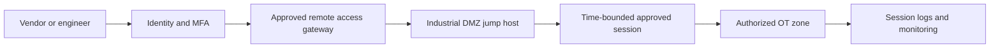

# OT Identity, Remote Access, and Privileged Access

## Objective

Control who can access industrial systems, from where, for what purpose, at what time, and with what level of privilege, while preserving safe operations and emergency access.

## Identity governance

- Use individually attributable accounts where supported.
- Avoid shared accounts; where legacy constraints require them, document compensating accountability controls.
- Separate human, service, machine, and vendor identities.
- Remove default and unused accounts through approved engineering change.
- Define joiner, mover, leaver, contractor, and emergency access processes.
- Review privileged entitlements periodically and after role changes.
- Protect service accounts and secrets; rotate credentials through tested procedures.
- Synchronize time sources sufficiently for reliable audit trails.

## Authentication

Use phishing-resistant MFA where feasible for remote and privileged access, subject to product support, operational constraints, and safety assessment. Do not introduce an authentication dependency that can prevent safe operation during loss of connectivity without a tested contingency.

## Remote access architecture

An illustrative access chain:

Controls should include:
- Asset-owner approval and business justification
- Named identity and strong authentication
- Managed endpoint posture where practical
- No direct internet exposure of controllers
- Brokered access through approved gateways
- Just-in-time, time-limited permissions
- Least privilege and destination allow-lists
- Session logging and recording where lawful and technically safe
- File transfer inspection and approved staging
- Immediate revocation path
- Emergency access with post-event review

## Privileged access

Separate administration from daily use. Restrict access to engineering tools and controller programming functions. Use dual authorization for high-impact changes where appropriate. Record project downloads, logic changes, firmware changes, and configuration modifications.

## Third-party access

Maintain a supplier and support register, named contacts, approved support windows, contract security requirements, remote access inventory, and exit procedure. Validate vendor identity through a trusted channel before enabling sessions.

## Operational resilience

Design emergency access and local operation procedures for loss of identity services, remote access gateways, WAN connectivity, or cloud services. Test these procedures with operations and safety stakeholders.

## Verification

Review account inventory, authentication policy, remote paths, privileged groups, service accounts, access logs, emergency access, and deprovisioning evidence. Avoid intrusive tests on production systems without approval.
