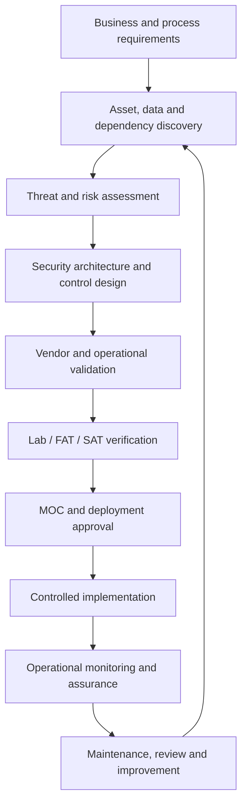
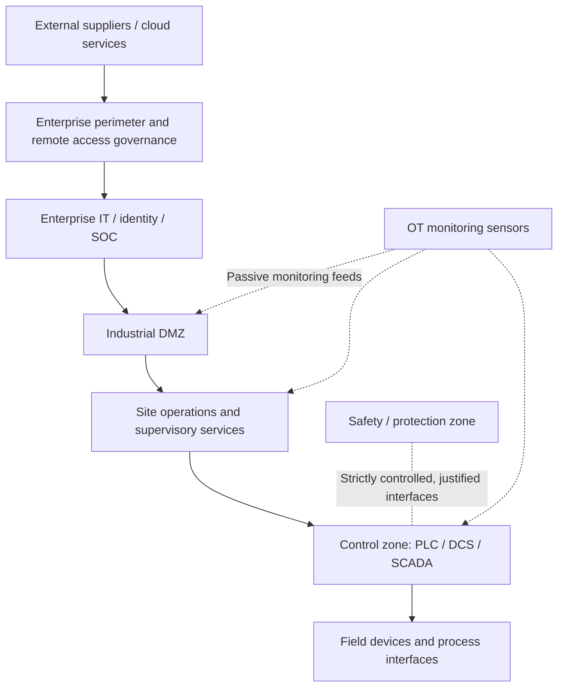
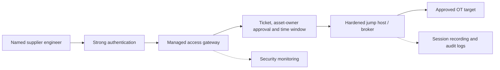
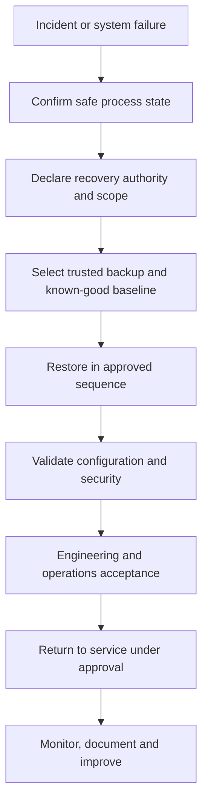

# OT Security Engineering, Hardening and Defensive Architecture

**Document ID:** UOTS-10-ENG | **Version:** 1.0 | **Status:** Engineering reference

**Audience:** OT security architects, control and automation engineers, network engineers, plant operations, system integrators, OEMs, facility teams, security operations, project managers and risk owners.

> **Safety and authorization:** This is a defensive design and engineering reference. It does not authorize changes to live industrial systems. Network changes, firewall rules, endpoint agents, account changes, protocol restrictions, firmware changes and controller configuration can affect production or safety. Apply management of change, vendor guidance, functional safety review and process-owner approval. Validate in a representative lab or test environment before production deployment.

---

# 1. Purpose and engineering outcomes

OT security engineering translates security objectives into implementable architecture, configurations, operating procedures, verification evidence and lifecycle controls.

The goal is not to maximize the number of security products. The goal is to protect people, the environment, process integrity, availability, essential services, information and recovery capability.

Engineering must account for:
- Physical process and operating modes.
- Safety instrumented and protection functions.
- Deterministic and time-sensitive communications.
- Legacy and vendor-supported technology.
- Reliability, redundancy and maintenance windows.
- Site topology and remote operations.
- Enterprise, cloud, supplier and OEM dependencies.
- Regulatory and contractual obligations.
- Degraded operation and recovery.

## 1.1 Design objectives

1. Establish clear security zones and controlled conduits.
2. Minimize unnecessary connectivity and trust.
3. Protect engineering, supervisory and control functions.
4. Restrict and monitor privileged and remote access.
5. Harden systems using tested, vendor-supported baselines.
6. Monitor communications and critical changes.
7. Protect backups, configurations and recovery paths.
8. Integrate security into procurement, projects and commissioning.
9. Maintain evidence that controls work as intended.
10. Preserve safe and reliable process operation.

## 1.2 Engineering lifecycle

---

# 2. Establish the engineering context

Before designing a control, understand what it protects and how the process works.

## 2.1 Required project inputs

| Input | Questions to resolve | Evidence |
|---|---|---|
| Process description | What does the plant or system do? | Process narrative, P&ID, functional description |
| Operating modes | Startup, normal, shutdown, maintenance, emergency? | Operating procedures |
| Asset inventory | Which controllers, servers, HMIs, networks and services exist? | Validated asset register |
| Architecture | How are zones, conduits and trust boundaries arranged? | Current network and system drawings |
| Data flows | Which systems communicate, why and in which direction? | Communication matrix |
| Safety functions | Which systems provide protection or interlocks? | Safety lifecycle documents |
| Dependencies | DNS, identity, time, historians, backups, cloud, OEM? | Dependency map |
| Remote access | Who connects, from where, through which path? | Access design and vendor contracts |
| Support lifecycle | Which products are supported and patchable? | Vendor lifecycle records |
| Regulatory scope | Which obligations apply to this operator and site? | Legal and compliance register |
| Recovery | How are systems restored and validated? | Recovery and continuity procedures |

## 2.2 Process consequence mapping

Map a cyber event to the physical and operational outcome.

Example:
- Compromised engineering workstation.
- Unauthorized project or logic modification attempt.
- Controller accepts or rejects the change depending on controls.
- Process behavior may change if the modification is accepted.
- Operators may see alarms, abnormal values or degraded control.
- Independent protection functions and manual procedures may reduce consequence.
- Recovery requires trusted project files, validated logic and controlled restoration.

Do not assume that compromising an IT workstation automatically compromises a controller. Document the actual trust path, prerequisites and safeguards.

## 2.3 Crown jewels

Identify the systems and functions whose compromise would create the greatest consequence. Examples may include:
- Safety instrumented functions and protection relays.
- Process controllers and critical control servers.
- Engineering workstations and project repositories.
- Operator consoles and alarm systems.
- Remote access gateways and identity services.
- Time synchronization and communications infrastructure.
- Backup repositories and recovery administration.
- Central management systems and industrial security appliances.

Crown-jewel classification must be site-specific and approved by engineering and operations.

---

# 3. Purdue model: useful reference, not a complete security design

The Purdue Enterprise Reference Architecture is commonly used to describe hierarchical industrial environments. It is a useful communication model, but real systems do not always fit neatly into fixed levels.

| Reference level | Typical functions and assets | Engineering focus |
|---|---|---|
| Level 0 | Physical process, sensors, actuators | Physical safety, signal integrity, field access |
| Level 1 | Basic control: PLCs, controllers, drives | Controller integrity and deterministic communications |
| Level 2 | Supervisory control, HMI, local SCADA | Operator access, command paths, monitoring |
| Level 3 | Site operations, historians, MES, engineering support | Site services, controlled information exchange |
| Level 3.5 | Industrial DMZ | Brokers, jump hosts, replication, controlled gateways |
| Level 4 | Enterprise IT | Business systems and enterprise identity |
| Level 5 | External networks / cloud / partners | Explicitly governed external connectivity |

## 3.1 Design cautions

- Do not assume every site has all levels.
- Do not treat a level number as proof of security.
- Do not permit broad connectivity merely because systems share a level.
- Separate safety and control functions based on process and risk, not labels alone.
- Model wireless, IIoT, remote sites, cloud and supplier paths explicitly.
- Document cross-level flows, direction, purpose and owner.
- Consider flat or vendor-specific architectures and document their actual trust boundaries.

## 3.2 Example reference architecture

This is conceptual. It is not a deployment drawing or a universal rule that every system should connect as shown. Define actual conduits and permitted flows from the process requirements.

---

# 4. Zones and conduits engineering

IEC 62443 uses zones and conduits to group assets with common security requirements and define controlled communication paths between them.

## 4.1 Zone definition

A zone is a grouping of logical or physical assets that share common security requirements. Consider:
- Process function and criticality.
- Trust level and ownership.
- Required communication.
- Threat exposure.
- Consequence of compromise.
- Safety and availability requirements.
- Vendor and lifecycle constraints.

Possible zones include:
- Enterprise IT.
- Industrial DMZ.
- Site operations.
- Supervisory control.
- Basic control.
- Safety and protection.
- Engineering and maintenance.
- Remote access.
- Wireless and IIoT.
- Building management and facilities.
- Vendor-managed systems.

These are examples, not mandatory zone names.

## 4.2 Conduit definition

A conduit is a controlled communication path between zones. Document:
- Source zone and destination zone.
- Source and destination assets.
- Business and process purpose.
- Protocol, port and direction.
- Initiator and responder.
- Authentication and encryption.
- Inspection and monitoring.
- Owner and approval.
- Availability and failover requirements.
- Expiry or review date.

## 4.3 Communication matrix

| Source | Destination | Purpose | Protocol/service | Direction | Owner | Approval |
|---|---|---|---|---|---|---|
| HMI zone | Controller zone | Supervisory control | Vendor-approved control protocol | Required direction only | Control engineering | MOC |
| Controller zone | Historian collector | Process data collection | Approved industrial protocol | Defined flow | Operations | Architecture review |
| Engineering zone | Controller zone | Authorized engineering | Vendor engineering service | Restricted and scheduled | Engineering lead | Explicit approval |
| OT DMZ | Enterprise SOC | Security event forwarding | Approved secure transport | Outbound where feasible | OT security | Security review |
| Vendor jump host | Managed target | Maintenance | Approved remote access | Time-bound | Asset owner | Ticket and session approval |

Never copy example ports or protocols into a live firewall rule without validating the exact product, version, service and vendor requirements.

## 4.4 Rule engineering workflow

## 4.5 Firewall rule quality

Every rule should have:
- Unique rule ID.
- Named owner.
- Business and process justification.
- Exact source and destination.
- Narrow service and direction.
- Required inspection and logging.
- Approval and implementation record.
- Review or expiry date.
- Test and rollback plan.

Avoid:
- Any-to-any rules.
- Unbounded temporary access.
- Unowned rules.
- Broad vendor subnets without justification.
- Duplicate or shadowed rules.
- Unreviewed bidirectional access.
- Direct inbound Internet access to controllers or HMIs.

---

# 5. Industrial DMZ design

An industrial DMZ provides controlled exchange between enterprise and industrial environments. It is not simply a subnet with a firewall.

## 5.1 Common DMZ services

Subject to architecture and vendor support:
- Remote access broker or jump host.
- Historian replication or data broker.
- File transfer and malware inspection gateway.
- Patch and update staging repository.
- Identity integration components where justified.
- Log forwarding and monitoring collectors.
- Time service relay.
- Secure application proxy or API gateway.
- Vendor support mediation.
- Backup replication gateway.

Do not place a service in the DMZ solely because it is available. Confirm its role, dependencies, hardening and trust boundaries.

## 5.2 DMZ design principles

1. No direct, uncontrolled enterprise-to-controller route.
2. Explicitly document and approve each conduit.
3. Separate services by trust and function where justified.
4. Minimize data and command flows.
5. Use authenticated, encrypted and logged management.
6. Harden and monitor DMZ hosts.
7. Control administrative access through dedicated paths.
8. Protect staging repositories and update provenance.
9. Define high availability and recovery.
10. Test failover without compromising process availability.

## 5.3 Data flow patterns

Prefer architecture patterns that broker or replicate required data rather than expose broad network access. Examples include:
- Historian replication from OT toward enterprise.
- Store-and-forward telemetry.
- Brokered message exchange.
- Controlled file transfer with scanning and approval.
- Read-only reporting interfaces.
- Dedicated remote access gateways.

The correct pattern depends on the product and operational requirement. A nominally read-only interface can still create risk if it exposes management functions or unsafe implementation.

---

# 6. Network segmentation and microsegmentation

Segmentation reduces unnecessary reachability and limits the spread of compromise.

## 6.1 Segmentation dimensions

- Process unit or production line.
- Control function.
- Safety and protection boundary.
- Site and remote facility.
- Engineering and maintenance.
- Vendor-managed assets.
- Wireless and IIoT.
- Building automation and facilities.
- Management and monitoring plane.

## 6.2 Segmentation design process

1. Validate asset inventory and communications.
2. Map business and process dependencies.
3. Identify trust boundaries and critical paths.
4. Group assets into candidate zones.
5. Define conduits and allowed flows.
6. Identify legacy and undocumented dependencies.
7. Model failure and recovery behavior.
8. Test in a lab or controlled pilot.
9. Obtain process, engineering and safety approval.
10. Deploy under MOC and monitor.
11. Review rules and exceptions periodically.

## 6.3 Microsegmentation cautions

Microsegmentation may use host controls, identity-aware policy, virtual network controls or dedicated gateways. It can be unsuitable for some legacy, deterministic or vendor-constrained systems.

Before deploying:
- Confirm platform and vendor support.
- Evaluate agent impact and resource overhead.
- Check multicast, broadcast, redundancy and discovery dependencies.
- Confirm behavior during policy-server outage.
- Define emergency bypass governance.
- Validate fail-safe behavior and recovery.
- Ensure the control itself does not become a single point of failure.

---

# 7. Industrial firewall and secure gateway engineering

## 7.1 Capability requirements

Select capabilities based on validated requirements:
- Stateful network filtering.
- Industrial protocol awareness where appropriate.
- Application and service restrictions.
- Secure management plane.
- Role-based administration.
- Centralized logging and time synchronization.
- High availability and tested failover.
- Configuration backup and restore.
- Vendor support for required throughput and latency.
- Change tracking and audit logs.

Deep packet inspection is not a substitute for sound architecture. Protocol parsers can have limitations and may not understand every vendor extension.

## 7.2 Deployment considerations

- Identify all paths, including redundant links.
- Establish a baseline of normal communications.
- Use vendor-approved transparent or routed modes.
- Understand behavior on power loss and device failure.
- Test fail-open/fail-closed consequences with engineering.
- Avoid inline deployment on critical paths without risk assessment.
- Confirm throughput, latency and packet handling.
- Monitor drops, retransmissions and alarms.
- Maintain configuration backups and recovery access.

## 7.3 Rule lifecycle

Request → engineering validation → owner approval → test → implementation → monitoring → recertification → removal.

Temporary rules must have an expiry date and accountable owner.

---

# 8. Remote access and third-party engineering

Remote access is a major trust boundary. It should be explicitly requested, approved, restricted, monitored and revoked.

## 8.1 Reference access flow

## 8.2 Required controls

- Named individual accounts.
- Strong authentication appropriate to the environment.
- Approved device and endpoint posture where feasible.
- Time-bound authorization.
- Asset-specific access.
- Least privilege.
- Session monitoring and recording where lawful and appropriate.
- File transfer controls.
- Command or application restrictions where supported.
- Emergency access procedure.
- Credential revocation after work.
- Supplier account recertification.
- No shared permanent vendor accounts.

## 8.3 Remote maintenance procedure

1. Supplier submits purpose, named personnel, target and duration.
2. Asset owner validates business need.
3. Engineering reviews technical and process risk.
4. Security reviews access route and identity.
5. Operations approves the maintenance window.
6. Access is enabled for the approved scope.
7. Session is monitored and recorded according to policy.
8. Changes and artifacts are documented.
9. Engineering validates the system.
10. Access is disabled and credentials/tokens revoked.
11. Logs and change records are retained.

Emergency access must have a defined authority, alerting, retrospective review and expiry.

---

# 9. Identity, privileged access and account governance

## 9.1 Identity design

Separate identities and privileges for:
- Operators.
- Control engineers.
- System administrators.
- Security analysts.
- OEM and supplier personnel.
- Service accounts.
- Application and machine identities.
- Emergency or break-glass use.

Use centralized identity where supported and safe. Do not force a dependency on enterprise identity if it could prevent safe local operation during an outage. Define resilient local access and controlled emergency procedures.

## 9.2 Privileged access controls

- Named privileged accounts.
- Separate standard and administrative identities.
- Just-in-time or time-bound elevation where supported.
- Approval for sensitive operations.
- Credential vaulting and rotation.
- Service account ownership and purpose.
- Interactive login restrictions for service accounts.
- Session logging.
- Periodic access recertification.
- Prompt deprovisioning.
- Tested emergency access.

## 9.3 Service account inventory

Record:
- Account or identity ID.
- System and service owner.
- Purpose and dependency.
- Privilege level.
- Authentication mechanism.
- Credential storage and rotation.
- Interactive login status.
- Last use and review date.
- Expiry or retirement plan.

Avoid changing service credentials without mapping dependencies and validating the change.

---

# 10. Secure configuration and hardening baselines

A hardening baseline defines approved security settings for a product and operating context. It must be tested against vendor guidance and operational requirements.

## 10.1 Baseline hierarchy

1. Vendor security hardening guide and product-specific instructions.
2. Applicable standards and recognized security benchmarks.
3. Organization-approved secure configuration standard.
4. Site-specific engineering deviation with approval.

Do not blindly apply an IT benchmark to an industrial controller, HMI or vendor appliance.

## 10.2 Windows OT systems

Potential controls, subject to vendor support:
- Supported OS and lifecycle tracking.
- Remove unnecessary applications and services.
- Restrict local administrator membership.
- Unique named accounts and appropriate authentication.
- Host firewall with tested allow rules.
- Application control or allowlisting.
- Endpoint protection configured for OT compatibility.
- Secure remote administration.
- Audit policy and centralized logs.
- Time synchronization.
- Disk protection where supported and operationally safe.
- Controlled removable media.
- Secure backup and restore.
- Patch testing and maintenance windows.

## 10.3 Linux OT systems

Potential controls, subject to vendor support:
- Supported distribution and kernel.
- Minimized packages and services.
- SSH restricted to approved sources and identities.
- Key-based authentication where supported.
- Privilege separation and sudo governance.
- Host firewall and service restrictions.
- File permissions and integrity monitoring.
- Central logging and time synchronization.
- Package provenance and repository controls.
- Secure boot and disk encryption where supported.
- Controlled updates and rollback.

## 10.4 HMI and engineering workstation controls

- Dedicated role and purpose.
- Restrict web browsing and email unless required.
- Restrict software installation.
- Control removable media.
- Protect engineering project files.
- Use approved remote access.
- Monitor privileged activity and project changes.
- Maintain tested system and project backups.
- Avoid simultaneous unvalidated security agent changes.
- Maintain vendor-approved recovery media.

## 10.5 PLC, RTU, DCS and IED controls

- Restrict engineering access.
- Use unique credentials and supported authentication.
- Disable unused interfaces only after vendor and process validation.
- Protect controller project and configuration files.
- Record approved logic and firmware baselines.
- Monitor program, settings and firmware changes where supported.
- Restrict physical and remote maintenance ports.
- Validate redundancy and failover.
- Keep vendor support and recovery procedures available.

Never change controller logic, protection settings or safety configuration as a hardening shortcut.

---

# 11. Endpoint protection and application control

Endpoint controls can provide prevention, visibility and containment, but compatibility is critical.

## 11.1 Control selection

Evaluate:
- Vendor support and compatibility matrix.
- CPU, memory and disk overhead.
- Real-time scanning impact.
- Update and cloud connectivity dependencies.
- Behavior during network isolation.
- Offline update capability.
- Logging and alert forwarding.
- Quarantine and remediation behavior.
- Application control policy maintenance.
- Recovery and rollback.

## 11.2 Deployment method

1. Inventory OS, applications and vendor constraints.
2. Identify critical process dependencies.
3. Build representative test image.
4. Establish baseline and approved application set.
5. Test detection, update, logging and failure modes.
6. Obtain engineering and operations approval.
7. Pilot on low-risk representative assets.
8. Monitor performance and process behavior.
9. Expand in controlled stages.
10. Maintain exclusions with documented rationale and review.

Exclusions must be narrow, owned and periodically reviewed. Do not exclude entire disks or directories by default.

---

# 12. Industrial protocol security

Security controls must understand protocol behavior and process requirements.

For every protocol:
- Identify legitimate initiators and responders.
- Document required operations and function codes.
- Restrict communication to necessary peers.
- Use secure protocol variants where supported.
- Protect management and configuration operations.
- Monitor unexpected writes, commands and peer changes.
- Validate inspection support and parser limitations.
- Preserve timing, redundancy and availability.
- Document vendor-specific extensions.

Examples of industrial protocol families include Modbus, DNP3, OPC UA, EtherNet/IP, PROFINET, IEC 60870-5-104, IEC 61850, BACnet and vendor-specific control protocols.

Protocol security controls should be based on the dedicated protocol engineering reference and exact product implementation. Do not infer that a protocol is safe merely because it is inside an OT network.

---

# 13. Wireless, IIoT, edge and cloud integration

## 13.1 Wireless and field connectivity

Assess:
- Radio coverage and physical access.
- Authentication and encryption.
- Device identity and key lifecycle.
- Rogue or unauthorized devices.
- Jamming and interference risks.
- Segmentation from control networks.
- Remote management.
- Resilience and local operating modes.

## 13.2 IIoT and edge

- Unique device identity.
- Secure onboarding and provisioning.
- Signed firmware and secure updates.
- API authentication and authorization.
- Secrets and certificate lifecycle.
- Local data buffering and integrity.
- Secure management plane.
- Restricted outbound communication.
- Decommissioning and credential revocation.

## 13.3 Cloud connectivity

- Explicit data flow and business purpose.
- Approved connectivity pattern.
- Strong workload and service identity.
- Encryption in transit and at rest.
- Tenant and environment separation.
- API authorization and secret rotation.
- Egress control and monitoring.
- Data residency and regulatory assessment.
- Supplier and cloud shared-responsibility mapping.
- Local process autonomy if cloud connectivity fails.

Cloud services should not become an undocumented dependency for safe local control.

---

# 14. Backup, recovery and resilience engineering

Backups are security controls only when they are protected, complete, tested and restorable.

## 14.1 What to protect

- PLC and controller logic.
- DCS and SCADA configurations.
- HMI projects and graphics.
- IED and protection relay settings.
- Engineering workstation images.
- Server and database backups.
- Network and firewall configurations.
- Identity and access configuration.
- Historian and critical operational data.
- Certificates, keys and recovery secrets under controlled custody.
- Vendor installation media and licenses.

## 14.2 Backup design principles

- Assign owners and recovery priorities.
- Maintain offline or immutable copies where feasible.
- Separate backup administration from production administration.
- Encrypt and control sensitive backups.
- Verify integrity and completeness.
- Record version, asset and capture date.
- Protect credentials and keys.
- Test restoration in representative environments.
- Define retention and secure disposal.
- Ensure suppliers can support recovery.

## 14.3 Recovery workflow

Recovery sequencing is site-specific. Restoring identity, DNS, time, virtualization or network services in the wrong order can prevent safe restoration of industrial systems.

---

# 15. Logging, monitoring and time services

Security engineering must provide the visibility required by operations and the SOC without overloading critical devices.

## 15.1 Logging priorities

- Authentication and privileged access.
- Remote access and supplier sessions.
- Firewall and gateway policy changes.
- Engineering workstation activity.
- Controller program or configuration changes where supported.
- Firmware and software updates.
- Endpoint security events.
- Network anomalies and unauthorized communications.
- Backup and restore operations.
- Security tool health and sensor availability.

## 15.2 Time synchronization

Accurate timestamps support event correlation and forensics. Document:
- Authoritative time sources.
- OT and IT time boundaries.
- Approved NTP/PTP architecture where applicable.
- Authentication and access controls.
- Redundancy and failure behavior.
- Time drift monitoring.
- Device compatibility and vendor requirements.

Do not change time settings on controllers, protection relays or time-sensitive systems without engineering validation.

---

# 16. Safety, availability and fail-safe design

Cybersecurity controls must not undermine functional safety or process reliability.

Review:
- Safe state and process response.
- Loss of communication behavior.
- Firewall and gateway failure modes.
- Authentication service outage.
- Endpoint agent failure.
- Security monitoring outage.
- Remote access gateway outage.
- Backup and restore failure.
- Power and network redundancy.
- Manual operation and local control.
- Emergency response and escalation.

Security controls are not safety instrumented functions unless designed, assessed and certified for that role. Never assume an ordinary firewall, endpoint agent or monitoring sensor provides a safety function.

---

# 17. Project engineering, FAT, SAT and commissioning

Security must be included in project requirements and acceptance criteria.

## 17.1 Project stages

| Stage | Security engineering deliverables |
|---|---|
| Concept | Process context, high-level risks, initial zones |
| Basic design | Reference architecture, conduits, requirements |
| Detailed design | Asset inventory, rule matrix, hardening baseline |
| Procurement | Supplier assurance, support lifecycle, security requirements |
| Factory acceptance test | Security configuration and functional compatibility tests |
| Site acceptance test | Connectivity, access, logging, recovery and operational checks |
| Commissioning | Approved baselines, accounts, evidence, handover |
| Operations | Monitoring, patch, backup, review and change management |
| Decommissioning | Access revocation, data sanitization and asset disposal |

## 17.2 FAT security test themes

- Confirm approved software and firmware versions.
- Validate identity and role behavior.
- Test secure configuration and unused services.
- Verify required communication paths.
- Verify blocked unauthorized paths in the test environment.
- Test logging and time synchronization.
- Verify backup and restore.
- Validate endpoint control compatibility.
- Confirm update provenance and vendor support.
- Record deviations and unresolved risks.

## 17.3 SAT and commissioning

- Confirm installed assets match approved design.
- Validate actual network paths and firewall rules.
- Verify remote access approval and termination.
- Confirm operational accounts and emergency access.
- Verify monitoring and sensor health.
- Test approved recovery procedures.
- Confirm engineering and process owner acceptance.
- Close or formally accept deviations.
- Deliver as-built diagrams and configuration records.

---

# 18. Change management and configuration control

Every security change that can affect industrial operation must follow site management of change.

Minimum record:
- Change ID and purpose.
- Affected assets and zones.
- Business and process justification.
- Security and safety risk assessment.
- Vendor support evidence.
- Dependencies and communication impact.
- Test results.
- Maintenance window.
- Approvers.
- Implementation and rollback steps.
- Monitoring and stop criteria.
- Post-change validation.
- Updated diagrams and baselines.

Emergency changes require retrospective review within the site's approved governance process.

---

# 19. Architecture review checklist

## 19.1 Network architecture

- [ ] Assets and communication dependencies are documented.
- [ ] Zones reflect process function and risk.
- [ ] Conduits have named owners and justifications.
- [ ] Industrial DMZ services are explicitly defined.
- [ ] No unnecessary direct enterprise-to-control connectivity.
- [ ] Vendor and cloud paths are documented.
- [ ] Redundancy and failover are validated.
- [ ] Management plane is protected.
- [ ] Monitoring coverage is documented.

## 19.2 Identity and remote access

- [ ] Named accounts and least privilege are implemented.
- [ ] Privileged accounts are controlled.
- [ ] Supplier access is time-bound and approved.
- [ ] Session activity is logged as appropriate.
- [ ] Service accounts have owners.
- [ ] Emergency access is controlled and tested.
- [ ] Revocation is part of offboarding.

## 19.3 Endpoint and asset hardening

- [ ] Vendor-approved baselines are documented.
- [ ] Unsupported products have treatment plans.
- [ ] Unnecessary services and applications are reviewed.
- [ ] Endpoint security compatibility is validated.
- [ ] Removable media is governed.
- [ ] Project files and configurations are protected.
- [ ] Changes are monitored.

## 19.4 Resilience and operations

- [ ] Backups are protected and restoration tested.
- [ ] Time synchronization is documented.
- [ ] Logs are available to responsible teams.
- [ ] Fail-safe and degraded modes are understood.
- [ ] MOC is followed.
- [ ] FAT/SAT security acceptance evidence exists.
- [ ] As-built documentation is current.

---

# 20. Engineering deliverables and reusable templates

Each project should produce, as applicable:

1. OT security requirements specification.
2. Process and asset context document.
3. Validated asset inventory.
4. Purdue reference and actual architecture diagrams.
5. Zone and conduit register.
6. Communication matrix.
7. Industrial DMZ design.
8. Firewall rule request and review register.
9. Remote access architecture and procedure.
10. Identity and privileged access matrix.
11. Vendor-approved hardening baseline.
12. Endpoint security compatibility register.
13. Backup and recovery architecture.
14. Logging and monitoring requirements.
15. Wireless, IIoT and cloud connectivity assessment.
16. Threat model and risk assessment.
17. MOC and test plan.
18. FAT/SAT security test records.
19. Exception register.
20. As-built documentation and operations handover.

## 20.1 Firewall rule request template

**Request ID:**  
**Requester / business owner:**  
**Asset owner:**  
**Source asset and zone:**  
**Destination asset and zone:**  
**Protocol / service:**  
**Direction and initiator:**  
**Business/process purpose:**  
**Vendor evidence:**  
**Availability and safety considerations:**  
**Monitoring requirement:**  
**Test plan:**  
**Maintenance window:**  
**Approvers:**  
**Expiry / review date:**  
**Implementation evidence:**  
**Rollback and verification:**

## 20.2 Hardening deviation template

**Deviation ID:**  
**Asset and product version:**  
**Baseline control:**  
**Reason not applicable or not feasible:**  
**Vendor reference:**  
**Operational impact:**  
**Risk assessment:**  
**Compensating controls:**  
**Owner:**  
**Approval:**  
**Expiry / review date:**  
**Evidence:**

## 20.3 Architecture decision record

**Decision ID:**  
**Context:**  
**Requirements:**  
**Options considered:**  
**Selected design:**  
**Security rationale:**  
**Operational and safety implications:**  
**Dependencies:**  
**Assumptions:**  
**Rejected alternatives:**  
**Approvers:**  
**Review triggers:**

---

# 21. Standards and framework mapping

Mappings below identify relevant reference areas. They are not claims of certification or automatic compliance. Confirm exact edition, clauses, sector applicability and licensed text before formal audit use.

| Reference | Engineering relevance |
|---|---|
| ISA/IEC 62443-1-1 | Concepts and models for IACS security |
| ISA/IEC 62443-2-1 | IACS security program requirements |
| ISA/IEC 62443-2-4 | Security program requirements for IACS service providers |
| ISA/IEC 62443-3-2 | Security risk assessment and system design |
| ISA/IEC 62443-3-3 | System security requirements and security levels |
| ISA/IEC 62443-4-1 | Secure product development lifecycle |
| ISA/IEC 62443-4-2 | Technical security requirements for IACS components |
| NIST SP 800-82 Rev. 3 | OT security architecture, threats and controls |
| NIST CSF 2.0 | Governance and cybersecurity outcomes |
| NIST SP 800-53 Rev. 5 | Security and privacy control catalogue, adapted to OT context |
| NIST SP 800-160 Vol. 1 | Systems security engineering |
| ISO/IEC 27001 | ISMS requirements |
| ISO/IEC 27002 | Information security control guidance |
| ISO 22301 | Business continuity management |
| IEC 61508 / IEC 61511 | Functional safety lifecycle; safety authority governs application |

Official starting points:
- ISA/IEC 62443: https://www.isa.org/standards-and-publications/isa-standards/isa-iec-62443-series-of-standards
- NIST SP 800-82 Rev. 3: https://csrc.nist.gov/pubs/sp/800/82/r3/final
- NIST CSF 2.0: https://www.nist.gov/cyberframework
- NIST SP 800-53: https://csrc.nist.gov/pubs/sp/800/53/r5/upd1/final
- NIST SP 800-160 Vol. 1: https://csrc.nist.gov/pubs/sp/800/160/v1/r1/final
- ISO: https://www.iso.org/standards.html
- IEC: https://www.iec.ch/

---

# 22. Operational ownership and assurance

| Role | Main engineering accountability |
|---|---|
| OT security architect | Architecture, trust boundaries, control design |
| Control/automation engineer | Process behavior, device compatibility and validation |
| Network engineer | Segmentation, conduits, routing and firewall implementation |
| Operations manager | Operational risk and maintenance windows |
| Functional safety authority | Safety impact and safety lifecycle approval |
| System integrator / OEM | Product-specific design and support |
| OT SOC | Monitoring, alerting and security evidence |
| Asset owner | Ownership, access and lifecycle decisions |
| Change authority | MOC and implementation approval |
| Risk owner | Residual risk acceptance within delegated authority |

## 22.1 Review triggers

Review the architecture when:
- A new process unit, asset or supplier is introduced.
- A network path, remote access method or cloud integration changes.
- A vendor changes product support or architecture.
- A vulnerability or incident reveals a new trust path.
- A safety or availability requirement changes.
- Segmentation or firewall rules are modified.
- A system is upgraded, relocated or decommissioned.
- A regulatory or contractual obligation changes.

## 22.2 Revision history

| Version | Date | Change | Status |
|---|---|---|---|
| 1.0 | 2026-11-17 | Initial OT security engineering, architecture, segmentation, hardening, remote access, resilience, project acceptance and AI-era engineering reference | Engineering reference |

## 22.3 Specialist expansion backlog

1. Vendor-specific hardening baselines for major PLC, DCS, SCADA, HMI and IED families.
2. Detailed zone and conduit design examples for oil and gas, power, water, manufacturing and transport.
3. Industrial firewall selection and high-availability engineering guide.
4. Windows and Linux OT hardening profiles with vendor compatibility evidence.
5. Remote access architecture patterns for multi-site and OEM support.
6. Industrial DMZ deployment patterns and service dependency catalogue.
7. Secure engineering workstation build standard.
8. Backup and recovery test procedures by asset family.
9. FAT/SAT security test scripts and acceptance criteria.
10. Sector and jurisdiction-specific control mapping with authoritative references.

This master playbook provides the engineering method. A real deployment requires site-specific process knowledge, vendor documentation, approved drawings, change control and operational acceptance.
