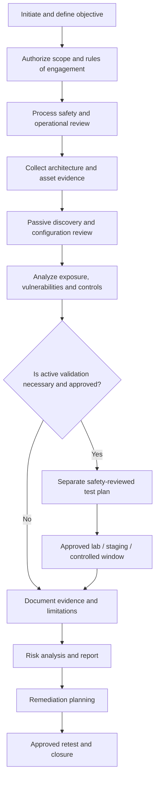
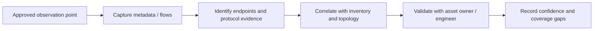
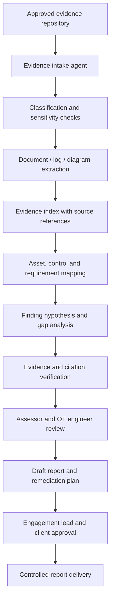

# OT Security Assessment, Audit and Testing Playbook

**Document ID:** UOTS-11-ASSESS | **Version:** 1.0 | **Status:** Engineering reference

**Audience:** OT security assessors, ICS engineers, internal audit, OT SOC, control system owners, system integrators, OEMs, risk managers and assurance teams.

> **Safety boundary:** This playbook is for authorized defensive assessment. It is not permission to scan, exploit, fuzz, write to industrial protocols, modify controller logic, alter protection settings, reboot devices, isolate networks or interrupt production. Written authorization is necessary but not sufficient. Each activity also requires technical safety review, asset-owner and operations approval, vendor compatibility review where applicable, and compliance with site procedures. Prefer document review, passive observation and isolated replicas. Stop work if process behavior, communications, safety, availability or device health changes unexpectedly.

---

# 1. Purpose and assessment outcomes

An OT security assessment evaluates whether industrial systems are appropriately protected while preserving safe, reliable and predictable operation.

A professional assessment must establish:
- What assets and processes are in scope.
- Which systems and dependencies support safe operation.
- How zones, conduits and trust boundaries are implemented.
- Whether access and configuration controls match the risk.
- Whether vulnerabilities are applicable to deployed products and versions.
- Whether monitoring, response and recovery capabilities are effective.
- Which findings are supported by evidence.
- Which remediation actions are safe, feasible and owned.

An assessment is not a checklist-only exercise and is not measured by the number of vulnerabilities found. It should produce an accurate view of exposure, operational consequence, control effectiveness and residual risk.

## 1.1 Assessment principles

1. Safety and process continuity take precedence over test coverage.
2. Scope, rules of engagement and stop-work criteria are explicit.
3. Passive and non-disruptive evidence collection is preferred.
4. Product-specific vendor guidance takes precedence over generic assumptions.
5. Findings distinguish observed fact, source fact, analysis and recommendation.
6. Technical severity is not the same as process risk.
7. No control is declared effective without appropriate evidence.
8. Unknowns and coverage limitations are reported honestly.
9. Every finding has an accountable owner and actionable treatment.
10. AI-assisted analysis remains human-reviewed and traceable.

## 1.2 Assessment lifecycle

---

# 2. Assessment types and boundaries

Choose the assessment type based on the decision the client needs to make. Do not call every review a penetration test.

| Assessment type | Primary purpose | Typical evidence | Typical boundary |
|---|---|---|---|
| Governance and compliance review | Assess policies, roles, risk and control evidence | Policies, registers, approvals, audit records | Documentary and interview-based |
| Architecture assessment | Evaluate trust boundaries and communication design | Drawings, flows, firewall rules, interviews | Usually non-intrusive |
| Configuration assessment | Review approved configuration against baselines | Exports, screenshots, configuration records | Read-only evidence |
| Passive network assessment | Observe assets, protocols and communication patterns | SPAN/TAP captures, sensor output, flow records | Passive collection |
| Vulnerability assessment | Identify applicable weaknesses and exposure | Version evidence, advisories, safe assessment records | Passive-first; active checks separately approved |
| Product security assessment | Review product development and product controls | SDLC, threat models, SAST/SCA, test evidence, PSIRT | Lab and development environments |
| Controlled penetration test | Validate a specific attack path in an approved environment | Reproducible test evidence | Prefer isolated replica or staging |
| Tabletop exercise | Evaluate decision-making and response readiness | Inject timeline, decisions, action logs | No production changes |
| Recovery exercise | Validate restore and return-to-service capability | Restore logs, validation and sign-off | Approved test environment or planned exercise |
| Supplier assessment | Evaluate OEM, integrator and service-provider controls | Contracts, remote access, lifecycle, evidence | Documentary and controlled technical review |

## 2.1 Assessment language

Use precise descriptions:
- **Review:** Examination of documents, settings or evidence.
- **Observation:** Data collected without intentionally changing system state.
- **Validation:** Confirmation of a specific claim or control using an approved method.
- **Active test:** A test that sends traffic or interacts with a target.
- **Exploit demonstration:** Controlled proof that a vulnerability can be exercised; requires exceptional approval and a safe environment.
- **Penetration test:** A scoped, authorized simulation of attack paths with explicit constraints.

A vulnerability scanner result alone does not constitute a penetration test.

---

# 3. Pre-engagement, authorization and scope

## 3.1 Required authorization record

Before work begins, obtain:
- Legal entity and authorized sponsor.
- Site, facility, process unit and location.
- Asset owner and responsible engineering authority.
- Operations contact and emergency contact.
- Safety and functional safety contacts as applicable.
- Written authorization and contract/SOW reference.
- Exact target list and exclusions.
- Assessment type and allowed techniques.
- Test dates, time zone and maintenance windows.
- Approved source systems and collection points.
- Data handling, retention and transfer rules.
- Third-party and vendor permissions.
- Escalation path and stop-work authority.
- Reporting recipients and disclosure constraints.

Authorization must come from someone with authority over the assets and activity. A client contact's verbal request does not automatically authorize testing of supplier-managed or third-party infrastructure.

## 3.2 Scope register

| Field | Example / required content |
|---|---|
| Scope ID | Unique engagement reference |
| Site | Named plant or facility |
| Process area | Unit, line, substation, station or utility |
| Asset ID | CMDB or site tag |
| Vendor/product | Exact product and model if known |
| Version | Firmware/software/build evidence |
| Owner | Accountable asset owner |
| Address/interface | Approved identifiers |
| Assessment method | Documentary, passive, configuration review, active |
| Allowed window | Approved local date/time |
| Exclusions | Explicit prohibited assets and paths |
| Dependencies | Upstream/downstream systems |
| Approval reference | Signed scope and authorization |
| Status | In scope, excluded, pending validation |

## 3.3 Rules of engagement

Specify:
- Allowed and prohibited methods.
- Approved test source addresses and collection points.
- Rate and traffic constraints if active testing is approved.
- No-go systems and safety boundaries.
- No exploitation or destructive proof by default.
- No controller writes, logic downloads or protection-setting changes.
- No reboot, reset, isolation or service disruption.
- No credential spraying or uncontrolled authentication testing.
- No social engineering unless separately authorized.
- No persistence, malware deployment or data exfiltration.
- Data minimization and evidence protection.
- Incident escalation and stop-work conditions.
- Test cleanup and post-assessment validation.

## 3.4 Stop-work triggers

Stop the activity and notify the designated site contact if:
- Unexpected process alarms or operating anomalies occur.
- Communications become unstable or devices show abnormal load.
- Safety, protection or emergency systems behave unexpectedly.
- A production owner requests suspension.
- Scope or authorization is uncertain.
- A test reaches an excluded asset.
- Sensitive operational data is exposed unexpectedly.
- A test could exceed its approved method or time window.

Do not independently restart, isolate or change a production asset to resolve a test-related issue. Follow site emergency and incident procedures.

---

# 4. Safety and process context review

## 4.1 Process understanding

Before technical assessment, understand:
- Process purpose and operating modes.
- Critical control loops and dependencies.
- Safety instrumented functions and independent protection layers.
- Emergency shutdown and protection arrangements.
- Manual and degraded operating modes.
- Environmental and product-quality consequences.
- Maintenance windows and operational constraints.
- Recovery and return-to-service authority.

## 4.2 Process consequence analysis

For each important asset or finding, consider:
- Loss of view: operators cannot observe process state.
- Loss of control: authorized commands cannot be issued.
- Manipulation: process values, setpoints or commands may be altered.
- Loss of protection: safety or protective function may be impaired.
- Loss of historian or records: visibility and investigation are affected.
- Loss of remote operations: site must operate locally or in degraded mode.
- Loss of availability: production, essential service or facility function is interrupted.
- Loss of integrity: recipes, logic, settings or engineering projects are changed.

Do not assume a cyber weakness directly causes a physical consequence. Document the attack path, prerequisites, safeguards and uncertainty.

## 4.3 Safety review questions

- Could the proposed method affect deterministic timing?
- Could it create unexpected network load?
- Does the device have vendor restrictions on discovery or scanning?
- Is redundancy available and how does failover behave?
- Could authentication or endpoint controls block operator access?
- Are independent protection functions outside the test boundary?
- Is a safe fallback and stop-work contact available?
- Does the method require process isolation or a shutdown?

---

# 5. Evidence collection and chain of custody

## 5.1 Evidence categories

- Approved architecture drawings and network diagrams.
- Asset register and product/version records.
- Firewall and routing configuration exports.
- Identity and access review records.
- Remote access approvals and session logs.
- Vendor security advisories and product manuals.
- Passive network observations.
- Approved configuration snapshots.
- Security monitoring alerts and event records.
- Patch, backup and change management records.
- Interviews and process owner confirmations.
- Test records from approved lab or staging environments.

## 5.2 Evidence register

| Field | Required content |
|---|---|
| Evidence ID | Unique identifier |
| Finding / control | Related issue or control |
| Source | System, document, interview or sensor |
| Collector | Authorized assessor |
| Date/time | Include timezone |
| Method | Passive, documentary, export, approved test |
| Asset / scope | Relevant system |
| Original location | Controlled repository reference |
| Integrity | Hash or approved integrity method where appropriate |
| Sensitivity | Classification and handling |
| Limitations | Coverage, freshness, confidence |
| Reviewer | Validation and review record |

## 5.3 Evidence handling

- Collect only what is necessary.
- Avoid capturing credentials, personal data or sensitive process details unless required and authorized.
- Store evidence in approved encrypted repositories.
- Restrict access to named engagement personnel.
- Preserve originals and record transformations.
- Use hashes where appropriate to support integrity.
- Redact sensitive details in client-facing or public examples.
- Follow retention, deletion and legal hold requirements.
- Do not upload confidential plant diagrams or raw OT data to unapproved AI services.

## 5.4 Interview evidence

Record role, date, subject, question and whether the statement is corroborated. Treat interview statements as evidence leads until confirmed by records or technical observation.

---

# 6. Asset inventory and passive discovery

## 6.1 Asset inventory review

Check completeness and quality for:
- PLC/PAC, RTU, DCS, SCADA, HMI, SIS and IED.
- Industrial switches, routers, firewalls and wireless.
- Engineering workstations and servers.
- Historians, MES and integration services.
- IIoT gateways, edge devices and cloud connectors.
- Building management and facility control.
- Virtualization, storage, identity and time services.
- Remote access and supplier-managed equipment.

## 6.2 Inventory quality dimensions

- Unique identity and site location.
- Vendor, exact model and hardware revision.
- Firmware/software version.
- Owner and support contact.
- Process function and criticality.
- Network interfaces and observed communications.
- Zone and conduit mapping.
- Lifecycle and support status.
- Backup and recovery status.
- Last verified date and confidence.

## 6.3 Passive discovery methods

Use approved sources:
- Existing asset registers and CMDB.
- Switch MAC address tables and network management records.
- Firewall flow and connection logs.
- Passive network monitoring sensors.
- SPAN/TAP packet capture under approved design.
- Engineering workstation records.
- Vendor management platforms.
- Procurement and maintenance records.
- Configuration exports.

Passive visibility is limited by sensor placement, encrypted traffic, quiet assets, sampling and network architecture. A device not observed is not necessarily absent.

## 6.4 Passive observation workflow

## 6.5 Asset confidence

Use a transparent scale:
- **Confirmed:** Product identity supported by authoritative inventory or validated engineering record.
- **High confidence:** Multiple independent indicators support the identity.
- **Medium confidence:** Partial indicators, such as protocol behavior and network records.
- **Low confidence:** Address, hostname or banner only.
- **Unknown:** Insufficient evidence.

Do not claim exact controller model or firmware from a single network banner unless the vendor method supports that conclusion.

---

# 7. Architecture, network and segmentation assessment

Review:
- Current as-built diagrams versus actual environment.
- Zones, conduits and trust boundaries.
- Enterprise-to-OT and OT-to-external paths.
- Industrial DMZ architecture.
- Remote access and supplier paths.
- Firewall rules, ownership and expiry.
- Routing, VLAN and management plane separation.
- Wireless, cellular and IIoT paths.
- Redundancy and failover.
- Monitoring coverage and blind spots.

## 7.1 Architecture review test questions

| Review question | Evidence |
|---|---|
| Are all critical zones defined? | Zone register and architecture |
| Are conduits justified and owned? | Communication matrix and firewall records |
| Is enterprise access brokered? | Network path and gateway design |
| Are direct external routes controlled? | Routing/firewall evidence |
| Are vendor paths time-bound? | Remote access records |
| Are safety and control boundaries explicit? | Safety architecture and engineering review |
| Are temporary rules expired? | Firewall recertification |
| Is monitoring present at key boundaries? | Sensor map and SOC coverage |
| Are failure modes understood? | Design and test records |

## 7.2 Firewall review

For each rule, examine:
- Source and destination specificity.
- Protocol and service necessity.
- Direction and session initiation.
- Business/process justification.
- Owner and approver.
- Logging and inspection.
- Any-to-any or broad address use.
- Temporary rule expiry.
- Shadowing, duplication and stale entries.
- Vendor and process dependencies.

Do not change firewall rules as part of an assessment unless separately approved as an implementation activity.

---

# 8. Identity, privileged access and remote access assessment

## 8.1 Identity review dimensions

- Account inventory and ownership.
- Named versus shared accounts.
- Role-based access and least privilege.
- Privileged account separation.
- Authentication strength and supported MFA.
- Local and domain identity dependencies.
- Service account lifecycle.
- Dormant and orphaned accounts.
- Joiner, mover and leaver process.
- Emergency access.
- Access recertification and audit trail.

## 8.2 Remote access review

Assess:
- Approved entry point and architecture.
- Supplier identity and named accounts.
- Strong authentication.
- Device and session controls.
- Ticket and owner approval.
- Time-bound access.
- Target-specific authorization.
- Session monitoring and recording.
- File transfer restrictions.
- Emergency access.
- Revocation and post-session review.

## 8.3 Safe validation boundary

Do not perform password spraying, brute force, lockout testing, MFA fatigue or credential replay against production OT. Validate account controls using policy review, approved identity reports, test accounts and isolated replicas. Any live authentication test needs separate explicit authorization and lockout/availability safeguards.

---

# 9. Secure configuration and endpoint assessment

Review product-specific approved baselines for:
- Windows and Linux OT servers.
- HMI and operator stations.
- Engineering workstations.
- Historians and application servers.
- Industrial network devices.
- PLC, RTU, DCS and IED configuration where vendor-supported.
- IIoT and edge systems.

## 9.1 Configuration review areas

- Supported software and firmware.
- Unnecessary services and applications.
- Local administrator and privileged groups.
- Authentication and session controls.
- Host firewall.
- Application allowlisting.
- Endpoint security compatibility.
- Logging and time synchronization.
- Removable media.
- Remote administration.
- Backup and recovery.
- Secure configuration and change tracking.

## 9.2 Endpoint protection assessment

Confirm:
- Vendor compatibility and approved policy.
- Deployment scope and exclusions.
- Update mechanism and offline behavior.
- Resource overhead and performance monitoring.
- Alert forwarding and sensor health.
- Quarantine and remediation behavior.
- Recovery and rollback.
- Ownership and exception review.

A missing agent is not automatically a finding if the platform is unsupported or protected by a documented alternative. Assess the actual risk and compensating controls.

---

# 10. Vulnerability and exposure assessment

## 10.1 Applicability validation

For each advisory:
1. Identify exact vendor and product.
2. Confirm model and hardware revision.
3. Confirm firmware/software version and build.
4. Identify affected component and configuration.
5. Compare vendor affected and fixed ranges.
6. Review prerequisites and attack vector.
7. Determine network reachability and trust path.
8. Check KEV and exploitation evidence.
9. Review vendor mitigation and operational warnings.
10. Record confirmed, potential, not affected or unknown.

## 10.2 Sources and enrichment

Use:
- Vendor PSIRT and official product advisories.
- CISA ICS advisories and KEV.
- CVE Program and NVD.
- FIRST CVSS and EPSS.
- National CERT and sector CERT.
- Vendor lifecycle and release documentation.

CVSS, EPSS and KEV answer different questions. None alone establishes site-specific OT risk.

## 10.3 Safe assessment methods

Prefer:
- Version and configuration review.
- Vendor advisory matching.
- Passive service and protocol observation.
- Approved authenticated configuration reports.
- Offline software composition analysis.
- Isolated lab reproduction.

Active vulnerability scanning of production OT requires a separate documented method, vendor review, process-owner approval and safety validation. Some devices and protocols can be disrupted by ordinary discovery traffic.

---

# 11. Industrial protocol assessment

Assess protocol use and architecture rather than assuming a protocol is vulnerable because it lacks a feature in one implementation.

Review:
- Protocol purpose and process function.
- Initiators, responders and legitimate peers.
- Required function codes, services or operations.
- Authentication and encryption capability.
- Write and configuration operations.
- Broadcast, multicast and discovery behavior.
- Vendor-specific extensions.
- Gateway and protocol converter exposure.
- Monitoring and anomaly visibility.
- Secure alternatives and migration constraints.

Relevant families may include Modbus, DNP3, OPC UA, EtherNet/IP, PROFINET, IEC 60870-5-104, IEC 61850, BACnet and vendor-specific protocols.

Do not send write commands, control operations, malformed packets or fuzzing traffic to live controllers as part of routine assessment. Use vendor simulators, protocol test benches or isolated replicas.

---

# 12. PLC, DCS, SCADA, HMI, SIS and IED assessment

## 12.1 PLC/PAC and RTU

Review:
- Model and firmware inventory.
- Engineering access paths.
- Program and configuration backup.
- Change authorization and audit.
- Authentication and privilege.
- Unused interfaces and services.
- Vendor security advisories.
- Physical and remote maintenance access.
- Recovery and replacement arrangements.

## 12.2 DCS and SCADA

Review:
- Server and workstation architecture.
- Application and database dependencies.
- Redundancy and failover.
- Operator and engineering roles.
- Historian and enterprise integration.
- Remote access and vendor support.
- Backup and recovery.
- Patch and product lifecycle.
- Security logging and monitoring.

## 12.3 HMI and engineering workstation

Review:
- Dedicated purpose and user roles.
- Software installation controls.
- Browsing and email restrictions where appropriate.
- Project file protection.
- Removable media controls.
- Endpoint security compatibility.
- Remote support.
- Approved configuration baseline.
- System image and project recovery.

## 12.4 SIS and protection systems

Assessment must be coordinated with the responsible functional safety and protection authority.

Review documentary and vendor-approved evidence for:
- Safety lifecycle and ownership.
- Separation and independence assumptions.
- Engineering access.
- Change authorization.
- Version and configuration management.
- Proof-test and maintenance governance.
- Vendor advisories.
- Backup and restoration.
- Interfaces to basic process control systems.

Do not actively test trip behavior, safety logic, protection settings or safety communications as part of a general cybersecurity assessment.

## 12.5 IED and substation systems

Review:
- Asset and firmware baseline.
- Engineering tool and settings access.
- Time synchronization.
- Substation network architecture.
- Protection setting governance.
- Remote maintenance and supplier access.
- Approved configuration backups.
- Vendor advisories and lifecycle.

---

# 13. Wireless, IIoT, cloud and supplier assessment

## 13.1 Wireless and remote sites

Review:
- Device identity and authentication.
- Encryption and key management.
- Coverage and physical access.
- Rogue device detection.
- Cellular/APN and carrier dependencies.
- Segmentation from control networks.
- Loss-of-link behavior.
- Remote management and monitoring.

## 13.2 IIoT and edge

Review:
- Secure onboarding.
- Unique device identity.
- Firmware and update provenance.
- API authorization and secrets.
- Cloud dependency and egress.
- Local autonomy and buffering.
- Device lifecycle and decommissioning.

## 13.3 Cloud integration

Review:
- Data flow and purpose.
- Tenant and service identity.
- API access and token lifecycle.
- Connectivity and egress control.
- Data residency and contractual requirements.
- Supplier shared responsibility.
- Logging and incident response.
- Local process behavior during cloud outage.

## 13.4 Supplier and OEM

Review:
- Security development lifecycle.
- PSIRT and disclosure process.
- Security advisory notification.
- Supported product lifecycle.
- Remote access controls.
- SBOM and component transparency.
- Patch and mitigation commitments.
- Incident notification.
- Subcontractor access.
- Secure decommissioning.

---

# 14. Monitoring, detection and incident response assessment

Assess whether the organization can detect and respond to relevant OT security events.

Review:
- Passive network monitoring coverage.
- Sensor placement and blind spots.
- Asset and protocol context.
- Authentication and privileged access logs.
- Remote access session records.
- Engineering change visibility.
- Controller and configuration change monitoring where supported.
- Firewall and endpoint telemetry.
- Time synchronization.
- Alert triage and escalation.
- OT incident response playbooks.
- Coordination with operations and safety.
- Evidence preservation and recovery.

## 14.1 Detection validation

Use approved tabletop scenarios, synthetic logs, replay in a lab or vendor-supported test events. Do not create disruptive activity on production networks merely to prove an alert works.

---

# 15. Backup, resilience and recovery assessment

Review:
- Scope of controller logic, HMI projects, configurations and server data.
- Backup frequency and ownership.
- Offline or immutable copies.
- Credential and key protection.
- Integrity and completeness checks.
- Restore testing and results.
- Recovery sequence and dependencies.
- RTO/RPO assumptions and business approval.
- Trusted baseline and golden images.
- Vendor support and replacement availability.
- Return-to-service validation and authorization.

A successful backup job is not proof of recoverability. Evidence must include restore testing and process-owner acceptance.

---

# 16. Standards and regulatory mapping

## 16.1 Mapping discipline

Map each assessment observation to the exact relevant requirement or control identifier. Record:
- Framework and edition.
- Clause/control identifier.
- Original control intent.
- Assessment observation.
- Evidence.
- Relationship: direct, partial, supporting or no demonstrated relationship.
- Applicability and scope.
- Confidence and reviewer notes.
- Gap and recommended action.

A mapping is an analytical cross-reference, not proof of compliance or certification.

## 16.2 Relevant references

| Reference | Assessment relevance |
|---|---|
| ISA/IEC 62443-2-1 | Asset owner security program |
| ISA/IEC 62443-2-4 | IACS service provider requirements |
| ISA/IEC 62443-3-2 | Risk assessment and system design |
| ISA/IEC 62443-3-3 | System security requirements |
| ISA/IEC 62443-4-1 | Secure product development |
| ISA/IEC 62443-4-2 | Component security requirements |
| NIST SP 800-82 Rev. 3 | OT security assessment and control context |
| NIST CSF 2.0 | Cybersecurity outcomes and governance |
| ISO/IEC 27001 | ISMS requirements |
| ISO/IEC 27002 | Security control guidance |
| ISO 19011 | Management system auditing guidance |
| MITRE ATT&CK for ICS | Adversary behavior and technique context |
| CISA CPGs | Cross-sector cybersecurity performance goals, where applicable |

Official starting points:
- ISA/IEC 62443: https://www.isa.org/standards-and-publications/isa-standards/isa-iec-62443-series-of-standards
- NIST SP 800-82 Rev. 3: https://csrc.nist.gov/pubs/sp/800/82/r3/final
- NIST CSF: https://www.nist.gov/cyberframework
- ISO 19011: https://www.iso.org/standard/70017.html
- MITRE ATT&CK for ICS: https://attack.mitre.org/matrices/ics/
- CISA Cross-Sector Cybersecurity Performance Goals: https://www.cisa.gov/cross-sector-cybersecurity-performance-goals

For jurisdiction-specific requirements, consult the global regulatory mapping chapter and verify each obligation against the current official instrument and applicability criteria. Do not assume a single GCC or Middle East rule applies uniformly across Saudi Arabia, UAE, Qatar, Bahrain, Kuwait and Oman.

---

# 17. Risk rating and finding prioritization

## 17.1 Required dimensions

- Technical severity and exploit prerequisites.
- Product/version applicability.
- Exposure and reachability.
- Exploitation evidence.
- Process consequence.
- Safety and environmental impact.
- Essential service and public impact.
- Existing safeguards.
- Recovery complexity.
- Operational feasibility of remediation.

## 17.2 Finding classification

| Rating | Meaning | Assessment handling |
|---|---|---|
| Critical | Credible exposure with severe process, safety or essential-service consequence | Immediate escalation and coordinated risk treatment |
| High | Significant weakness with plausible attack path or major operational consequence | Prioritized remediation plan and accountable owner |
| Medium | Meaningful weakness with constrained exposure or mitigations | Planned remediation and monitoring |
| Low | Limited impact or strong existing safeguards | Track and review |
| Informational | Improvement opportunity or observation without demonstrated vulnerability | Record context and recommendation |

These are illustrative categories. Use the client's approved risk methodology and do not invent universal remediation deadlines.

## 17.3 Finding structure

Every finding should contain:
- Finding ID and title.
- Severity and rationale.
- Affected asset(s) and location.
- Observation and evidence.
- Technical explanation.
- Attack prerequisites and reachability.
- Process and business consequence.
- Existing controls and limitations.
- Recommendation and alternatives.
- Owner and target date.
- Standards mapping and confidence.
- Retest method and closure criteria.

## 17.4 Evidence strength

Distinguish:
- Directly observed.
- Confirmed by authoritative configuration or vendor record.
- Corroborated by multiple sources.
- Reported by interviewee.
- Inferred from architecture.
- Not verified.

Do not present an inference as a confirmed compromise or exploitable condition.

---

# 18. Reporting and client deliverables

## 18.1 Executive report

Include:
1. Assessment objective and scope.
2. Sites, process areas and asset coverage.
3. Assessment methods and safety restrictions.
4. Executive risk summary.
5. Material themes and systemic gaps.
6. Business and process consequences.
7. Priority recommendations.
8. Coverage limitations and exclusions.
9. Management decisions required.

Use clear language. Explain why a finding matters to the plant, service or business.

## 18.2 Technical report

Include:
- Detailed scope and asset references.
- Method and evidence.
- Finding reproduction or validation steps appropriate to the approved method.
- Technical impact and prerequisites.
- Process consequence.
- Existing safeguards.
- Remediation options and constraints.
- Vendor references.
- Standards mapping.
- Retest and closure criteria.

Do not publish sensitive network paths, credentials, controller addresses or exploitable details beyond the authorized recipients and agreed handling classification.

## 18.3 Assessment coverage report

| Domain | Planned | Reviewed | Evidence | Limitation |
|---|---|---|---|---|
| Asset inventory | Yes/No | Complete/Partial/Not reviewed | Evidence IDs | Coverage gaps |
| Architecture | Yes/No | Complete/Partial/Not reviewed | Evidence IDs | Outdated diagrams |
| Identity and access | Yes/No | Complete/Partial/Not reviewed | Evidence IDs | Restricted records |
| Vulnerability management | Yes/No | Complete/Partial/Not reviewed | Evidence IDs | Version uncertainty |
| Monitoring | Yes/No | Complete/Partial/Not reviewed | Evidence IDs | Sensor visibility |
| Recovery | Yes/No | Complete/Partial/Not reviewed | Evidence IDs | Restore not tested |

---

# 19. Retesting and closure

Retesting must use a method approved for the target and process.

Closure evidence may include:
- Updated firmware/software version.
- Approved configuration snapshot.
- Firewall rule correction.
- Account removal or privilege adjustment.
- Remote access control evidence.
- Vendor mitigation confirmation.
- Successful restore or validation record.
- Monitoring evidence.
- Owner acceptance of residual risk.

Classify results:
- **Closed:** Evidence demonstrates the finding is remediated.
- **Partially remediated:** Some risk remains.
- **Not remediated:** Original condition remains.
- **Risk accepted:** Authorized owner accepts documented residual risk until expiry/review.
- **Unable to verify:** Insufficient approved evidence.

A ticket marked complete is not proof that a security weakness is fixed.

---

# 20. Practical assessment scenarios and labs

All hands-on work must use synthetic data, vendor simulators, isolated replicas or explicitly approved non-production assets.

| Lab | Scenario | Objective | Deliverable |
|---|---|---|---|
| 01 | Scope and rules of engagement | Build authorization and exclusion register | Signed-style ROE exercise |
| 02 | Asset inventory reconciliation | Compare CMDB, network records and engineering list | Confidence-rated asset register |
| 03 | Passive PCAP review | Identify endpoints and protocol metadata from synthetic capture | Passive discovery report |
| 04 | Purdue and zone review | Identify trust boundaries and undocumented flows | Annotated architecture |
| 05 | Firewall policy review | Identify broad, stale and ownerless rules in sample config | Rule review register |
| 06 | Remote access audit | Evaluate synthetic supplier access records | Access control findings |
| 07 | Windows OT baseline review | Review supplied configuration evidence | Hardening gap report |
| 08 | Vendor advisory matching | Match synthetic asset versions to official advisories | Applicability decisions |
| 09 | Protocol security review | Analyze documented protocol flows and operations | Protocol assessment |
| 10 | Backup and recovery tabletop | Evaluate recovery dependencies and evidence | Recovery gap assessment |
| 11 | Incident detection tabletop | Analyze synthetic alert timeline | Detection and escalation report |
| 12 | IEC 62443 crosswalk | Map observations to supplied control references | Traceable control matrix |
| 13 | Finding writing | Convert observations into evidence-led findings | Technical report |
| 14 | Retest simulation | Assess remediation evidence | Closure decision |
| 15 | AI-assisted report QA | Detect unsupported claims and missing citations | Human-reviewed QA record |

Each lab should include prerequisites, scope, synthetic data, step-by-step procedure, expected observations, evidence requirements, scoring rubric and cleanup.

---

# 21. AI-assisted assessment workflow

AI can support document extraction, evidence indexing, control crosswalk suggestions, advisory matching and report quality review. It must not independently authorize tests, determine safety, declare compliance or change production systems.

## 21.1 Reference agent workflow

## 21.2 Agent roles and controls

| Agent | Permitted role | Prohibited autonomous action |
|---|---|---|
| Scope assistant | Draft scope and evidence checklist | Authorize target testing |
| Evidence extractor | Extract text and metadata from approved files | Upload restricted evidence to unapproved services |
| Asset correlation assistant | Suggest matching records | Declare identity confirmed without evidence |
| Control mapper | Suggest framework crosswalk | Claim compliance or certification |
| Vulnerability assistant | Summarize cited advisories | Treat a CVE match as confirmed without version evidence |
| Finding assistant | Draft finding from evidence | Invent proof or exploitability |
| Report QA agent | Check traceability, consistency and omissions | Approve final report |
| Workflow agent | Create draft tasks | Modify production assets or deploy changes |

## 21.3 AI quality gates

- Every factual claim links to an evidence ID or authoritative source.
- Extracted text is checked against the original document.
- Diagrams and OCR are manually validated where material.
- Confidentiality and data residency requirements are respected.
- Prompt injection in untrusted documents is treated as untrusted content.
- Model output is labeled draft until reviewed.
- Uncertainty and missing evidence are visible.
- Human reviewer and approval are recorded.
- No autonomous active testing or production change.

---

# 22. Roles and responsibilities

| Role | Accountability |
|---|---|
| Engagement lead | Scope, delivery quality, escalation and report approval |
| OT security assessor | Evidence collection and technical analysis |
| Control/automation engineer | Process behavior, asset validation and safe methods |
| Operations representative | Operating constraints and stop-work authority |
| Functional safety authority | Safety impact review where applicable |
| Asset owner | Access, asset scope and remediation ownership |
| OT SOC | Monitoring evidence and response context |
| Vendor/OEM | Product-specific technical guidance |
| Risk owner | Residual risk decision within delegated authority |
| Internal audit/compliance | Independent assurance and evidence review |

No assessor should approve their own production change or accept risk on behalf of the asset owner.

---

# 23. Quality assurance and assessor competency

## 23.1 Engagement quality review

Before report release:
- Scope and exclusions are accurate.
- Every finding has evidence.
- Asset identities and versions are validated or uncertainty stated.
- Risk rationale reflects process context.
- Standards mappings use correct editions and identifiers.
- Recommendations are feasible and vendor-aware.
- Safety restrictions and coverage limitations are disclosed.
- No unsupported compromise or attribution claim exists.
- Sensitive details are appropriately classified.
- Client response and factual review are recorded.

## 23.2 Competency considerations

Assessment teams collectively need:
- OT/ICS architecture and process knowledge.
- Control and automation engineering understanding.
- Industrial networking and protocol knowledge.
- Cybersecurity assessment and evidence skills.
- Functional safety awareness.
- Vendor-specific product knowledge.
- Risk, audit and regulatory mapping competence.
- Incident response and recovery knowledge.

A generic IT penetration testing qualification does not by itself establish competence to test safety-critical industrial systems.

---

# 24. Templates and checklists

## 24.1 Pre-assessment checklist

- [ ] Written authorization received.
- [ ] Exact scope and exclusions approved.
- [ ] Asset owners and engineering authority identified.
- [ ] Operations and safety contacts confirmed.
- [ ] Process context reviewed.
- [ ] Rules of engagement approved.
- [ ] Allowed and prohibited methods documented.
- [ ] Test window and stop-work criteria agreed.
- [ ] Third-party permissions confirmed.
- [ ] Evidence handling and retention agreed.
- [ ] Emergency escalation path tested.
- [ ] Assessor competency and vendor constraints reviewed.

## 24.2 Technical finding template

**Finding ID:**  
**Title:**  
**Severity:**  
**Affected site/process:**  
**Asset ID and product:**  
**Version evidence:**  
**Observation:**  
**Evidence IDs:**  
**Validation method:**  
**Attack prerequisites / exposure:**  
**Process consequence:**  
**Existing safeguards:**  
**Limitations and uncertainty:**  
**Recommendation:**  
**Owner:**  
**Target date:**  
**Standards mapping:**  
**Retest method:**  
**Closure criteria:**

## 24.3 Rules of engagement template

**Engagement ID:**  
**Client / legal entity:**  
**Site and process area:**  
**Authorized sponsor:**  
**Asset owner:**  
**Engineering authority:**  
**Operations contact:**  
**Safety contact:**  
**Assessment dates and timezone:**  
**In-scope assets:**  
**Excluded assets:**  
**Approved methods:**  
**Prohibited methods:**  
**Test source and collection points:**  
**Maintenance windows:**  
**Stop-work triggers:**  
**Escalation contacts:**  
**Evidence handling:**  
**Third-party approvals:**  
**Signatures / approval references:**

## 24.4 Executive risk summary template

| Theme | Observation | Process/business consequence | Priority | Decision required |
|---|---|---|---|---|
| Architecture | | | | |
| Identity and remote access | | | | |
| Asset and vulnerability management | | | | |
| Monitoring and response | | | | |
| Recovery and resilience | | | | |
| Governance and supplier assurance | | | | |

---

# 25. Standards, references and source discipline

Use the exact edition and current authoritative source relevant to the engagement.

| Reference | Application |
|---|---|
| ISA/IEC 62443 series | IACS security program, risk assessment, system and component requirements |
| NIST SP 800-82 Rev. 3 | OT security guidance and assessment context |
| NIST CSF 2.0 | Cybersecurity governance and outcomes |
| ISO/IEC 27001 | ISMS requirements and audit evidence |
| ISO/IEC 27002 | Security control guidance |
| ISO 19011 | Auditing management systems |
| MITRE ATT&CK for ICS | Adversary behavior taxonomy |
| CISA ICS advisories | Industrial vulnerability and product security information |
| FIRST CVSS / EPSS | Vulnerability severity and exploitation probability context |
| Vendor PSIRT advisories | Product-specific affected versions and mitigations |

Official sources:
- ISA/IEC 62443: https://www.isa.org/standards-and-publications/isa-standards/isa-iec-62443-series-of-standards
- NIST SP 800-82 Rev. 3: https://csrc.nist.gov/pubs/sp/800/82/r3/final
- NIST CSF: https://www.nist.gov/cyberframework
- ISO 19011: https://www.iso.org/standard/70017.html
- MITRE ATT&CK for ICS: https://attack.mitre.org/matrices/ics/
- CISA ICS Advisories: https://www.cisa.gov/news-events/ics-advisories
- FIRST CVSS: https://www.first.org/cvss/
- FIRST EPSS: https://www.first.org/epss/

Regulatory mappings must be jurisdiction- and sector-specific. Confirm the official instrument, covered entity, effective date, amendments, exemptions and regulator guidance. Do not generalize one GCC country's requirements to another.

---

# 26. Assumptions, limitations and review

This playbook provides a common assessment structure. It does not replace:
- Site-specific authorization and safety procedures.
- Functional safety engineering.
- Vendor-specific testing restrictions.
- Legal and regulatory advice.
- Licensed standards text.
- The client's approved risk methodology.
- Qualified engineering judgment.

Review when standards, vendor guidance, threat conditions, site architecture, regulations or assessment practices change.

## Revision history

| Version | Date | Change | Status |
|---|---|---|---|
| 1.0 | 2026-11-17 | Initial end-to-end OT security assessment, audit, safe testing, evidence, reporting, standards mapping and AI-assisted workflow playbook | Engineering reference |

## Specialist expansion backlog

1. Detailed assessment worksheets by asset family: PLC, RTU, DCS, SCADA, HMI, SIS and IED.
2. Passive network assessment playbooks by protocol and topology.
3. Vendor-specific safe assessment restrictions and compatibility references.
4. OT audit evidence catalogue mapped to IEC 62443 requirements.
5. Sector-specific assessment scenarios for oil and gas, power, water, manufacturing, mining and transport.
6. Tabletop inject packs and synthetic logs/PCAPs.
7. Technical report and executive report examples using sanitized data.
8. OT assessment maturity model and scoring methodology.
9. GCC jurisdiction-specific assessment and audit obligation crosswalks with primary sources.
10. AI assessment evidence schema, traceability and QA test suite.

The existing [OT Security Assessment Methodology](OT-ASSESSMENT-METHODOLOGY.md) remains the concise lifecycle summary. This playbook expands it into a detailed engagement and engineering reference.
