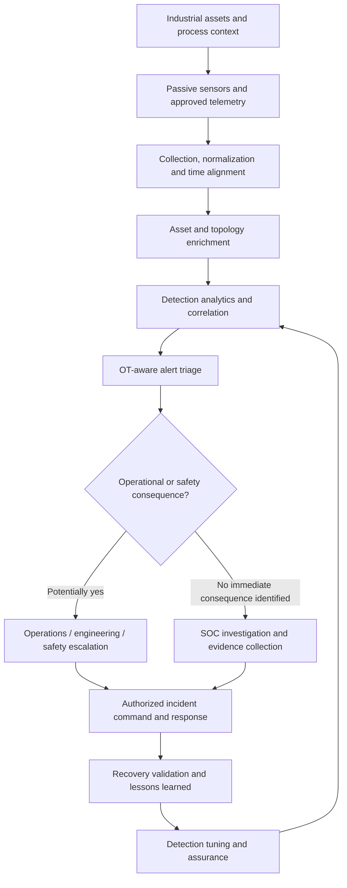
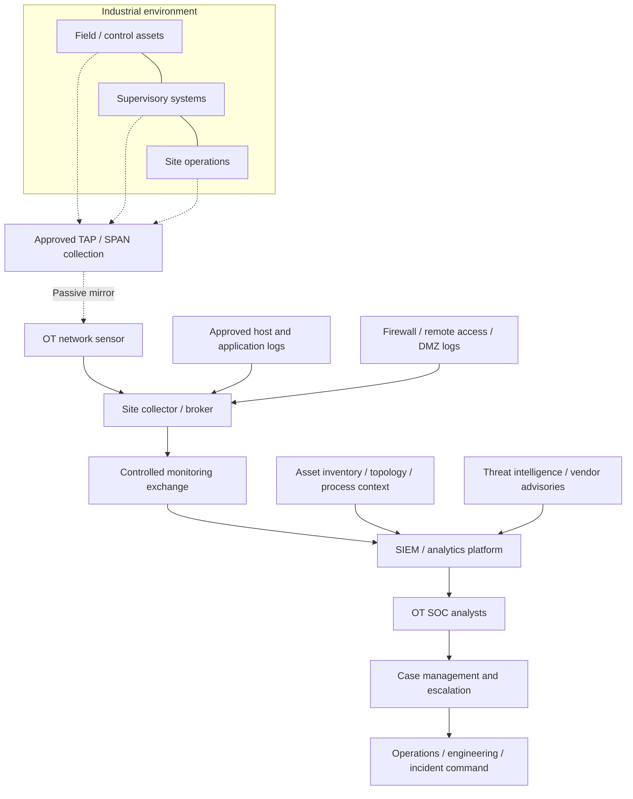
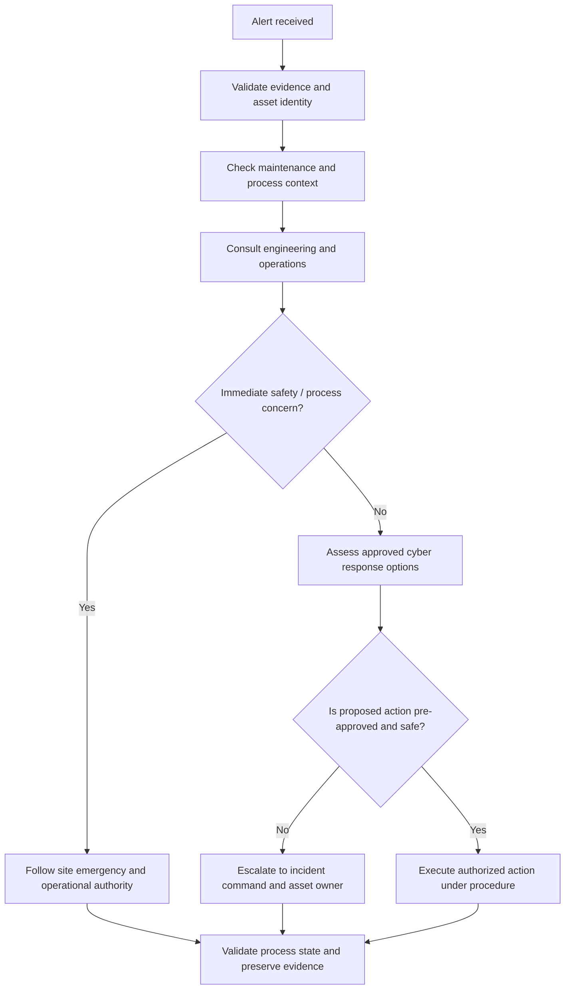
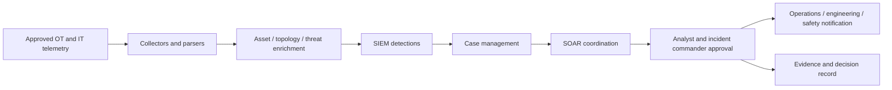
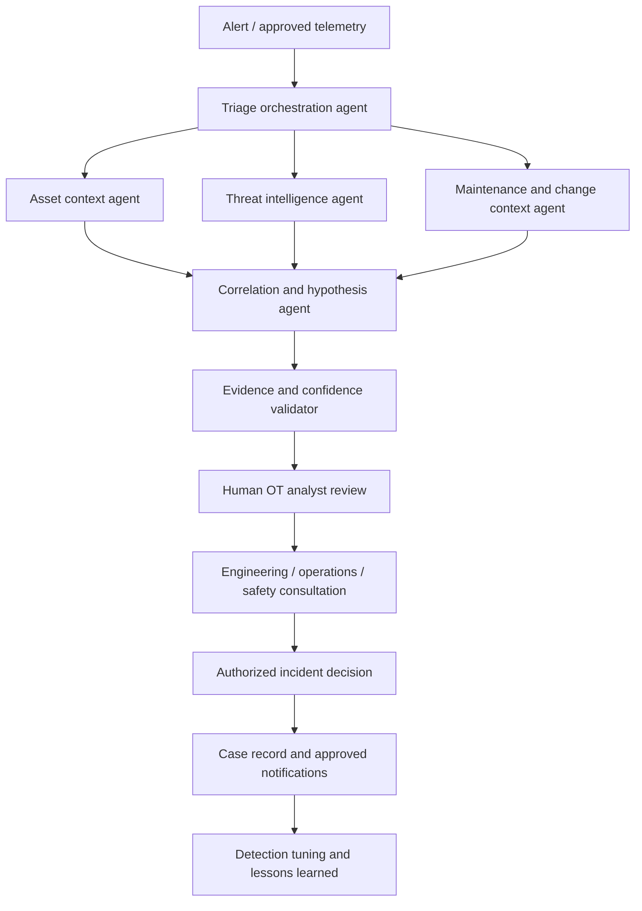

# OT SOC, Industrial Monitoring and Detection Engineering Playbook

**Document ID:** UOTS-12-SOC | **Version:** 1.0 | **Status:** Engineering reference

**Audience:** OT SOC leaders, SOC analysts, detection engineers, OT security architects, control engineers, operations managers, incident responders, system integrators and asset owners.

> **Operational safety:** Monitoring and response must preserve safe process operation and availability. Passive monitoring is preferred. Active discovery, endpoint agent changes, inline inspection, blocking, isolation, reboot, controller interaction and automated response require asset-owner approval, engineering and operations review, applicable safety assessment, management of change and a tested rollback plan. An SOC alert does not authorize an operational action.

---

# 1. Mission, scope and outcomes

An OT Security Operations Center (OT SOC) provides industrial-context security monitoring, detection, analysis, coordination and assurance. It connects cybersecurity observations to asset identity, process function, operational state and consequence.

The mission is to detect malicious, unauthorized, unsafe or anomalous activity while preserving process visibility, availability, engineering safety and essential services.

An OT SOC is not simply an IT SOC with industrial protocol parsers. It requires:
- Knowledge of process operations and control engineering.
- Asset and topology context.
- Awareness of normal engineering and maintenance activity.
- Passive-first telemetry architecture.
- Detection logic that considers industrial protocols and process context.
- Clear decision authority and operational escalation.
- Response procedures that distinguish IT containment from safe OT action.
- Evidence integrity and recovery coordination.

## 1.1 Target outcomes

1. Maintain a trustworthy view of monitored OT assets and critical communications.
2. Detect unauthorized access, configuration changes and anomalous industrial activity.
3. Correlate cyber events with maintenance, process and operational context.
4. Identify monitoring blind spots and telemetry failures.
5. Provide timely, evidence-based triage to engineering and operations.
6. Coordinate incident response without unsafe automatic containment.
7. Measure detection coverage and operational readiness.
8. Improve detections through exercises, incidents and controlled validation.

## 1.2 OT SOC operating loop

---

# 2. OT SOC versus IT SOC

| Dimension | IT SOC emphasis | OT SOC emphasis |
|---|---|---|
| Primary context | Users, endpoints, applications, data | Physical process, controllers, industrial assets and services |
| Availability | Important business service objective | May be essential to safe process operation |
| Telemetry | Endpoint, identity, cloud, network | Passive network, control-system logs, engineering and process context |
| Discovery | Active endpoint and vulnerability tools commonly used | Passive-first; active methods require asset-specific approval |
| Threat interpretation | Data and service impact | Process, safety, environment, production and essential service impact |
| Containment | Isolate host, disable account, block traffic | Must assess process dependencies and safe operating state |
| Change cadence | Frequent in many environments | Vendor, maintenance window and MOC constrained |
| Asset lifecycle | Often shorter and standardized | Long-lived, legacy and vendor-dependent |
| Response authority | IT incident commander and service owner | Operations, engineering, safety and site incident command |
| Success measures | Detection and response performance | Detection quality plus process safety and availability preservation |

IT SOC processes can contribute to OT security, but must be adapted. An endpoint isolation command that is routine in IT can remove an operator's view or disrupt a control dependency in OT.

---

# 3. Operating models and organizational design

## 3.1 Common operating models

**Centralized OT SOC:** A central team monitors multiple sites. Requires reliable site context, local escalation contacts, consistent telemetry and jurisdiction-aware governance.

**Hybrid SOC:** Central analysts work with site-based OT security champions and control engineers. Often balances scale with process knowledge.

**Site-based OT monitoring:** Local team monitors a facility with direct operational context. Requires staffing resilience, specialist skills and escalation arrangements.

**Managed OT security service:** A third party provides monitoring or analysis. The asset owner retains operational authority and must govern data access, remote access, service levels, subcontractors and incident notification.

## 3.2 Roles

| Role | Responsibility |
|---|---|
| OT SOC manager | Service governance, coverage, escalation and performance |
| Tier 1 analyst | Alert validation, context collection and initial triage |
| Tier 2 analyst | Investigation, correlation and evidence development |
| OT detection engineer | Detection logic, testing, tuning and coverage |
| OT security architect | Monitoring architecture, trust boundaries and platform design |
| Control/automation engineer | Process and device interpretation |
| Operations representative | Operating context and safe response authority |
| Incident commander | Coordinates incident decisions under site governance |
| Threat intelligence analyst | Industrial threat and advisory context |
| Platform engineer | Sensor, collector, SIEM and pipeline reliability |
| Risk/compliance owner | Assurance, evidence and regulatory obligations |

## 3.3 RACI example

| Activity | SOC | OT engineering | Operations | Safety authority | Asset owner |
|---|---|---|---|---|---|
| Alert triage | R | C | C | I | I |
| Process impact assessment | C | R | A/R | C | I |
| Passive sensor design | R | C | C | I | A |
| Active test approval | C | R | A | C/A as applicable | A |
| Production containment | C | R | A/R | C/A as applicable | I |
| Detection tuning | R | C | C | I | A |
| Recovery acceptance | C | R | A/R | C/A as applicable | I |

R = Responsible, A = Accountable, C = Consulted, I = Informed. Actual authority must be set by the site's governance and emergency plans.

---

# 4. Monitoring architecture and trust boundaries

## 4.1 Reference architecture

This is a conceptual pattern. The actual architecture must respect site zones, conduit requirements, data classification, vendor support and failure modes. Monitoring must not introduce an uncontrolled route into the control network.

## 4.2 Architecture principles

- Prefer passive collection from engineered TAP or SPAN points.
- Avoid inline placement unless the risk and failure behavior are fully assessed.
- Keep monitoring management interfaces separate from observed traffic paths.
- Minimize outbound flows from OT and use controlled brokers.
- Protect sensor administration and update channels.
- Document packet loss, sampling, asymmetric visibility and encrypted traffic.
- Define behavior when collectors, SIEM or WAN connectivity fail.
- Avoid making process operation dependent on cloud analytics.
- Maintain local monitoring capability appropriate to site risk.
- Ensure time synchronization and asset context are available.

## 4.3 Collection point design

For every collection point, document:
- Site and network zone.
- Switch, TAP or packet broker identity.
- Source interfaces and direction.
- VLAN and link aggregation behavior.
- Expected bandwidth and peak utilization.
- Mirroring limitations and oversubscription risk.
- Packet truncation, sampling or filtering.
- Redundant path visibility.
- Sensor capacity and supported protocols.
- Maintenance and change process.
- Owner and health monitoring.

A SPAN port can drop mirrored packets under congestion. Absence of observed traffic is not proof that communication did not occur.

---

# 5. Telemetry sources and coverage

## 5.1 Network telemetry

- Passive packet metadata and protocol transactions.
- Network flow records where available.
- Firewall allow/deny and policy change logs.
- Router and switch configuration and administrative events.
- Industrial DMZ and remote access gateway logs.
- VPN and jump-host sessions.
- Wireless controller and cellular gateway events.
- Network sensor health, packet drops and configuration changes.

## 5.2 Host and application telemetry

Where supported and approved:
- Windows and Linux security events.
- Engineering workstation logons and process execution.
- Application and database audit events.
- HMI, SCADA, DCS and historian application logs.
- Endpoint protection and application control alerts.
- File integrity and configuration change records.
- Privileged access management events.
- Backup and restore logs.
- Virtualization and infrastructure events.

Do not install agents or enable verbose auditing on fragile systems without vendor and operations validation.

## 5.3 Industrial and engineering telemetry

- PLC project download and logic change records where available.
- Controller mode and diagnostic events.
- IED setting or firmware change records.
- Engineering software activity.
- Alarm and event system records.
- Process historian events where authorized.
- Maintenance and work-order records.
- Physical access and removable media records.
- Safety system access or diagnostic events through approved interfaces.

## 5.4 Telemetry source register

| Field | Description |
|---|---|
| Source ID | Unique identifier |
| Site / zone | Physical and logical location |
| System / device | Exact product and identity |
| Data type | Packet, flow, event, audit, host, process |
| Collection method | TAP, SPAN, syslog, API, agent, export |
| Owner | Accountable technical owner |
| Destination | Collector and approved data path |
| Frequency / latency | Expected event delivery |
| Time source | Clock and timezone behavior |
| Coverage | Assets, interfaces and event classes |
| Sensitivity | Classification and retention |
| Health check | Method and alert threshold |
| Limitations | Drops, sampling, unsupported logs |
| Approval | Change and data access record |

---

# 6. Asset, topology and process context

Detection without asset context creates noisy and potentially unsafe decisions.

Enrich events with:
- Unique asset ID and hostname.
- Vendor, model and firmware/software version.
- Site, process unit and physical location.
- Asset owner and support contact.
- Purdue reference level where useful.
- Zone and conduit membership.
- Criticality and process consequence.
- Expected peers and communication profile.
- Maintenance windows and approved changes.
- Vendor support status.
- Safety relevance and response restrictions.
- Last inventory verification date and confidence.

## 6.1 Context data quality

Track missing, stale and conflicting asset data. An IP address may be reassigned; MAC addresses can be virtualized or spoofed; hostnames can be duplicated. Correlate multiple sources and retain confidence.

## 6.2 Process-aware baseline

Build baselines by:
- Asset role and process function.
- Operating mode and shift.
- Maintenance and engineering windows.
- Production campaign or seasonal behavior.
- Redundant and failover paths.
- Approved vendor support sessions.
- Startup, shutdown and commissioning activity.

A single static baseline can incorrectly flag legitimate operating-mode changes or miss low-and-slow misuse.

---

# 7. Time synchronization and event integrity

Accurate time is essential for correlation across sensors, servers, controllers and enterprise services.

Review:
- Approved site time architecture.
- NTP/PTP sources and boundaries.
- Device timezone and timestamp format.
- Clock drift and offset monitoring.
- Collector receipt time versus event time.
- Buffering and delayed event delivery.
- Time source failover.
- Log integrity and access controls.

Do not alter controller or protection-device time settings as a monitoring fix without vendor and engineering approval.

Normalize timestamps while preserving the original event timestamp, source timezone and ingestion timestamp. Document clock uncertainty in incident timelines.

---

# 8. Detection engineering lifecycle

## 8.1 Lifecycle

1. Define a threat or misuse scenario grounded in the process.
2. Identify target assets, trust boundaries and likely prerequisites.
3. Determine the telemetry required.
4. Verify source availability, quality and coverage.
5. Form a clear detection hypothesis.
6. Define analytic logic and context enrichment.
7. Identify benign engineering and maintenance activity.
8. Test with synthetic data, replay or isolated lab.
9. Define triage questions and safe response guidance.
10. Obtain technical and operational review.
11. Deploy under change control.
12. Monitor false positives, misses and telemetry health.
13. Review after incidents, changes and threat updates.

## 8.2 Detection specification

Each detection should contain:
- Detection ID and name.
- Threat or misuse hypothesis.
- ATT&CK for ICS mapping, where justified.
- Relevant assets and zones.
- Required telemetry.
- Logic and query version.
- Baseline and threshold rationale.
- Severity and confidence.
- Known false positives.
- Triage questions.
- Escalation contacts.
- Prohibited automated actions.
- Test data and validation result.
- Owner, review date and change history.

## 8.3 Detection quality

Evaluate:
- True positive rate where measurable.
- False positive rate and alert burden.
- Time to detect under exercise conditions.
- Asset and telemetry coverage.
- Data freshness and packet loss.
- Analyst agreement and triage consistency.
- Response readiness.
- Detection drift after architecture or process changes.

Do not optimize only for alert count or mean time metrics. A low alert volume can reflect missing telemetry rather than strong security.

---

# 9. Industrial detection use-case catalogue

These are hypotheses to adapt and validate, not universal rules or pre-approved response instructions.

| ID | Detection scenario | Potential evidence | Triage focus |
|---|---|---|---|
| DET-001 | New or unexpected OT asset | Passive inventory and switch records | Is this commissioning, replacement or unauthorized attachment? |
| DET-002 | New cross-zone communication | Firewall and network sensor records | Is the conduit approved and process-required? |
| DET-003 | Remote access outside approved window | VPN, gateway and ticket records | Is there an approved emergency or maintenance change? |
| DET-004 | Unusual privileged account use | Identity and jump-host logs | Who used it, from where and for what purpose? |
| DET-005 | Engineering workstation execution anomaly | Host telemetry and engineering records | Is this approved engineering software or an unexpected process? |
| DET-006 | PLC project or logic change | Controller audit and engineering logs | Was the change authorized and validated? |
| DET-007 | Unexpected controller mode transition | Controller diagnostics and process context | Is this planned maintenance or a process event? |
| DET-008 | Unusual industrial protocol operation | Passive protocol metadata | Is the operation expected for this peer and mode? |
| DET-009 | New or changed firewall rule | Configuration audit | Who approved the change and is it still required? |
| DET-010 | Removable media activity anomaly | Endpoint and physical access logs | Is media approved, scanned and attributable? |
| DET-011 | Loss of OT sensor visibility | Sensor health and packet counters | Is there a network change, sensor fault or path failure? |
| DET-012 | Historian or data broker disruption | Application and service events | Is process control affected or only enterprise reporting? |
| DET-013 | Time synchronization anomaly | NTP/PTP and host logs | Are timestamps reliable for incident reconstruction? |
| DET-014 | Backup deletion or integrity failure | Backup platform audit | Is recovery capability at risk? |
| DET-015 | Vendor access identity change | IAM and supplier records | Is the supplier identity current and authorized? |
| DET-016 | Unexpected controller peer | Passive network observation | Is this a new device, redundancy event or unauthorized path? |
| DET-017 | Repeated denied communications | Firewall and network records | Misconfiguration, discovery, scanning or attempted access? |
| DET-018 | Unusual DNS or outbound connection | DNS, proxy and firewall logs | Does the asset legitimately require this dependency? |
| DET-019 | Engineering project repository change | File audit and version records | Is change linked to an approved work order? |
| DET-020 | Monitoring or security tool tampering | Sensor and platform audit logs | Is visibility degraded or management access compromised? |

---

# 10. MITRE ATT&CK for ICS integration

ATT&CK for ICS provides a knowledge base of adversary tactics and techniques relevant to industrial control environments. Use the current official matrix and technique pages.

## 10.1 Mapping rules

- Map only when the behavior and evidence support the technique.
- Distinguish observed behavior from hypothesized attack paths.
- Do not infer an adversary or attribution from one technique.
- Include relevant prerequisites and affected asset classes.
- Record technique version or access date in formal content.
- Map detections to telemetry and validation exercises.
- Review mappings when ATT&CK content changes.

## 10.2 Detection coverage matrix

| ATT&CK behavior area | Example monitoring focus | Telemetry |
|---|---|---|
| Initial access | External and supplier access paths | VPN, gateway, firewall, identity |
| Execution | Unexpected engineering workstation execution | Host and application logs |
| Persistence | Unauthorized configuration or account changes | Identity, host, controller audit |
| Discovery | Unexpected enumeration or protocol discovery | Passive network sensors |
| Lateral movement | New cross-zone or peer communication | Network flow, firewall |
| Collection | Unusual historian or engineering data access | Application audit |
| Command and control | Unexpected outbound communication | DNS, proxy, firewall |
| Inhibit response function | Access to or change of protective capabilities | Approved system audit and engineering records |
| Impair process control | Unauthorized logic, mode or setpoint changes | Controller and engineering telemetry |
| Impact | Process anomaly or loss of availability | Process alarms, operations reports, system health |

This is a high-level analytic aid, not a complete ATT&CK crosswalk. Use exact technique identifiers only after checking the current MITRE source.

Official matrix: https://attack.mitre.org/matrices/ics/

---

# 11. Threat hunting in OT

Threat hunting is a hypothesis-led search for suspicious activity not already surfaced by existing detections. In OT, hunting must be passive-first and process-aware.

## 11.1 Hunting workflow

1. Define a hypothesis and business reason.
2. Identify affected assets and zones.
3. Confirm approved data sources.
4. Establish time range and expected operating mode.
5. Search passive telemetry and existing logs.
6. Correlate with maintenance and engineering records.
7. Validate with asset owner and operations.
8. Preserve evidence and uncertainty.
9. Escalate through the approved incident process.
10. Document lessons and detection improvements.

## 11.2 Example hypotheses

- A controller communicates with a peer not present in the approved asset register.
- A vendor account is used outside a documented support window.
- An engineering workstation accesses multiple controller zones without a related work order.
- A controller project change has no corresponding approved change record.
- A historian collector loses visibility after a network change.
- A security sensor stops reporting during a maintenance period without an approved ticket.

## 11.3 Hunting safety boundaries

Do not use active scanning, protocol writes, fuzzing, brute force or exploitation as a hunting shortcut on production OT. Use existing telemetry, approved exports, lab replay and controlled simulations.

---

# 12. Alert triage and severity

## 12.1 Triage questions

For every alert, establish:
- What asset, site and process are involved?
- Is the asset identity confirmed?
- What was observed and when?
- Is the activity expected and approved?
- Is there a maintenance or engineering change?
- Is the event isolated or part of a sequence?
- Which zones and dependencies are involved?
- What is the potential safety, environmental and business impact?
- Is telemetry complete and time reliable?
- Which engineering, operations or safety authority must be consulted?
- What evidence can be collected without disrupting process operation?

## 12.2 Alert severity dimensions

Consider:
- Asset criticality.
- Process consequence.
- Safety and environmental relevance.
- Confidence in the observation.
- Exposure and attack prerequisites.
- Scope and spread.
- Existing safeguards.
- Operational state.
- Recovery complexity.

Severity and confidence are separate. A high-consequence alert with uncertain evidence may require urgent validation without being labeled a confirmed compromise.

## 12.3 Triage outcomes

- Benign and expected.
- Authorized maintenance or engineering activity.
- False positive or detection defect.
- Suspicious activity requiring further investigation.
- Confirmed security incident.
- Operational or equipment fault requiring operations escalation.
- Insufficient evidence; continue monitoring and document limitation.

---

# 13. OT SOC response guardrails

SOC analysts must not automatically isolate, reboot, block, scan or modify industrial assets based solely on an alert.

## 13.1 Response decision path

## 13.2 Examples of potentially sensitive actions

- Disabling an account used by operators or automation.
- Blocking a conduit that carries control or historian data.
- Isolating an engineering workstation.
- Quarantining files used by industrial applications.
- Updating endpoint protection signatures or policies.
- Deploying a new monitoring sensor.
- Changing firewall or switch configuration.
- Disconnecting a supplier session.

Each requires dependency analysis and the site's approved decision authority.

---

# 14. SIEM, SOAR and platform integration

## 14.1 SIEM integration requirements

- Support for relevant industrial log formats.
- Reliable timestamp handling.
- Asset and topology enrichment.
- Role-based access and audit logging.
- Data retention and evidence export.
- Segregation of customer/site data.
- Resilient collectors and buffering.
- Controlled management access.
- Detection version control.
- Monitoring of ingestion health and parsing failures.

## 14.2 SOAR design

Use SOAR for low-risk coordination and evidence tasks:
- Create case and assign owner.
- Enrich asset and advisory context.
- Retrieve approved maintenance ticket metadata.
- Notify designated responders.
- Gather relevant logs from approved sources.
- Track approval and evidence checklist.
- Generate draft incident timeline.
- Record response decisions.

Do not automate disruptive containment, controller changes, firewall blocking or safety-related action without a formally engineered, tested and explicitly authorized mechanism under site governance.

## 14.3 Integration data flow

---

# 15. OT SOC dashboards and KPIs

Dashboards should help decision-making rather than reward activity volume.

## 15.1 Operational dashboards

- Monitored sites and process areas.
- Asset inventory coverage and confidence.
- Critical zone and conduit visibility.
- Sensor availability and packet loss.
- Telemetry ingestion delay and parsing health.
- Detection coverage by use case and asset family.
- Open alerts by severity and age.
- Alerts awaiting engineering validation.
- Supplier remote access activity.
- Unresolved critical exposure and exceptions.
- Backup and recovery readiness indicators.
- Exercise and corrective action status.

## 15.2 KPI definitions

| KPI | Definition | Caution |
|---|---|---|
| Asset visibility | Validated monitored assets / identified in-scope assets | Inventory denominator must be trustworthy |
| Critical conduit coverage | Critical conduits with validated telemetry / critical conduits identified | Visibility does not prove detection efficacy |
| Sensor availability | Time healthy and reporting / expected monitoring time | Include packet drops and blind spots |
| Telemetry freshness | Time from event generation to usable ingestion | Preserve source clock uncertainty |
| Detection validation | Use cases tested successfully / use cases scheduled for validation | Test quality matters more than count |
| Triage time | Time from alert receipt to documented initial disposition | Do not pressure analysts into unsafe decisions |
| False positive rate | Validated false alerts / alerts reviewed | Define classification consistently |
| Response readiness | Exercises completed with actions closed / exercises planned | Exercise realism and learning matter |
| Recovery readiness | Critical assets with recent successful restore evidence / critical assets in scope | A backup job alone is insufficient |

Set targets using site risk, staffing, operating model and baseline data. Do not invent universal thresholds.

---

# 16. Use-case engineering template

**Detection ID:**  
**Name:**  
**Threat / misuse hypothesis:**  
**Process context:**  
**Relevant asset classes:**  
**Zones / conduits:**  
**ATT&CK for ICS mapping:**  
**Required telemetry:**  
**Source owner:**  
**Detection logic / query version:**  
**Baseline assumptions:**  
**Severity:**  
**Confidence:**  
**Known false positives:**  
**Triage questions:**  
**Escalation authority:**  
**Prohibited response actions:**  
**Lab / replay test data:**  
**Validation result:**  
**Change approval:**  
**Detection owner:**  
**Review date:**

---

# 17. Sensor deployment and health engineering

## 17.1 Before deployment

- Confirm asset owner and site approvals.
- Review architecture, traffic paths and network redundancy.
- Select passive collection method and location.
- Assess SPAN oversubscription and TAP failure modes.
- Confirm sensor capacity and supported protocols.
- Define management and update paths.
- Confirm time and logging architecture.
- Review data classification and retention.
- Establish rollback and removal plan.
- Obtain MOC and operational acceptance.

## 17.2 Health monitoring

Track:
- Sensor process and hardware health.
- Interface link state.
- Packet capture drops.
- CPU, memory and storage.
- Clock drift.
- Collector connectivity.
- Parser and protocol decoding errors.
- Configuration drift.
- Management login and update events.
- Certificate expiry where applicable.

A sensor outage is a security visibility event. It should create a monitored case and be reconciled with maintenance and network changes.

---

# 18. Incident coordination and escalation

The OT SOC supports the site's incident response structure. It does not replace incident command, operations control or functional safety authority.

## 18.1 Escalation information

Provide:
- Incident/case ID.
- Site, asset and process unit.
- Detection and observation time.
- Evidence and source reliability.
- Potential process consequence.
- Affected zones and dependencies.
- Current operating context if known.
- Actions already taken and by whom.
- Recommended safe next steps.
- Required decision authority.
- Communication and update cadence.

## 18.2 Handover

A shift handover must include open incidents, pending approvals, sensor outages, active maintenance windows, known false positives, evidence locations, action owners and deadlines. Do not rely on chat messages alone for critical operational decisions.

---

# 19. Threat intelligence integration

Ingest only intelligence that can be contextualized to the organization's assets and threats.

Useful sources include:
- Vendor PSIRT advisories.
- CISA ICS advisories and KEV.
- National and sector CERT publications.
- MITRE ATT&CK for ICS.
- FIRST CVSS and EPSS.
- Trusted sector information sharing communities.
- Internal incident and near-miss observations.

Record source, publication date, affected product/version, confidence, relevance, asset match and action owner. Do not treat a generic threat report as proof that a site is compromised.

---

# 20. AI-assisted OT SOC and agent workflow

AI can reduce analyst workload in evidence summarization, asset enrichment, alert clustering, advisory matching, timeline drafting and report quality checks. It must not make autonomous safety decisions or directly control production assets.

## 20.1 Reference multi-agent flow

## 20.2 Agent responsibilities

| Agent | Allowed task | Guardrail |
|---|---|---|
| Triage orchestrator | Route and summarize alerts | Cannot declare incident solely from model output |
| Asset context agent | Retrieve approved asset metadata | Must show source and confidence |
| Threat intelligence agent | Match cited advisories and techniques | Cannot infer compromise or attribution |
| Maintenance context agent | Correlate approved tickets and windows | Cannot approve or create operational changes |
| Correlation agent | Suggest related events and hypotheses | Must distinguish evidence from inference |
| Evidence validator | Check timestamps, source links and missing fields | Cannot fabricate evidence |
| Report assistant | Draft case notes and timelines | Human review required |
| Workflow agent | Create cases and notify approved contacts | No autonomous disruptive response |

## 20.3 AI security and governance

- Treat logs, documents, email and packet metadata as untrusted input.
- Defend against prompt injection in telemetry and documents.
- Enforce least privilege and per-site data isolation.
- Do not expose credentials, secrets or sensitive process data to unapproved models.
- Log model, prompt template, source evidence and output versions.
- Require citations or evidence IDs for factual claims.
- Measure hallucination and false correlation rates.
- Provide human override and fallback procedures.
- Do not allow agents to execute arbitrary network commands.
- Require explicit approval for any external action.
- Test agent failure, stale data and adversarial inputs.
- Keep a non-AI fallback for critical SOC functions.

---

# 21. Practical labs and exercises

Use synthetic logs, sanitized datasets, isolated simulators and replay PCAPs. Do not generate attack traffic on live control networks.

| Lab | Scenario | Learning outcome | Deliverable |
|---|---|---|---|
| 01 | OT SOC architecture design | Design passive-first monitoring | Architecture and trust-boundary diagram |
| 02 | Asset context enrichment | Correlate inventory and telemetry | Enriched asset register |
| 03 | Sensor health monitoring | Identify packet loss and telemetry gaps | Sensor health report |
| 04 | Industrial protocol baseline | Understand expected peer behavior | Protocol baseline |
| 05 | Unauthorized asset scenario | Investigate new device evidence | Triage case |
| 06 | Remote access anomaly | Correlate VPN, jump host and approval records | Incident timeline |
| 07 | Engineering workstation anomaly | Review synthetic host telemetry | Investigation report |
| 08 | Controller change alert | Validate a synthetic project-change event | Change correlation record |
| 09 | ATT&CK for ICS mapping | Map supported behaviors to techniques | Detection crosswalk |
| 10 | SIEM correlation | Build a lab-only multi-source analytic | Detection specification |
| 11 | Alert triage tabletop | Practice escalation and stop-work | Decision log |
| 12 | SOAR safe workflow | Automate ticket enrichment and notifications | Workflow and guardrail review |
| 13 | Threat hunting | Search synthetic passive telemetry | Hunt report |
| 14 | AI-assisted triage | Evaluate evidence-grounded agent output | QA scorecard |
| 15 | Sensor outage scenario | Identify monitoring blind spot | Resilience improvement plan |
| 16 | Executive SOC dashboard | Define useful site KPIs | Dashboard requirements |

Each lab should eventually include prerequisites, topology, synthetic data, exact steps, expected observations, evidence, scoring rubric, safety boundary and cleanup instructions.

---

# 22. Service management and operating procedures

Maintain documented procedures for:
- Shift start and handover.
- Alert intake and triage.
- Asset identity verification.
- Engineering and operations escalation.
- Sensor outage and telemetry degradation.
- Threat advisory intake.
- Detection change management.
- Evidence preservation.
- Incident coordination.
- Supplier notification.
- Case closure and lessons learned.
- Access review and platform administration.

Define coverage hours, on-call responsibilities, response expectations and escalation timeframes contractually and according to site risk. Do not imply 24/7 coverage unless it is actually staffed and tested.

---

# 23. Assurance, audit and maturity

## 23.1 Assurance questions

- Is every critical site and process area represented?
- Are collection points approved and documented?
- Are critical assets and conduits visible?
- Are sensor gaps and packet loss measured?
- Are detections linked to real threats and process context?
- Are detections tested with representative evidence?
- Are analysts trained in industrial operations?
- Are response actions approved and safe?
- Are supplier and managed service responsibilities clear?
- Are data access, retention and residency controlled?
- Are AI outputs traceable and reviewed?
- Are lessons learned converted into changes?

## 23.2 Illustrative maturity scale

| Level | Description |
|---|---|
| 0 - Not established | No defined OT monitoring capability |
| 1 - Initial | Ad hoc logs and limited asset context |
| 2 - Repeatable | Defined monitoring sources, triage and escalation |
| 3 - Defined | Standard architecture, use cases, owners and governance |
| 4 - Measured | Coverage, detection quality and exercises measured |
| 5 - Adaptive | Continuous improvement, validated analytics and resilient operations |

This is a project maturity model, not an official certification scale. Tailor evidence and scoring to the organization's governance.

---

# 24. Standards and reference mapping

| Reference | Relevance |
|---|---|
| ISA/IEC 62443-2-1 | Asset owner security program and operations |
| ISA/IEC 62443-2-4 | Service provider security practices |
| ISA/IEC 62443-3-2 | Risk assessment and system design |
| ISA/IEC 62443-3-3 | System security requirements |
| NIST SP 800-82 Rev. 3 | OT security architecture, monitoring and response context |
| NIST CSF 2.0 | Govern, Identify, Protect, Detect, Respond, Recover outcomes |
| NIST SP 800-61 Rev. 3 | Incident response recommendations and CSF integration |
| MITRE ATT&CK for ICS | Industrial adversary behavior and technique context |
| CISA Cross-Sector CPGs | Baseline cybersecurity goals where applicable |
| ISO/IEC 27001 and 27002 | ISMS governance and security control context |

Mappings are analytical cross-references, not proof of compliance. Confirm exact edition, clause and applicability before formal audit use.

Official sources:
- ISA/IEC 62443: https://www.isa.org/standards-and-publications/isa-standards/isa-iec-62443-series-of-standards
- NIST SP 800-82 Rev. 3: https://csrc.nist.gov/pubs/sp/800/82/r3/final
- NIST CSF: https://www.nist.gov/cyberframework
- NIST SP 800-61 Rev. 3: https://csrc.nist.gov/pubs/sp/800/61/r3/final
- MITRE ATT&CK for ICS: https://attack.mitre.org/matrices/ics/
- CISA CPGs: https://www.cisa.gov/cross-sector-cybersecurity-performance-goals
- FIRST: https://www.first.org/

---

# 25. Regulatory and jurisdiction considerations

OT SOC governance may be influenced by critical infrastructure, energy, telecommunications, data protection, cyber incident reporting, operational resilience and sector regulator obligations.

Do not assume that one national requirement applies to every organization or every industrial sector. For each jurisdiction and regulated entity, record:
- Issuing authority and legal instrument.
- Covered entity definition.
- Sector and system scope.
- Mandatory versus recommended requirements.
- Incident reporting trigger and timeframe.
- Evidence retention and regulator notification.
- Data residency and cross-border transfer constraints.
- Third-party and managed service obligations.
- Effective date, amendments and superseded status.
- Official source and verification date.

The global regulatory mapping chapter is the authoritative location for country-by-country analysis. SOC procedures should link to the applicable jurisdiction record rather than reproduce unverified legal claims.

---

# 26. Templates

## 26.1 Alert triage record

**Case ID:**  
**Alert ID / detection:**  
**Date/time and timezone:**  
**Site / process unit:**  
**Asset ID and confidence:**  
**Observed behavior:**  
**Evidence sources:**  
**Maintenance / change reference:**  
**Zones and dependencies:**  
**Potential process consequence:**  
**Safety/environmental relevance:**  
**Current operational context:**  
**Analyst assessment:**  
**Confidence and unknowns:**  
**Engineering contact:**  
**Operations contact:**  
**Escalation decision:**  
**Approved actions and approver:**  
**Prohibited actions:**  
**Next update / owner:**

## 26.2 Sensor deployment checklist

- [ ] Site and asset owner approval.
- [ ] Architecture and trust boundaries reviewed.
- [ ] TAP/SPAN method validated.
- [ ] Oversubscription and packet loss assessed.
- [ ] Sensor compatibility and capacity confirmed.
- [ ] Management path isolated and approved.
- [ ] Time synchronization configured.
- [ ] Data path and retention approved.
- [ ] Health monitoring enabled.
- [ ] MOC and rollback plan approved.
- [ ] Operations acceptance completed.
- [ ] As-built documentation updated.

## 26.3 Detection change request

**Detection ID:**  
**Current version:**  
**Proposed version:**  
**Reason for change:**  
**Threat / process hypothesis:**  
**Telemetry dependencies:**  
**Logic change:**  
**False positive analysis:**  
**Lab validation evidence:**  
**Expected alert impact:**  
**Operational review:**  
**Approver:**  
**Deployment window:**  
**Rollback:**  
**Post-deployment validation:**  
**Review date:**

## 26.4 SOC shift handover

**Shift and date:**  
**Outgoing / incoming analyst:**  
**Open critical/high cases:**  
**Pending engineering decisions:**  
**Active maintenance windows:**  
**Sensor and collector outages:**  
**Threat advisories requiring review:**  
**Known detection issues:**  
**Evidence locations:**  
**Next actions and deadlines:**  
**Escalation contacts:**

---

# 27. Assumptions, limitations and review

This playbook is a reference model. It does not establish that an organization has a compliant SOC, complete monitoring coverage or safe response capability. Those conclusions require evidence from the actual site and operating model.

Review this playbook when:
- Industrial architecture or sensor design changes.
- New telemetry sources are introduced.
- Threat techniques or vendor advisories materially change.
- Applicable standards or regulatory obligations are updated.
- Monitoring or managed service contracts change.
- An incident or exercise identifies a gap.
- AI capabilities or data processing arrangements change.

## Revision history

| Version | Date | Change | Status |
|---|---|---|---|
| 1.0 | 2026-11-17 | Initial OT SOC operating model, monitoring architecture, telemetry, detection engineering, threat hunting, triage, response guardrails, AI workflows and assurance playbook | Engineering reference |

## Specialist expansion backlog

1. Detailed detection catalogue with validated ATT&CK for ICS technique IDs and telemetry prerequisites.
2. Protocol-specific monitoring baselines and safe detection examples.
3. Sensor placement patterns for substations, pipelines, refineries, water and manufacturing.
4. SIEM integration field mappings and normalized event schema.
5. Synthetic PCAP and log datasets with analyst exercises.
6. OT SOC staffing, service-level and managed service governance models.
7. Detection validation and purple-team exercise framework for isolated labs.
8. Jurisdiction-specific incident reporting and SOC evidence requirements.
9. AI agent evaluation dataset, threat model and safety test suite.
10. Sector-specific SOC dashboards and risk metrics.

The concise [OT SOC and Detection Engineering](OT-SOC-AND-DETECTION.md) page remains the quick overview. This playbook expands it into an operational and engineering reference.
