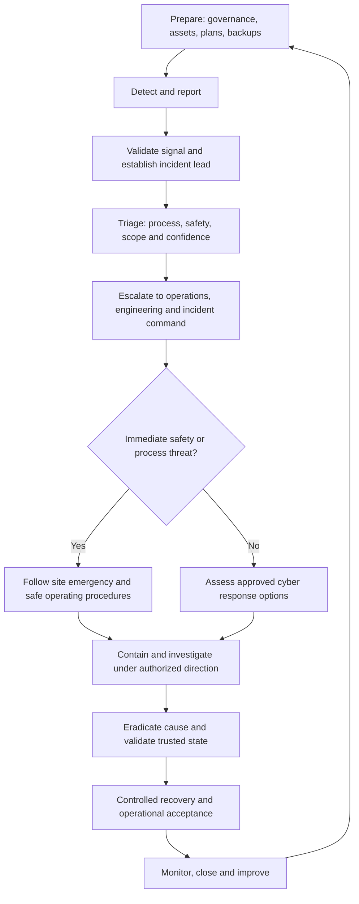
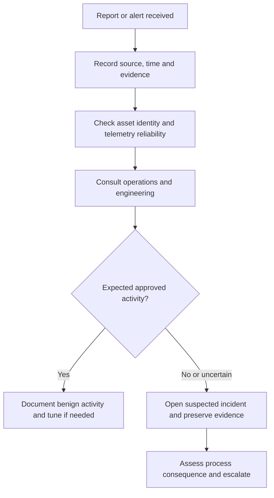
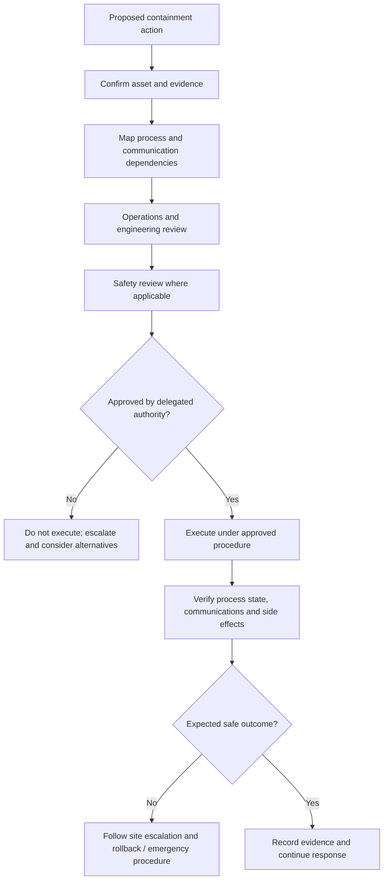
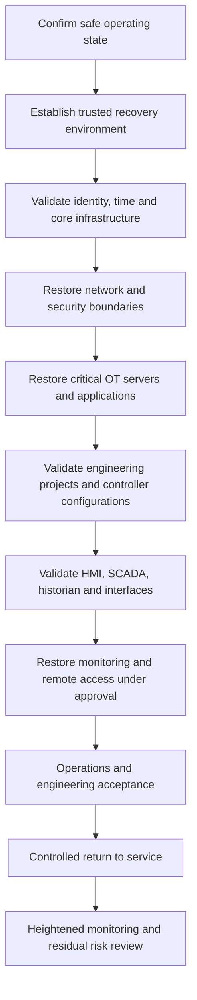
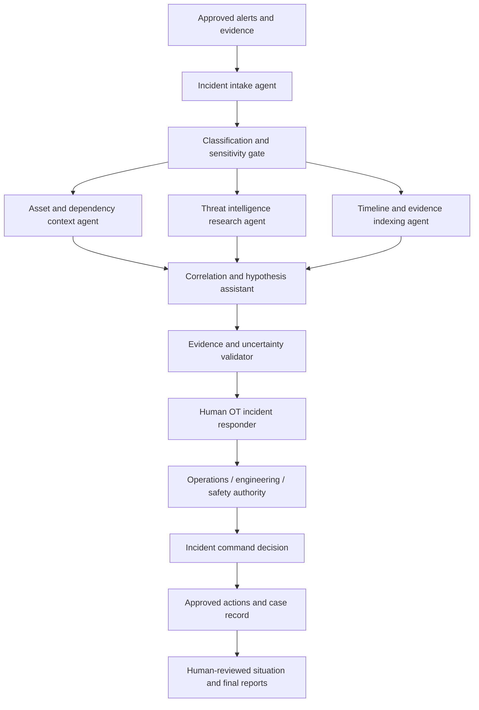

# OT Incident Response, Crisis Management and Cyber Recovery

**Document ID:** UOTS-13-IR | **Version:** 2.0 | **Status:** Engineering reference

**Audience:** CISO, OT security leaders, plant and operations managers, control engineers, process safety professionals, SOC and incident responders, business continuity teams, legal and compliance teams, OEMs and system integrators.

> **Safety and authority boundary:** Protect people, the environment and safe process operation first. This playbook does not authorize operational intervention. Cybersecurity personnel must not independently direct process shutdown, safety bypass, controller isolation, logic changes, blocking of industrial communications or restart. Follow the site's emergency response plan, process safety procedures, incident command model and designated decision authority. Evidence preservation must never delay immediate actions needed to protect life or prevent a major incident.

---

# 1. Purpose and outcomes

This playbook expands the repository's OT incident response lifecycle into a practical reference for preparation, detection, triage, escalation, safe containment, investigation, eradication, recovery, crisis communication and post-incident improvement.

An OT cyber incident can affect more than information systems. It may affect the ability to observe or control a process, the integrity of engineering configurations, the availability of essential services, environmental protection, product quality, worker safety or public safety.

Incident response must therefore coordinate cybersecurity with operations, engineering, process safety, environmental, business continuity, legal, communications, suppliers and relevant authorities.

## 1.1 Desired outcomes

- Protect people and the environment.
- Maintain or restore a safe and stable operating condition.
- Understand affected assets, process areas, dependencies and trust boundaries.
- Establish a reliable incident timeline and evidence record.
- Make decisions through the correct operational and incident command authority.
- Contain threats using approved, technically validated methods.
- Restore trustworthy systems and configurations in a controlled sequence.
- Meet applicable contractual and regulatory notification obligations.
- Capture lessons and verify corrective actions.

## 1.2 Governing principles

1. Safety before cyber containment.
2. Process continuity and safe degradation are explicit response objectives.
3. Follow site emergency, process safety and operational procedures.
4. Do not assume an IT containment action is safe for OT.
5. Preserve clear decision authority and communications.
6. Prefer known-good, independently verified recovery sources.
7. Preserve evidence where feasible without delaying safety actions.
8. Treat uncertain asset identity, time and telemetry as material limitations.
9. Do not reconnect or restart a system solely because malware appears removed.
10. Require operations and engineering acceptance before return to service.
11. Maintain a decision log, including rejected options and rationale.
12. Use AI only as a human-reviewed support capability.

## 1.3 Incident response lifecycle

---

# 2. What constitutes an OT cybersecurity incident?

An incident is an event or series of events that has compromised, or credibly threatens to compromise, the confidentiality, integrity or availability of OT systems, industrial communications, engineering information or supporting services.

Potential examples:
- Unauthorized access to an engineering workstation.
- Unapproved controller logic, parameter or firmware change.
- Ransomware affecting systems that support OT operations.
- Loss or manipulation of SCADA visibility.
- Compromised vendor remote access.
- Unauthorized network path between zones.
- Malware introduced through removable media.
- Compromise of a historian, data broker or industrial gateway.
- Unavailable or tampered monitoring and logging.
- Suspected access to a safety instrumented system.
- Loss of communications to remote sites or substations.
- Compromise of identity, time, backup or virtualization services that OT depends on.

Not every alarm is a cyber incident. Equipment failure, configuration error, process upset, maintenance activity and telemetry faults can resemble malicious activity. Investigate without prematurely assigning cause or attribution.

## 2.1 Event, alert, incident and crisis

| Term | Meaning | Example |
|---|---|---|
| Event | Observable occurrence | A new device appears in a network record |
| Alert | Rule or analyst identifies a condition | Sensor reports an unexpected peer |
| Suspected incident | Credible concern requiring investigation | Unknown engineering account activity |
| Confirmed incident | Evidence supports unauthorized or malicious activity | Verified unauthorized project modification |
| Major incident | Significant operational, safety, environmental or business consequence or potential | Loss of control visibility at a critical facility |
| Crisis | Organization-wide or multi-stakeholder event requiring executive coordination | Major service disruption with public or regulatory impact |

The organization must define its own thresholds, severity categories and activation criteria.

---

# 3. Preparation and readiness

Preparation determines whether the organization can respond safely under pressure.

## 3.1 Essential inventories and records

Maintain current, accessible copies of:
- OT asset inventory with site, zone, owner, product, model and version.
- Network diagrams, zone/conduit diagrams and approved communication flows.
- Process diagrams and critical dependencies appropriate to responder access.
- Engineering workstation and software inventories.
- Controller logic and configuration backup catalogue.
- Remote access, supplier and emergency support arrangements.
- Identity and privileged account ownership.
- Critical applications, historians, domain services, DNS, NTP/PTP and virtualization dependencies.
- Backup systems, recovery media, golden images and spare parts.
- Safety and emergency procedures, stored in the approved operational repository.
- Contact and escalation lists with alternates.
- Contracts, notification clauses and regulator contact procedures.

Record last verified date, source, owner and confidence. A stale drawing must not be treated as a reliable live topology.

## 3.2 Response capabilities

Prepare:
- OT-specific incident response plan.
- Site emergency and safe operating procedure references.
- Incident command and decision authority matrix.
- Pre-approved response options and explicit prohibited actions.
- Safe isolation and degraded-operation procedures where engineered.
- Evidence collection kits and chain-of-custody forms.
- Approved forensic workstations and storage.
- Offline contact and communications methods.
- Vendor support agreements and escalation routes.
- Recovery sequence and restoration acceptance criteria.
- Backup restoration test records.
- Tabletop and technical exercise schedule.

## 3.3 Readiness register

| Capability | Evidence of readiness | Owner |
|---|---|---|
| Asset and dependency inventory | Reviewed inventory and owner attestations | Asset management |
| Network and process diagrams | Current approved drawings | OT engineering |
| Incident contacts | Tested primary and alternate contacts | Incident management |
| Decision authority | Approved RACI and escalation matrix | Site leadership |
| Emergency procedures | Current controlled procedures | Operations / safety |
| Engineering backups | Restore test and integrity record | Control engineering |
| Recovery infrastructure | Tested images, media and spares | OT / IT infrastructure |
| Evidence handling | Approved procedure and access controls | Incident response |
| Vendor support | Current contracts and emergency contacts | Procurement / engineering |
| Exercises | After-action reports and tracked actions | Resilience lead |

## 3.4 Pre-incident agreements

Agree before an incident:
- Who can declare an OT incident and activate crisis management.
- Who has authority to change process operating state.
- Who can approve network or account containment.
- Who contacts regulators, law enforcement and sector authorities.
- Who authorizes vendor access.
- Who approves public statements.
- Which communication channels remain available if corporate IT is unavailable.
- How evidence is handled across company and supplier boundaries.
- Who accepts residual risk and return to service.

---

# 4. Incident severity and classification

Severity must reflect both cyber evidence and industrial consequence. A technically sophisticated event is not automatically the highest operational severity; a simple loss of visibility can be critical in a safety-sensitive process.

## 4.1 Classification dimensions

Assess:
- People and worker safety.
- Environmental impact.
- Process control and operator visibility.
- Essential service delivery.
- Production and product quality.
- Integrity of logic, setpoints, recipes and configurations.
- Confidentiality of sensitive engineering or operational information.
- Geographic and site spread.
- Recovery complexity and availability of safe fallback.
- Confidence in evidence and attribution of activity.
- Regulatory and contractual reporting implications.

## 4.2 Illustrative severity model

| Level | Illustrative condition | Coordination |
|---|---|---|
| SEV-1 Critical | Actual or imminent threat to people, environment, safety functions, essential service or major process control | Site emergency procedures and executive crisis command |
| SEV-2 High | Confirmed compromise or significant disruption affecting critical OT assets or multiple zones | OT incident lead, operations, engineering and senior management |
| SEV-3 Moderate | Suspected or limited compromise with contained scope and no identified immediate process impact | OT security and asset owner investigation |
| SEV-4 Low | Isolated policy or security event with limited impact and strong compensating controls | Standard security workflow and owner tracking |

These are example categories, not a universal scoring standard. Align them with the site's emergency classification, corporate incident process and regulatory obligations. A safety event is governed by emergency and process safety procedures regardless of cyber severity.

## 4.3 Confidence is separate from severity

Record confidence independently:
- Confirmed by direct, reliable evidence.
- Strongly corroborated by multiple sources.
- Plausible but incomplete evidence.
- Unverified report or single weak indicator.

High consequence with low confidence may still require urgent operational validation. Do not lower urgency simply because cyber attribution is uncertain.

---

# 5. Roles, incident command and decision authority

## 5.1 Core roles

| Role | Primary responsibility |
|---|---|
| Executive sponsor / crisis lead | Enterprise priorities, resources and crisis decisions within delegated authority |
| Site incident commander | Coordinates site response under the emergency management model |
| Operations manager / control room | Process state, operating constraints and safe operational decisions |
| Control / automation engineer | Asset behavior, controller dependencies and technical validation |
| Process safety authority | Safety implications and required safety governance |
| OT incident response lead | Cyber investigation coordination, scope and evidence |
| SOC lead | Alert validation, telemetry and detection context |
| IT infrastructure lead | Enterprise services and shared dependencies |
| Legal and compliance | Legal privilege considerations, notification and regulatory coordination |
| Communications lead | Internal, external and stakeholder messaging |
| OEM / system integrator | Product-specific technical advice and support |
| Business continuity lead | Essential service priorities and alternate operating arrangements |
| Risk owner | Documented residual risk acceptance within delegated authority |

One person may hold multiple roles in smaller organizations, but conflicts and decision authority must remain explicit.

## 5.2 RACI example

| Activity | OT IR lead | Operations | Engineering | Safety | Incident commander |
|---|---|---|---|---|---|
| Cyber alert investigation | R | C | C | I | A |
| Process impact assessment | C | A/R | R | C | I |
| Safety decision | I | R | C | A/R | I |
| Cyber evidence collection | A/R | C | C | I | I |
| Production network containment | C | A | R | C | I |
| Process shutdown / safe state | I | A/R | C | A/C as site-defined | Per emergency plan |
| Recovery technical validation | C | A | R | C | I |
| Return-to-service approval | I | A/R | R | C/A as applicable | Per site governance |
| Regulatory notification | C | C | I | C | A through authorized function |

R = Responsible, A = Accountable, C = Consulted, I = Informed. This is a model only. The site emergency plan, legal obligations and actual delegation of authority take precedence.

## 5.3 Decision log

Record:
- Decision ID and timestamp.
- Incident phase and current process state as confirmed by operations.
- Options considered.
- Technical and process dependencies.
- Safety and environmental review.
- Decision owner and consulted roles.
- Chosen action and rationale.
- Rejected options and rationale.
- Preconditions, rollback and verification.
- Outcome and follow-up.

---

# 6. Initial detection, reporting and validation

## 6.1 Potential sources

- OT network monitoring and IDS alerts.
- Firewall, VPN and jump-host logs.
- Endpoint and application monitoring.
- Engineering workstation and controller audit records.
- Operator reports and process alarms.
- Vendor notifications and advisories.
- Physical security and access control.
- Backup, identity, time and virtualization systems.
- External CERT or sector authority notifications.

## 6.2 Initial report minimum fields

- Reporter and callback method.
- Date/time and timezone.
- Site and process area.
- Asset identifier and identity confidence.
- What was observed, not assumed.
- Source of observation and evidence reference.
- Current operational status confirmed by operations.
- Any recent maintenance or approved change.
- Immediate safety or environmental concern.
- Actions already taken and by whom.

## 6.3 Validation workflow

Do not delay escalation while trying to prove malware, identify an attacker or determine attribution.

---

# 7. Triage, scope and impact assessment

## 7.1 Establish the incident picture

Determine:
- What happened and when?
- Which assets are directly affected?
- Which assets may be indirectly affected through dependencies?
- Which zones and conduits are involved?
- Is the activity ongoing?
- Is the event affecting visibility, control, integrity or availability?
- Are safety, protection or emergency systems involved?
- Is the process in a normal, startup, shutdown, maintenance or degraded mode?
- What alternate operating capability exists?
- Are telemetry and clocks trustworthy?
- What is known, inferred and unknown?

## 7.2 Impact dimensions

| Dimension | Questions |
|---|---|
| Safety | Could people be exposed to unsafe conditions? |
| Environment | Could release, pollution or environmental controls be affected? |
| Process | Is control, monitoring, interlocking or sequencing affected? |
| Availability | Can the facility continue safely in current or degraded mode? |
| Integrity | Are logic, recipes, settings or engineering files changed? |
| Confidentiality | Is sensitive process or engineering information exposed? |
| Essential service | Are customers, communities or interconnected operators affected? |
| Recovery | Are known-good backups, spares and vendor support available? |

## 7.3 Scope confidence

Classify assets as confirmed affected, suspected affected, potentially exposed, investigated and not affected, or unknown. Record the evidence and method supporting each classification.

---

# 8. Communications and crisis management

## 8.1 Communication principles

- Use the incident command communication structure.
- Maintain a single authoritative incident log.
- Separate confirmed facts from hypotheses.
- Use approved out-of-band channels if corporate systems are compromised.
- Do not share sensitive process diagrams or credentials through informal channels.
- Keep technical and executive updates appropriate to each audience.
- Record decisions, acknowledgements and time of notification.
- Coordinate supplier and regulator communications through authorized owners.

## 8.2 Situation report template

**Incident ID:**  
**Reporting time / timezone:**  
**Site / process unit:**  
**Incident commander:**  
**Current severity:**  
**Current operational status (confirmed by):**  
**What is known:**  
**What remains unknown:**  
**Affected / suspected assets:**  
**Safety and environmental status:**  
**Business / essential service impact:**  
**Actions completed:**  
**Actions in progress:**  
**Decisions required:**  
**External support required:**  
**Next update time:**  
**Prepared by / approval:**

## 8.3 Stakeholder groups

As appropriate:
- Site leadership and control room.
- OT and IT teams.
- Process safety and environmental teams.
- Corporate crisis management.
- Legal, privacy and compliance.
- Customers and critical suppliers.
- OEMs and integrators.
- Insurers and contractual partners.
- Sector CERT, regulator and law enforcement.
- Emergency services and public authorities.

Notification duties and timing are jurisdiction- and entity-specific. Confirm the current law, regulator instruction, contract and incident facts before making a notification decision. Do not invent a universal reporting deadline.

---

# 9. Safe containment and operational guardrails

Containment aims to limit further harm while maintaining safe process operation. In OT, containment options can themselves create hazards or disrupt essential services.

## 9.1 Containment decision requirements

Before any cyber containment action:
1. Confirm the target identity and exact interface or account.
2. Identify process and network dependencies.
3. Consult operations and control engineering.
4. Involve process safety where relevant.
5. Check redundancy, failover and degraded operating behavior.
6. Confirm the action is approved by the designated authority.
7. Define rollback and success criteria.
8. Record the decision and implementation owner.
9. Monitor process and equipment state after the action.

## 9.2 Potential response options requiring site approval

Depending on architecture and circumstances, options may include:
- Restricting a compromised external remote access session.
- Suspending a supplier identity after confirming operational dependencies.
- Restricting an enterprise-to-OT conduit through an approved control.
- Moving a workstation to an engineered response state.
- Disabling an exposed service under vendor and engineering guidance.
- Using an approved safe operating or degraded mode.
- Restricting removable media through established procedures.

These are not universal instructions. Each option may be unsafe in a particular installation.

## 9.3 Prohibited assumptions

- Do not assume unplugging a cable is safe.
- Do not assume blocking a protocol is safe.
- Do not assume disabling an account will not affect a service.
- Do not assume an endpoint quarantine is safe for HMI or engineering software.
- Do not assume a controller can be rebooted without process consequences.
- Do not assume a backup is clean or complete.
- Do not assume a safety system is compromised based on an adjacent network alert.
- Do not assume a system is clean because an antivirus scan is negative.

## 9.4 Containment decision path

---

# 10. Investigation, evidence and forensic readiness

## 10.1 Evidence priorities

Potential evidence includes:
- Network sensor records and approved packet captures.
- Firewall, VPN and remote access logs.
- Identity and privileged access events.
- Engineering workstation event logs.
- Controller audit records where supported.
- Project files, configuration snapshots and hashes.
- HMI, SCADA, DCS and historian logs.
- Endpoint protection alerts.
- Backup and infrastructure audit records.
- Change tickets, work orders and maintenance records.
- Physical access and removable media logs.
- Vendor support records and advisory communications.

## 10.2 Evidence register

| Field | Required content |
|---|---|
| Evidence ID | Unique reference |
| Incident ID | Related case |
| Source asset | Device, system or record |
| Collector | Authorized person |
| Collection time | Include timezone |
| Original event time | Preserve source timestamp |
| Method | Export, passive capture, approved acquisition |
| Integrity | Hash or platform integrity record where appropriate |
| Storage location | Approved evidence repository |
| Sensitivity | Classification and access restrictions |
| Chain of custody | Transfers and access history |
| Limitations | Clock drift, missing logs, sampling, retention |
| Reviewer | Validation record |

## 10.3 Forensic safety

- Do not run forensic tools on fragile controllers without vendor approval.
- Do not power down equipment to preserve evidence unless operations and safety authority direct it.
- Do not alter source data unnecessarily.
- Prefer copies or approved exports.
- Record any unavoidable change made during emergency response.
- Preserve volatile evidence only where technically safe and authorized.
- Use qualified personnel for specialized acquisition.
- Coordinate legal hold and privacy requirements.

## 10.4 Chain of custody

Record every transfer, access, copy, analysis and disposition. Hashes support integrity but do not by themselves prove that the original collection was complete or accurate.

## 10.5 Incident timeline

Maintain both event time and collection/ingestion time. Document time source, timezone, clock offset and uncertainty. Correlate with operator logs, work orders and known process events.

---

# 11. Scenario playbook: ransomware affecting enterprise services connected to OT

## 11.1 Scenario

Ransomware affects enterprise identity, file services, virtualization or shared infrastructure. OT may depend on these services for engineering access, historian reporting, authentication, patching or business operations.

## 11.2 Initial concerns

- Which services are actually required for safe process operation?
- Are control functions local or dependent on enterprise services?
- Are domain, DNS, NTP, virtualization or backup systems affected?
- Is there evidence of spread into OT zones?
- Are remote access paths or shared credentials exposed?
- Can operations continue safely in local or degraded mode?

## 11.3 Response workflow

1. Activate enterprise and OT incident coordination.
2. Have operations confirm current process state and dependencies.
3. Identify affected enterprise services and OT-connected paths.
4. Preserve relevant telemetry and identity evidence.
5. Review remote access and shared service dependencies.
6. Evaluate any proposed conduit restrictions with engineering and operations.
7. Use approved continuity procedures for affected business services.
8. Determine trusted recovery sources and credential integrity.
9. Validate OT services independently before reconnecting enterprise dependencies.
10. Record residual risk and formal acceptance.

## 11.4 Recovery checks

- Identity and privileged access integrity.
- DNS, NTP and other shared services.
- Engineering file and project integrity.
- Historian and data exchange.
- Backup platform and recovery credentials.
- Remote access trust.
- Endpoint and server integrity.
- Monitoring and logging continuity.

Do not assume that restoring enterprise IT automatically restores a trustworthy OT environment.

---

# 12. Scenario playbook: compromised engineering workstation

## 12.1 Scenario

An engineering workstation shows suspicious execution, unauthorized remote access, unexpected account use or a project file change.

## 12.2 Investigation questions

- Is the workstation currently used for active engineering?
- Which controllers, projects and zones can it access?
- Are there approved maintenance activities?
- Are project files changed, downloaded or transferred?
- Are credentials stored or reused?
- Are there corresponding controller audit records?
- Is the workstation redundant or can it be safely removed from service?

## 12.3 Response workflow

1. Notify operations and control engineering.
2. Confirm workstation role, current use and process dependencies.
3. Preserve approved host and network evidence.
4. Identify accessible assets and accounts.
5. Validate project and configuration integrity using trusted baselines.
6. Decide on workstation restriction or isolation only through approved authority.
7. Rebuild from trusted media if required and approved.
8. Rotate affected credentials using a dependency-aware plan.
9. Review controller and engineering activity for unauthorized changes.
10. Validate tools, licenses, project files and communications before operational return.

Do not simply disconnect an active engineering station without understanding its role and process state.

---

# 13. Scenario playbook: unauthorized PLC logic or parameter change

## 13.1 Scenario

A controller audit record, engineering system or operator report indicates an unexpected logic, parameter, mode or configuration change.

## 13.2 Immediate priorities

- Operations determines current process condition and safe operating response.
- Engineering verifies the asset, change and trusted reference.
- Process safety authority is involved where protection or safety functions may be implicated.
- Cybersecurity preserves evidence and investigates access path.
- Incident command coordinates the response.

## 13.3 Investigation

- Confirm controller identity, model and firmware.
- Identify exact change and timestamp where supported.
- Compare with approved change record and known-good project.
- Correlate engineering workstation, user and remote access activity.
- Establish whether change is active, pending or merely a repository difference.
- Determine process and safety consequence with qualified engineers.
- Preserve original project and configuration evidence.

## 13.4 Recovery

Only authorized control engineering personnel should determine whether restoration or reloading is appropriate. Validate logic, parameters, interlocks, alarms, communications and process behavior under approved commissioning and operational procedures. Do not blindly download a backup to a live controller.

---

# 14. Scenario playbook: loss of SCADA or operator visibility

## 14.1 Scenario

Operators report loss, delay or inconsistency of SCADA/HMI data, alarms or command visibility.

## 14.2 First response

Operations follows established abnormal operating and fallback procedures. Cyber responders should not attempt network changes or restart systems without operational authority.

## 14.3 Investigation domains

- HMI and SCADA application health.
- Network path and industrial DMZ dependencies.
- Historian and data broker services.
- Authentication, DNS and time dependencies.
- Redundant server and communications state.
- Recent changes, maintenance and vendor activity.
- Evidence of malicious activity versus equipment or network failure.

## 14.4 Recovery validation

Confirm operator visibility, data freshness, alarm correctness, command path integrity, redundancy, event timestamps and process-owner acceptance. Distinguish restoration of display service from proof that underlying control behavior is correct.

---

# 15. Scenario playbook: vendor remote access compromise

## 15.1 Scenario

A supplier identity, VPN account, remote support platform or vendor workstation may be compromised.

## 15.2 Investigation and coordination

- Confirm supplier identity and contractual relationship.
- Identify the approved access path, target assets and session times.
- Preserve gateway, identity and session records.
- Contact supplier through a verified out-of-band channel.
- Identify whether shared credentials or service accounts are affected.
- Determine whether sessions remain active and their process dependencies.
- Review activity during and after the suspected compromise.

## 15.3 Containment and recovery

The authorized owner decides whether and how to suspend access after operational dependency review. Replace credentials and certificates through a planned process, review other supplier identities, and reauthorize access only after supplier and site validation.

---

# 16. Scenario playbook: OT network segmentation failure

## 16.1 Scenario

Unexpected communication appears across a zone boundary, or a firewall, router or industrial DMZ change creates an unintended path.

## 16.2 Response

- Confirm observed traffic and collection point reliability.
- Identify source, destination, protocol and time window.
- Compare against approved communication matrix and change tickets.
- Identify process dependencies and redundancy.
- Determine whether the event is a misconfiguration, approved change or malicious activity.
- Escalate proposed rule changes to network engineering and operations.
- Verify monitoring and process behavior after any approved remediation.

Do not insert a blocking rule solely because a flow is unfamiliar. Unknown communications must be investigated in context.

---

# 17. Scenario playbook: malware on removable media

## 17.1 Scenario

Removable media is reported lost, unapproved, infected or used to transfer files into an industrial environment.

## 17.2 Response

- Identify the media, source, custodian and systems where it was used.
- Consult site removable media procedure.
- Preserve available endpoint and transfer records.
- Identify files and systems involved using approved methods.
- Assess whether engineering projects or controller configurations were affected.
- Use approved scanning and analysis stations.
- Review other media and transfer events for related activity.
- Reissue media only through controlled approval and validation.

Do not connect suspected media to production assets for testing.

---

# 18. Scenario playbook: compromised historian or data broker

Assess whether the compromise affects only enterprise reporting or also data used for control, alarms, optimization or operational decisions. Identify data integrity, availability and trust implications. Validate source values against approved authoritative systems before using recovered data for operational decisions.

Review:
- Collector and interface integrity.
- Service identities and certificates.
- Data forwarding and egress.
- Database and application audit.
- Backup and restore integrity.
- Time and sequence consistency.
- Downstream consumers and automated decisions.

---

# 19. Scenario playbook: substation or remote site communications disruption

Coordinate with grid or facility operations, protection engineers and telecom providers. Determine whether local autonomous protection and control remain functional, whether remote visibility is lost, and which approved alternate communications exist.

Do not manipulate protection settings, trip commands, relay configurations or substation network paths as a cyber response action. Follow the applicable utility/site emergency and protection procedures.

---

# 20. Scenario playbook: suspected SIS compromise

Treat any credible concern involving a safety instrumented system as a safety-relevant event requiring immediate escalation through the site's functional safety and emergency governance.

- Notify the responsible operations and functional safety authority.
- Follow established safety and abnormal operating procedures.
- Preserve available evidence where it does not delay safety action.
- Validate asset identity, boundary and source of observation.
- Coordinate OEM and qualified functional safety support.
- Do not test trip behavior, bypass protections, change safety logic or alter setpoints as part of cyber investigation.
- Recovery and return to service require the designated safety and operations approvals.

A nearby IT or OT alert does not by itself prove SIS compromise. Equally, lack of direct telemetry does not prove the system is unaffected.

---

# 21. Eradication and root cause

Eradication removes the cause and persistence of the incident. It follows scoping and containment and must be planned with engineering and operations.

Potential work:
- Remove unauthorized accounts and access paths.
- Rebuild affected servers or workstations from trusted sources.
- Restore known-good application and configuration states.
- Replace compromised credentials, keys and certificates.
- Correct exposed services and architecture weaknesses.
- Validate supplier access and third-party systems.
- Patch or mitigate only through approved compatibility and change processes.
- Review persistence and lateral movement evidence.
- Confirm monitoring and logging are trustworthy.

Root cause analysis should distinguish:
- Initial access vector.
- Exploited weakness or control gap.
- Enabling conditions.
- Detection and response gaps.
- Process and organizational contributors.
- Third-party and supply chain factors.
- Recovery and resilience gaps.

Do not claim a root cause until supported by evidence. Record alternative hypotheses and unresolved questions.

---

# 22. Recovery strategy and restoration priorities

Recovery restores a trustworthy and operationally accepted state, not merely powered-on systems.

## 22.1 Recovery planning dimensions

- Safe process operating condition.
- Criticality and dependencies.
- Availability of trusted backups and images.
- Spare hardware and replacement lead times.
- Vendor support and license availability.
- Firmware and software compatibility.
- Identity, DNS, time and infrastructure dependencies.
- Network trust and segmentation.
- Monitoring and incident persistence.
- Recovery sequence and resource availability.
- RTO/RPO approved by business and operations.
- Residual risk and return-to-service authority.

## 22.2 Recovery dependency map

This is a planning pattern, not a universal restoration order. Actual sequence depends on process architecture, vendor instructions and site recovery procedures.

## 22.3 Recovery sequence record

For each system, document:
- Asset and dependency.
- Recovery priority.
- Approved source image or backup.
- Source integrity verification.
- Required credentials, licenses and certificates.
- Vendor instructions.
- Restore owner and witness.
- Test procedure and expected result.
- Process and safety checks.
- Rollback or fallback.
- Acceptance authority.
- Residual risk.

## 22.4 RTO and RPO

- **RTO:** Target time to restore a service or capability.
- **RPO:** Target maximum tolerable data loss measured in time.

These are business and operational objectives, not guaranteed technical outcomes. Define them per service and process dependency. Validate through realistic recovery exercises.

---

# 23. Backup integrity and trusted restoration

A successful backup job is not proof of recoverability or integrity.

Verify:
- Backup scope and completeness.
- Asset and version match.
- Date and known-good state.
- Offline or immutable protection where appropriate.
- Access controls and backup credential integrity.
- Hashes or platform integrity evidence where applicable.
- Malware and compromise assessment.
- Vendor-supported restoration procedure.
- Restore test results.
- Engineering and operations acceptance.

For controller logic and engineering projects, compare against authorized baselines and approved change history. A backup taken after compromise may preserve malicious or unauthorized changes.

---

# 24. Return to service and operational acceptance

Return to service is a controlled operational decision.

## 24.1 Technical validation

As applicable, verify:
- Asset identity, model and firmware.
- Trusted configuration and logic.
- Network paths and approved conduits.
- Authentication and privileged access.
- Application and service integrity.
- Communications and redundancy.
- Operator displays and alarm behavior.
- Historian and data integrity.
- Time synchronization.
- Monitoring and alert delivery.
- Backup and recovery status.
- Vendor support and outstanding advisories.

## 24.2 Process and safety validation

Qualified operations, engineering and safety personnel determine applicable checks for:
- Process operating mode.
- Interlocks and alarms.
- Safety functions and independent protection layers.
- Manual and degraded operating capability.
- Control loop behavior and approved test procedures.
- Operator visibility and response.
- Environmental and quality controls.

Cybersecurity staff do not independently certify process or functional safety performance.

## 24.3 Acceptance record

**Incident ID:**  
**System / asset:**  
**Restoration source and integrity:**  
**Technical tests completed:**  
**Process validation completed by:**  
**Safety review reference:**  
**Monitoring verified:**  
**Outstanding vulnerabilities / exceptions:**  
**Residual risk owner:**  
**Operational acceptance:**  
**Return-to-service approval:**  
**Date/time and timezone:**

---

# 25. Business continuity and crisis resilience

Business continuity planning considers how essential services continue during disruption, including safe degraded operation, alternate facilities, manual procedures and supply chain constraints.

Review:
- Essential products and services.
- Maximum tolerable disruption.
- Safe manual or local operating modes.
- Staffing, fatigue and shift coverage.
- Spare parts and specialist availability.
- Alternate communications.
- Supplier and logistics dependencies.
- Customer and public communication.
- Environmental and regulatory obligations.
- Recovery prioritization across sites.

Manual operation is not automatically safer. It must be covered by approved procedures, trained personnel, suitable staffing and safety review.

---

# 26. Regulatory, contractual and external notification

Notification duties vary by country, sector, entity classification, incident type, severity and applicable law or contract.

For each relevant jurisdiction, maintain a controlled register containing:
- Official legal instrument and issuing authority.
- Covered entity and sector definition.
- Reportable incident threshold.
- Initial notification and follow-up requirements.
- Time calculation and triggering event.
- Required information and reporting channel.
- Data protection and privacy obligations.
- Cross-border and customer notification considerations.
- Supplier and contractual notification clauses.
- Current amendments, effective dates and source verification.
- Responsible internal notification owner.

Do not apply one GCC country's deadline to another. Do not infer that all oil and gas, power, water or manufacturing operators have identical reporting duties. Legal and compliance teams should verify the current official instrument and obtain legal advice where needed.

The repository's global regulatory mapping chapter is the authoritative cross-reference location. Incident procedures should link to the applicable country and sector record.

---

# 27. Post-incident review and corrective action

Conduct a review after stabilization and recovery. The purpose is to improve controls and readiness, not assign blame without evidence.

## 27.1 Review questions

- What happened and what was the timeline?
- How was the event detected?
- What was the actual process and business impact?
- Which assets and dependencies were involved?
- Which controls worked as intended?
- Which assumptions or records were inaccurate?
- Were decisions made by the correct authority?
- Were communications effective?
- Were containment and recovery safe and timely?
- Were evidence and notification obligations met?
- What supplier or technology issues contributed?
- What changes prevent recurrence?

## 27.2 Corrective action register

| Field | Description |
|---|---|
| Action ID | Unique reference |
| Finding / root cause | Evidence-supported issue |
| Corrective action | Specific improvement |
| Risk addressed | Process and cyber consequence |
| Owner | Accountable person |
| Priority | Approved risk-based priority |
| Due date | Agreed date |
| Dependency | Vendor, outage or budget |
| Verification | Evidence required for closure |
| Status | Open, in progress, blocked, verified |
| Residual risk | Remaining exposure and owner |

An action is not closed merely because a ticket is marked complete. Verify the control or capability.

---

# 28. Exercises and practical scenarios

Exercises should use tabletop discussion, synthetic telemetry, isolated replicas or vendor-approved test environments. Never create an unapproved incident condition on a live industrial process.

## 28.1 Exercise types

- Executive tabletop: crisis decisions, public impact and resource priorities.
- Site tabletop: operations, engineering and cyber coordination.
- Technical simulation: synthetic alerts, logs and network evidence.
- Recovery exercise: restore from isolated backup and validate dependencies.
- Communications exercise: test alternate channels and escalation.
- Supplier exercise: vendor compromise and support coordination.

## 28.2 Exercise scenarios

| ID | Scenario | Primary learning objective |
|---|---|---|
| EX-01 | Ransomware in enterprise services supporting OT | Dependency and safe continuity decisions |
| EX-02 | Engineering workstation compromise | Project integrity and access review |
| EX-03 | Unauthorized PLC logic change | Control engineering and safety escalation |
| EX-04 | SCADA visibility loss | Safe operating response and recovery |
| EX-05 | Vendor remote access compromise | Supplier coordination and identity control |
| EX-06 | Segmentation failure | Communication path analysis |
| EX-07 | Removable media malware | Controlled transfer and evidence |
| EX-08 | Historian integrity compromise | Data trust and downstream impact |
| EX-09 | Remote substation communication loss | Local autonomy and utility coordination |
| EX-10 | Suspected SIS compromise | Functional safety escalation and authority |
| EX-11 | Backup platform compromise | Trusted recovery source validation |
| EX-12 | OT sensor outage during incident | Visibility and alternate evidence |
| EX-13 | Multi-site supply chain compromise | Enterprise coordination and prioritization |
| EX-14 | AI triage agent produces false conclusion | Human verification and model governance |

## 28.3 Exercise evaluation

Measure:
- Time to recognize and report.
- Correct identification of operational authority.
- Completeness of asset and dependency assessment.
- Quality of evidence and timeline.
- Safety and process impact consideration.
- Decision traceability.
- Communication effectiveness.
- Recovery sequence quality.
- Corrective action ownership and closure.

Do not reward participants for fast containment if the action bypasses engineering or safety approval.

---

# 29. AI-assisted incident response and agent governance

AI can support summarization, event correlation, evidence indexing, advisory lookup, timeline drafting and situation report preparation. It must not replace incident command, process engineering or safety authority.

## 29.1 Reference agent flow

## 29.2 Agent responsibilities and prohibitions

| Agent | Permitted support | Prohibited autonomous action |
|---|---|---|
| Intake agent | Normalize alert fields and open draft case | Declare crisis without policy and human confirmation |
| Asset context agent | Retrieve approved inventory and dependencies | Change asset configuration |
| Threat research agent | Summarize cited advisories and intelligence | Assert attribution or compromise without evidence |
| Timeline agent | Correlate timestamps and identify gaps | Alter original evidence |
| Correlation assistant | Suggest related events and hypotheses | Treat inference as fact |
| Evidence QA agent | Check source references and missing fields | Fabricate evidence or chain of custody |
| Situation report agent | Draft management updates | Send external notifications without approval |
| Workflow agent | Create tickets and notify approved contacts | Isolate devices, block traffic or change controllers |

## 29.3 AI security controls

- Use only approved data sources and processing environments.
- Enforce site-level access controls and data segregation.
- Treat logs, documents and messages as untrusted input.
- Defend against prompt injection in evidence.
- Do not expose credentials, secrets or restricted process data to unapproved services.
- Preserve source references, timestamps and model output versions.
- Label generated analysis as draft.
- Require human review of all material findings and decisions.
- Test hallucination, false correlation, stale data and adversarial inputs.
- Provide a manual fallback if AI is unavailable.
- Never grant agents unrestricted network or control-system command execution.

---

# 30. Templates and operational checklists

## 30.1 Incident intake form

**Incident ID:**  
**Reporter:**  
**Callback channel:**  
**Date/time and timezone:**  
**Site / process unit:**  
**Asset / system:**  
**Observed event:**  
**Evidence source:**  
**Current process state confirmed by:**  
**Safety / environmental concern:**  
**Maintenance or change reference:**  
**Actions already taken:**  
**Escalation contact:**  
**Confidence and unknowns:**

## 30.2 Initial response checklist

- [ ] Record alert/report and preserve source reference.
- [ ] Confirm reporter and site.
- [ ] Notify operations and designated incident contact.
- [ ] Determine immediate safety or environmental concern.
- [ ] Confirm asset identity and process role.
- [ ] Establish incident lead and decision authority.
- [ ] Open decision and evidence logs.
- [ ] Identify affected zones and dependencies.
- [ ] Review maintenance and vendor activity.
- [ ] Determine severity and confidence separately.
- [ ] Agree communications and next update.
- [ ] Do not take unapproved disruptive action.

## 30.3 Incident decision log

**Decision ID:**  
**Incident ID:**  
**Date/time:**  
**Current process condition:**  
**Decision required:**  
**Options considered:**  
**Technical dependencies:**  
**Operations assessment:**  
**Safety assessment:**  
**Decision authority:**  
**Decision and rationale:**  
**Rejected options:**  
**Implementation owner:**  
**Verification and rollback:**  
**Outcome:**

## 30.4 Evidence collection record

**Evidence ID:**  
**Incident ID:**  
**Source asset/system:**  
**Collector:**  
**Collection time/timezone:**  
**Original event time:**  
**Collection method:**  
**Integrity/hash:**  
**Storage location:**  
**Sensitivity:**  
**Transfer/access history:**  
**Limitations:**  
**Reviewer:**

## 30.5 Recovery plan

**Incident ID:**  
**System / asset:**  
**Recovery priority:**  
**Safe process state:**  
**Dependencies:**  
**Trusted backup/image reference:**  
**Integrity validation:**  
**Vendor procedure:**  
**Restore owner:**  
**Technical tests:**  
**Process validation:**  
**Safety approval reference:**  
**Rollback / fallback:**  
**Residual risk:**  
**Operational acceptance:**

## 30.6 Post-incident review

**Incident ID:**  
**Date and participants:**  
**Summary and impact:**  
**Timeline:**  
**Detection source:**  
**Root cause confidence:**  
**Controls that worked:**  
**Controls that failed or were absent:**  
**Decision and communication lessons:**  
**Recovery performance:**  
**Regulatory/contractual actions:**  
**Corrective actions and owners:**  
**Lessons incorporated into plans and exercises:**

---

# 31. Standards and authoritative references

Use exact editions and verify current publication status before formal compliance or audit use.

| Reference | Relevance |
|---|---|
| NIST SP 800-61 Rev. 3 | Incident response recommendations integrated with cybersecurity risk management |
| NIST SP 800-82 Rev. 3 | OT security architecture, threats, controls and operational context |
| ISA/IEC 62443-2-1 | Asset owner security program and lifecycle governance |
| ISA/IEC 62443-2-4 | IACS service provider security practices |
| ISA/IEC 62443-3-2 | Risk assessment and system design |
| ISA/IEC 62443-3-3 | System security requirements |
| NIST CSF 2.0 | Govern, Identify, Protect, Detect, Respond and Recover outcomes |
| ISO/IEC 27001 and 27002 | ISMS and information security control context |
| ISO 22301 | Business continuity management systems |
| ISO 19011 | Management system audit guidance |
| MITRE ATT&CK for ICS | Industrial adversary behavior and technique context |
| CISA ICS advisories | Industrial vulnerability and incident-relevant advisories |

Official starting points:
- NIST SP 800-61 Rev. 3: https://csrc.nist.gov/pubs/sp/800/61/r3/final
- NIST SP 800-82 Rev. 3: https://csrc.nist.gov/pubs/sp/800/82/r3/final

### Publication status note checked 17 November 2026

NIST SP 800-82 Rev. 3 remains the final published OT security guide located for this review. NIST has also published an Initial Public Draft of SP 800-82 Rev. 4 dated 21 September 2026, with comments due 30 November 2026. The Rev. 4 IPD is a draft, not a final publication; monitor the NIST OT Security project page and update this reference when a final revision is issued.

- NIST SP 800-82 Rev. 4 Initial Public Draft: https://csrc.nist.gov/pubs/sp/800/82/r4/ipd
- NIST OT Security publications and status: https://csrc.nist.gov/projects/operational-technology-security/publications

- NIST CSF 2.0: https://www.nist.gov/cyberframework
- ISA/IEC 62443: https://www.isa.org/standards-and-publications/isa-standards/isa-iec-62443-series-of-standards
- ISO 22301: https://www.iso.org/standard/75106.html
- ISO 19011: https://www.iso.org/standard/70017.html
- MITRE ATT&CK for ICS: https://attack.mitre.org/matrices/ics/
- CISA ICS advisories: https://www.cisa.gov/news-events/ics-advisories

These references provide different kinds of guidance. A cross-reference does not establish compliance, certification or legal applicability. Use the global regulatory mapping chapter for jurisdiction-specific legal obligations.

---

# 32. Limitations, assumptions and review

This playbook is a general professional reference. It does not replace:
- Site emergency response and process safety procedures.
- Functional safety engineering and competent authority.
- Vendor-specific restoration instructions.
- Legal advice and current regulator directions.
- The organization's approved incident classification.
- Site-specific engineering, MOC and operational acceptance.
- Licensed standards text and contractual requirements.

Review this document after major incidents, exercises, architecture changes, new supplier arrangements, standards updates or changes in applicable law.

## Revision history

| Version | Date | Change | Status |
|---|---|---|---|
| 1.0 | Prior baseline | Initial incident response and recovery lifecycle | Superseded |
| 2.0 | 2026-11-17 | Expanded into crisis management, scenario playbooks, evidence, safe containment, recovery, continuity, AI governance and operational templates | Engineering reference |

## Specialist expansion backlog

1. Sector-specific incident playbooks for oil and gas, LNG, power, water, manufacturing, mining, transport and building automation.
2. Detailed incident command and authority matrices adaptable by facility type.
3. Sanitized forensic evidence packs and synthetic incident timelines.
4. Backup restoration and recovery validation worksheets by asset family.
5. Jurisdiction-specific incident notification crosswalks with primary legal sources.
6. Vendor-specific controller and SCADA recovery considerations.
7. Tabletop facilitator guides, inject cards and scoring rubrics.
8. OT cyber crisis communications templates.
9. AI agent adversarial evaluation and incident workflow test suite.
10. Lessons-learned and corrective action assurance model.

