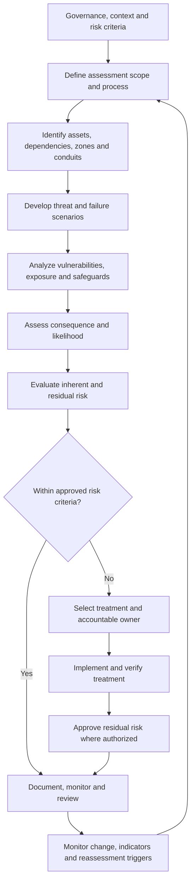
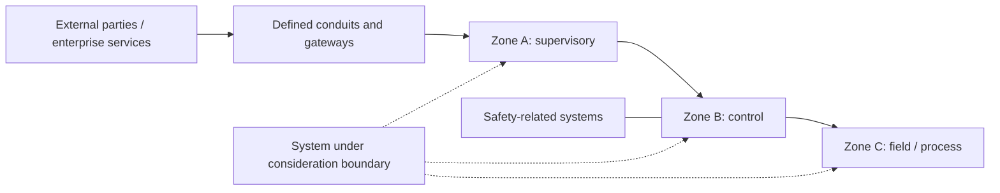
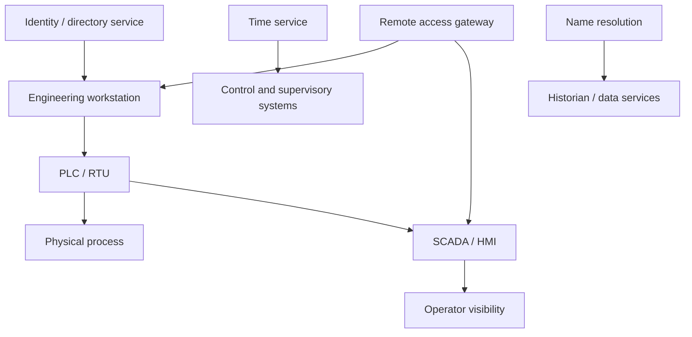
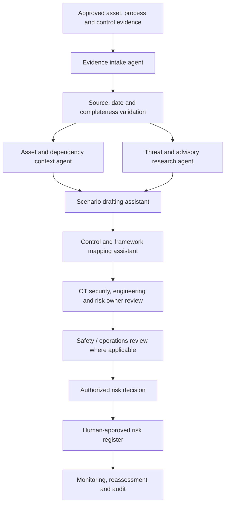

# OT Cybersecurity Risk Management, Governance and Assurance Playbook

**Document ID:** UOTS-14-RISK | **Version:** 2.0 | **Status:** Engineering reference

**Audience:** Board and executive leadership, CISO, OT security leaders, risk owners, plant managers, control engineers, process safety professionals, internal audit, compliance, procurement, system integrators and industrial service providers.

> **Critical boundary:** Cybersecurity risk assessment does not replace process hazard analysis, functional safety lifecycle activities, engineering design approval, or legal/regulatory interpretation. Cyber risk decisions that may affect safe operation must be reviewed by competent operations, engineering and safety authorities. Risk acceptance cannot waive statutory duties or make an unsafe operating condition acceptable.

---

# 1. Purpose and risk management outcomes

This playbook provides a repeatable way to identify, analyze, evaluate, treat, communicate and monitor cybersecurity risks in operational technology environments. It expands the concise OT risk assessment method into an engineering and governance reference.

OT risk management must account for cyber compromise and accidental failure that can affect physical processes, people, the environment, essential services, equipment, product quality and business continuity. A risk register is useful only when it is connected to real assets, process functions, accountable owners, effective safeguards and verifiable treatment actions.

## 1.1 Outcomes

- Identify critical process functions, assets, dependencies and trust boundaries.
- Define credible threat and failure scenarios.
- Evaluate consequences across safety, environment, operations, quality and business.
- Evaluate likelihood using explicit assumptions and evidence.
- Distinguish inherent risk, current control effectiveness and residual risk.
- Prioritize treatment according to risk appetite and legal obligations.
- Assign accountable risk owners and treatment owners.
- Track exceptions, compensating safeguards and expiry dates.
- Demonstrate control design and operating effectiveness.
- Provide meaningful risk information to executives and operational decision makers.
- Continuously reassess risk when assets, threats, processes or safeguards change.

## 1.2 Risk management lifecycle



---

# 2. OT risk principles

1. **Process context first:** assess a defined process function or system, not an abstract IT asset alone.
2. **Safety is distinct:** cyber risk scoring does not replace hazard analysis or safety integrity assessment.
3. **Availability is not the only OT concern:** integrity, unauthorized control, visibility and unsafe process behavior matter.
4. **Dependencies matter:** shared identity, DNS, time, virtualization, remote access, historians and engineering services can create systemic risk.
5. **Zones and conduits matter:** assess boundaries and permitted communication paths, not only individual devices.
6. **Safeguards must be evidenced:** a policy or product purchase is not proof of effective control operation.
7. **Likelihood is not exploitability alone:** consider threat capability, access, exposure, vulnerabilities, safeguards and operating context.
8. **Uncertainty must be visible:** unknowns, assumptions, data quality and confidence belong in the assessment.
9. **Risk has an owner:** technical teams can analyze risk, but accountable business and operational owners decide within delegated authority.
10. **Risk changes over time:** reassess after changes, incidents, new advisories, vendor end-of-life and control failures.

---

# 3. Governance structure and accountability

## 3.1 Three levels of risk management

| Level | Typical scope | Example decisions |
|---|---|---|
| Enterprise | Organization-wide risk appetite, policy, investment and accountability | Approve risk framework, strategic investment and enterprise exceptions |
| Business / site / mission | Facility, production line, utility, business service or sector | Prioritize site risks, approve treatment resources and operational constraints |
| System / zone / asset | Defined system under consideration, zone, conduit, asset group or service | Analyze scenarios, specify safeguards and validate implementation |

Risk information should flow between levels. A local technical risk may become an enterprise risk when it affects multiple sites, critical suppliers, essential services or a shared infrastructure dependency.

## 3.2 Key roles

| Role | Accountability |
|---|---|
| Board / governing body | Oversight of material enterprise risk and risk appetite |
| Executive leadership | Resources, strategic priorities and risk governance |
| CISO / security leader | Cyber risk framework, reporting and coordination |
| OT security leader | OT-specific methodology, technical analysis and assurance |
| Plant / operations manager | Operational risk ownership and process priorities |
| Asset owner | Lifecycle, maintenance, support and asset risk |
| Control / automation engineer | Technical architecture, configuration and engineering validation |
| Process safety authority | Safety-related assessment and safety lifecycle governance |
| Risk manager | Risk criteria, register quality and aggregation |
| Compliance / legal | Applicable obligations and interpretation |
| Internal audit | Independent assurance over governance and controls |
| Procurement / supplier manager | Third-party and supply-chain risk |
| Treatment owner | Delivery and evidence of assigned mitigation actions |

## 3.3 RACI model

| Activity | CISO | OT security | Operations | Engineering | Safety | Risk owner |
|---|---|---|---|---|---|---|
| Risk framework | A | R | C | C | C | C |
| Assessment scope | C | R | A | R | C | I |
| Threat scenario analysis | C | R | C | R | C | I |
| Process consequence | I | C | A/R | R | C/A as applicable | I |
| Safety assessment | I | C | R | C | A/R | I |
| Treatment proposal | A/C | R | R | R | C | C |
| Residual risk decision | C | C | A/R within delegation | C | C/A as required | A per delegation |
| Independent assurance | I | C | C | C | C | I; audit independent |

This is an illustrative model. Actual accountability must match organizational delegations, legal duties and site safety governance. Internal audit should retain appropriate independence.

---

# 4. Risk appetite, tolerance and criteria

Define risk criteria before scoring. Criteria should be approved by the appropriate executive and operational authorities and be consistent with enterprise risk appetite, legal obligations and safety requirements.

## 4.1 Define criteria for

- Personnel injury and fatality potential.
- Environmental release and impact.
- Loss of control or operator visibility.
- Essential service disruption.
- Equipment damage and asset replacement.
- Product quality, contamination and batch integrity.
- Production downtime and recovery duration.
- Financial loss and contractual impact.
- Regulatory, legal and reputational consequences.
- Critical supplier and cross-site dependencies.

## 4.2 Non-negotiable constraints

Some requirements are not tradeable through a low numeric risk score. Examples include legal obligations, mandated safety requirements, required protection functions, regulator directions and approved operating limits. A risk acceptance process cannot override these constraints.

## 4.3 Risk criteria record

**Criteria ID:**  
**Organization / site:**  
**Approved consequence categories:**  
**Likelihood definitions:**  
**Risk matrix and aggregation rules:**  
**Risk appetite / tolerance statements:**  
**Escalation thresholds:**  
**Mandatory treatment conditions:**  
**Risk acceptance authority:**  
**Review date and approver:**

---

# 5. Assessment scope and system under consideration

Choose an assessment unit that is meaningful and bounded. Avoid scoring an entire plant as one undifferentiated object.

Possible units:
- Process unit or production line.
- Control system or subsystem.
- System under consideration (SUC).
- Zone or conduit.
- Remote site or substation.
- Engineering and maintenance service.
- OT DMZ or remote access service.
- Shared infrastructure supporting multiple plants.
- Supplier-managed industrial service.

## 5.1 Scope definition

Record:
- Business purpose and process function.
- Physical and logical boundaries.
- Site, location and operating modes.
- Included and excluded assets.
- Interfaces and external dependencies.
- Zones, conduits and trust boundaries.
- Safety-related systems and interfaces, at an approved level of detail.
- Data flows and remote access.
- Stakeholders and decision authorities.
- Assessment period and evidence cut-off.
- Assumptions, constraints and limitations.

## 5.2 Scope diagram



Conceptual only. The real scope must be derived from approved architecture and engineering records. Do not assume every installation follows the same Purdue levels or network design.

---

# 6. Assessment inputs and evidence

Collect and validate:
- Process descriptions and operating modes.
- Asset and dependency inventories.
- Network, zone, conduit and data-flow diagrams.
- Authorized safety and hazard study outputs.
- Threat intelligence and relevant incident history.
- Vulnerability and exposure information.
- Vendor support, patch and end-of-life data.
- Existing safeguards and operating procedures.
- Maintenance windows and change records.
- Remote access and supplier arrangements.
- Backup and recovery evidence.
- Business impact and service criticality.
- Legal, regulatory and contractual requirements.
- Prior risk assessments, audits and exceptions.

## 6.1 Evidence quality

For each evidence item, record source, owner, date, scope, method, confidence and limitations. Distinguish:
- Verified observation.
- Documented but not independently verified statement.
- Interview statement.
- Inference.
- Assumption.
- Unknown or unavailable evidence.

A network diagram last reviewed several years ago is not equivalent to a verified current topology.

---

# 7. Asset criticality and dependency analysis

Asset criticality is not simply a device's purchase price or CVSS score. Assess the function it supports and the consequence of loss, compromise or incorrect operation.

## 7.1 Asset dimensions

- Process function and operating role.
- Safety relevance and protection dependencies.
- Essential service contribution.
- Operational availability requirement.
- Integrity sensitivity.
- Network exposure and connectivity.
- Replaceability and lead time.
- Vendor support and lifecycle.
- Recovery complexity.
- Dependency centrality and blast radius.
- Data sensitivity and engineering value.

## 7.2 Dependency graph



Illustrative only. Map actual dependencies, including redundant paths, local autonomy and failure behavior. A dependency may be operational, administrative, data-related or recovery-related.

## 7.3 Criticality assessment

Use documented categories such as Critical, High, Medium and Low only after defining criteria. Record the rationale and approving owner. Do not let a generic asset criticality label replace scenario-specific consequence analysis.

---

# 8. Threat, hazard and failure scenario development

A risk scenario should explain how a threat source or failure condition could exploit a vulnerability or dependency and produce a defined consequence.

## 8.1 Scenario structure

**Threat source / initiating condition** + **action or failure** + **target asset / process** + **vulnerability or enabling condition** + **consequence**.

Example:

"An unauthorized party obtains a supplier remote access credential. The credential is accepted by a remote access gateway with broad engineering network reach. The party accesses an engineering workstation and attempts an unauthorized configuration change. If the change is accepted and affects a critical process function, process integrity or availability may be impacted."

This is a scenario hypothesis, not a statement that an attack has occurred.

## 8.2 Scenario categories

- External cyber threat.
- Insider misuse or error.
- Supplier and supply-chain compromise.
- Accidental configuration change.
- Equipment and software failure.
- Loss of monitoring or visibility.
- Identity and remote access compromise.
- Malicious or unauthorized engineering change.
- Ransomware and destructive malware.
- Network segmentation failure.
- Backup and recovery compromise.
- Environmental or physical event affecting cyber resilience.
- Common-cause failure of shared dependencies.

## 8.3 Scenario register

| Field | Description |
|---|---|
| Scenario ID | Unique identifier |
| Process / service | Function potentially affected |
| Threat source | External, insider, supplier, accidental, environmental |
| Initiating event | How the scenario begins |
| Target | Asset, zone, conduit or service |
| Preconditions | Access, exposure and dependencies |
| Vulnerability / weakness | Enabling condition |
| Event sequence | Plausible progression |
| Consequence | Process and business outcome |
| Existing safeguards | Preventive, detective, mitigative, recovery |
| Evidence | Source and confidence |
| Assumptions | Explicit unknowns |
| Owner | Accountable risk owner |

---

# 9. Vulnerability, exposure and threat analysis

Review:
- Product and firmware vulnerabilities.
- Unsupported and end-of-life systems.
- Weak authentication and privileged access.
- Unnecessary services and exposed management interfaces.
- Flat or poorly governed network paths.
- Insecure remote access and supplier pathways.
- Weak backup protection and recovery dependencies.
- Configuration drift and unauthorized changes.
- Inadequate monitoring and logging.
- Physical access and removable media.
- Supply-chain and software integrity.
- Missing procedures, training or governance.

A vulnerability is not automatically a high risk. Evaluate whether the affected asset is in scope, reachable, exposed, exploitable in the actual environment, protected by effective safeguards and capable of causing material consequence.

## 9.1 Vulnerability intelligence inputs

Use vendor advisories, CISA ICS advisories and KEV where applicable, NVD, FIRST EPSS and trusted sector sources. Validate exact product, version, configuration and affected component. Record source date and applicability.

CVSS measures technical vulnerability severity under its model. It does not by itself quantify OT process consequence, asset criticality, safety impact, exposure, compensating safeguards or residual organizational risk.

---

# 10. Consequence analysis

Analyze consequences across multiple dimensions. Do not collapse OT risk into a generic confidentiality score.

| Dimension | Example questions |
|---|---|
| Personnel safety | Could injury or fatality occur? Which credible process conditions matter? |
| Process safety | Could control, interlocks or protection layers be impaired? |
| Environment | Could a release, spill, emission or contamination occur? |
| Essential service | Could electricity, water, fuel, transport or another service be disrupted? |
| Equipment | Could machinery, controllers or infrastructure be damaged? |
| Product quality | Could contamination, incorrect recipe or batch integrity occur? |
| Operations | What production, visibility or control capability could be lost? |
| Recovery | What time, skills, spares and vendor support are required? |
| Financial | What direct and indirect costs may arise? |
| Legal / regulatory | Which obligations, investigations or penalties may apply? |
| Reputation / trust | Which customers, communities or partners may be affected? |

Use credible, documented consequence pathways. Avoid unsupported worst-case claims and avoid minimizing low-frequency, high-consequence events without analysis.

---

# 11. Likelihood analysis

Likelihood estimation must use a documented method. Consider:
- Threat capability and intent where evidence exists.
- Opportunity and access path.
- Exposure and reachability.
- Vulnerability and exploit prerequisites.
- Existing preventive safeguards and their effectiveness.
- Detection and response capability.
- Asset operating mode and maintenance exposure.
- Historical events and sector intelligence.
- Uncertainty and data quality.

## 11.1 Example qualitative scale

| Rating | Illustrative definition |
|---|---|
| 1 Rare | Exceptional conditions required; strong evidence of effective safeguards |
| 2 Unlikely | Plausible but limited opportunity or significant prerequisites |
| 3 Possible | Credible path and some enabling conditions exist |
| 4 Likely | Repeated opportunity, exposure or relevant evidence |
| 5 Almost certain | Ongoing or repeatedly observed condition with strong supporting evidence |

Organizations must define time horizon and calibration. Do not assign likelihood solely from a CVSS score, attacker sophistication label or analyst intuition.

## 11.2 Likelihood rationale

For every rating, record:
- Time horizon.
- Scenario prerequisites.
- Evidence and intelligence sources.
- Exposure and access conditions.
- Safeguard assumptions.
- Historical basis, if available.
- Confidence and uncertainty.
- Reason adjacent ratings were not selected.

---

# 12. Safeguard and control effectiveness

Assess both control design and operating effectiveness.

## 12.1 Control categories

- Preventive: segmentation, authentication, hardening, authorization.
- Detective: monitoring, logging, alerting, anomaly detection.
- Responsive: incident procedures, escalation and approved containment.
- Recovery: backups, restoration, redundancy and continuity.
- Governance: policy, roles, training, change management and supplier controls.

## 12.2 Effectiveness questions

- Is the control appropriately designed for the scenario?
- Is it deployed on all relevant assets and paths?
- Is it configured correctly?
- Is it operating consistently?
- Is it monitored and tested?
- Is its evidence current and trustworthy?
- Does it depend on another control that may fail for the same reason?
- Is it supported by vendor and operational procedures?
- Does it create an unsafe side effect or new dependency?

## 12.3 Independence and common-cause failure

Two controls are not necessarily independent because they are different products. If both depend on the same identity service, network path, power supply, administrator account or management plane, one failure may defeat both.

Document control dependencies and common-cause failure assumptions. Do not multiply control effectiveness percentages without a justified model.

---

# 13. Risk rating method

Use a consistent, transparent method approved by the organization. A simple qualitative matrix can support prioritization, but the score is not a measurement of physical safety or a prediction of incident probability.

## 13.1 Illustrative matrix

```text
Risk score = Likelihood rating x Consequence rating
```

| Likelihood  Consequence | 1 Minor | 2 Limited | 3 Significant | 4 Major | 5 Severe |
|---|---:|---:|---:|---:|---:|
| 5 Almost certain | 5 | 10 | 15 | 20 | 25 |
| 4 Likely | 4 | 8 | 12 | 16 | 20 |
| 3 Possible | 3 | 6 | 9 | 12 | 15 |
| 2 Unlikely | 2 | 4 | 6 | 8 | 10 |
| 1 Rare | 1 | 2 | 3 | 4 | 5 |

Illustrative only. Define consequence ratings consistently for each relevant dimension and define how multiple consequences are aggregated. A single severe safety consequence must not be averaged away by several minor business impacts.

## 13.2 Inherent and residual risk

- **Inherent risk:** scenario risk before considering the effectiveness of existing safeguards, according to the organization's defined method.
- **Current risk:** risk considering verified safeguards currently operating.
- **Residual risk:** risk remaining after proposed or implemented treatment, using the same documented assessment basis.

State exactly how the organization defines these terms. Do not subtract an arbitrary control score from inherent risk.

## 13.3 Multi-dimensional risk profile

Where appropriate, report separate ratings for:
- Safety and process.
- Environment.
- Availability and essential service.
- Integrity and unauthorized control.
- Confidentiality.
- Financial and legal exposure.

This avoids hiding a critical consequence in a single aggregate score.

---

# 14. Risk evaluation and prioritization

Compare analyzed risk with approved criteria and mandatory obligations.

Prioritization should consider:
- Potential consequence and urgency.
- Credibility of the scenario.
- Existing safeguard effectiveness.
- Exposure and exploitability in context.
- Critical asset and dependency reach.
- Legal and contractual obligations.
- Treatment feasibility and operational windows.
- Time required to reduce risk.
- Compensating safeguards and residual exposure.

Do not defer a mandatory control or safety requirement solely because its numeric score is low.

---

# 15. Risk treatment planning

Treatment options:
- **Avoid:** stop or redesign the activity that creates the risk.
- **Reduce:** implement safeguards to lower likelihood or consequence.
- **Transfer/share:** allocate defined financial or contractual aspects through insurance or agreements; accountability and statutory duties may remain with the asset owner.
- **Accept:** retain the risk through an authorized, documented decision.

## 15.1 Treatment hierarchy

Consider, in order appropriate to the scenario:
1. Remove unnecessary exposure or access.
2. Eliminate the enabling condition where feasible.
3. Apply engineered architecture and technical safeguards.
4. Apply administrative and operational safeguards.
5. Improve detection, response and recovery.
6. Document residual risk and approved acceptance where permitted.

## 15.2 Treatment plan fields

- Risk ID and scenario.
- Treatment decision.
- Target risk state.
- Action description.
- Technical and operational dependencies.
- Change / MOC requirement.
- Safety review requirement.
- Owner and accountable approver.
- Budget and resource requirements.
- Due date and milestones.
- Interim compensating safeguards.
- Validation evidence.
- Residual risk and acceptance authority.

---

# 16. Risk acceptance and exception management

Risk acceptance is not an informal email or a ticket closure. It is a controlled decision by an authorized risk owner.

## 16.1 Minimum acceptance record

**Risk ID:**  
**Scenario and affected process:**  
**Scope and asset:**  
**Inherent and residual risk:**  
**Reason treatment is deferred or declined:**  
**Legal / regulatory review:**  
**Safety and operational review:**  
**Compensating safeguards:**  
**Monitoring and escalation triggers:**  
**Risk owner:**  
**Approval authority:**  
**Acceptance date:**  
**Expiry / review date:**  
**Reassessment trigger:**  
**Conditions for withdrawal:**

## 16.2 Acceptance guardrails

- Acceptance does not waive law, contract, safety requirements or regulator direction.
- Acceptance cannot be delegated to a person without authority.
- Acceptance must be time-bound where appropriate.
- Compensating safeguards must be verified.
- Critical risks require escalation under governance criteria.
- New evidence or changes can invalidate acceptance.
- Risk owner must understand the actual consequence, not only the score.

---

# 17. OT change management and risk reassessment

Changes that may alter risk include:
- New or modified PLC, RTU, DCS, HMI, SCADA or IED.
- New firmware, software, patch or configuration.
- Network route, firewall rule, VLAN or conduit changes.
- Remote access and supplier changes.
- Identity, DNS, NTP or virtualization changes.
- New cloud, IIoT, wireless or cellular connection.
- Process modification, production mode or safety interface change.
- New monitoring or security tooling.
- Backup, recovery or support contract changes.
- Vendor end-of-life or end-of-support notices.

Use the site's MOC process. Reassess affected scenarios before implementation where practicable and verify risk after the change. Emergency changes still require retrospective documentation and review under site procedures.

---

# 18. Third-party and supply-chain risk

Assess OEMs, integrators, maintenance contractors, managed security providers, cloud services, software suppliers and component manufacturers.

Review:
- Supplier criticality and service dependency.
- Remote access method and approval.
- Named identities, MFA and session accountability.
- Least privilege and time-bound access.
- Subcontractor access and data handling.
- Secure development and vulnerability disclosure.
- Product support and patch commitments.
- Software and firmware provenance.
- Backup and recovery responsibilities.
- Incident notification and cooperation.
- Data location, retention and cross-border processing.
- Exit, transition and continuity arrangements.

A supplier certification or questionnaire is supporting evidence, not proof that every delivered system or service is secure.

---

# 19. Sector-specific risk considerations

| Sector | Example risk scenarios | Consequence focus |
|---|---|---|
| Oil and gas upstream | Remote well access, telemetry disruption, control system compromise | Personnel safety, environment, production |
| Midstream pipelines | SCADA communications or remote station compromise | Flow integrity, service continuity, environment |
| Refining and petrochemicals | DCS engineering change, historian integrity, vendor access | Process safety, product quality, plant availability |
| LNG | Shared utilities, process control dependencies, remote support | Major process consequence, continuity |
| Power generation | Control network disruption, engineering access compromise | Generation availability, equipment and grid stability |
| Transmission and distribution | Substation communications, relay configuration integrity | Protection, grid reliability, public service |
| Water and wastewater | Treatment control, chemical dosing data integrity | Public health, environmental compliance |
| Manufacturing | PLC/robotics changes, production recipe manipulation | Worker safety, quality, production |
| Mining | Autonomous fleet, conveyor and remote operations | Worker safety, equipment, production |
| Ports and airports | Baggage, access, terminal and building automation dependencies | Passenger safety, logistics, continuity |
| Rail and transport | Signalling, control centre and communications dependencies | Passenger safety and service continuity |
| Data centre facilities | BMS, power management and cooling control dependencies | Availability, equipment and customer service |

These are scenario prompts, not assertions that every sector uses the same architecture or regulatory regime.

---

# 20. Risk register design

## 20.1 Recommended fields

| Field | Description |
|---|---|
| Risk ID | Unique persistent identifier |
| Title | Concise scenario title |
| Site / business unit | Location and owner |
| Process / service | Function at risk |
| Asset / zone / conduit | Defined assessment object |
| Criticality | Approved asset or service criticality |
| Threat source | Threat, insider, supplier, accidental, failure |
| Scenario | Cause, event and consequence |
| Vulnerability / exposure | Enabling weakness |
| Existing safeguards | Controls mapped to evidence |
| Control effectiveness | Design and operating result |
| Consequence profile | Safety, environment, operations, etc. |
| Likelihood | Rating and rationale |
| Inherent risk | Before safeguards per method |
| Current / residual risk | After verified safeguards |
| Treatment | Avoid, reduce, transfer/share, accept |
| Risk owner | Accountable decision owner |
| Action owner | Responsible treatment owner |
| Due date | Agreed completion |
| Evidence | Assessment and validation references |
| Approval | Decision record |
| Status | Open, treating, accepted, closed |
| Review date | Next scheduled review |
| Trigger | Event requiring earlier reassessment |

## 20.2 Risk statement format

"Because **[threat or failure condition]** may exploit **[vulnerability or exposure]** affecting **[asset/process]**, **[event]** could result in **[operational, safety, environmental or business consequence].**"

Avoid vague statements such as "PLC is vulnerable" or "network is insecure" without a credible scenario and consequence.

---

# 21. Risk aggregation and enterprise reporting

Aggregation helps executives understand systemic exposure, but careless aggregation hides important details.

## 21.1 Aggregation rules

- Group by site, sector, process, asset family, threat scenario and control domain.
- Identify common dependencies and common-cause risks.
- Avoid adding ordinal risk scores as if they were financial quantities.
- Preserve severe safety and environmental scenarios separately.
- Distinguish open risks from accepted risks and overdue treatments.
- Report uncertainty and evidence quality.
- Avoid double-counting the same scenario across multiple registers without linking records.

## 21.2 Executive dashboard

Recommended views:
- Top material OT risks and accountable owners.
- Critical risks by site and process.
- Safety, environment, availability and integrity risk profile.
- Overdue high-priority treatment actions.
- Expired or near-expiry risk acceptances.
- Unsupported critical assets and vendor dependencies.
- Critical zone and conduit risk coverage.
- Third-party remote access exposure.
- Backup and recovery assurance.
- Incidents and near misses affecting risk posture.
- Control effectiveness and audit findings.
- Trend over time with explanation of changes.

---

# 22. Key risk indicators and metrics

Metrics should support decisions, not create false assurance.

| Indicator | Example definition | Interpretation caution |
|---|---|---|
| Critical asset inventory coverage | Verified critical assets / identified critical assets | Denominator must be reliable |
| Critical asset ownership | Critical assets with named accountable owner / all critical assets | Ownership does not prove control |
| Risk assessment freshness | In-scope assessments reviewed within policy period | Relevance matters more than date alone |
| High-risk treatment overdue | High risks past approved due date | Show age and consequence |
| Risk acceptance expiry | Accepted risks due for review or expired | Expiry does not automatically remove exposure |
| Unsupported critical assets | Critical assets outside vendor support | Include compensating safeguards |
| Remote access review coverage | Supplier paths reviewed / identified paths | Include actual session evidence |
| Recovery validation coverage | Critical systems with successful restore evidence / critical systems | Backup job success is insufficient |
| Control test pass rate | Controls passing defined test / controls tested | Test design and sampling matter |
| MOC risk review completion | Changes with required risk review / applicable changes | Review quality must be sampled |

Define owner, source, frequency, target, threshold, exception and response for every indicator.

---

# 23. Assurance, audit and control testing

Risk management requires assurance that safeguards exist and operate as intended.

## 23.1 Assurance types

- First line: asset and control owners perform routine checks.
- Second line: risk, security and compliance functions provide oversight and challenge.
- Third line: internal audit provides independent assurance under its charter.
- External assurance: regulator, customer, certification body or independent assessor, where applicable.

## 23.2 Control test record

**Control ID:**  
**Risk / scenario:**  
**Control objective:**  
**Control owner:**  
**Design criteria:**  
**Operating frequency:**  
**Population and sample:**  
**Test method:**  
**Evidence reviewed:**  
**Exceptions:**  
**Result:**  
**Limitations:**  
**Tester / reviewer:**  
**Date:**  
**Corrective action:**

## 23.3 Audit evidence principles

- Evidence must be relevant to the control objective.
- Record scope, date and system identity.
- Distinguish policy evidence from operating evidence.
- Sample rationale and population must be documented.
- Retain evidence securely with access controls.
- Record exceptions and compensating safeguards.
- Do not claim compliance from a partial mapping.
- Verify closure of findings.

---

# 24. Framework and standards mapping

Mappings are cross-references, not equivalence statements or certification claims. Verify the exact edition and licensed normative text before formal audit use.

| Reference | Risk governance relevance |
|---|---|
| ISA/IEC 62443-2-1 | Asset owner security program and lifecycle governance |
| ISA/IEC 62443-2-4 | IACS service provider security practices |
| IEC 62443-3-2 | System under consideration, zones, conduits, risk assessment and target security levels |
| IEC 62443-3-3 | System security requirements and security levels |
| IEC 62443-4-1 | Secure product development lifecycle |
| IEC 62443-4-2 | Technical security requirements for IACS components |
| NIST SP 800-30 Rev. 1 | Risk assessment preparation, conduct and maintenance |
| NIST SP 800-82 Rev. 3 | OT-specific security and risk considerations |
| NIST CSF 2.0 | Govern, Identify, Protect, Detect, Respond and Recover outcomes |
| ISO 31000:2018 | Risk management principles and guidance |
| ISO/IEC 27001:2022 | Information security management system requirements |
| ISO 22301:2019 | Business continuity management systems |
| ISO 19011:2018 | Management system audit guidance |
| MITRE ATT&CK for ICS | Adversary behavior context for scenario development |

## 24.1 IEC 62443-3-2 alignment notes

The standard's system design risk assessment approach includes defining the system under consideration, identifying its perimeter and access points, conducting an initial cyber risk assessment, partitioning zones and conduits, assessing risk for zones and conduits, establishing target security levels and documenting security requirements.

Do not claim that a generic enterprise risk matrix alone satisfies IEC 62443-3-2. Apply the standard's actual requirements to the defined IACS scope and use licensed normative text.

## 24.2 NIST risk management alignment

NIST SP 800-30 Rev. 1 describes preparing for, conducting and maintaining risk assessments. NIST SP 800-82 Rev. 3 provides OT-specific considerations and emphasizes OT performance, reliability and safety requirements. NIST SP 800-82 Rev. 4 was issued as an initial public draft in September 2026; it is a draft and must not be presented as a final publication.

---

# 25. Regulatory and jurisdiction mapping

Legal and regulatory applicability must be assessed for the actual entity, sector, activity, asset and jurisdiction. Do not assume all operators in one country or all GCC countries share the same obligations.

For each applicable instrument, record:
- Country and competent authority.
- Exact legal instrument, regulation, directive or binding standard.
- Issuing and effective dates.
- Entity and sector scope.
- Covered systems and critical infrastructure definitions.
- Mandatory versus recommended provisions.
- Required risk assessment and governance duties.
- Incident reporting and notification obligations.
- Third-party and supply-chain duties.
- Audit, evidence and retention requirements.
- Data residency and cross-border transfer implications.
- Enforcement and penalty provisions where verified.
- Official source and last verification date.
- Internal legal reviewer and applicability decision.

The global regulatory mapping chapter is the authoritative country-by-country reference. This risk playbook does not attempt to state unverified country-specific legal obligations.

---

# 26. AI-assisted risk management

AI can support evidence extraction, scenario drafting, control mapping, risk register quality checks and executive summaries. It must not autonomously accept risk, declare compliance, determine safety tolerability or approve engineering changes.

## 26.1 Reference workflow



## 26.2 Agent responsibilities

| Agent | Allowed assistance | Guardrail |
|---|---|---|
| Evidence intake | Extract fields and source references | Cannot invent missing facts |
| Asset context | Retrieve approved inventory and dependencies | Must show source freshness |
| Threat research | Summarize cited advisories and threat scenarios | No unsupported attribution |
| Scenario assistant | Draft cause-event-consequence statements | Human validates plausibility |
| Control mapper | Suggest candidate control references | Must verify exact edition and applicability |
| Risk QA | Detect missing owners, rationale and evidence | Does not approve ratings |
| Report assistant | Draft executive summaries and trends | Human checks source and context |

## 26.3 AI governance requirements

- Use approved models and data processing locations.
- Enforce access control and site-level data segregation.
- Treat source documents and logs as untrusted input.
- Defend against prompt injection and malicious content.
- Preserve source citations and extracted evidence.
- Label generated content as draft.
- Record model, version, date and workflow provenance.
- Measure hallucination and mapping error rates.
- Require qualified human approval.
- Keep manual fallback processes.
- Prohibit autonomous risk acceptance, safety decisions and production control actions.

---

# 27. Practical risk assessment workshop

## 27.1 Workshop stages

1. Confirm sponsor, scope and assessment unit.
2. Review process and operating modes.
3. Validate asset and dependency information.
4. Identify trust boundaries and communication paths.
5. Develop credible threat and failure scenarios.
6. Identify vulnerabilities and exposure.
7. Review safeguards and test evidence.
8. Analyze consequence by dimension.
9. Estimate likelihood and document rationale.
10. Evaluate current risk and treatment options.
11. Assign owners, actions and approvals.
12. Validate the register with operations, engineering and risk leadership.

## 27.2 Example workshop agenda

| Session | Topic | Output |
|---|---|---|
| 1 | Scope and process context | Approved scope statement |
| 2 | Assets and dependencies | Validated asset/dependency view |
| 3 | Threat and failure scenarios | Scenario register |
| 4 | Safeguards and evidence | Control evidence register |
| 5 | Consequence and likelihood | Assessment rationale |
| 6 | Risk evaluation | Prioritized risk profile |
| 7 | Treatment and ownership | Treatment plan |
| 8 | Review and approval | Risk owner decisions |

---

# 28. Worked illustrative scenario

**Scenario:** A supplier remote access account may be compromised and has access to an engineering workstation used to maintain a production control environment.

**Assessment boundary:** Remote access gateway, supplier identity, engineering workstation and defined controller communication path. Actual site boundaries must be confirmed.

**Threat source:** External actor using compromised supplier credentials.

**Enabling conditions to investigate:** Persistent access, broad permissions, weak session oversight, shared identity, insufficient segmentation or incomplete logging.

**Potential event:** Unauthorized access to engineering resources and attempted modification of configuration or project files.

**Potential consequences:** Loss of engineering integrity, disruption to process availability, delayed maintenance, or process consequence if an unauthorized change is accepted and affects operation.

**Existing safeguards to verify:** Named accounts, MFA, time-bound approvals, jump host, session logging, least privilege, change approval, project version control, monitoring and vendor access review.

**Evidence required:** Identity configuration, access approvals, session logs, network paths, engineering workstation records, project change history and control owner interview.

**Likelihood:** Must be assessed from actual exposure, threat evidence, access controls and safeguard operation. No numeric rating is assigned without evidence.

**Consequence:** Must be assessed by operations, engineering and safety authorities for the actual process. Do not assume a controller change automatically produces a hazardous event.

**Treatment options:** Remove unnecessary access, reduce privileges, strengthen approval and session controls, improve monitoring, validate project integrity and test response arrangements. Implement changes under site governance.

**Risk owner:** Designated operational or business owner.

**Acceptance:** Only through documented delegated authority, subject to legal and safety constraints.

This scenario demonstrates method structure. It is not a site assessment or a claim of actual compromise.

---

# 29. Templates and registers

## 29.1 Assessment scope statement

**Assessment ID:**  
**Organization / site:**  
**Process / business function:**  
**System under consideration:**  
**Physical boundary:**  
**Logical boundary:**  
**Included assets:**  
**Excluded assets and rationale:**  
**Zones and conduits:**  
**Operating modes:**  
**Dependencies:**  
**Stakeholders:**  
**Applicable criteria:**  
**Assumptions and limitations:**  
**Evidence cut-off date:**  
**Approver:**

## 29.2 Risk scenario worksheet

**Risk ID:**  
**Process / service:**  
**Threat source / initiating condition:**  
**Target asset / zone:**  
**Vulnerability / enabling condition:**  
**Event sequence:**  
**Potential consequence:**  
**Existing safeguards:**  
**Evidence references:**  
**Uncertainties:**  
**Likelihood rationale:**  
**Consequence profile:**  
**Inherent risk:**  
**Current residual risk:**  
**Treatment recommendation:**  
**Risk owner:**

## 29.3 Control effectiveness worksheet

**Control ID:**  
**Control objective:**  
**Risk scenario addressed:**  
**Control owner:**  
**Design description:**  
**Deployment scope:**  
**Operating frequency:**  
**Evidence sample:**  
**Design effectiveness:**  
**Operating effectiveness:**  
**Dependencies / common-cause risks:**  
**Exceptions:**  
**Conclusion:**  
**Remediation owner:**

## 29.4 Risk treatment plan

**Risk ID:**  
**Treatment option:**  
**Target state:**  
**Action:**  
**Technical dependency:**  
**Operational dependency:**  
**MOC / safety review:**  
**Owner:**  
**Approver:**  
**Milestones:**  
**Due date:**  
**Interim safeguards:**  
**Validation evidence:**  
**Residual risk:**  
**Closure approval:**

## 29.5 Risk acceptance form

**Risk ID:**  
**Scenario and scope:**  
**Current risk:**  
**Reason for acceptance:**  
**Alternatives considered:**  
**Compensating controls:**  
**Legal / regulatory review:**  
**Safety / operations review:**  
**Monitoring requirements:**  
**Risk owner:**  
**Approval authority:**  
**Effective date:**  
**Expiry / review date:**  
**Reassessment triggers:**

## 29.6 Risk review meeting

**Meeting date:**  
**Attendees:**  
**Top risks reviewed:**  
**Risk changes since prior review:**  
**New incidents / advisories:**  
**Overdue treatments:**  
**Expiring acceptances:**  
**Control failures:**  
**Decisions and approvals:**  
**Actions / owners / dates:**

---

# 30. Practical exercises and labs

Use synthetic data, isolated replicas, tabletop exercises and approved documentation. Do not create production process changes or disruptive tests to demonstrate risk scenarios.

| Lab | Scenario | Deliverable |
|---|---|---|
| 01 | Define an OT system under consideration | Scope and boundary diagram |
| 02 | Build asset criticality model | Asset criticality register |
| 03 | Map shared dependencies | Dependency graph |
| 04 | Develop threat scenarios | Scenario register |
| 05 | Analyze remote access risk | Evidence-based risk worksheet |
| 06 | Assess PLC engineering change risk | Control and consequence analysis |
| 07 | Review unsupported assets | Lifecycle risk register |
| 08 | Evaluate safeguards | Control effectiveness worksheet |
| 09 | Apply a qualitative matrix | Rating rationale and limitations |
| 10 | Build treatment plans | Action and ownership register |
| 11 | Review risk acceptance | Approval and expiry record |
| 12 | Conduct supplier risk review | Supplier assurance record |
| 13 | Map IEC 62443-3-2 process | SUC, zones and conduits assessment |
| 14 | Create executive dashboard | Risk profile and KPI definitions |
| 15 | AI-assisted register QA | Human-reviewed QA findings |

Each lab should include prerequisites, synthetic source material, exact steps, expected outputs, scoring criteria, evidence, limitations and facilitator notes.

---

# 31. Review cadence and reassessment triggers

Define review frequency based on risk, change velocity, legal obligations and site policy. Reassess when:
- A significant incident or near miss occurs.
- New vulnerabilities or relevant threat intelligence emerge.
- A critical asset changes, is replaced or is reconfigured.
- A new network connection, conduit or remote access path is introduced.
- A supplier or support arrangement changes.
- A critical control fails or becomes unavailable.
- A backup or recovery test fails.
- A process, operating mode or safety study changes.
- An asset reaches end-of-support.
- A regulator or contractual obligation changes.
- An accepted risk expires or its assumptions change.

A scheduled annual review does not remove the need for event-driven reassessment.

---

# 32. Limitations and professional use

This playbook is a general reference and does not:
- Certify compliance with IEC 62443, NIST, ISO or any regulator.
- Replace licensed standards or legal advice.
- Replace HAZID, HAZOP, LOPA, functional safety or other required safety studies.
- Establish a universal likelihood scale or risk appetite.
- Provide site-specific engineering approval.
- Establish that a control is effective without evidence.
- Authorize changes to production OT.
- Establish legal applicability for every country or sector.

Organizations must tailor criteria, authority, evidence and treatment to their own context and obligations.

---

# 33. Authoritative references and source notes

Verify current editions and publication status at the time of formal use.

1. **NIST SP 800-30 Rev. 1, Guide for Conducting Risk Assessments (2012).** Risk assessment preparation, conduct and maintenance.  
   https://csrc.nist.gov/pubs/sp/800/30/r1/final

2. **NIST SP 800-82 Rev. 3, Guide to Operational Technology Security (2023).** OT-specific performance, reliability, safety and security risk context.  
   https://csrc.nist.gov/pubs/sp/800/82/r3/final

3. **NIST SP 800-82 Rev. 4 Initial Public Draft (21 September 2026).** Draft for public comment, not a final publication.  
   https://csrc.nist.gov/pubs/sp/800/82/r4/ipd

4. **IEC 62443-3-2:2020, Security risk assessment for system design.** System under consideration, zones, conduits, risk assessment and target security levels.  
   https://webstore.iec.ch/en/publication/30727

5. **ISA/IEC 62443 series.** Industrial automation and control systems cybersecurity requirements and processes.  
   https://www.isa.org/standards-and-publications/isa-standards/isa-iec-62443-series-of-standards

6. **ISO 31000:2018, Risk management — Guidelines.**  
   https://www.iso.org/standard/65694.html

7. **NIST Cybersecurity Framework 2.0.**  
   https://www.nist.gov/cyberframework

8. **MITRE ATT&CK for ICS.** Industrial adversary behavior context for scenario development.  
   https://attack.mitre.org/matrices/ics/

9. **FIRST CVSS and EPSS.** Technical vulnerability severity and exploit prediction inputs; neither is a complete OT risk assessment.  
   https://www.first.org/cvss/  
   https://www.first.org/epss/

10. **CISA Industrial Control Systems advisories.** Product-specific vulnerability and mitigation intelligence.  
    https://www.cisa.gov/news-events/ics-advisories

## Revision history

| Version | Date | Change | Status |
|---|---|---|---|
| 1.0 | Prior baseline | Initial OT cyber risk assessment method | Superseded |
| 2.0 | 2026-11-17 | Expanded governance, scope, scenario analysis, likelihood, consequence, safeguards, treatment, assurance, AI, sector considerations and templates | Engineering reference |

## Specialist expansion backlog

1. Detailed IEC 62443-3-2 assessment worksheets with traceability to licensed normative clauses.
2. Sector-specific risk criteria and consequence guidance.
3. Quantitative risk analysis guidance with explicit data limitations.
4. Bow-tie and attack-path analysis examples for industrial scenarios.
5. Country-specific legal and regulatory risk obligations with official source verification.
6. Supplier and product lifecycle risk assessment model.
7. OT control assurance test catalogue.
8. Risk aggregation and board reporting examples.
9. Synthetic case studies and facilitator packs.
10. AI risk assessment validation datasets and governance tests.
