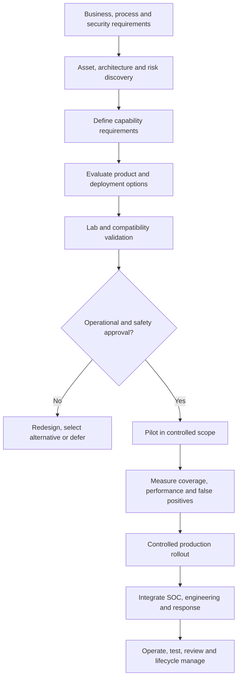
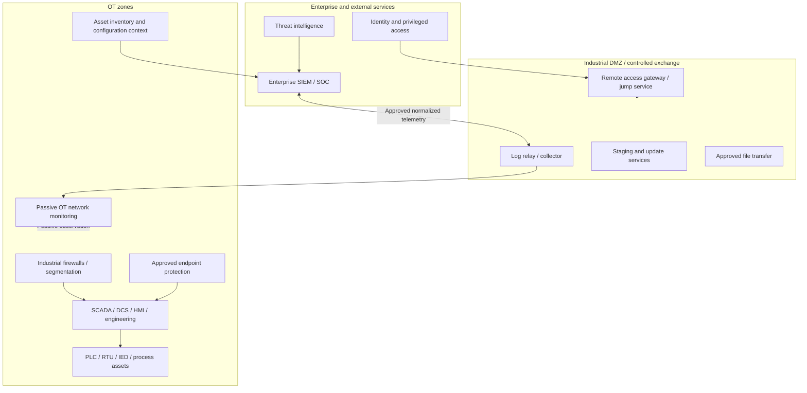
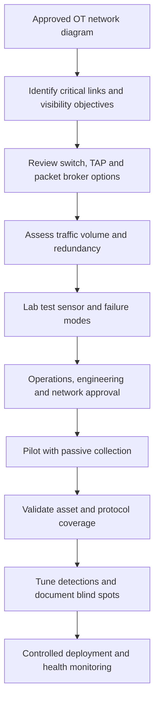
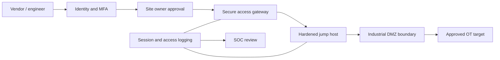
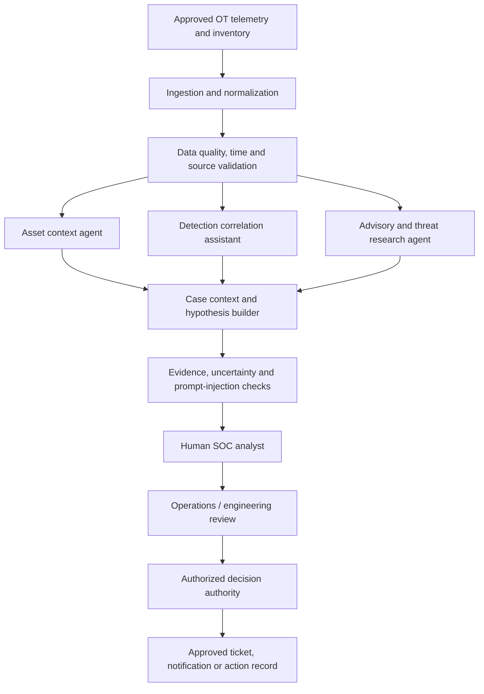

# OT Security Tools, Technologies and Engineering Platforms

**Document ID:** UOTS-15-TOOLS | **Version:** 1.0 | **Status:** Engineering reference

**Audience:** CISO, OT security architects, SOC leaders, control and automation engineers, network architects, plant operations, procurement, internal audit, system integrators and industrial technology owners.

> **Operational safety boundary:** This playbook is for security architecture, evaluation and defensive engineering. It does not authorize active scanning, intrusive testing, agent installation, inline inspection, blocking, controller interaction, firmware changes or production network modifications. Validate product behavior with the asset owner, OEM, control engineer and site change-management process. Prefer passive observation where active interaction could affect process reliability or safety.

---

# 1. Purpose and scope

This playbook explains how to select, design, deploy, integrate, operate and assure cybersecurity technologies for operational technology environments. It is a technology engineering reference, not a vendor ranking or product endorsement.

OT security technology must support the actual process environment. A product that performs well in an enterprise IT network may be unsuitable for a deterministic control network, legacy controller, safety-related system, low-bandwidth remote site or isolated facility.

The technology decision must account for:
- Process safety, reliability and availability.
- Asset and protocol compatibility.
- Passive versus active collection behavior.
- Network topology, zones and conduits.
- Local, centralized, cloud and hybrid deployment constraints.
- Data sovereignty, connectivity and retention.
- Vendor support and lifecycle.
- Integration with existing SOC and engineering workflows.
- Resilience when the security product or management plane fails.
- Total cost of ownership and operational staffing.

## 1.1 Outcomes

- Establish a defensible OT security technology architecture.
- Understand tool categories and their roles.
- Distinguish OT-native capabilities from general IT security capabilities.
- Select tools based on requirements and verified evidence.
- Deploy sensors and agents without unacceptable process impact.
- Integrate OT telemetry into SOC workflows with context.
- Maintain product lifecycle, configuration and performance assurance.
- Test tools in isolated or representative environments before deployment.
- Avoid tool overlap, blind spots and unsupported security claims.

## 1.2 Technology architecture lifecycle



---

# 2. OT security technology reference architecture

A typical architecture is composed of multiple control layers. Not every facility needs every product, and one product may provide more than one capability.



Conceptual only. Actual network placement, data flows and security boundaries must be based on the site's approved architecture. Avoid introducing a direct enterprise-to-controller path for convenience.

## 2.1 Capability layers

| Layer | Capability | Typical purpose |
|---|---|---|
| Asset visibility | Passive discovery, inventory, topology | Know what exists and how it communicates |
| Network security | Segmentation, industrial firewalls, access control | Restrict and govern communications |
| Detection | OT NDR, IDS, endpoint telemetry | Identify suspicious or unauthorized behavior |
| Endpoint security | EDR, application control, allowlisting | Protect supported hosts and engineering systems |
| Identity | MFA, PAM, session control | Govern human and service access |
| Vulnerability management | Exposure context, advisory mapping | Prioritize product and configuration weaknesses |
| Configuration integrity | Change monitoring, backups, version control | Detect unauthorized or accidental changes |
| Recovery | Backup, immutable storage, restore tooling | Restore trustworthy services and configurations |
| Central operations | SIEM, SOAR, case management | Correlate alerts and coordinate human response |
| Assurance | Compliance evidence, control testing | Demonstrate control operation and coverage |

---

# 3. Tool selection principles

1. Start from a risk scenario and control objective, not a vendor demonstration.
2. Define the asset population and supported technologies.
3. Confirm passive or active behavior precisely.
4. Validate protocol decoding and asset identification claims.
5. Identify required data flows, DNS, time, identity and cloud dependencies.
6. Evaluate fail-safe behavior and failure modes.
7. Confirm whether a sensor can operate without internet connectivity.
8. Test in a representative lab or pilot environment.
9. Measure coverage, false positives, latency and operational overhead.
10. Include deployment, support, licensing, training and lifecycle costs.
11. Document data ownership, residency, retention and access.
12. Define rollback and removal procedures before installation.

## 3.1 Requirements traceability

For every capability requirement, record:
- Requirement ID.
- Risk or use case addressed.
- Asset and zone scope.
- Required function.
- Mandatory versus optional.
- Acceptance criteria.
- Evidence source.
- Product response.
- Lab test result.
- Limitation or exception.
- Owner and approval.

Do not accept statements such as "supports OT" without exact supported product versions, protocols, devices, operating systems and deployment constraints.

---

# 4. OT asset discovery and inventory platforms

## 4.1 Purpose

Asset discovery identifies devices, systems, communication relationships and relevant attributes. OT discovery may use passive network observation, endpoint collection, engineering data imports, configuration sources or carefully controlled active methods.

## 4.2 Discovery approaches

| Approach | Description | OT considerations |
|---|---|---|
| Passive network observation | Analyze mirrored or tapped traffic | Generally preferred starting point; visibility limited to observed paths |
| Switch and network inventory | Retrieve approved infrastructure metadata | Requires secure access and may not reveal process devices behind gateways |
| Endpoint collection | Agent or local query on supported hosts | Validate resource use, supportability and change approval |
| Engineering repository import | Import project and configuration records | Data may be stale or incomplete |
| Vendor management platform | Use native asset information | Validate export, access and integration limits |
| Active discovery | Send probes or queries | Can affect fragile devices; require explicit engineering and OEM approval |

## 4.3 Required asset attributes

- Unique asset ID and observed identifiers.
- Site, building, unit, line and process.
- Zone, conduit and network segment.
- Manufacturer, model, serial and firmware where available.
- IP, MAC and communication interfaces.
- Role: PLC, RTU, HMI, DCS, SIS, IED, historian, workstation, server, gateway, network device.
- Criticality and process dependency.
- Owner and support contact.
- Vendor support and lifecycle status.
- Observed protocols and peers.
- Last seen and observation point.
- Discovery source and confidence.
- Vulnerability and exposure references.
- Approved baseline and change owner.

## 4.4 Coverage limitations

A passive sensor only sees traffic traversing its collection point. It may not identify silent devices, disconnected equipment, serial-only links, encrypted application details or traffic on unmonitored paths. Inventory must merge multiple sources and expose confidence and freshness.

---

# 5. Passive OT network monitoring, NDR and industrial IDS

## 5.1 Purpose

OT network detection and response tools observe network behavior, identify assets and protocols, establish baselines and detect suspicious communication patterns. Capabilities vary by product and version.

Typical use cases:
- New or unexpected asset.
- New communication relationship.
- Unexpected engineering workstation activity.
- Unusual protocol function or command.
- Remote access outside approved windows.
- Unexpected traffic across a zone boundary.
- Controller or device communication change.
- Known malicious indicators.
- Abnormal data volume or beacon-like behavior.
- Loss of expected telemetry or sensor health.

## 5.2 Collection architecture

Common collection methods:
- Network TAP.
- Switch SPAN or mirror port.
- Packet broker.
- Vendor-integrated sensor.
- Endpoint or host telemetry where supported.

NIST SP 800-82 Rev. 3 discusses network monitoring and use of TAP and SPAN, and cautions that SPAN use may affect performance. Sensor placement and failure behavior should be evaluated. Test sensors before production deployment and tune with representative traffic. [NIST SP 800-82 Rev. 3](https://csrc.nist.gov/pubs/sp/800/82/r3/final).

## 5.3 Sensor placement workflow



## 5.4 Vendor examples

The following are examples of market offerings, not rankings, certifications or endorsements. Confirm current product names, licensing, support, protocol coverage and deployment options directly with each vendor.

| Provider / platform family | Publicly described focus | Evaluation questions |
|---|---|---|
| Claroty platform / CTD / xDome | Cyber-physical systems visibility and security capabilities | On-premises versus cloud architecture, sensor design, supported assets, data flow |
| Nozomi Networks platform | OT and IoT visibility and security monitoring | Protocol coverage, sensor sizing, offline operation, integrations |
| Dragos Platform | OT-focused asset visibility, threat detection and response capabilities | Deployment model, intelligence services, incident support, asset coverage |
| Microsoft Defender for IoT | OT monitoring integrated with Microsoft security ecosystem | Sensor architecture, cloud connectivity, SIEM integration, data handling |
| Cisco Cyber Vision | Industrial network visibility and security capabilities | Supported network hardware, sensor placement, licensing and architecture |
| Tenable OT Security | OT asset and exposure management capabilities | Discovery methods, passive/active behavior, vulnerability context and deployment |
| Forescout platform | Device visibility and control across connected environments | OT device coverage, enforcement impact, integrations |
| Kaspersky Industrial CyberSecurity | Industrial security product portfolio | Regional availability, support, deployment and product-specific capabilities |

A product's advertised feature is not evidence that it is enabled, licensed, supported for a specific device, or suitable for a particular site.

## 5.5 Detection engineering requirements

For each alert, define:
- Detection ID and version.
- Behavior and rationale.
- Required telemetry and sensor location.
- Asset and process context.
- Rule logic and tuning.
- Severity and confidence.
- Known false-positive conditions.
- Analyst investigation steps.
- Operations escalation criteria.
- Safe response guardrails.
- Test data and validation result.
- Owner and review date.

---

# 6. Industrial firewalls, segmentation and secure conduits

## 6.1 Capability

Industrial firewalls and network security controls enforce approved communication boundaries between zones, conduits, enterprise services, industrial DMZs and remote access paths.

Selection considerations:
- Supported throughput and connection rates.
- Industrial protocol awareness and limitations.
- Stateful filtering and application identification.
- High availability and failover behavior.
- Management plane separation.
- Logging and SIEM integration.
- Rule lifecycle and change approval.
- Vendor support and firmware lifecycle.
- Environmental and physical requirements.
- Fail-open or fail-closed behavior and process impact.

## 6.2 Rule governance

Every rule should have:
- Rule ID and business purpose.
- Source and destination zones/assets.
- Protocol, port and direction.
- Process or service owner.
- Technical owner.
- Approval and change reference.
- Logging requirement.
- Start and expiry date where temporary.
- Review frequency.
- Test and rollback plan.

Do not create broad any-to-any rules to resolve operational issues without a documented risk decision.

## 6.3 Segmentation technology categories

- Industrial next-generation firewalls.
- Layer 3 routing and ACLs.
- Managed industrial switches.
- Network access control where appropriate.
- Industrial DMZ gateways.
- Unidirectional security gateways/data diodes for specific one-way transfer use cases.
- Secure remote access brokers.

No single product automatically creates a compliant zone-and-conduit architecture. Architecture, configuration, operations and evidence matter.

---

# 7. Identity, privileged access and remote access

## 7.1 Required capabilities

- Named individual accounts.
- MFA for remote and privileged access where supported and appropriate.
- Role-based access and least privilege.
- Time-bound supplier access.
- Approval workflow and business justification.
- Jump host or controlled access gateway.
- Session recording or logging where lawful and technically feasible.
- Credential vaulting and rotation.
- Service account governance.
- Emergency access and break-glass controls.
- Periodic access recertification.
- Revocation and offboarding.

## 7.2 Remote access architecture



The exact path must be designed for the site's architecture. Remote access must not create an uncontrolled direct route to controllers or safety systems.

## 7.3 PAM evaluation

Assess:
- Protocol and target support.
- Windows, Linux and industrial engineering application compatibility.
- Session recording fidelity.
- Credential injection and rotation.
- Offline and disconnected site operation.
- High availability and recovery.
- Supplier identity federation.
- Emergency access.
- Data residency and retention.
- Operational usability during maintenance windows.

---

# 8. Endpoint protection, EDR and application control

OT endpoints may include engineering workstations, HMI stations, historians, SCADA servers, domain services, jump hosts and operator workstations. Not all endpoints support modern agents or frequent updates.

## 8.1 Technology options

- Endpoint detection and response.
- Antivirus and antimalware.
- Application allowlisting.
- Host firewall.
- Device control and removable media control.
- File integrity monitoring.
- Patch and configuration management.
- Host logging and telemetry.

## 8.2 Compatibility checklist

Before deployment, verify:
- OS and application support matrix.
- OEM approval or support statement.
- CPU, memory, disk and network overhead.
- Compatibility with real-time and control applications.
- Update and signature distribution model.
- Reboot requirements.
- Offline mode.
- Exclusions and their governance.
- Alert forwarding and retention.
- Rollback and uninstall method.
- Pilot results under representative load.

Do not install an endpoint agent on a controller, HMI or engineering workstation solely because it is supported on a generic operating system. Confirm the full system configuration and vendor support.

---

# 9. Vulnerability and exposure management

## 9.1 Technology capabilities

- Asset and software inventory.
- Product/version identification.
- Vendor advisory correlation.
- CVE and CPE mapping where reliable.
- Known exploited vulnerability context.
- Exposure and reachability analysis.
- Compensating control context.
- Remediation workflow and exception tracking.
- Lifecycle and end-of-support tracking.

## 9.2 OT vulnerability prioritization

Prioritize with:
- Exact product and version applicability.
- Vendor advisory and mitigation guidance.
- Asset criticality and process consequence.
- Reachability and attack path.
- Required privileges and exploit preconditions.
- Known exploitation evidence.
- Existing safeguards.
- Availability of safe mitigation.
- Maintenance windows and validation requirements.

CVSS is a technical severity input, not a complete OT risk decision. Avoid unapproved vulnerability scans of production control devices.

---

# 10. SIEM, SOAR and security operations integration

## 10.1 Data integration

Potential sources:
- OT NDR and IDS.
- Industrial firewalls and gateways.
- Remote access and PAM.
- Windows and Linux systems.
- Identity and authentication services.
- EDR and application control.
- Asset inventory and vulnerability systems.
- Backup and infrastructure services.
- Physical access records where approved.

## 10.2 OT-specific SIEM requirements

- Site and process context.
- Asset criticality and owner.
- Zone and conduit information.
- Time synchronization and timestamp quality.
- Protocol and command context where available.
- Data volume controls.
- Local buffering during WAN outage.
- Secure relay from OT to enterprise.
- Retention and data residency.
- Access segregation and audit.
- Sensor health and telemetry gap detection.

## 10.3 SOAR guardrails

Appropriate automations may include:
- Create a case from a validated alert.
- Enrich asset owner and approved inventory context.
- Retrieve relevant advisories.
- Notify designated on-call personnel.
- Draft a situation report.
- Track an approval workflow.
- Record analyst disposition.

Do not automate disruptive actions such as blocking industrial traffic, disabling OT identities, quarantining production endpoints, changing controller configurations or restarting systems without explicit engineering validation and authorized human decision-making.

---

# 11. Configuration, change and integrity management

Capabilities:
- Version-controlled engineering project repositories.
- Approved configuration baselines.
- File integrity monitoring.
- Controller and network configuration backup.
- Change detection and audit trails.
- Secure engineering workstation images.
- Firmware and software inventory.
- MOC integration.

For each monitored object, define authoritative baseline, approval process, collection method, integrity verification, retention, access and restoration authority. A detected difference is an investigation lead, not automatic proof of malicious activity.

---

# 12. Backup, recovery and resilience technologies

Evaluate:
- Offline and immutable backup.
- Application-aware backup.
- Controller project and configuration backup.
- Historian and database backup.
- Virtual machine and server recovery.
- Golden images and installation media.
- Spare hardware and replacement lead times.
- Recovery orchestration.
- Integrity validation and malware assessment.
- Restore testing and operational acceptance.

A successful backup job does not prove that a backup is complete, clean, compatible or recoverable. Test restoration in a representative isolated environment and record results.

---

# 13. Deception, honeypots and research environments

OT deception can provide intelligence about unauthorized interaction with decoy services or systems. Use only controlled, clearly governed deployments.

Consider:
- Isolated placement and containment.
- No unintended route to production controllers.
- Synthetic data and non-operational credentials.
- Clear ownership and alert routing.
- Legal and privacy review.
- Safe reset and evidence handling.
- No use as a substitute for asset inventory or segmentation.

Honeypots and protocol simulators are valuable for training and detection validation when isolated from live production.

---

# 14. Wireless, IIoT, edge and cloud-connected OT

Assess:
- Industrial Wi-Fi and roaming.
- Private cellular and public cellular connectivity.
- Wireless sensor networks.
- IIoT gateways and protocol translators.
- Edge compute and container platforms.
- Cloud historians and analytics.
- Remote fleet management.
- Certificate and device identity lifecycle.
- Offline operation and store-and-forward.
- Data residency and cross-border transfer.
- Cloud identity, API and tenant security.

Cloud connectivity must be justified by process and business requirements, designed through controlled boundaries and validated for loss-of-connectivity behavior. Do not assume cloud-hosted monitoring means the underlying control system is cloud-dependent.

---

# 15. Open-source and general-purpose defensive tools

Open-source tools can provide useful packet analysis, network metadata, IDS, log management and lab capabilities. They are not automatically OT-safe or industrially validated.

| Tool | Primary capability | Suitable use | OT caution |
|---|---|---|---|
| Wireshark | Packet capture analysis and protocol dissection | Offline packet investigation and training | Capture location and traffic generation must be approved |
| Zeek | Network security monitoring and protocol metadata | Passive traffic analysis and metadata generation | Validate industrial protocol visibility and parser support |
| Suricata | Network IDS/IPS and protocol inspection | Detection in lab or approved passive deployment | Inline IPS can disrupt traffic; use carefully validated passive mode |
| Security Onion | Integrated network and host visibility platform | SOC lab, detection validation and selected monitoring use | Resource, architecture and protocol coverage need engineering validation |
| Arkime | Full packet capture indexing and search | Forensic packet investigation | Storage, privacy, retention and sensitive payload controls |
| Snort | Network intrusion detection/prevention | Rule-based detection in lab or approved sensor | Rule tuning and passive/inline mode matter |
| Elastic Stack | Search, analytics and dashboards | Log collection and analysis | Requires secure architecture, sizing and lifecycle management |
| OpenSearch | Search and analytics | Log and telemetry analytics | Integration and support model need assessment |
| Wazuh | Host security monitoring and SIEM functions | Supported endpoint and lab telemetry | Agent compatibility must be verified for each OT endpoint |
| Grafana | Dashboards and visualization | Metrics and operational security dashboards | Dashboard is not a detection or asset assurance control by itself |

Official project documentation:
- Wireshark: https://www.wireshark.org/docs/
- Zeek: https://docs.zeek.org/
- Suricata: https://docs.suricata.io/
- Security Onion: https://docs.securityonion.net/
- Arkime: https://arkime.com/
- Snort: https://www.snort.org/
- Elastic: https://www.elastic.co/guide/
- OpenSearch: https://opensearch.org/docs/
- Wazuh: https://documentation.wazuh.com/
- Grafana: https://grafana.com/docs/

Security Onion publicly describes network visibility, host visibility, IDS, honeypots, log management and case management, including Suricata, Zeek and Elastic Agent integrations. Product capabilities and current release details should be checked in its official documentation. [Security Onion documentation](https://docs.securityonion.net/en/3/dev/introduction/).

---

# 16. Commercial platform evaluation framework

Do not publish a universal winner. Build a weighted, evidence-based evaluation for the actual environment.

## 16.1 Evaluation dimensions

| Dimension | Example evidence |
|---|---|
| Asset coverage | Lab results against representative devices and traffic |
| Protocol support | Exact protocol, function, version and decode limitations |
| Passive architecture | Data path, TAP/SPAN support and active behavior |
| Deployment | On-premises, cloud, hybrid, disconnected and multi-site |
| Safety and reliability | OEM compatibility, resource use and failure mode |
| Detection | Test cases, alert fidelity and false-positive rate |
| Integrations | SIEM, ticketing, identity, firewall and asset systems |
| Scalability | Sensor capacity, throughput and retention design |
| Security | RBAC, MFA, encryption, audit and secure updates |
| Privacy and residency | Data location, access and retention |
| Support | Regional support, SLA, escalation and product lifecycle |
| Cost | Licensing, hardware, implementation, training and renewal |
| Exit | Data export, migration and decommissioning |

## 16.2 Scoring model

An organization may use a weighted score, but the weights must be approved and documented.

```text
Weighted score = Sum(requirement weight x evidence-based rating)
```

Use a defined rating scale, for example:
- 0: Not supported or no evidence.
- 1: Major gap.
- 2: Partial capability with material limitation.
- 3: Meets requirement with documented constraints.
- 4: Strong evidence in representative testing.

Do not score marketing statements as verified capability. Mandatory safety, legal, architecture and data residency requirements should be pass/fail gates rather than averaged into a high overall score.

## 16.3 Proof of concept acceptance criteria

- Representative device and protocol coverage.
- No unacceptable process impact.
- Sensor health and fail-state behavior understood.
- Detection test cases validated.
- False positives and missed detections documented.
- SIEM integration and timestamp quality verified.
- Access controls and audit verified.
- Data export and deletion tested.
- Operational ownership and support confirmed.
- Rollback and decommissioning tested.

---

# 17. Deployment and change governance

## 17.1 Deployment stages

1. Business case and risk statement.
2. Asset and architecture discovery.
3. Requirements and acceptance criteria.
4. Vendor and product due diligence.
5. Lab compatibility testing.
6. Site engineering and safety review.
7. MOC and implementation approval.
8. Pilot deployment.
9. Performance and detection validation.
10. Production rollout by approved scope.
11. Handover to operations and SOC.
12. Periodic review and lifecycle management.

## 17.2 Required change record

- Product, version and license.
- Hardware, VM or sensor specifications.
- Exact installation location.
- Network interfaces and flows.
- Ports, protocols and destination endpoints.
- Data collected and retention.
- Authentication and administration.
- Expected performance and resource impact.
- OEM and engineering approval.
- Failure mode and bypass behavior.
- Test plan and rollback.
- Monitoring and support owner.
- Maintenance and upgrade schedule.

## 17.3 Failure mode analysis

Evaluate:
- Sensor failure.
- Packet loss or overload.
- SPAN oversubscription.
- Packet broker failure.
- Management server outage.
- Cloud connectivity loss.
- Time synchronization loss.
- Certificate expiry.
- Storage exhaustion.
- Update failure.
- Misconfigured rule or policy.
- Integration queue backlog.

Security monitoring should not become a single point of failure for the process network.

---

# 18. Operational procedures and service ownership

Every tool requires:
- Named business owner.
- Technical platform owner.
- Operations contact.
- Support and escalation path.
- Configuration baseline.
- Access review.
- Backup and recovery procedure.
- Update and patch process.
- Alert and incident workflow.
- Health monitoring.
- License and contract tracking.
- End-of-life plan.
- Data retention and deletion policy.

A product deployed without operational ownership, tuning, review and support is not a sustainable security control.

---

# 19. Metrics and service-level indicators

| Metric | Definition | Caution |
|---|---|---|
| Asset visibility coverage | In-scope assets observed or reconciled / known in-scope assets | State confidence and source limitations |
| Sensor coverage | Critical links with validated visibility / identified critical links | Coverage is not detection effectiveness |
| Sensor availability | Available monitoring time / planned monitoring time | Include data quality and packet loss |
| Protocol decode coverage | Validated traffic classes decoded / traffic classes in scope | Do not rely on vendor protocol count |
| Detection validation | Passed test cases / executed test cases | Include false negatives and limitations |
| Alert precision | Confirmed relevant alerts / investigated alerts | Depends on analyst disposition quality |
| Triage time | Time from alert to initial review | Do not optimize at expense of safe escalation |
| Integration health | Successful expected event delivery / expected event delivery | Include queue and timestamp checks |
| Endpoint coverage | Supported endpoints with verified protection / supported in-scope endpoints | Do not force unsupported agents |
| Recovery assurance | Critical tools with tested restore evidence / critical tools | Backup job success is not enough |
| Rule review completion | Rules reviewed on schedule / rules due for review | Review quality matters |

Define measurement owner, source, frequency, target, threshold and corrective action.

---

# 20. AI-assisted security technology and agent workflows

AI can assist with telemetry summarization, alert enrichment, natural-language search, anomaly investigation, rule drafting, asset context and report preparation. It must not become an autonomous controller or unreviewed response authority.

## 20.1 Reference agent architecture



## 20.2 Agent controls

- Read-only access by default.
- Explicitly scoped data sources.
- Site and tenant segregation.
- No direct controller or safety system credentials.
- Treat telemetry, logs and documents as untrusted input.
- Prompt-injection resistance and tool allowlisting.
- Source citation and evidence provenance.
- Confidence and uncertainty labels.
- Human review before material decisions.
- Audit logs for prompts, outputs and actions.
- Model and rule version management.
- Manual fallback and incident procedure.
- Periodic adversarial and quality testing.

## 20.3 Allowed and prohibited actions

| Workflow | AI support | Boundary |
|---|---|---|
| Alert enrichment | Retrieve asset owner and known context | Do not invent asset attributes |
| Threat research | Summarize cited vendor advisories | Do not claim attribution without evidence |
| Detection drafting | Suggest detection logic and test cases | Human validates against actual telemetry |
| Case management | Draft incident summary and timeline | Preserve original evidence |
| Compliance mapping | Suggest candidate framework references | Verify exact clauses and applicability |
| Response | Draft options and decision records | No autonomous production containment |
| Configuration | Explain proposed configuration | No autonomous firewall or controller changes |

---

# 21. Industry-specific technology considerations

| Industry | Technology priorities | Specific evaluation concerns |
|---|---|---|
| Oil and gas upstream | Remote site visibility, cellular links, RTU monitoring, secure vendor access | Intermittent connectivity, bandwidth and autonomous operation |
| Pipelines and midstream | SCADA telemetry, remote access, segmentation and communications monitoring | Long-distance sites, telecom dependencies and availability |
| Refining and petrochemicals | DCS visibility, engineering workstation protection, process network segmentation | Legacy systems, process constraints and vendor support |
| LNG | Multi-system visibility, secure remote support, recovery | Complex dependencies and high consequence |
| Power generation | Control network monitoring, engineering access, configuration integrity | OEM ecosystem, generation continuity and protection boundaries |
| Transmission and distribution | Substation network visibility, IED and relay configuration assurance | IEC 61850 and utility-specific architectures |
| Water and wastewater | Asset inventory, remote access, segmentation, operator visibility | Small teams, remote sites and public health implications |
| Manufacturing | PLC and robotics visibility, endpoint control, recipe integrity | Production windows and mixed-age equipment |
| Mining | Autonomous systems, wireless networks, remote operations | Harsh environments and connectivity |
| Ports and airports | BMS, terminal systems, physical access and operational networks | Multiple operators and supplier boundaries |
| Rail and transport | Signalling support systems, control centre and communications monitoring | Safety lifecycle and strict change control |
| Data centre facilities | BMS, EPMS, cooling and power monitoring | Availability and facility management dependencies |

These are selection prompts. Actual requirements depend on facility design, process function, asset inventory and applicable obligations.

---

# 22. Practical labs and validation exercises

All exercises must use isolated labs, synthetic traffic, representative replicas or explicitly approved non-production environments.

| Lab | Objective | Deliverable |
|---|---|---|
| 01 | Build an OT security tool capability map | Capability matrix |
| 02 | Design passive TAP/SPAN collection | Sensor placement diagram |
| 03 | Analyze synthetic industrial packet capture | Protocol and asset observations |
| 04 | Build Zeek metadata pipeline | Network metadata records |
| 05 | Validate Suricata rules using synthetic traffic | Detection test report |
| 06 | Deploy Security Onion in isolated lab | Lab architecture and validation |
| 07 | Design industrial firewall rule governance | Rule register |
| 08 | Design remote access and PAM workflow | Access architecture |
| 09 | Assess endpoint protection compatibility | Endpoint compatibility matrix |
| 10 | Build vulnerability applicability workflow | Advisory triage worksheet |
| 11 | Integrate sample telemetry with SIEM | Normalization and use-case map |
| 12 | Test backup and configuration integrity | Recovery evidence pack |
| 13 | Create asset inventory confidence model | Reconciled inventory |
| 14 | Evaluate vendor proposals | Weighted POC scorecard |
| 15 | Test AI alert enrichment with synthetic data | Human-reviewed case report |
| 16 | Conduct sensor failure tabletop | Failure and fallback plan |
| 17 | Create a technology lifecycle register | Ownership and end-of-life tracker |

Each lab should include prerequisites, topology, exact steps, synthetic source data, expected output, validation criteria, limitations, cleanup and instructor notes. No lab should require scanning or changing a live production controller.

---

# 23. Procurement and vendor due diligence

Request and verify:
- Product and component bill of materials where available.
- Security architecture and data flow.
- Deployment and connectivity requirements.
- Supported product, OS and protocol matrices.
- Secure development and vulnerability disclosure practices.
- Update signing and distribution.
- Authentication, RBAC and audit.
- Encryption and key management.
- Data residency, retention and deletion.
- Third-party and subcontractor dependencies.
- Incident notification and support obligations.
- Product lifecycle and end-of-support dates.
- Vulnerability remediation SLA.
- Backup, export and exit options.
- Regional support and service continuity.
- Independent assurance reports and scope.
- Contractual limitations and liability.

Do not equate a vendor certification with certification of the customer's deployment or with compliance of the entire OT environment.

---

# 24. Technology lifecycle and obsolescence

Maintain a lifecycle register with:
- Product name and edition.
- Version and build.
- Deployment location.
- Owner and support contact.
- License and renewal date.
- Vendor support status.
- End-of-sale and end-of-life dates.
- Vulnerability and advisory status.
- Integration dependencies.
- Backup and recovery details.
- Upgrade path and compatibility.
- Replacement plan and funding.
- Exception and residual risk.

Plan upgrades with representative testing and change approval. Do not automatically apply enterprise patch schedules to industrial systems.

---

# 25. Standards and authoritative references

Verify publication status and exact editions before formal compliance use.

1. **NIST SP 800-82 Rev. 3, Guide to Operational Technology Security (September 2023).** OT security architecture, monitoring, segmentation, asset and risk considerations.  
   https://csrc.nist.gov/pubs/sp/800/82/r3/final

2. **NIST SP 800-82 Rev. 4 Initial Public Draft (September 21, 2026).** Draft, not final. The draft expands coverage including building automation, water and wastewater, food and agriculture, freight rail, maritime, IIoT and cloud convergence, and reorganizes around CSF 2.0. Public comments due November 30, 2026.  
   https://csrc.nist.gov/pubs/sp/800/82/r4/ipd

3. **NIST SP 800-53 Rev. 5.** Security and privacy controls, subject to OT tailoring.  
   https://csrc.nist.gov/pubs/sp/800/53/r5/upd1/final

4. **ISA/IEC 62443 series.** Industrial automation and control systems security.  
   https://www.isa.org/standards-and-publications/isa-standards/isa-iec-62443-series-of-standards

5. **NIST CSF 2.0.** Cybersecurity risk governance and outcomes.  
   https://www.nist.gov/cyberframework

6. **MITRE ATT&CK for ICS.** Industrial adversary techniques and detection context.  
   https://attack.mitre.org/matrices/ics/

7. **CISA ICS advisories.** Industrial product vulnerability and mitigation advisories.  
   https://www.cisa.gov/news-events/ics-advisories

8. **Security Onion documentation.** Open security monitoring platform architecture and component documentation.  
   https://docs.securityonion.net/

9. **Zeek documentation.** Network security monitoring platform.  
   https://docs.zeek.org/

10. **Suricata documentation.** Network IDS/IPS and network security monitoring engine.  
    https://docs.suricata.io/

## 25.1 Mapping limitations

This document maps tool capabilities to broad security objectives. It does not claim that a product implements or satisfies a particular IEC 62443 requirement, NIST control, national regulation or certification scheme. Formal mapping requires exact control text, deployment evidence, configuration review and applicability analysis.

---

# 26. Limitations and professional use

This is a general engineering reference. It does not:
- Endorse or rank vendors.
- Guarantee support for a specific industrial asset or protocol.
- Certify a product or deployment.
- Replace OEM compatibility guidance.
- Authorize active discovery, intrusive testing or production changes.
- Replace process safety, MOC or site engineering approval.
- Establish legal or regulatory applicability.
- Guarantee that a passive sensor sees all network activity.
- Guarantee that a detection platform will identify every attack.

Validate all product capabilities, supported versions, licensing, architecture and regional availability with current primary vendor documentation and representative testing.

## Revision history

| Version | Date | Change | Status |
|---|---|---|---|
| 1.0 | 2026-11-17 | Initial OT security tools and technology engineering playbook | Engineering reference |

## Specialist expansion backlog

1. Product-by-product capability and version matrix using primary vendor documentation.
2. Detailed protocol coverage and asset identification validation catalogue.
3. Sensor sizing and packet broker engineering worksheets.
4. Industrial firewall architecture patterns and rule review pack.
5. SIEM schema and OT telemetry normalization reference.
6. Secure remote access patterns by sector and site type.
7. Product security and software supply-chain assurance questionnaire.
8. Regional procurement, data residency and support considerations.
9. Lab build guides and synthetic industrial PCAP datasets.
10. Vendor lifecycle and vulnerability tracking catalogue.
