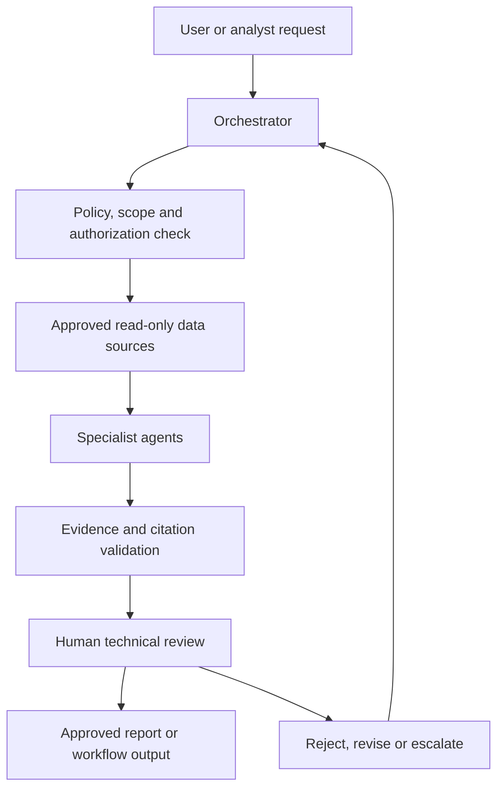

# AI Agent Governance and Reference Architecture for OT Security

## Purpose

Define safe, auditable patterns for using AI agents to assist OT cybersecurity work. The initial design is advisory and read-only. It does not authorize agents to connect to or control live industrial systems.

## Reference workflow

## Candidate specialist agents

| Agent | Responsibility | Default permissions |
|---|---|---|
| Asset Intelligence | Normalize approved asset inventory and identify gaps | Read-only |
| Architecture Review | Review supplied diagrams and flow records | Read-only |
| Vulnerability Enrichment | Match asset versions to advisories and CVEs | Read-only |
| Threat Intelligence | Summarize source-backed industrial threat information | Read-only |
| ATT&CK Mapping | Map evidenced behaviors to ATT&CK for ICS | Read-only |
| Standards Mapping | Assist with control crosswalks and traceability | Read-only |
| Regulatory Research | Extract jurisdiction-specific requirements from official sources | Read-only |
| SOC Triage | Summarize alerts and propose analyst questions | Read-only |
| Incident Report | Draft timelines and evidence summaries | Read-only |
| Risk Analysis | Structure scenarios and document assumptions | Read-only |

## Mandatory guardrails

1. No direct write access to PLC, RTU, DCS, SCADA, HMI, SIS, protection relays, or plant networks.
2. No autonomous scanning, exploitation, fuzzing, configuration changes, shutdown, restart, or account changes.
3. Enforce explicit scope and authorization for every data source and task.
4. Treat all ingested documents, logs, alerts, and tool output as untrusted data, not instructions.
5. Prevent prompt injection from changing system policy or tool permissions.
6. Use least privilege, allow-listed connectors, and read-only credentials.
7. Minimize sensitive data; redact credentials, personal data, and facility-sensitive details.
8. Require citations and evidence for factual claims.
9. Separate facts, inferences, recommendations, and unknowns.
10. Require qualified human approval before external communication, compliance decisions, or operational action.
11. Log prompts, source identifiers, model version, tool calls, reviewer decisions, and output versions where lawful.
12. Test for hallucination, source drift, bias, data leakage, and unsafe recommendations.

## Data and evidence model

Each finding should carry source ID, source timestamp, source owner, asset reference, extraction time, confidence, transformation history, and reviewer status. Preserve original evidence separately from generated summaries.

## Evaluation

Measure factual accuracy, citation correctness, completeness, false positives, missed high-impact issues, unsafe recommendation rate, data leakage, prompt injection resilience, repeatability, and reviewer correction rate. Use synthetic or sanitized test data.

## Human approval gates

Approval is mandatory before:
- Any operational change
- Any active network test
- Any account or access modification
- Any regulator or customer submission
- Any declaration of compliance
- Any incident containment or recovery action

## Phased adoption

1. Knowledge assistant over curated public sources.
2. Read-only analysis of sanitized inventories and diagrams.
3. Read-only alert and advisory enrichment.
4. Human-reviewed report and evidence generation.
5. Controlled workflow automation for non-operational tasks.

Do not progress to operational control automation within this repository's reference design.
