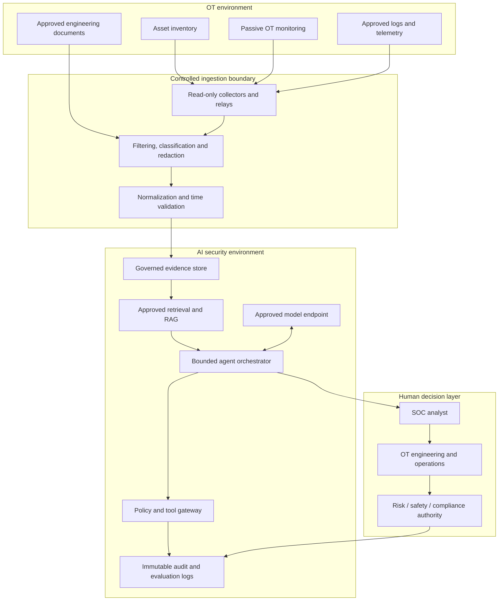
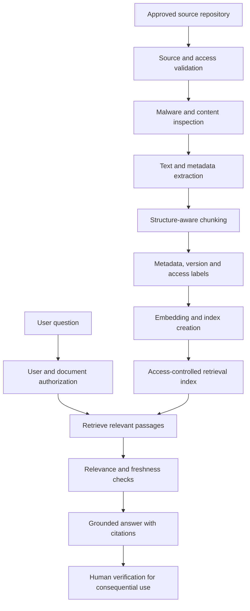
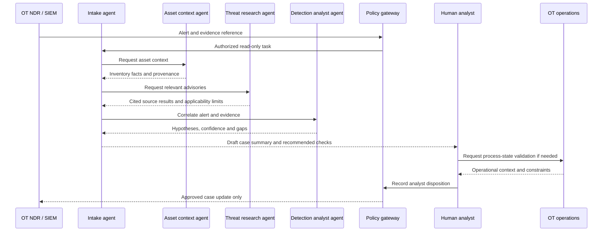
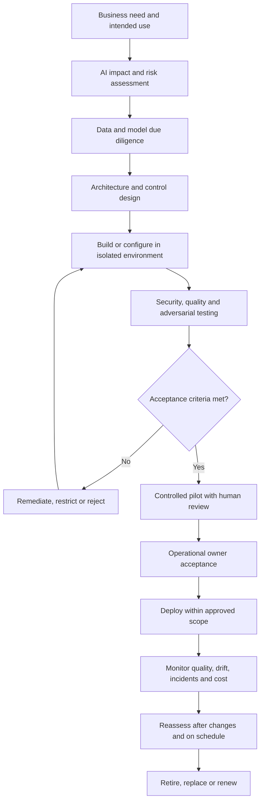

# AI and Agentic OT Security Engineering Playbook

**Document ID:** UOTS-17-AI | **Version:** 1.0 | **Status:** Engineering and governance reference

**Audience:** CISOs, OT security leaders, AI architects, industrial automation engineers, SOC managers, data scientists, risk and compliance teams, safety professionals, system integrators, product security teams and critical infrastructure operators.

> **Safety boundary:** AI must not be given autonomous authority to operate, reconfigure, stop, start, isolate, block or otherwise control production OT assets or safety-related systems through this playbook. Default to read-only data access, isolated evaluation and human-reviewed recommendations. Any future operational action requires a separately approved safety, security, engineering, legal and governance case, with explicit scope, fail-safe design, testing and accountable authorization. Never connect an experimental agent directly to a live controller.

---

# 1. Purpose and scope

This playbook defines an engineering approach to applying artificial intelligence, machine learning, large language models (LLMs), retrieval-augmented generation (RAG), and agentic workflows to operational technology cybersecurity.

AI can help security teams interpret large volumes of telemetry, connect asset and process context, summarize vendor advisories, draft detection logic, search engineering documentation, support incident timelines and improve analyst workflows. These capabilities introduce risks: inaccurate outputs, hidden assumptions, prompt injection, data leakage, model compromise, unsafe tool use, automation bias and unreviewed operational decisions.

The purpose is to describe where AI can provide defensible assistance, how to architect and govern it, how to validate outputs and how to prevent an AI workflow from becoming an unsafe control path.

This is not a claim that AI is necessary for every OT security function. Deterministic engineering controls, known-good baselines, conventional analytics, expert review and manual procedures remain essential.

## 1.1 Outcomes

- Define AI use cases from explicit OT security and business needs.
- Separate AI assistance from operational authority.
- Design secure data and model architectures.
- Establish trustworthy OT knowledge retrieval.
- Build bounded, auditable agent workflows.
- Evaluate detection quality and model limitations.
- Protect prompts, models, tools, datasets and outputs.
- Integrate AI into SOC and engineering workflows safely.
- Map governance to recognized AI and cybersecurity frameworks.
- Measure benefit, risk, cost and operational impact.

## 1.2 Terms

| Term | Meaning in this playbook |
|---|---|
| AI system | A machine-based system that produces predictions, content, recommendations or decisions for defined objectives |
| Machine learning | Methods that learn patterns from data |
| LLM | A model trained to process and generate language |
| Generative AI | AI that generates text, code, images, audio or other content |
| RAG | Retrieval-augmented generation: retrieving external information and supplying it to a model as context |
| Agent | A software workflow that uses a model to select among permitted steps or tools toward an objective |
| Multi-agent system | A workflow in which multiple specialized agents exchange information or coordinate tasks |
| Tool | A defined API or function an agent may invoke |
| Human-in-the-loop | A person reviews or approves a decision or action before it proceeds |
| Model drift | A change in model performance as data or operating conditions change |
| Grounding | Linking an output to evidence or retrieved source material |
| Guardrail | A technical or procedural control that constrains model input, output or action |

---

# 2. AI use-case suitability for OT

Begin with the process, risk and user problem. Do not begin with a model or vendor demonstration.

## 2.1 Suitable assistance patterns

- Summarize alerts and supporting telemetry.
- Retrieve asset ownership and engineering context.
- Explain protocol fields in an offline packet capture.
- Search approved standards interpretations and internal procedures.
- Correlate advisories with verified asset product/version records.
- Draft incident timelines from supplied evidence.
- Suggest candidate detection hypotheses.
- Generate test cases for synthetic lab environments.
- Draft audit evidence indexes and gap summaries.
- Translate technical findings for different stakeholder audiences.
- Assist with knowledge management and training.

## 2.2 High-risk or unsuitable patterns without separate approval

- Autonomous modification of PLC, DCS, SCADA, SIS or IED configurations.
- Autonomous firewall rule changes or network isolation.
- Automatic shutdown, restart or process setpoint modification.
- Unreviewed endpoint quarantine in production.
- Automatic disabling of operator or engineering accounts.
- AI-only determination that a plant is safe to operate.
- AI-only declaration of regulatory compliance.
- AI-only vulnerability applicability or risk acceptance.
- Model-generated commands executed on production assets.
- Unbounded agents with broad network access or reusable privileged credentials.

## 2.3 Use-case risk classification

| Class | Example | Default governance |
|---|---|---|
| A: Knowledge assistance | Search approved procedure, summarize public advisory | Source controls, privacy review and user verification |
| B: Analyst assistance | Alert enrichment, incident timeline draft | Evidence grounding, confidence and analyst approval |
| C: Decision support | Prioritize exposure or propose treatment options | Independent validation, accountable decision owner |
| D: Controlled lab automation | Create disposable lab, run synthetic exercise | Isolated environment, allowlisted tools and quotas |
| E: Operational action | Change a production security or control configuration | Prohibited by default; separate formal authorization and safety case required |

# 3. Reference AI architecture for OT security

A safe architecture separates data collection, retrieval, model inference, agent orchestration and operational systems. The model does not receive direct control-plane access.

Conceptual reference only. The actual architecture must specify trust boundaries, data flows, identities, deployment location, network paths, retention, model hosting and jurisdictional requirements. A diagram is not proof that a deployment is secure.

## 3.1 Architecture principles

1. Read-only collection by default.
2. Separate OT collection from AI inference infrastructure.
3. Minimize and classify data before transfer.
4. Use authenticated, encrypted, logged interfaces.
5. Separate model access from tool execution.
6. Put every tool behind a policy-enforcing gateway.
7. Apply per-user, per-agent and per-site authorization.
8. Keep human decision-makers accountable.
9. Preserve source evidence and original timestamps.
10. Support operation during model or WAN outage.
11. Maintain a manual fallback.
12. Record model, prompt, tool and knowledge-base versions.

# 4. Data engineering and industrial context

AI quality is constrained by the quality, provenance and context of its input data. OT telemetry is often incomplete, time-sensitive, site-specific and dependent on engineering meaning.

## 4.1 Potential data sources

- Passive network metadata and approved packet extracts.
- OT IDS/NDR alerts.
- Firewall and remote-access logs.
- PAM and identity events.
- EDR telemetry from supported endpoints.
- Asset inventory and configuration management.
- Engineering change records.
- Vendor product advisories.
- Vulnerability and exposure records.
- Approved network and process diagrams.
- Incident tickets and response records.
- Backup and recovery test evidence.
- Maintenance schedules and work orders.
- Approved operating procedures and emergency plans.

## 4.2 Data quality controls

For every source, document:
- Source owner and system of record.
- Collection method and authorization.
- Site, zone and asset scope.
- Timestamp and time zone.
- Clock synchronization quality.
- Data format and schema version.
- Completeness and known blind spots.
- Confidence and freshness.
- Classification and sensitivity.
- Personal or commercially sensitive data.
- Retention and deletion.
- Integrity and chain-of-custody requirements.
- Permitted AI use and prohibited reuse.

## 4.3 OT context model

A useful context record can include:
- Site and facility identifier.
- Process area and operational function.
- Asset ID, role, manufacturer, model and version.
- Zone and conduit.
- Criticality and consequence context.
- Owner and support contact.
- Approved communication relationships.
- Maintenance window.
- System lifecycle and support status.
- Source references and confidence.
- Last verified time.

Do not let an LLM infer a controller identity, process function, criticality or safety role from an IP address alone.

# 5. RAG for OT documentation and standards knowledge

RAG can make approved documentation searchable and can provide source excerpts to support a generated answer. It does not make the model authoritative or guarantee that retrieved material is correct, current or applicable.

## 5.1 Knowledge source classes

| Source class | Examples | Handling |
|---|---|---|
| Primary authoritative | Regulator publications, standards catalogues, national CERT advisories | Preserve publisher, edition, date and exact reference |
| Vendor primary | Product manuals, advisories, support matrices | Preserve product, version, publication date and applicability |
| Internal controlled | Approved architecture, policy, runbook, asset register | Respect classification, access control and document version |
| Research | Peer-reviewed papers, technical reports | Record methodology, limitations and publication status |
| Community | Forums, blogs, issue trackers | Treat as leads; independently verify before operational use |

## 5.2 RAG ingestion workflow

## 5.3 Retrieval controls

- Enforce document-level and section-level authorization.
- Do not retrieve across customer or site boundaries.
- Preserve headings, tables, clause identifiers and page references.
- Retain publication and revision dates.
- Identify superseded documents.
- Detect duplicate and conflicting versions.
- Distinguish final publications from drafts.
- Prevent hidden text or embedded instructions from controlling the agent.
- Provide source links and exact retrieved references.
- Return "not found" when evidence is insufficient.
- Do not fabricate standards clauses or regulatory requirements.
- Re-index after approved document changes and record index version.

## 5.4 Standards copyright and use

Licensed standards may be subject to copyright and distribution restrictions. Store only content the organization is licensed and authorized to use. Prefer metadata, clause identifiers, original summaries and controlled links where full-text ingestion is not permitted. Do not reproduce protected standards text into an open knowledge base without permission.

# 6. Agentic OT SOC architecture

Agents should be specialized, bounded and independently auditable. A multi-agent workflow does not mean agents can independently decide or execute production response.

## 6.1 Example agent roles

| Agent | Responsibility | Permitted default tools | Prohibited authority |
|---|---|---|---|
| Intake agent | Normalize alert fields and identify missing data | Read-only alert API | Close incident or change source record |
| Asset context agent | Retrieve approved asset details | Inventory read API | Modify asset criticality |
| Threat research agent | Search trusted advisories and threat references | Approved read-only search | Declare attribution without evidence |
| Detection analyst agent | Explain alert and suggest hypotheses | Read-only telemetry query | Change production detection policy |
| Vulnerability context agent | Check exact product/version applicability | Advisory and inventory read API | Launch production scans or patch assets |
| Incident timeline agent | Draft event chronology | Read-only case and log API | Alter original evidence |
| Report agent | Draft executive and technical summaries | Approved document generator | Publish externally without approval |
| Governance agent | Check required approvals and evidence fields | Read-only workflow state | Approve its own action |

## 6.2 Agent flow

## 6.3 Agent interaction contract

Every agent request should specify:
- Task ID and requesting identity.
- Site and tenant scope.
- Permitted data sources.
- Allowed tools and operations.
- Expected output schema.
- Time and token budget.
- Evidence and citation requirement.
- Confidence and uncertainty requirement.
- Prohibited actions.
- Human review requirement.
- Audit correlation ID.

## 6.4 Orchestration safeguards

- Tool allowlists, not arbitrary shell or network access.
- Strict argument schemas and validation.
- Per-tool authentication and authorization.
- Short-lived credentials where possible.
- Rate limits and quotas.
- Execution timeouts.
- Output validation and content limits.
- Sandboxed code execution if code is genuinely required.
- Human approval for consequential steps.
- Kill switch and circuit breaker.
- Complete event and tool-call logging.
- Explicit failure and fallback behavior.

# 7. AI-driven anomaly detection

Machine learning can identify patterns that differ from a learned baseline. An anomaly is not necessarily an attack. It may reflect maintenance, a process transition, a sensor fault, an engineering change, an unusual but legitimate event or a data quality problem.

## 7.1 Candidate detection approaches

| Approach | Description | Limitations |
|---|---|---|
| Rule-based detection | Explicit conditions and known indicators | Requires maintenance; limited to defined patterns |
| Statistical baseline | Thresholds and statistical variation | Can be sensitive to process changes and seasonality |
| Unsupervised learning | Clustering, density or reconstruction-based anomaly scoring | Anomaly score does not explain malicious intent |
| Supervised learning | Model trained on labelled events | Requires representative, trustworthy labels |
| Time-series analysis | Detect temporal deviations and relationships | Sampling, missing data and process modes matter |
| Graph analytics | Model communication or dependency relationships | Graph completeness and identity resolution matter |
| Hybrid analytics | Combine rules, statistical and ML evidence | More complex to tune and explain |

## 7.2 OT features and context

Potential features include:
- Source and destination asset identity.
- Protocol and service.
- Communication direction and frequency.
- Connection count and duration.
- Observed industrial function or service metadata.
- Maintenance window and approved change.
- Asset role and zone.
- Process mode where approved and available.
- Sensor health and data completeness.
- Historical baseline and confidence.

Do not train a model on unlabelled traffic and describe every deviation as malicious.

## 7.3 Detection lifecycle

1. Define the behavior and security hypothesis.
2. Identify required telemetry and visibility limits.
3. Establish representative baseline periods.
4. Separate process modes and maintenance activity.
5. Prepare data and document labels.
6. Split training, validation and test data by time and site where appropriate.
7. Train or configure candidate model.
8. Evaluate false positives, false negatives and detection delay.
9. Review explainability and stability.
10. Run in shadow mode.
11. Obtain SOC and OT engineering acceptance.
12. Monitor drift and periodically revalidate.

## 7.4 Metrics

- Precision and recall.
- False-positive rate and false-negative rate.
- Detection delay.
- Alert volume per site and asset class.
- Performance by protocol and operating mode.
- Calibration and confidence reliability.
- Coverage of required scenarios.
- Drift and data quality.
- Analyst workload and disposition.
- Performance during maintenance and process transitions.

Accuracy alone is insufficient, particularly when malicious events are rare and datasets are imbalanced.

# 8. AI-assisted threat intelligence and vulnerability prioritization

AI can help collect and summarize evidence, but exact applicability must be verified against authoritative sources.

## 8.1 Vulnerability context workflow

1. Retrieve the asset's authoritative manufacturer, model, product and version.
2. Retrieve the vendor advisory from its official source.
3. Check exact affected and fixed versions.
4. Review prerequisites, exposure and mitigation statements.
5. Check CISA KEV or other relevant exploitation evidence where applicable.
6. Review asset criticality and reachable attack paths.
7. Identify compensating controls.
8. Ask the asset owner and OEM about safe remediation.
9. Record uncertainty and conflicting evidence.
10. Route the recommendation for human risk and change approval.

AI must not invent a CVE mapping from a product family name or infer exploitability from severity alone.

## 8.2 Threat intelligence output schema

- Intelligence item ID.
- Publisher and source URL.
- Publication and retrieval dates.
- Threat or campaign label as reported by source.
- Affected products and versions.
- Relevant techniques with evidence.
- Indicators and their confidence.
- OT sector relevance.
- Site-specific exposure evidence.
- Mitigation and detection references.
- Attribution caveat.
- Analyst reviewer and disposition.

# 9. LLM security and prompt injection

LLMs can be influenced by malicious or misleading content in user prompts, retrieved documents, logs, tickets, web pages, packet metadata and tool responses. OT telemetry and documents must be treated as untrusted input even when they originate from internal systems.

## 9.1 Threat scenarios

- Direct prompt injection from a user.
- Indirect prompt injection in a retrieved document.
- Malicious instructions embedded in logs or asset names.
- Data exfiltration through model output.
- Cross-tenant retrieval or memory leakage.
- Unauthorized tool invocation.
- Tool argument manipulation.
- Excessive agent permissions.
- Model denial of service or resource exhaustion.
- Poisoned fine-tuning or retrieval corpus.
- Model or dependency supply-chain compromise.
- Hallucinated commands, clauses or product facts.
- Overreliance on model confidence.
- Insecure generated code or detection rules.

## 9.2 Defensive controls

- Treat retrieved content as data, never as authority to change system policy.
- Separate system policy from user and document content.
- Use structured input and output schemas.
- Restrict tools to explicit allowlists.
- Validate all tool arguments independently of model output.
- Apply least privilege and site-level authorization.
- Redact secrets and personal data.
- Prevent direct access to production control interfaces.
- Require source citations for factual claims.
- Detect unsupported claims and missing evidence.
- Log prompts, retrievals, tool calls and outputs subject to privacy policy.
- Test with adversarial documents and malicious telemetry.
- Maintain a manual workflow when AI is unavailable.

# 10. AI model and supply-chain security

The model is one component in a larger supply chain that includes datasets, embeddings, libraries, orchestration code, plugins, inference endpoints, hosting providers, container images and update channels.

Assess:
- Model provider and hosting location.
- Model name, version and lifecycle policy.
- Data retention and training-use terms.
- Access controls and tenant isolation.
- Model provenance and integrity evidence where available.
- Model and dependency vulnerability management.
- Signed artifacts and trusted registries.
- Dataset provenance and licensing.
- Poisoning and contamination risk.
- Fine-tuning and adapter governance.
- Embedding model and vector store security.
- Plugin and tool supply chain.
- Secrets and key management.
- Logging, monitoring and incident notification.
- Exit, portability and deletion arrangements.

Do not assume that a hosted model is private, that a local model is automatically secure, or that model weights are trustworthy simply because they can be downloaded.

# 11. AI governance and lifecycle

An AI governance program should assign accountable owners before deployment.

## 11.1 Governance roles

| Role | Responsibility |
|---|---|
| Executive sponsor | Approves purpose, funding and risk appetite |
| AI system owner | Owns intended use, lifecycle and outcomes |
| OT asset owner | Defines operational boundaries and approves relevant data use |
| Process safety authority | Reviews potential safety implications |
| CISO / security architecture | Reviews cyber architecture and control design |
| Data owner | Approves source, classification, access and retention |
| Model owner | Manages model selection, validation, drift and change |
| SOC owner | Owns analyst workflow and alert disposition |
| Legal / privacy | Reviews legal basis, contracts, privacy and cross-border issues |
| Internal audit / assurance | Independently assesses governance and evidence |

## 11.2 AI system lifecycle

## 11.3 Required AI system record

- System name and unique ID.
- Business purpose and intended users.
- Prohibited uses.
- System owner and accountable executive.
- OT sites and process boundaries.
- Data sources and classification.
- Model provider, model name and version.
- Hosting region and deployment architecture.
- Tools, permissions and integration points.
- Risk classification and impact assessment.
- Threat model and test evidence.
- Human review and escalation.
- Performance and drift metrics.
- Incident and fallback procedures.
- Retention and deletion.
- Change history and review date.
- Retirement and exit plan.

# 12. Human-in-the-loop and operational decision governance

Human review must be meaningful. A person should have enough evidence, competence, authority and time to reject the model recommendation.

For every consequential AI-assisted recommendation:
- Show the original evidence.
- Separate facts, inference and recommendation.
- Show uncertainty and missing data.
- Identify the responsible decision owner.
- Provide an alternative manual path.
- Record reviewer identity and decision.
- Record the reason for acceptance, modification or rejection.
- Preserve the model output and final human decision.
- Do not pressure the reviewer to accept a recommendation.

A human approval button does not create a safe process if the reviewer cannot understand the action or its operational consequence.

# 13. AI for OT incident response

## 13.1 Appropriate assistance

- Normalize alert data.
- Draft an event timeline.
- Retrieve related asset and process context.
- Summarize relevant vendor advisories.
- Identify missing evidence.
- Prepare stakeholder-specific situation reports.
- Draft questions for engineering and OEM support.
- Track action owners and approvals.
- Compare recovery evidence with an approved baseline.

## 13.2 Response boundaries

AI should not autonomously:
- Isolate a production zone.
- Block a control protocol.
- Stop or restart a process.
- Change an operating setpoint.
- Disable an operator or engineering account.
- Deploy patches to industrial assets.
- Modify a safety function.
- Declare the incident contained or the plant safe.

Those decisions belong to authorized incident command, plant operations, engineering and safety authorities under the site's incident and emergency procedures.

# 14. AI-enabled compliance and assurance

AI may help organize evidence and identify candidate mappings. It cannot establish compliance solely by generating a mapping table.

For every mapping:
- Name the framework and exact edition.
- Identify the requirement or clause reference.
- Record jurisdiction and applicability.
- Link the control owner and implementation.
- Identify objective evidence.
- Record testing method and result.
- State gaps and compensating controls.
- Identify assessor and review date.
- Preserve human approval.

Never allow an LLM to invent legal obligations, IEC 62443 clauses, NIST control identifiers or national regulatory requirements. Verify against the authoritative publisher or regulator.

# 15. AI testing and evaluation framework

Testing must cover utility, safety, security, privacy, robustness and operational fit.

## 15.1 Evaluation dimensions

| Dimension | Example test |
|---|---|
| Factual correctness | Compare outputs with verified source material |
| Grounding | Confirm each material claim has supporting evidence |
| Retrieval quality | Measure relevant and current source retrieval |
| Citation integrity | Detect invalid, mismatched or fabricated citations |
| Prompt injection resistance | Test malicious instructions in documents and telemetry |
| Data leakage | Test cross-user, cross-site and secret disclosure |
| Authorization | Attempt disallowed tool and data access in a test tenant |
| Tool safety | Supply malformed and unauthorized arguments |
| Robustness | Test incomplete, conflicting and noisy telemetry |
| Calibration | Compare confidence with actual correctness |
| Fairness and accessibility | Review effects across user groups and contexts |
| Availability | Test provider, network and dependency outage |
| Drift | Re-evaluate on new data and changing process modes |
| Human factors | Evaluate reviewer comprehension and automation bias |

## 15.2 Recommended metrics

- Task completion rate.
- Evidence-grounded answer rate.
- Unsupported claim rate.
- Citation correctness.
- Retrieval precision and recall.
- Prompt injection success rate.
- Unauthorized tool-call rejection rate.
- Sensitive data leakage rate.
- Human override and correction rate.
- Time saved versus manual baseline.
- Analyst acceptance and error rate.
- Cost per completed workflow.
- Model availability and fallback performance.

Define test datasets, sampling, ground truth, thresholds and reviewer roles before evaluation. A single benchmark score is not a sufficient deployment decision.

# 16. AI incident management

Treat AI components as systems that can fail or be attacked.

Potential incidents:
- Data leakage.
- Prompt injection causing policy bypass.
- Unauthorized tool execution.
- Model or retrieval compromise.
- Poisoned source corpus.
- Incorrect recommendation causing unsafe human action.
- Loss of model service.
- Model behavior change after provider update.
- Cross-tenant data exposure.
- Compromised plugin or integration.

Response should include:
1. Stop or disable the affected AI workflow.
2. Revoke affected credentials and tokens.
3. Preserve prompts, retrieval references, outputs and tool logs.
4. Identify affected users, sites and data.
5. Assess whether any downstream human or system action occurred.
6. Notify security, data, legal and OT owners as required.
7. Restore the manual process.
8. Validate integrity of model, tools and knowledge sources.
9. Re-enable only after approved testing and risk acceptance.
10. Record lessons learned and update controls.

Do not destroy relevant logs or evidence during containment.

# 17. AI and industrial digital twins

AI can assist with simulation analysis, anomaly explanation, synthetic scenario creation and model documentation. It must not assume that a digital twin is an accurate representation of a live plant.

Potential applications:
- Explain trends from simulated process data.
- Generate synthetic training scenarios.
- Compare expected and observed simulated states.
- Identify model assumptions and missing variables.
- Draft test cases for a digital twin.
- Assist with maintenance and asset knowledge search.
- Support operator training and tabletop exercises.

Controls:
- Clearly label synthetic and live data.
- Prevent unintended write-back to production.
- Validate model fidelity and calibration.
- Track twin and AI model versions.
- Preserve data provenance.
- Define permitted use and decision boundary.
- Require engineering review for process conclusions.

# 18. Sector-specific AI considerations

| Sector | Potential AI assistance | Key constraints |
|---|---|---|
| Upstream oil and gas | Remote-site alert enrichment, asset context | Low bandwidth, disconnected operation and process safety |
| Midstream pipelines | Telemetry trend analysis and incident timeline | Integrity, latency, remote site availability |
| Refining and petrochemicals | Alert correlation and engineering knowledge retrieval | Complex process modes and OEM constraints |
| LNG | Cross-system dependency analysis | High consequence and strict change control |
| Power generation | Substation and plant event triage | Protection boundaries and operational authority |
| Transmission and distribution | Asset and event correlation | Utility requirements and grid reliability |
| Renewables | Fleet telemetry and remote access analysis | Vendor connectivity and distributed sites |
| Water and wastewater | Alert prioritization and asset inventory enrichment | Public health and resource constraints |
| Manufacturing | Production-aware anomaly explanation | Product quality and downtime |
| Mining | Remote operation telemetry triage | Connectivity and physical safety |
| Ports and airports | Multi-operator incident information management | Data sharing and service continuity |
| Rail | Evidence organization and support-system monitoring | Safety assurance and strict authorization |
| Building automation | Asset and energy telemetry analysis | Privacy and physical access dependencies |
| Data centres | Facility telemetry summarization | Availability and power/cooling dependencies |

These are candidate use cases, not evidence that a particular model is suitable or approved for the sector.

# 19. AI regulatory and framework mapping

Use frameworks according to their actual scope. Applicability depends on jurisdiction, organization, system purpose, sector and legal status.

| Framework or guidance | AI relevance | How to use |
|---|---|---|
| NIST AI RMF 1.0 | Govern, Map, Measure and Manage AI risk | Structure AI risk governance and assessment |
| NIST AI RMF Generative AI Profile | Generative AI-specific risk considerations | Evaluate GenAI use cases and controls |
| NIST Cybersecurity Framework 2.0 | Cybersecurity governance and outcomes | Integrate AI platform security into enterprise risk |
| NIST SP 800-53 Rev. 5 | Security and privacy controls | Select and tailor controls for AI infrastructure |
| ISO/IEC 42001:2023 | AI management system | Establish organizational AI governance |
| ISO/IEC 23894:2023 | AI risk management guidance | Structure AI risk identification and treatment |
| ISO/IEC 27001 | Information security management | Govern AI data, access and platform security |
| ISO/IEC 62443 series | Industrial automation and control system security | Protect OT boundaries and the environment where AI integrates |
| MITRE ATLAS | Adversarial threat knowledge for AI systems | Threat model AI applications and model workflows |
| OWASP Top 10 for LLM Applications | Application-level LLM risk themes | Use as an application security review aid |
| EU AI Act | EU legal framework for AI | Determine territorial and role-based applicability with legal counsel |

Important distinctions:
- NIST AI RMF is voluntary guidance unless adopted through a binding requirement or contract.
- ISO management system standards have defined scope and certification requirements; an AI tool alone is not an ISO 42001 management system.
- MITRE ATLAS and OWASP materials are security knowledge resources, not legislation.
- IEC 62443 is not an AI certification scheme.
- A mapping does not prove conformity or compliance.

# 20. Middle East and international governance considerations

Do not treat the Middle East as one regulatory jurisdiction. Determine applicable requirements separately for each country, sector, entity type, data class and deployment arrangement.

For deployments in GCC and other markets, conduct a country-by-country legal and regulatory review covering:
- National AI strategy or policy and its legal status.
- Critical infrastructure and sector cybersecurity requirements.
- Personal data protection and cross-border transfer.
- Data residency and cloud hosting requirements.
- Government or regulated-sector procurement conditions.
- Telecom, energy, utilities and industrial regulator obligations.
- Incident notification and evidence retention.
- Supplier and subcontractor access.
- Model provider data use and retention terms.
- Language, records and audit requirements.

Country names or national AI strategies must not be treated as proof that a specific AI control is legally mandatory. Maintain a separate jurisdictional register with regulator, legal instrument, clause, publication date, effective date, entity scope, sector scope, applicability analysis, official URL and legal reviewer.

# 21. AI supplier and procurement due diligence

Ask every AI provider or integrator:
- Which model and version will process the data?
- Where is inference performed?
- Is customer data retained?
- Is customer data used for model training or improvement?
- Can retention and training use be contractually disabled?
- Which subprocessors are involved?
- How are tenants isolated?
- How are prompts, outputs and embeddings protected?
- How are model updates tested and announced?
- What is the vulnerability disclosure process?
- How are model and service incidents reported?
- What audit evidence is available?
- How are keys, secrets and administrator access controlled?
- What happens when the provider is unavailable?
- Can data and configurations be exported and deleted?
- What are termination and transition arrangements?
- Does the provider support the required country and sector?
- Are claims supported by current, scoped independent evidence?

# 22. Practical labs and exercises

All exercises must use synthetic data, public test data or isolated non-production environments. No lab requires live controller access.

| Lab | Objective | Deliverable |
|---|---|---|
| AI-001 | Build an AI use-case register for OT | Use-case and risk matrix |
| AI-002 | Classify data for AI ingestion | Data classification and flow diagram |
| AI-003 | Design a read-only AI reference architecture | Trust boundary diagram |
| AI-004 | Build a RAG index from approved sample documents | Source-grounded answer and citations |
| AI-005 | Test retrieval freshness and conflicting documents | Retrieval evaluation report |
| AI-006 | Test prompt injection using synthetic documents | Adversarial test results |
| AI-007 | Build a read-only alert enrichment workflow | Analyst-reviewed alert summary |
| AI-008 | Build an asset context agent using mock inventory | Provenance-aware asset report |
| AI-009 | Create a multi-agent incident investigation tabletop | Case timeline and agent audit |
| AI-010 | Evaluate anomaly detection on synthetic time series | Metrics and limitations |
| AI-011 | Correlate a synthetic vendor advisory to mock assets | Applicability assessment |
| AI-012 | Evaluate hallucination and citation errors | Grounding scorecard |
| AI-013 | Test tool authorization and schema validation | Tool security test report |
| AI-014 | Design AI incident response and fallback | AI incident playbook |
| AI-015 | Map AI governance to NIST AI RMF | Govern/Map/Measure/Manage crosswalk |
| AI-016 | Build a synthetic OT digital twin assistant | Simulation-only analysis report |
| AI-017 | Evaluate human review and automation bias | Human factors assessment |
| AI-018 | Perform AI supplier due diligence | Supplier questionnaire and risk decision |
| AI-019 | Test model outage and manual fallback | Resilience exercise report |
| AI-020 | Conduct an end-to-end AI SOC capstone | Approved architecture, test evidence and risk acceptance |

Each lab should include prerequisites, synthetic source data, exact steps, expected outputs, evaluation criteria, known limitations, cleanup and instructor notes.

# 23. AI use-case register template

| Field | Description |
|---|---|
| Use-case ID | Unique identifier |
| Name | Concise use-case name |
| Business problem | Problem to solve |
| Intended outcome | Measurable improvement |
| Users | Authorized user groups |
| OT scope | Site, zone and asset classes |
| Data sources | Approved input systems |
| Data classification | Sensitivity and handling |
| AI capability | RAG, LLM, ML, agent or hybrid |
| Model/provider | Model identity and version |
| Tools | Explicit permitted interfaces |
| Risk class | Internal risk classification |
| Human oversight | Reviewer and authority |
| Prohibited actions | Explicit restrictions |
| Evaluation | Test data and acceptance criteria |
| Performance | Quality, safety and cost measures |
| Owner | Accountable system owner |
| Approval | Security, OT, privacy and safety decisions |
| Review date | Scheduled reassessment |

# 24. AI threat model template

Document:
- System purpose and trust boundaries.
- Assets, data and model components.
- User, administrator and service identities.
- External providers and dependencies.
- Entry points and retrieval sources.
- Tool interfaces and privileges.
- Adversaries and misuse cases.
- Direct and indirect prompt injection.
- Data poisoning and exfiltration.
- Model and dependency compromise.
- Unauthorized tool use.
- Hallucination and automation bias.
- Safety and operational consequence.
- Existing preventive and detective controls.
- Residual risk and owner.
- Test evidence and review date.

# 25. AI operational metrics

| Metric | Definition | Owner |
|---|---|---|
| Grounded response rate | Material responses supported by valid evidence / responses sampled | AI assurance |
| Citation accuracy | Correct citations / citations sampled | Knowledge owner |
| Retrieval freshness | Retrieved sources within approved review period | Knowledge owner |
| Unsupported claim rate | Unsupported material claims / claims sampled | AI assurance |
| Human correction rate | Outputs materially corrected by reviewers / outputs reviewed | Workflow owner |
| Unauthorized tool rejection | Disallowed calls correctly blocked / disallowed calls tested | Platform security |
| Data leakage test result | Sensitive data disclosures during test scenarios | Privacy and security |
| Analyst time saved | Validated time difference against manual baseline | SOC owner |
| Model availability | Available inference time / planned inference time | Platform owner |
| Fallback success | Exercises completed through manual fallback / fallback tests | Service owner |
| Drift indicator | Change in defined performance or data distribution measures | Model owner |
| Cost per task | Total measured service cost / completed workflow | Business owner |

Targets must be set for the actual use case and risk. Do not use a generic target as proof of suitability.

# 26. Minimum deployment acceptance checklist

Before a production-adjacent AI service is approved:
- [ ] Intended use and prohibited use are documented.
- [ ] Accountable business and technical owners are named.
- [ ] OT asset owner has approved the data use.
- [ ] Process safety implications have been reviewed where relevant.
- [ ] Data classification, residency and retention are approved.
- [ ] Model provider terms and data handling are reviewed.
- [ ] Architecture and trust boundaries are documented.
- [ ] Least privilege and tenant isolation are tested.
- [ ] Prompt injection and data leakage tests are completed.
- [ ] Tool access is allowlisted and independently authorized.
- [ ] No unapproved production control path exists.
- [ ] Grounding and citation tests meet acceptance criteria.
- [ ] Human review and escalation are defined.
- [ ] Model outage and manual fallback are tested.
- [ ] Logging, monitoring and incident response are operational.
- [ ] Performance, drift and cost monitoring are assigned.
- [ ] Change and revalidation triggers are documented.
- [ ] Residual risk is accepted by the authorized owner.

# 27. References and authoritative resources

Check the current edition, status, scope and publication date at the publisher before using a reference in a formal assessment.

1. **NIST AI Risk Management Framework (AI RMF 1.0), January 2023.** Voluntary framework structured around Govern, Map, Measure and Manage. https://www.nist.gov/itl/ai-risk-management-framework
2. **NIST AI RMF Generative AI Profile, NIST AI 600-1, July 2024.** Companion resource for generative AI risks and actions. https://nvlpubs.nist.gov/nistpubs/ai/NIST.AI.600-1.pdf
3. **NIST Cybersecurity Framework 2.0, February 2024.** Cybersecurity risk governance and outcomes. https://www.nist.gov/cyberframework
4. **NIST SP 800-82 Rev. 3, September 2023.** Guide to Operational Technology Security. https://csrc.nist.gov/pubs/sp/800/82/r3/final
5. **NIST SP 800-53 Rev. 5.** Security and privacy control catalogue. https://csrc.nist.gov/pubs/sp/800/53/r5/upd1/final
6. **ISO/IEC 42001:2023.** Artificial intelligence management system requirements. https://www.iso.org/standard/81230.html
7. **ISO/IEC 23894:2023.** Guidance on AI risk management. https://www.iso.org/standard/77304.html
8. **MITRE ATLAS.** Adversarial Threat Landscape for Artificial-Intelligence Systems. https://atlas.mitre.org/
9. **OWASP Top 10 for LLM Applications.** Application security risk resource. https://genai.owasp.org/
10. **EU AI Act official text and policy resources.** Determine legal applicability from official EU sources. https://artificial-intelligence-act.europa.eu/
11. **CISA AI resources.** Official cybersecurity and AI resources. https://www.cisa.gov/ai
12. **ISA/IEC 62443 series.** Industrial automation and control systems security. https://www.isa.org/standards-and-publications/isa-standards/isa-iec-62443-series-of-standards

# 28. Limitations and professional use

This playbook:
- Does not certify an AI model, AI system, organization or OT environment.
- Does not replace legal, privacy, safety or engineering review.
- Does not establish that AI use is permitted by a regulator or contract.
- Does not guarantee model accuracy or complete threat detection.
- Does not authorize active testing or production system changes.
- Does not reproduce licensed standards or guarantee clause-level conformity.
- Does not endorse a model provider or product.
- Does not make AI a substitute for qualified OT personnel.

Use case-specific validation, authoritative sources and accountable human decisions are mandatory for consequential OT security work.

## Revision history

| Version | Date | Change | Status |
|---|---|---|---|
| 1.0 | 2026-11-17 | Initial AI and agentic OT security engineering playbook | Engineering and governance reference |

## Specialist expansion backlog

1. Country-specific AI and critical infrastructure legal applicability registers with official legal sources.
2. Detailed AI system threat models and attack trees.
3. Reference implementation for a read-only multi-agent SOC workflow.
4. Secure RAG pipeline build guide and evaluation dataset.
5. OT telemetry schema and asset-context ontology.
6. Model evaluation benchmark for synthetic industrial events.
7. AI supplier questionnaire and contract control schedule.
8. AI incident response tabletop pack.
9. Secure agent tool gateway API specification.
10. Continuous evaluation and model change-management pipeline.
